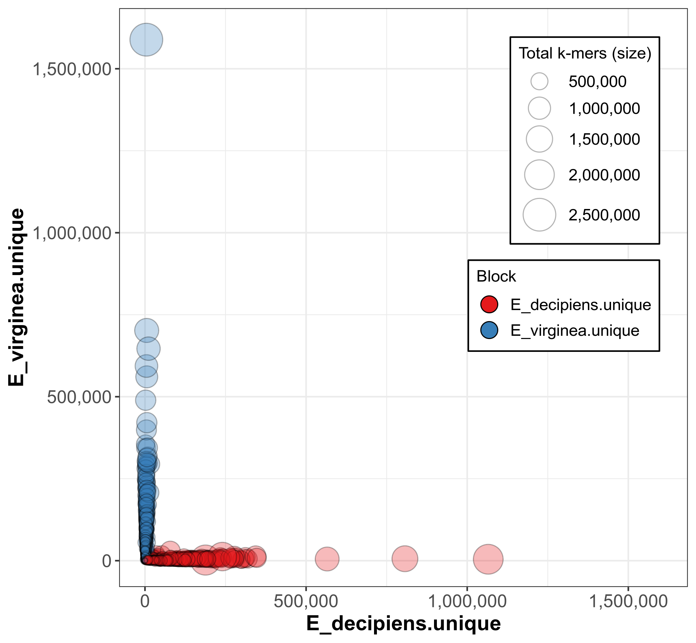
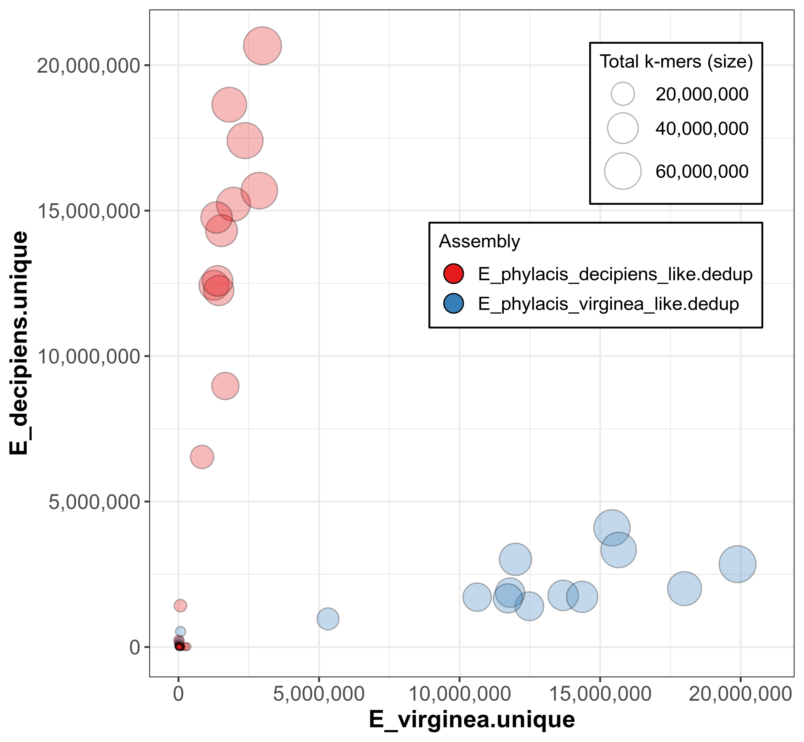

# Summary of the *Eucalyptus x phylacis* Genome Assembly

This branch is purposed to finalise the assembly of the *Eucalyptus x phylacis* genome from ONT reads.

## Table of Contents
- <a href="#01">Prerequisites</a>
- <a href="#02">QC</a>
    - <a href="#02a">Running Chopper</a>
    - <a href="#02b">Running Kraken2</a>
    - <a href="#02c">Running GenomeScope2</a>
- <a href="#03">Assembly using Hifiasm</a>
    - <a href="#03a">Dotplot</a>
    - <a href="#03b">Contamination check</a>
- <a href="#04">Assembly of organelle genomes</a>
    - <a href="#04a">mtDNA</a>
    - <a href="#04b">ptDNA</a>
- <a href="#05">Assembly of nuclear genome</a>
    - <a href="#05a">Checking for duplicate contigs</a>
    - <a href="#05b">Comparing to parental k-mers</a>
    - <a href="#05c">Assigning individual contigs to each putative parent</a>
    - <a href="#05d">Filtering out cross-haplotype duplicates</a>
- <a href="#06">Scaffolding</a>

## <a id="01">Prerequisites</a>
This analysis requires a number of software and R packages to run. Here, I am going to install them using `conda`:
```
# create a new conda environment
conda create   -n meelupmallee
conda activate    meelupmallee

# install dependencies
conda install  -c conda-forge -c bioconda \
    barrnap=0.9  blobtoolkit  chopper    compleasm diamond \
    genomescope2 gfatools     hifiasm    kmc       kraken2 \
    merqury      mosdepth     nanoplot   ncbi-datasets-cli \
    oatk         pigz         quast \
    r-circlize   r-data.table r-optparse r-plotly  r-tidyverse \
    racon        ragtag       seqkit     sra-tools tgsgapcloser
```

> [!NOTE]
> The raw ONT (Oxford Nanopore Technologies) long reads are stored as 70 compressed FASTQ files at `00_raw_data/`.

## <a id="02">QC</a>

### <a id="02a">Running Chopper</a>
First, I filtered the raw ONT reads with Chopper with a minimum read length of **15kb** and read quality of **10**.

```
# run NanoPlot pre-filtering
NanoPlot \
    -t 128 \
    --fastq 00_raw_data/*.fastq.gz \
    -o 01_qc/01_nanoplot \
    --title "E_phylacis_Raw_ONT"

# pipe pigz (decompression) -> Chopper (filtering) -> bgzip (compression)
pigz -dc -p 16 00_raw_data/*.fastq.gz | \
chopper -q 10 -l 15000 | \
bgzip -@ 128 > 01_qc/02_chopper/E_phylacis_filtered.fastq.gz

# run NanoPlot post-filtering
NanoPlot \
    -t 128 \
    --fastq 01_qc/02_chopper/E_phylacis_filtered.fastq.gz \
    -o 01_qc/03_nanoplot \
    --title "E_phylacis_Filtered_ONT"
```

|        Metric       |         Raw       |      Filtered     |
| :------------------ | -----------------:| -----------------:|
| Total bases         | 44,326,974,907.0  | 33,967,234,187.0  |
| Number of reads     | 3,064,194.0       | 1,345,923.0       |
| Mean read length    | 14,466.1          | 25,237.1          |
| Median read length  | 12,334.0          | 22,752.0          |
| Read length N50     | 22,177.0          | 25,598.0          |
| STDEV read length   | 11,705.0          | 9,033.2           |
| Mean read quality   | 17.2              | 17.8              |
| Median read quality | 19.6              | 20.2              |
| >Q10                | 3051048 (99.6%)   | 1345923 (100.0%)  |
| >Q15                | 2547395 (83.1%)   | 1165231 (86.6%)   |
| >Q20                | 1396296 (45.6%)   | 696853 (51.8%)    |
| >Q25                | 66131 (2.2%)      | 32580 (2.4%)      |
| >Q30                | 992 (0.0%)        | 10 (0.0%)         |

### <a id="02b">Running Kraken2</a>
I then ran Kraken2 to detect foreign DNA on the filtered ONT reads (see <a href="./analyses/01_qc/README.md">here</a> to download the PFP database). Here, I used two confidence thresholds: **0** (default) and **0.2**. At default, a read is assigned to a taxonomic group on the basis of a single matching k-mer and thus might capture an increased proportion of false positives. Setting this threshold higher should better capture true positives from the dataset.

```
# run Kraken2 with default parameter
kraken2 \
    --db 01_qc/04_kraken/pluspfp \
    --threads 128 \
    --gzip-compressed \
    --report 01_qc/04_kraken/default.kreport \
    --report-minimizer-data \
    --use-names \
    --output 01_qc/04_kraken/default.kraken \
    01_qc/02_chopper/E_phylacis_filtered.fastq.gz

# run Kraken2 with --confidence 0.2
kraken2 \
    --db 01_qc/04_kraken/pluspfp \
    --threads 128 \
    --confidence 0.2 \
    --gzip-compressed \
    --report 01_qc/04_kraken/conf02.kreport \
    --report-minimizer-data \
    --use-names \
    --output 01_qc/04_kraken/conf02.kraken \
    01_qc/02_chopper/E_phylacis_filtered.fastq.gz
```

| Category                        |  `--confidence 0`  |  `--confidence 0.2`  |
| :------------------------------ | -----------------: | -------------------: |
| Total reads                     | 1,345,923          | 1,345,923            |
| **Streptophyta (land plants)**  | 1,336,060 (99.27%) | 1,222,485 (90.83%)   |
| – *Eucalyptus* (*E. grandis*)   | 1,332,485 (99.00%) | 1,118,097 (83.07%)   |
| – Other plant genera            | 3,165 (0.24%)      | 96 (0.01%)           |
| – Unresolved at genus level     | 410 (0.03%)        | 104,292 (7.75%)      |
| **Human (*Homo sapiens*)**      | 3,661 (0.27%)      | 116 (0.01%)          |
| **Fungi**                       | 3,496 (0.26%)      | 0                    |
| **Unresolved at kingdom level** | 180 (0.01%)        | 10,842 (0.81%)       |
| **Bacteria**                    | 1,704 (0.13%)      | 18 (<0.01%)          |
| **Archaea**                     | 6 (<0.01%)         | 0                    |
| **Viruses**                     | 0                  | 0                    |
| **Other sequences**             | 2 (<0.01%)         | 0                    |
| **Unresolved at domain level**  | 681 (0.05%)        | 4,009 (0.30%)        |
| **Unclassified**                | 133 (0.01%)        | 108,453 (8.06%)      |

The proportion of foreign reads in the dataset is very low and unlikely to pass the depth criteria during contig formation, so I think we can go directly to the assembly step.

### <a id="02c">Running GenomeScope2</a>
In addition, I estimated the heterozygosity and genome size of *E. x phylacis* based on the filtered ONT reads using KMC and GenomeScope2 with `k=21`.

```
# store the path to the filtered reads
find 01_qc/02_chopper/ -name "*.fastq.gz" > 01_qc/05_genomescope/files.txt

# run KMC
kmc \
    -k21 \
    -t128 \
    -ci1 -cs10000 \
    @01_qc/05_genomescope/files.txt \
    01_qc/05_genomescope/kmc_db \
    01_qc/05_genomescope/

# generate the k-mer histogram
kmc_tools transform \
    01_qc/05_genomescope/kmc_db \
    histogram \
    01_qc/05_genomescope/histogram.txt \
    -ci1 -cs10000

# run GenomeScope2
genomescope2 \
    -i 01_qc/05_genomescope/histogram.txt \
    -o 01_qc/05_genomescope/ \
    -k 21 -p 2
```


The genome size of *E. x phylacis* is estimated to be **~533 Mb** (which is comparable to other *Eucalyptus* species) with **~4.3%** heterozygosity.

## <a id="03">Assembly using Hifiasm</a>
After trying different combinations of `-s` and `-l` parameters, we found that `-l 3 -s 0.50` produced the most consistent results (see <a href="./analyses/02_assembly/README.md">here</a> for more details).

```
hifiasm \
    -o 02_assembly/homcov55/hifiasm_s050/E_phylacis_asm \
    -t 128 \
    --ont \
    -l 3 -s 0.50 \
    --telo-m AAACCCT \
    --hom-cov 55 \
    --dual-scaf \
    01_qc/02_chopper/E_phylacis_filtered.fastq.gz \
    2>&1 | tee 02_assembly/homcov55/hifiasm_s050/hifiasm_restart.log
```

### <a id="03a">Dotplot</a>

```
# change the working directory
cd 02_assembly/homcov55/s050

# map both haplotypes
minimap2 -x asm20 -t 128 -N 1000 --secondary=no \
    E_phylacis_s050.asm.bp.hap1.p_ctg.fa \
    E_phylacis_s050.asm.bp.hap2.p_ctg.fa \
    > hap1_vs_hap2.paf

# generate the dotplot
Rscript scripts/pafCoordsDotPlotly.R \
    -i hap1_vs_hap2.paf \
    -o hap1_vs_hap2_dotplot2 -s -t

# change the working directory
cd ../../..
```


The 12 longest contigs between the two haplotypes are aligned very nicely, but the shorter contigs will require additional check in later stages. As *Eucalyptus* has 11 chromosomes, it is likely that one of the chromosomes is split into two contigs.

### <a id="03b">Contamination check</a>
Here, I generated 100kb sliding windows from individual contigs and BLAST them to existing databases to check for potential contaminants. Note that this step requires a lot of storage space, particularly to store the `core_nt` database.

<details>
<summary><i>Click here to view the full code</i></summary>

```
# map the filtered ONT reads to the union
minimap2 -t 128 -ax lr:hq \
    02_assembly/homcov55/hifiasm_s050/E_phylacis_s050.asm.bp.hap1.p_ctg.fa \
    01_qc/02_chopper/E_phylacis_filtered.fastq.gz \
    | samtools sort -@16 -o 03_qc/hap1.bam

minimap2 -t 128 -ax lr:hq \
    02_assembly/homcov55/hifiasm_s050/E_phylacis_s050.asm.bp.hap2.p_ctg.fa \
    01_qc/02_chopper/E_phylacis_filtered.fastq.gz \
    | samtools sort -@16 -o 03_qc/hap2.bam

# index the BAM file
samtools index -c 03_qc/hap1.bam
samtools index -c 03_qc/hap2.bam

# index each haplotype
samtools faidx 02_assembly/homcov55/hifiasm_s050/E_phylacis_s050.asm.bp.hap1.p_ctg.fa
samtools faidx 02_assembly/homcov55/hifiasm_s050/E_phylacis_s050.asm.bp.hap2.p_ctg.fa

# download the taxonomy metadata
mkdir -p 03_qc/taxdump && cd 03_qc/taxdump
curl -L https://ftp.ncbi.nlm.nih.gov/pub/taxonomy/new_taxdump/new_taxdump.tar.gz | tar xzf -
cd ../..

# download core_nt database
mkdir -p 03_qc/blastdb && cd 03_qc/blastdb
update_blastdb.pl --decompress --num_threads 128 --source ncbi core_nt
update_blastdb.pl --decompress --source ncbi taxdb
cd ../..

# download UniProt / Swiss-Prot database
mkdir -p 03_qc/uniprot && cd 03_qc/uniprot
wget https://ftp.uniprot.org/pub/databases/uniprot/current_release/knowledgebase/complete/uniprot_sprot.fasta.gz
wget https://ftp.ncbi.nlm.nih.gov/pub/taxonomy/accession2taxid/prot.accession2taxid.gz
diamond makedb --in uniprot_sprot.fasta.gz -d uniprot_sprot \
    --taxonmap prot.accession2taxid.gz \
    --taxonnodes ../taxdump/nodes.dmp
cd ../..

# generate 100kb sliding-windows
seqkit sliding -s 100000 -W 100000 -g 02_assembly/homcov55/hifiasm_s050/E_phylacis_s050.asm.bp.hap1.p_ctg.fa > 03_qc/hap1.chunks.fa
seqkit sliding -s 100000 -W 100000 -g 02_assembly/homcov55/hifiasm_s050/E_phylacis_s050.asm.bp.hap2.p_ctg.fa > 03_qc/hap2.chunks.fa

# check windows against core_nt
blastn -task megablast -db 03_qc/blastdb/core_nt -query 03_qc/hap1.chunks.fa \
    -outfmt "6 qseqid staxids bitscore std" -max_target_seqs 10 -max_hsps 1 \
    -evalue 1e-25 -num_threads 128 \
    | sed 's/_sliding:[0-9]*-[0-9]*//' > 03_qc/hap1.blastn.out

blastn -task megablast -db 03_qc/blastdb/core_nt -query 03_qc/hap2.chunks.fa \
    -outfmt "6 qseqid staxids bitscore std" -max_target_seqs 10 -max_hsps 1 \
    -evalue 1e-25 -num_threads 128 \
    | sed 's/_sliding:[0-9]*-[0-9]*//' > 03_qc/hap2.blastn.out

# check windows against UniProt / Swiss-Prot
diamond blastx --query 03_qc/hap1.chunks.fa --db 03_qc/uniprot/uniprot_sprot.dmnd \
    --outfmt 6 qseqid staxids bitscore qseqid sseqid pident length mismatch gapopen qstart qend sstart send evalue bitscore \
    --sensitive --max-target-seqs 1 --evalue 1e-25 --threads 128 \
    | sed 's/_sliding:[0-9]*-[0-9]*//' > 03_qc/hap1.diamond.out

diamond blastx --query 03_qc/hap2.chunks.fa --db 03_qc/uniprot/uniprot_sprot.dmnd \
    --outfmt 6 qseqid staxids bitscore qseqid sseqid pident length mismatch gapopen qstart qend sstart send evalue bitscore \
    --sensitive --max-target-seqs 1 --evalue 1e-25 --threads 128 \
    | sed 's/_sliding:[0-9]*-[0-9]*//' > 03_qc/hap2.diamond.out

# change compleasm output table to follow blobtools requirements
sed -e '1s/^# compleasm version is: .*/# BUSCO version is: 6.1.0/' \
    -e 's/\tSingle\t/\tComplete\t/; s/\tInterspaced\t/\tFragmented\t/' \
    02_assembly/homcov55/compleasm/s050_hap1/eudicotyledons_odb12/full_table_busco_format.tsv \
    > 03_qc/s050_hap1_busco_btk.tsv

sed -e '1s/^# compleasm version is: .*/# BUSCO version is: 6.1.0/' \
    -e 's/\tSingle\t/\tComplete\t/; s/\tInterspaced\t/\tFragmented\t/' \
    02_assembly/homcov55/compleasm/s050_hap2/eudicotyledons_odb12/full_table_busco_format.tsv \
    > 03_qc/s050_hap2_busco_btk.tsv

# build the Blobdir
blobtools create \
    --fasta 02_assembly/homcov55/hifiasm_s050/E_phylacis_s050.asm.bp.hap1.p_ctg.fa \
    --taxid 3932 --taxdump 03_qc/taxdump/ 03_qc/hap1_btk
blobtools add --cov 03_qc/hap1.bam --threads 16 03_qc/hap1_btk
blobtools add --hits 03_qc/hap1.blastn.out --hits 03_qc/hap1.diamond.out \
    --taxrule bestsumorder --taxdump 03_qc/taxdump/ 03_qc/hap1_btk
blobtools add --busco 03_qc/s050_hap1_busco_btk.tsv 03_qc/hap1_btk

blobtools create \
    --fasta 02_assembly/homcov55/hifiasm_s050/E_phylacis_s050.asm.bp.hap2.p_ctg.fa \
    --taxid 3932 --taxdump 03_qc/taxdump/ 03_qc/hap2_btk
blobtools add --cov 03_qc/hap2.bam --threads 16 03_qc/hap2_btk
blobtools add --hits 03_qc/hap2.blastn.out --hits 03_qc/hap2.diamond.out \
    --taxrule bestsumorder --taxdump 03_qc/taxdump/ 03_qc/hap2_btk
blobtools add --busco 03_qc/s050_hap2_busco_btk.tsv 03_qc/hap2_btk

# export the output
blobtools filter --table 03_qc/hap1_btk.tsv 03_qc/hap1_btk
blobtools filter --table 03_qc/hap2_btk.tsv 03_qc/hap2_btk

# generate plots
blobtk plot -v blob  -d 03_qc/hap1_btk -o 03_qc/hap1_blob.png
blobtk plot -v snail -d 03_qc/hap1_btk -o 03_qc/hap1_snail.svg

blobtk plot -v blob  -d 03_qc/hap2_btk -o 03_qc/hap2_blob.png
blobtk plot -v snail -d 03_qc/hap2_btk -o 03_qc/hap2_snail.svg
```

</details>

|                   Haplotype 1               |                   Haplotype 2               |
| :-----------------------------------------: | :-----------------------------------------: |
|   |   |
|  |  |

It seems that hap1 contains a little bit of contamination from *Ascomycota* (fungi). We should remove these contigs in later stages. 

## <a id="04">Assembly of organelle genomes</a>
I followed <a href="https://github.com/roblanf/MM_genome/tree/initial_trials">Rob's</a> recommendation to assemble the mtDNA and ptDNA genomes (see <a href="./analyses/03_organelle/README.md">here</a> to download the organelle database). I also asked Claude to generate an R <a href="./analyses/03_organelle/scripts/oatk_circular_map.R">script</a> to visualise the circular map of each organelle.

```
# create a new directory as not to overwrite the previous results
cd 02_assembly/homcov55/hifiasm_s050 && mkdir -p ec_extract && cd ec_extract

# extract Hifiasm corrected reads
for s in ec.bin ovlp.source.bin ovlp.reverse.bin; do ln -s ../E_phylacis_s050.asm.$s .; done
hifiasm -o E_phylacis_s050.asm -t 128 --ont --write-ec ../../../../01_qc/02_chopper/E_phylacis_filtered.fastq.gz

# change directory
cd ../../../..

# run OatK
oatk -k 1001 \
     -c 30 \
     -t 128 \
     -p 04_organelle/db/magnoliopsida_pltd.fam \
     -m 04_organelle/db/magnoliopsida_mito.fam \
     -o 04_organelle/c30k1001/E_phylacis \
     02_assembly/homcov55/hifiasm_s050/ec_extract/E_phylacis_s050.asm.ec.fq

# save into PNG
Rscript scripts/oatk_circular_map.R \
    04_organelle/c30k1001/E_phylacis.mito.ctg.fasta \
    04_organelle/c30k1001/E_phylacis.mito.ctg.bed \
    -o 04_organelle/c30k1001/mito_map.png

Rscript scripts/oatk_circular_map.R \
    04_organelle/c30k1001/E_phylacis.pltd.ctg.fasta \
    04_organelle/c30k1001/E_phylacis.pltd.ctg.bed \
    -o 04_organelle/c30k1001/pltd_map.png
```

### <a id="04a">mtDNA</a>

```
>ctg000001l     length=355146 wlength=41066840.0 nv=11 circular=false path=u151-,u152+,u150-,u148-,u146-,u147+,u141-,u12277+,u139+,u146-,u138-
>ctg000002l     length=23355 wlength=2312145.0 nv=1 circular=false path=u149+
>ctg000003c     length=79427 wlength=7942700.0 nv=1 circular=true path=u12148-
```


### <a id="04b">ptDNA</a>

```
>ctg000001c     length=160190 wlength=150009126.0 nv=12 circular=true path=u140+,u12277+,u137-,u7+,u12278-,u143-,u142+,u143+,u12278+,u7-,u137+,u12277-
```


## <a id="05">Assembly of nuclear genome</a>

### <a id="05a">Checking for duplicate contigs</a>
Claude generated an R <a href="./analyses/04_nuclear/scripts/flag_contained_contigs.R">script</a> to identify duplicates based on their identities and mapping depths. Based on the <a href="./analyses/04_nuclear/README.md">final table</a>, there are <a href="./files/h1_remove.txt">99 contigs</a> that should be removed from haplotype 1 and <a href="./files/h2_remove.txt">78 contigs</a> from haplotype 2. Let's filter these contigs out!

```
# iterate over haplotypes
for h in 1 2; do
    seqkit grep -v \
        -f 05_nuclear_qc/03_filtered/h${h}_remove.txt \
        02_assembly/homcov55/hifiasm_s050/E_phylacis_s050.asm.bp.hap${h}.p_ctg.fa \
        > 05_nuclear_qc/03_filtered/hap${h}.purged.fa
    seqkit grep \
        -f 05_nuclear_qc/03_filtered/h${h}_remove.txt \
        02_assembly/homcov55/hifiasm_s050/E_phylacis_s050.asm.bp.hap${h}.p_ctg.fa \
        > 05_nuclear_qc/03_filtered/hap${h}.removed.fa
done

# combine the two purged haplotypes
cat 05_nuclear_qc/03_filtered/hap1.purged.fa 05_nuclear_qc/03_filtered/hap2.purged.fa > 05_nuclear_qc/03_filtered/union.purged.fa
```

### Seqkit
```
seqkit stats 05_nuclear_qc/03_filtered/*.purged.fa
```

- <b><i>Haplotype 1</b></i>

    | Metric            | Before purge | After purge |           Removed |
    | :---------------- | -----------: | ----------: | ----------------: |
    | Contigs           |          402 |         303 |                99 |
    | Total length (bp) |  574,198,743 | 564,835,398 | 9,363,345 (1.63%) |
    | Min (bp)          |       24,809 |      24,809 |                 – |
    | Mean (bp)         |    1,428,355 |   1,864,143 |                 – |
    | Max (bp)          |   65,682,487 |  65,682,487 |                 – |

- <b><i>Haplotype 2</b></i>

    | Metric            | Before purge | After purge |           Removed |
    | :---------------- | -----------: | ----------: | ----------------: |
    | Contigs           |          305 |         227 |                78 |
    | Total length (bp) |  560,735,642 | 553,092,091 | 7,643,551 (1.36%) |
    | Min (bp)          |       36,811 |      44,597 |                 – |
    | Mean (bp)         |    1,838,478 |   2,436,529 |                 – |
    | Max (bp)          |   61,702,390 |  61,702,390 |                 – |

- <b><i>Union (hap1 + hap2)</b></i>

    | Metric            |  Before purge |   After purge |            Removed |
    | :---------------- | ------------: | ------------: | -----------------: |
    | Contigs           |           707 |           530 |                177 |
    | Total length (bp) | 1,134,934,385 | 1,117,927,489 | 17,006,896 (1.50%) |
    | Min (bp)          |        24,809 |        24,809 |                  – |
    | Mean (bp)         |     1,605,282 |     2,109,297 |                  – |
    | Max (bp)          |    65,682,487 |    65,682,487 |                  – |

### Compleasm + Merqury
```
# compleasm
for a in hap1 hap2 union; do
    compleasm run -a 05_nuclear_qc/03_filtered/${a}.purged.fa \
        -o 05_nuclear_qc/03_filtered/compleasm/${a} \
        -l eudicotyledons --odb odb12 \
        -t 128 \
        -L 02_assembly/default/busco_lineages/
done

# merqury
for a in hap1 hap2 union; do
    mkdir -p 05_nuclear_qc/03_filtered/merqury/${a} && cd 05_nuclear_qc/03_filtered/merqury/${a}
    merqury.sh ../../../../02_assembly/homcov55/merqury/reads.meryl ../../${a}.purged.fa ${a}_merq
    cd ../../../..
done
```

- <b><i>Compleasm</b></i>

    | Metric                | hap1 before | hap1 after | hap2 before | hap2 after | union before | union after |
    | :-------------------- | ----------: | ---------: | ----------: | ---------: | -----------: | ----------: |
    | BUSCO S (%)           |       93.44 |      95.19 |       94.40 |      95.83 |         2.92 |        2.99 |
    | BUSCO D (%)           |        6.20 |       4.46 |        5.28 |       3.85 |        96.86 |       96.79 |
    | BUSCO F (%)           |        0.32 |       0.32 |        0.29 |       0.29 |         0.18 |        0.18 |
    | BUSCO&nbsp;M&nbsp;(%) |        0.04 |       0.04 |        0.04 |       0.04 |         0.04 |        0.04 |

- <b><i>Merqury</b></i>

    | Metric                      | hap1 before | hap1 after | hap2 before | hap2 after | union before | union after |
    | :-------------------------- | ----------: | ---------: | ----------: | ---------: | -----------: | ----------: |
    | k-mer completeness&nbsp;(%) |       65.94 |      65.54 |       65.25 |      64.87 |        99.31 |       99.27 |
    | Solid k-mers found (M)      |       396.4 |      394.0 |       392.3 |      389.9 |        597.0 |       596.7 |
    | QV                          |       64.43 |      64.92 |       65.62 |      66.07 |        64.98 |       65.46 |
    | Asm-only k-mers             |       4,326 |      3,801 |       3,227 |      2,865 |        7,553 |       6,666 |

- <b><i>Copy number of het-peak (14–44x) and hom-peak (44–69x) read k-mers (%)</b></i>

    | Metric               | hap1 before | hap1 after | hap2 before | hap2 after | union before | union after |
    | :------------------- | ----------: | ---------: | ----------: | ---------: | -----------: | ----------: |
    | het k-mers: 0x       |        45.3 |       45.8 |        46.0 |       46.4 |          0.6 |         0.6 |
    | het k-mers: 1x       |        54.3 |       53.9 |        53.7 |       53.2 |         89.6 |        90.5 |
    | het k-mers:&nbsp;≥2x |         0.4 |        0.4 |         0.4 |        0.3 |          9.8 |         8.9 |
    | hom k-mers: 0x       |         8.7 |        8.8 |         9.4 |        9.5 |          0.2 |         0.2 |
    | hom k-mers: 1x       |        78.5 |       79.6 |        78.7 |       79.8 |          4.2 |         4.3 |
    | hom k-mers: 2x       |        12.6 |       11.4 |        11.6 |       10.4 |         84.7 |        86.9 |
    | hom k-mers:&nbsp;≥3x |         0.3 |        0.2 |         0.3 |        0.3 |         10.9 |         8.6 |

While the proportion of single-copy BUSCO increases for both haplotypes, two BUSCO that were first duplicated in the union are now only found in one haplotype:
- 742808at71240 (h2tg000002l): likely due to compleasm different scoring (as we did not touch its respective contig) 
- 904132at71240 (h1tg000159l): half-depth haplotig, likely due to case 2 (see above)

I think we can move on to the next step!

### <a id="05b">Comparing to parental k-mers</a>
I first generated a `meryl` database with `k=31` for both putative parents, and excluded those with <6 occurrences (see <a href="https://github.com/roblanf/MM_genome/tree/initial_trials">Rob's</a> recommendation). I did the same thing for *E. x phylacis* filtered ONT reads, and filtered out those with <10 occurrences.

<details>
<summary><i>Click here to view the full code</i></summary>

```
# change working directory
cd 06_parental_assign/parents/

# E. decipiens
wget https://sra-downloadb.be-md.ncbi.nlm.nih.gov/sos9/sra-pub-zq-922/SRR025/25119/SRR25119757/SRR25119757.lite.1
fasterq-dump SRR25119757.lite.1 --split-files --threads 16 --progress && pigz -p 16 *.fastq
mv SRR25119757.lite.1_1.fastq.gz E_decipiens_R1.fastq.gz
mv SRR25119757.lite.1_2.fastq.gz E_decipiens_R2.fastq.gz

# E. virginea
wget https://sra-downloadb.be-md.ncbi.nlm.nih.gov/sos9/sra-pub-zq-922/SRR025/25119/SRR25119786/SRR25119786.lite.1
fasterq-dump SRR25119786.lite.1 --split-files --threads 16 --progress && pigz -p 16 *.fastq
mv SRR25119786.lite.1_1.fastq.gz E_virginea_R1.fastq.gz
mv SRR25119786.lite.1_2.fastq.gz E_virginea_R2.fastq.gz

# create a meryl database with k=31
meryl k=31 count threads=128 \
    output E_virginea.meryl \
    E_virginea_R1.fastq.gz E_virginea_R2.fastq.gz

meryl k=31 count threads=128 memory=1200G \
    output E_decipiens.meryl \
    E_decipiens_R1.fastq.gz E_decipiens_R2.fastq.gz

# filter out k-mers <6 occurrences
meryl threads=128 greater-than 5 \
    output E_virginea.filtered.meryl \
    E_virginea.meryl

meryl threads=128 greater-than 5 \
    output E_decipiens.filtered.meryl \
    E_decipiens.meryl

# extract unique k-mers
meryl difference threads=128 \
    E_virginea.filtered.meryl E_decipiens.filtered.meryl \
    output E_virginea.unique.meryl

meryl difference threads=128 \
    E_decipiens.filtered.meryl E_virginea.filtered.meryl \
    output E_decipiens.unique.meryl

meryl symmetric-difference threads=128 \
    E_decipiens.filtered.meryl E_virginea.filtered.meryl \
    output union.unique.meryl

# change working directory
cd ../e_phylacis/

# create a meryl database with k=31
meryl k=31 count threads=128 \
    output E_phylacis.meryl \
    ../../01_qc/02_chopper/E_phylacis_filtered.fastq.gz

# check for trough
meryl statistics E_phylacis.meryl | head -n 30

# filter out k-mers <10 occurrences
meryl threads=128 greater-than 9 \
    output E_phylacis.filtered.meryl \
    E_phylacis.meryl

# run Merqury
mkdir merqury && cd merqury

merqury.sh \
    ../E_phylacis.filtered.meryl \
    ../../parents/E_virginea.unique.meryl \
    ../../parents/E_decipiens.unique.meryl \
    ../../../05_nuclear_qc/03_filtered/hap1.purged.fa \
    ../../../05_nuclear_qc/03_filtered/hap2.purged.fa \
    E_phylacis_trio

# change working directory
cd ../../..
```

</details>

### Phased blocks per haplotype (blocks broken by ≥ 100 opposite hapmers spanning ≥ 20 kb)

|                  Haplotype 1                  |                    Haplotype 2                 |
| :-------------------------------------------: | :--------------------------------------------: |
|  |   |

| Assembly | Blocks | Total (Mb) | Mean (kb) | N50 (kb) | Max (Mb) | Switch&nbsp;hapmers (M) | Total&nbsp;hapmers (M) | Switch&nbsp;error (%) | Minority&nbsp;hapmers (%) |
| :------- | -----: | ---------: | --------: | -------: | -------: | -----------------: | ----------------: | ---------------: | -------------------: |
| hap1     | 21,091 |      563.3 |      26.7 |    101.1 |     3.09 |               14.7 |             200.8 |             7.31 |                 11.8 |
| hap2     | 22,021 |      551.1 |      25.0 |     91.8 |     2.53 |               15.2 |             197.3 |             7.71 |                 13.2 | 

### Blobplot


### K-mer copy number spectrum


Consistent with `hifiasm` and `GenomeScope2`, the heterozygous k‑mers (red, one copy in the union) peak at ~27x, while homozygous k‑mers (blue, two copies — one per haplotype) peak at ~52x. The elevated number of asm-only k-mers (i.e., x==0) is caused by the threshold set when generating the `meryl` database (i.e., at least 10 occurrences).

### Parental assignment of the chromosome pairs (V: virginea-specfic; D: decipiens-specific)

| hap1 contig | V&nbsp;(%) | D&nbsp;(%) | Minority&nbsp;(%) | Putative&nbsp;Parent | hap2 contig | V&nbsp;(%) | D&nbsp;(%) | Minority&nbsp;(%) | Putative&nbsp;Parent |
| :---------- | ----: | ----: | -----------: | :------------- | :---------- | ----: | ----: | -----------: | :------------- |
| h1tg000003l |   4.5 |  31.5 |         12.6 | decipiens-like | h2tg000008l |  32.2 |   4.6 |         12.5 | virginea-like  |
| h1tg000295l |   4.0 |  29.7 |         12.0 | decipiens-like | h2tg000004l |  26.0 |   6.9 |         21.0 | virginea-like  |
| h1tg000007l |   4.8 |  26.0 |         15.5 | decipiens-like | h2tg000010l |  27.8 |   5.9 |         17.6 | virginea-like  |
| h1tg000004l |   3.3 |  34.5 |          8.8 | decipiens-like | h2tg000012l |  35.2 |   3.9 |         10.0 | virginea-like  |
| h1tg000001l |   3.8 |  29.6 |         11.4 | decipiens-like | h2tg000002l |  26.5 |   6.7 |         20.1 | virginea-like  |
| h1tg000009l |   3.5 |  32.7 |          9.7 | decipiens-like | h2tg000007l |  34.2 |   4.1 |         10.7 | virginea-like  |
| h1tg000006l |  34.5 |   4.5 |         11.5 | virginea-like  | h2tg000006l |   3.2 |  35.0 |          8.4 | decipiens-like |
| h1tg000005l |  32.3 |   5.1 |         13.7 | virginea-like  | h2tg000011l |   3.5 |  31.6 |         10.0 | decipiens-like |
| h1tg000012l |  32.9 |   4.7 |         12.5 | virginea-like  | h2tg000001l |   3.3 |  32.7 |          9.2 | decipiens-like |
| h1tg000002l |  36.0 |   4.0 |         10.1 | virginea-like  | h2tg000003l |   3.7 |  31.8 |         10.5 | decipiens-like |
| h1tg000008l |  31.8 |   5.1 |         13.9 | virginea-like  | h2tg000009l |   5.5 |  29.7 |         15.7 | decipiens-like |
| h1tg000014l |   4.1 |  31.9 |         11.4 | decipiens-like | h2tg000005l |  30.1 |   5.5 |         15.4 | virginea-like  |

### Species-specific k-mers found in each haplotype

| Hapmer set            |       Total | In&nbsp;hap1 (%) | In&nbsp;hap2 (%) | In&nbsp;union (%) | In&nbsp;both&nbsp;haplotypes (% of those in union) |
| :-------------------- | ----------: | ---------------: | ---------------: | ----------------: | -------------------------------------------------: |
| E.&nbsp;virginea–specific  | 334,998,162 |        22.0 |        30.2 |         46.7 |                                     11.7 |
| E.&nbsp;decipiens–specific | 401,534,689 |        26.5 |        19.2 |         40.2 |                                     13.7 |

From these results, the 12 longest contigs seem to clearly prefer one parent over another. The ~12% minority hapmers (whose value is comparable to the species-specific k-mers found in both haplotypes), alongside ~7% error-rate and relatively short ~100 kb N50, likely reflect homozygous regions across the two haplotypes, resulting in a frequent switching between decipiens- and virginea-derived kmers.

### <a id="05c">Assigning individual contigs to each putative parent</a>
I tried to use <a href="https://github.com/roblanf/MM_genome/tree/genome_assembly">Jack's</a> script to categorise contigs onto `decipiens-like` and `virginea-like` based on their mapping identity to each putative parent (`ID`). However, I found that the placement of some contigs was <a href="./analyses/04_nuclear/README.md">ambiguous</a>. We could use tools such as ROADIES to categorise each contig, but it is very resource intensive. Instead, Claude suggested a simpler <a href="./scripts/split_parents.R">approach</a> to categorise each contig based on the following criteria (in the order of importance):
1. Assign each chromosome‑scale contig, including the 3.5 Mb long `h2tg000036l`, to its respective parents (see previous <a href="#05b">section</a>)
2. Assign other contig fragments whose best partner in the other haplotype is a chromosome-scale contig covering ≥ 50% of the fragment
3. Assign the rest of contigs that did not map to a chromosome-scale contig based on its `ID`

```
# extract the parent of each chromosome
awk -F'\t' 'NR>1 {len=$3; gsub(",","",len)}
            NR>1 && (len+0 >= 10000000 || $1=="h2tg000036l") && ($15=="decipiens" || $15=="virginea") {print $1"\t"$15}' \
    06_parental_assign/alignment/dv_scoring.tsv > 06_parental_assign/alignment/parent_of_chromosome.tsv

# index FASTA files
samtools faidx 05_nuclear_qc/03_filtered/hap1.purged.fa
samtools faidx 05_nuclear_qc/03_filtered/hap2.purged.fa

# split contigs to each parent
Rscript scripts/split_parents.R \
    --pairs   05_nuclear_qc/04_alignment/both.pairs.tsv \
    --chrom   06_parental_assign/alignment/parent_of_chromosome.tsv \
    --fai     05_nuclear_qc/03_filtered/hap1.purged.fa.fai 05_nuclear_qc/03_filtered/hap2.purged.fa.fai \
    --dv      06_parental_assign/alignment/dv_scoring.tsv \
    --hapmers 06_parental_assign/e_phylacis/merqury/E_phylacis_trio.hapmers.count \
    --out     06_parental_assign/alignment/parent_of_contig.tsv
```

This generated two files:
- `decipiens.txt`: a set of decipiens-like contigs (13 chromosome-scale [548.42 Mb], 231 fragments [23.22 Mb], 3 others [2.79 Mb])
- `virginea.txt` : a set of virginea-like contigs  (12 chromosome-scale [514.14 Mb], 264 fragments [28.88 Mb])
- Unassigned: 7 [0.48 Mb]

Across the 7 unassigned and 3 decipiens-like contigs (others), 8 came from *Ascomycota* according to <a href="#03b">BlobTools</a>. The other two (`h1tg000058l` and `h2tg000019l`) paired to each other with 0.993 identity, and both mapped to *E. decipiens*. This might reflect a genomic region with very low heterozygosity between the two parents and thus was failed to be differentiated based on the k-mers. Thus, I assigned `h2tg000019l` to *E. decipiens* (because it is larger and thus has a stronger call for *E. decipiens*) and `h1tg000058l` to *E. virginea*.

```
# change the working directory
cd 06_parental_assign/final/

# remove contaminated contigs
printf 'h1tg000017l\nh1tg000131l\nh1tg000179l\nh1tg000184l\nh1tg000191l\nh1tg000320l\nh1tg000321l\nh1tg000361l\n' > excluded_ascomycota.txt
grep -v -x -f excluded_ascomycota.txt ../alignment/decipiens.txt > tmp && mv tmp decipiens.txt
grep -v -x -f excluded_ascomycota.txt ../alignment/virginea.txt  > tmp && mv tmp virginea.txt

# add h2tg000019l to decipiens, add h1tg000058l to virginea
grep -v -x h1tg000058l decipiens.txt > tmp && mv tmp decipiens.txt
grep -q -x h2tg000019l decipiens.txt || echo h2tg000019l >> decipiens.txt
grep -q -x h1tg000058l virginea.txt  || echo h1tg000058l >> virginea.txt

# updated the table
awk -F'\t' 'BEGIN{OFS="\t"}
    FNR==NR {ex[$1]=1; next}
    ($1 in ex)          {$4="excluded"; $5="excluded"; $11="Ascomycota (blobtools)"}
    $1=="h1tg000058l"   {$4="manual";   $5="virginea"; $11="homozygous pair, one copy per parent"}
    {print}' excluded_ascomycota.txt ../alignment/parent_of_contig.tsv > tmp && mv tmp parent_of_contig.tsv

# rebuild the parental assemblies
seqkit grep -f virginea.txt  ../../06_parental_assign/roadies/all.purged.fa > E_phylacis_virginea_like.fa
seqkit grep -f decipiens.txt ../../06_parental_assign/roadies/all.purged.fa > E_phylacis_decipiens_like.fa

# change the working directory
cd ../..
```

### <a id="05d">Filtering out cross-haplotype duplicates</a>
While our deduplication step removed within-haplotype duplicates, there might be cross-haplotype duplicates, where a duplicate contig of hap1 is present on hap2 (or vice versa). To identify such cases, Claude generated a <a href="./scripts/crosshap_dedup.py">script</a> that checks the depth of individual contigs. Similar to the previous deduplication <a href="#05a">criterion</a>, we compared every contig to *every* other contig and marked one as a duplicate if at least 50% of its sites aligned to a longer contig with ≥ 99.5% identity and < 41.3x depth.

```
# generate parent_of_chromosome.tsv
awk -F'\t' 'NR>1 {len=$3; gsub(",","",len)}
            NR>1 && (len+0 >= 10000000 || $1=="h2tg000036l") && ($15=="decipiens" || $15=="virginea") {print $1"\t"$15}' \
    06_parental_assign/alignment/dv_scoring.tsv > 06_parental_assign/alignment/parent_of_chromosome.tsv

# deduplication
python3 scripts/crosshap_dedup.py \
    --union   06_parental_assign/roadies/all.purged.fa \
    --anchors 06_parental_assign/alignment/parent_of_chromosome.tsv \
    --bam-h1  03_qc/hap1.bam \
    --bam-h2  03_qc/hap2.bam \
    --out     06_parental_assign/cross_dedup

# remove duplicates
seqkit grep -v -f 06_parental_assign/cross_dedup.drop.txt 06_parental_assign/final/E_phylacis_virginea_like.fa  -o 06_parental_assign/final/E_phylacis_virginea_like.dedup.fa
seqkit grep -v -f 06_parental_assign/cross_dedup.drop.txt 06_parental_assign/final/E_phylacis_decipiens_like.fa -o 06_parental_assign/final/E_phylacis_decipiens_like.dedup.fa
```

This excludes 217 contigs with <41.3x depth, and retains the rest (288 contigs).
```
duplicate     drop (single-parent copy)  n= 217   23.04 Mb
duplicate     keep (shared sequence)     n= 273   28.70 Mb
no-hit        keep                       n=  14    3.48 Mb
own-sequence  keep                       n=   1    0.16 Mb
```

### Phasing and SeqKit
```
seqkit stats 06_parental_assign/final/E_phylacis_*_like.dedup.fa
```

| Metric            | decipiens-like | virginea-like |
| :---------------- | -------------: | ------------: |
| Contigs           |            148 |           157 |
| Total length (bp) |    564,348,195 |   530,008,586 |
| Min (bp)          |         24,809 |        44,597 |
| Mean (bp)         |      3,813,164 |     3,375,851 |
| Max (bp)          |     65,682,487 |    61,702,390 |

### Compleasm + Merqury
```
# compleasm
compleasm run -a 06_parental_assign/final/E_phylacis_virginea_like.dedup.fa  -o 06_parental_assign/final/compleasm/virginea  -l eudicotyledons --odb odb12 -t 128 -L 02_assembly/default/busco_lineages/
compleasm run -a 06_parental_assign/final/E_phylacis_decipiens_like.dedup.fa -o 06_parental_assign/final/compleasm/decipiens -l eudicotyledons --odb odb12 -t 128 -L 02_assembly/default/busco_lineages/

# merqury
mkdir -p 06_parental_assign/final/merqury && cd 06_parental_assign/final/merqury
merqury.sh \
    ../../e_phylacis/E_phylacis.meryl \
    ../../parents/E_virginea.unique.meryl \
    ../../parents/E_decipiens.unique.meryl \
    ../E_phylacis_virginea_like.dedup.fa \
    ../E_phylacis_decipiens_like.dedup.fa \
    E_phylacis_parents

cd ../../..
```

- <b><i>Compleasm</b></i>

    | Metric                | decipiens   | virginea   |
    | :-------------------- | ----------: | ---------: |
    | BUSCO S (%)           |       96.72 |      97.54 |
    | BUSCO D (%)           |        2.92 |       2.10 |
    | BUSCO F (%)           |        0.32 |       0.32 |
    | BUSCO&nbsp;M&nbsp;(%) |        0.04 |       0.04 |

- <b><i>Merqury</b></i>

    | Metric                       | virginea-like | decipiens-like |       Both |
    | :--------------------------- | ------------: | -------------: | ---------: |
    | QV                           |         62.38 |          62.80 |      62.59 |
    | Error rate                   |      5.78e-07 |       5.25e-07 |   5.51e-07 |
    | Asm-only k-mers              |         9,483 |          9,156 |     18,639 |
    | k-mer completeness&nbsp;(%)  |         58.84 |          60.78 |      99.32 |

- <b><i>Species-specific k-mers found in each haplotype</i></b>

    | Hapmer set            |       Total | In&nbsp;virginea-like (%) | In&nbsp;decipiens-like (%) | In&nbsp;union (%) | In&nbsp;both&nbsp;haplotypes (% of those in union) |
    | :-------------------- | ----------: | ------------------------: | -------------------------: | ----------------: | -------------------------------------------------: |
    | virginea–specific  |        156.5 |                 95.1 |                  14.2 |               9.4 |                                 4.9 |
    | decipiens–specific |        161.5 |                 16.5 |                  94.2 |              10.7 |                                 5.8 |

- <b><i>Phased blocks</b></i>

    | Assembly       | Blocks | N50 (kb) | Max (Mb) | Switch error (%) |
    | :------------- | -----: | -------: | -------: | ---------------: |
    | decipiens-like | 19,509 |    117.2 |     3.09 |             7.25 |
    | virginea-like  | 22,465 |     83.5 |     2.53 |             7.79 |



The results look pretty good! The two assemblies have **~97%** BUSCO completeness scores, and **94-95%** of the k-mers agree to the hypothesised parents.

## <a id="06">Scaffolding</a>
<i>See current progress <a href="./analyses/05_scaffolding/README.md">here</a>.</i>

---
*Last update: 13 November 2026 by Jeremias Ivan*