# Summary of the *Eucalyptus x phylacis* Genome Assembly

This branch is purposed to finalise the assembly of the *Eucalyptus x phylacis* genome from ONT reads.

## Table of Contents
- <a href="#01">Prerequisites</a>
- <a href="#02">QC</a>
    - <a href="#02a">Running Chopper</a>
    - <a href="#02b">Running Kraken2</a>
    - <a href="#02c">Running GenomeScope2</a>
- <a href="#03">Assembly using Hifiasm</a>
- <a href="#04">Assembly of organelle genomes</a>
    - <a href="#04a">mtDNA</a>
    - <a href="#04b">ptDNA</a>
- <a href="#05">Assembly of nuclear genome</a>
    - <a href="#05a">Checking for duplicate contigs</a>
    - <a href="#05b">Aligning haplotypes against each other</a>
    - <a href="#05c">Generating parental k-mers</a>
    - <a href="#05d">Mapping to reference assemblies</a>
    - <a href="#05e">Scaffolding</a>
    - <a href="#05f">Gap closing</a>
- <a href="#06">Tree inference</a>

## <a id="01">Prerequisites</a>
This analysis requires a number of software and R packages to run. Here, I am going to install them using `conda`:
```
# create a new conda environment
conda create   -n meelupmallee
conda activate    meelupmallee

# install dependencies
conda install  -c conda-forge -c bioconda \
    barrnap=0.9  blobtoolkit chopper    compleasm diamond \
    genomescope2 gfatools    hifiasm    kmc       kraken2 \
    merqury      mosdepth    nanoplot   ncbi-datasets-cli \
    oatk         pigz        pycirclize quast \
    r-optparse   r-plotly    r-tidyverse \
    racon        ragtag      seqkit     sra-tools tgsgapcloser
```

> [!NOTE]
> The raw ONT (Oxford Nanopore Technologies) long reads are stored as 70 compressed FASTQ files at `00_raw_data/`.

## <a id="02">QC</a>

### <a id="02a">Running Chopper</a>
First, I filtered the raw ONT reads with Chopper with a minimum read length of **15kb** and read quality of **10**.

```
# run NanoPlot pre-filtering
NanoPlot \
    -t 128 \
    --fastq 00_raw_data/*.fastq.gz \
    -o 01_qc/01_nanoplot \
    --title "E_phylacis_Raw_ONT"

# pipe pigz (decompression) -> Chopper (filtering) -> bgzip (compression)
pigz -dc -p 16 00_raw_data/*.fastq.gz | \
chopper -q 10 -l 15000 | \
bgzip -@ 128 > 01_qc/02_chopper/E_phylacis_filtered.fastq.gz

# run NanoPlot post-filtering
NanoPlot \
    -t 128 \
    --fastq 01_qc/02_chopper/E_phylacis_filtered.fastq.gz \
    -o 01_qc/03_nanoplot \
    --title "E_phylacis_Filtered_ONT"
```

### OUTPUT

|        Metric       |         Raw       |      Filtered     |
| :------------------ | -----------------:| -----------------:|
| Total bases         | 44,326,974,907.0  | 33,967,234,187.0  |
| Number of reads     | 3,064,194.0       | 1,345,923.0       |
| Mean read length    | 14,466.1          | 25,237.1          |
| Median read length  | 12,334.0          | 22,752.0          |
| Read length N50     | 22,177.0          | 25,598.0          |
| STDEV read length   | 11,705.0          | 9,033.2           |
| Mean read quality   | 17.2              | 17.8              |
| Median read quality | 19.6              | 20.2              |
| >Q10                | 3051048 (99.6%)   | 1345923 (100.0%)  |
| >Q15                | 2547395 (83.1%)   | 1165231 (86.6%)   |
| >Q20                | 1396296 (45.6%)   | 696853 (51.8%)    |
| >Q25                | 66131 (2.2%)      | 32580 (2.4%)      |
| >Q30                | 992 (0.0%)        | 10 (0.0%)         |

### <a id="02b">Running Kraken2</a>
I then ran Kraken2 to detect foreign DNA on the filtered ONT reads. Here, I used two confidence thresholds: **0** (default) and **0.2**. At default, a read is assigned to a taxonomic group on the basis of a single matching k-mer and thus might capture an increased proportion of false positives. Setting this threshold higher should better capture true positives from the dataset.

```
# run Kraken2 with default parameter
kraken2 \
    --db 01_qc/04_kraken/pluspfp \
    --threads 128 \
    --gzip-compressed \
    --report 01_qc/04_kraken/default.kreport \
    --report-minimizer-data \
    --use-names \
    --output 01_qc/04_kraken/default.kraken \
    01_qc/02_chopper/E_phylacis_filtered.fastq.gz

# run Kraken2 with --confidence 0.2
kraken2 \
    --db 01_qc/04_kraken/pluspfp \
    --threads 128 \
    --confidence 0.2 \
    --gzip-compressed \
    --report 01_qc/04_kraken/conf02.kreport \
    --report-minimizer-data \
    --use-names \
    --output 01_qc/04_kraken/conf02.kraken \
    01_qc/02_chopper/E_phylacis_filtered.fastq.gz
```

### OUTPUT

| Category                        |  `--confidence 0`  |  `--confidence 0.2`  |
| :------------------------------ | -----------------: | -------------------: |
| Total reads                     | 1,345,923          | 1,345,923            |
| **Streptophyta (land plants)**  | 1,336,060 (99.27%) | 1,222,485 (90.83%)   |
| – *Eucalyptus* (*E. grandis*)   | 1,332,485 (99.00%) | 1,118,097 (83.07%)   |
| – Other plant genera            | 3,165 (0.24%)      | 96 (0.01%)           |
| – Unresolved at genus level     | 410 (0.03%)        | 104,292 (7.75%)      |
| **Human (*Homo sapiens*)**      | 3,661 (0.27%)      | 116 (0.01%)          |
| **Fungi**                       | 3,496 (0.26%)      | 0                    |
| **Unresolved at kingdom level** | 180 (0.01%)        | 10,842 (0.81%)       |
| **Bacteria**                    | 1,704 (0.13%)      | 18 (<0.01%)          |
| **Archaea**                     | 6 (<0.01%)         | 0                    |
| **Viruses**                     | 0                  | 0                    |
| **Other sequences**             | 2 (<0.01%)         | 0                    |
| **Unresolved at domain level**  | 681 (0.05%)        | 4,009 (0.30%)        |
| **Unclassified**                | 133 (0.01%)        | 108,453 (8.06%)      |

The proportion of foreign reads in the dataset is very low and unlikely to pass the depth criteria during contig formation, so I think we can go directly to the assembly step.

### <a id="02c">Running GenomeScope2</a>
In addition, I estimated the heterozygosity and genome size of *E. x phylacis* based on the filtered ONT reads using KMC and GenomeScope2 with `k=21`.

```
# store the path to the filtered reads
find 01_qc/02_chopper/ -name "*.fastq.gz" > 01_qc/05_genomescope/files.txt

# run KMC
kmc \
    -k21 \
    -t128 \
    -ci1 -cs10000 \
    @01_qc/05_genomescope/files.txt \
    01_qc/05_genomescope/kmc_db \
    01_qc/05_genomescope/

# generate the k-mer histogram
kmc_tools transform \
    01_qc/05_genomescope/kmc_db \
    histogram \
    01_qc/05_genomescope/histogram.txt \
    -ci1 -cs10000

# run GenomeScope2
genomescope2 \
    -i 01_qc/05_genomescope/histogram.txt \
    -o 01_qc/05_genomescope/ \
    -k 21 -p 2
```

### OUTPUT


The genome size of *E. x phylacis* is estimated to be **~533 Mb** (which is comparable to other *Eucalyptus* species) with **~4.3%** heterozygosity.

## <a id="03">Assembly using Hifiasm</a>
After trying different combinations of `-s` and `-l` parameters, we found that `-l 3 -s 0.50` produced the most consistent results (see <a href="./analyses/02_assembly/README.md">here</a> for more details).

```
hifiasm \
    -o 02_assembly/homcov55/hifiasm_s050/E_phylacis_asm \
    -t 128 \
    --ont \
    -l 3 -s 0.50 \
    --telo-m AAACCCT \
    --hom-cov 55 \
    --dual-scaf \
    01_qc/02_chopper/E_phylacis_filtered.fastq.gz \
    2>&1 | tee 02_assembly/homcov55/hifiasm_s050/hifiasm_restart.log
```

### Dotplot

```
# change the working directory
cd 02_assembly/homcov55/s050

# map both haplotypes
minimap2 -x asm20 -t 128 -N 1000 --secondary=no \
    E_phylacis_s050.asm.bp.hap1.p_ctg.fa \
    E_phylacis_s050.asm.bp.hap2.p_ctg.fa \
    > hap1_vs_hap2.paf

# generate the dotplot
Rscript scripts/pafCoordsDotPlotly.R \
    -i hap1_vs_hap2.paf \
    -o hap1_vs_hap2_dotplot2 -s -t

# change the working directory
cd ../../..
```

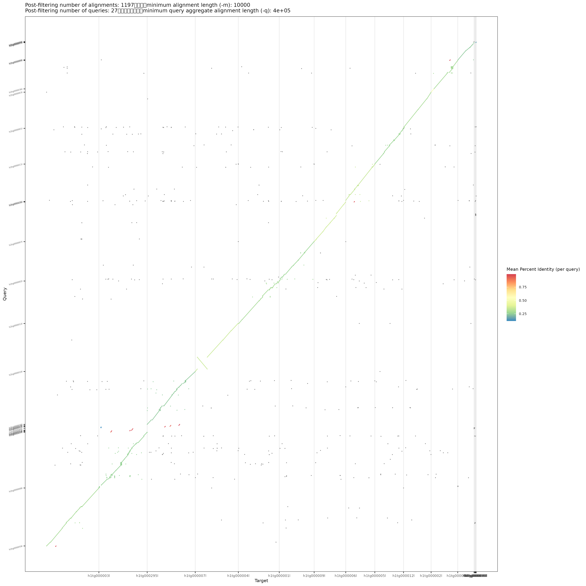

The 12 longest contigs between the two haplotypes are aligned very nicely, but the shorter contigs will require additional check in later stages. As *Eucalyptus* has 11 chromosomes, it is likely that one of the chromosomes is split into two contigs.

### Contamination check
Here, I generated 100kb sliding windows from individual contigs and BLAST them to existing databases to check for potential contaminants. Note that this step requires a lot of storage, particularly to download the `core_nt` database.

```
# map the filtered ONT reads to the union
minimap2 -t 128 -ax lr:hq \
    02_assembly/homcov55/hifiasm_s050/E_phylacis_s050.asm.bp.hap1.p_ctg.fa \
    01_qc/02_chopper/E_phylacis_filtered.fastq.gz \
    | samtools sort -@16 -o 03_qc/hap1.bam

minimap2 -t 128 -ax lr:hq \
    02_assembly/homcov55/hifiasm_s050/E_phylacis_s050.asm.bp.hap2.p_ctg.fa \
    01_qc/02_chopper/E_phylacis_filtered.fastq.gz \
    | samtools sort -@16 -o 03_qc/hap2.bam

# index the BAM file
samtools index -c 03_qc/hap1.bam
samtools index -c 03_qc/hap2.bam

# index each haplotype
samtools faidx 02_assembly/homcov55/hifiasm_s050/E_phylacis_s050.asm.bp.hap1.p_ctg.fa
samtools faidx 02_assembly/homcov55/hifiasm_s050/E_phylacis_s050.asm.bp.hap2.p_ctg.fa

# download the taxonomy metadata
mkdir -p 03_qc/taxdump && cd 03_qc/taxdump
curl -L https://ftp.ncbi.nlm.nih.gov/pub/taxonomy/new_taxdump/new_taxdump.tar.gz | tar xzf -
cd ../..

# download core_nt database
mkdir -p 03_qc/blastdb && cd 03_qc/blastdb
update_blastdb.pl --decompress --num_threads 128 --source ncbi core_nt
update_blastdb.pl --decompress --source ncbi taxdb
cd ../..

# download UniProt / Swiss-Prot database
mkdir -p 03_qc/uniprot && cd 03_qc/uniprot
wget https://ftp.uniprot.org/pub/databases/uniprot/current_release/knowledgebase/complete/uniprot_sprot.fasta.gz
wget https://ftp.ncbi.nlm.nih.gov/pub/taxonomy/accession2taxid/prot.accession2taxid.gz
diamond makedb --in uniprot_sprot.fasta.gz -d uniprot_sprot \
    --taxonmap prot.accession2taxid.gz \
    --taxonnodes ../taxdump/nodes.dmp
cd ../..

# generate 100kb sliding-windows
seqkit sliding -s 100000 -W 100000 -g 02_assembly/homcov55/hifiasm_s050/E_phylacis_s050.asm.bp.hap1.p_ctg.fa > 03_qc/hap1.chunks.fa
seqkit sliding -s 100000 -W 100000 -g 02_assembly/homcov55/hifiasm_s050/E_phylacis_s050.asm.bp.hap2.p_ctg.fa > 03_qc/hap2.chunks.fa

# check windows against core_nt
blastn -task megablast -db 03_qc/blastdb/core_nt -query 03_qc/hap1.chunks.fa \
    -outfmt "6 qseqid staxids bitscore std" -max_target_seqs 10 -max_hsps 1 \
    -evalue 1e-25 -num_threads 128 \
    | sed 's/_sliding:[0-9]*-[0-9]*//' > 03_qc/hap1.blastn.out

blastn -task megablast -db 03_qc/blastdb/core_nt -query 03_qc/hap2.chunks.fa \
    -outfmt "6 qseqid staxids bitscore std" -max_target_seqs 10 -max_hsps 1 \
    -evalue 1e-25 -num_threads 128 \
    | sed 's/_sliding:[0-9]*-[0-9]*//' > 03_qc/hap2.blastn.out

# check windows against UniProt / Swiss-Prot
diamond blastx --query 03_qc/hap1.chunks.fa --db 03_qc/uniprot/uniprot_sprot.dmnd \
    --outfmt 6 qseqid staxids bitscore qseqid sseqid pident length mismatch gapopen qstart qend sstart send evalue bitscore \
    --sensitive --max-target-seqs 1 --evalue 1e-25 --threads 128 \
    | sed 's/_sliding:[0-9]*-[0-9]*//' > 03_qc/hap1.diamond.out

diamond blastx --query 03_qc/hap2.chunks.fa --db 03_qc/uniprot/uniprot_sprot.dmnd \
    --outfmt 6 qseqid staxids bitscore qseqid sseqid pident length mismatch gapopen qstart qend sstart send evalue bitscore \
    --sensitive --max-target-seqs 1 --evalue 1e-25 --threads 128 \
    | sed 's/_sliding:[0-9]*-[0-9]*//' > 03_qc/hap2.diamond.out

# change compleasm output table to follow blobtools requirements
sed -e '1s/^# compleasm version is: .*/# BUSCO version is: 6.1.0/' \
    -e 's/\tSingle\t/\tComplete\t/; s/\tInterspaced\t/\tFragmented\t/' \
    02_assembly/homcov55/compleasm/s050_hap1/eudicotyledons_odb12/full_table_busco_format.tsv \
    > 03_qc/s050_hap1_busco_btk.tsv

sed -e '1s/^# compleasm version is: .*/# BUSCO version is: 6.1.0/' \
    -e 's/\tSingle\t/\tComplete\t/; s/\tInterspaced\t/\tFragmented\t/' \
    02_assembly/homcov55/compleasm/s050_hap2/eudicotyledons_odb12/full_table_busco_format.tsv \
    > 03_qc/s050_hap2_busco_btk.tsv

# build the Blobdir
blobtools create \
    --fasta 02_assembly/homcov55/hifiasm_s050/E_phylacis_s050.asm.bp.hap1.p_ctg.fa \
    --taxid 3932 --taxdump 03_qc/taxdump/ 03_qc/hap1_btk
blobtools add --cov 03_qc/hap1.bam --threads 16 03_qc/hap1_btk
blobtools add --hits 03_qc/hap1.blastn.out --hits 03_qc/hap1.diamond.out \
    --taxrule bestsumorder --taxdump 03_qc/taxdump/ 03_qc/hap1_btk
blobtools add --busco 03_qc/s050_hap1_busco_btk.tsv 03_qc/hap1_btk

blobtools create \
    --fasta 02_assembly/homcov55/hifiasm_s050/E_phylacis_s050.asm.bp.hap2.p_ctg.fa \
    --taxid 3932 --taxdump 03_qc/taxdump/ 03_qc/hap2_btk
blobtools add --cov 03_qc/hap2.bam --threads 16 03_qc/hap2_btk
blobtools add --hits 03_qc/hap2.blastn.out --hits 03_qc/hap2.diamond.out \
    --taxrule bestsumorder --taxdump 03_qc/taxdump/ 03_qc/hap2_btk
blobtools add --busco 03_qc/s050_hap2_busco_btk.tsv 03_qc/hap2_btk

# export the output
blobtools filter --table 03_qc/hap1_btk.tsv 03_qc/hap1_btk
blobtools filter --table 03_qc/hap2_btk.tsv 03_qc/hap2_btk

# generate plots
blobtk plot -v blob  -d 03_qc/hap1_btk -o 03_qc/hap1_blob.png
blobtk plot -v snail -d 03_qc/hap1_btk -o 03_qc/hap1_snail.svg

blobtk plot -v blob  -d 03_qc/hap2_btk -o 03_qc/hap2_blob.png
blobtk plot -v snail -d 03_qc/hap2_btk -o 03_qc/hap2_snail.svg
```

|                   Haplotype 1               |                   Haplotype 2               |
| :-----------------------------------------: | :-----------------------------------------: |
|   | 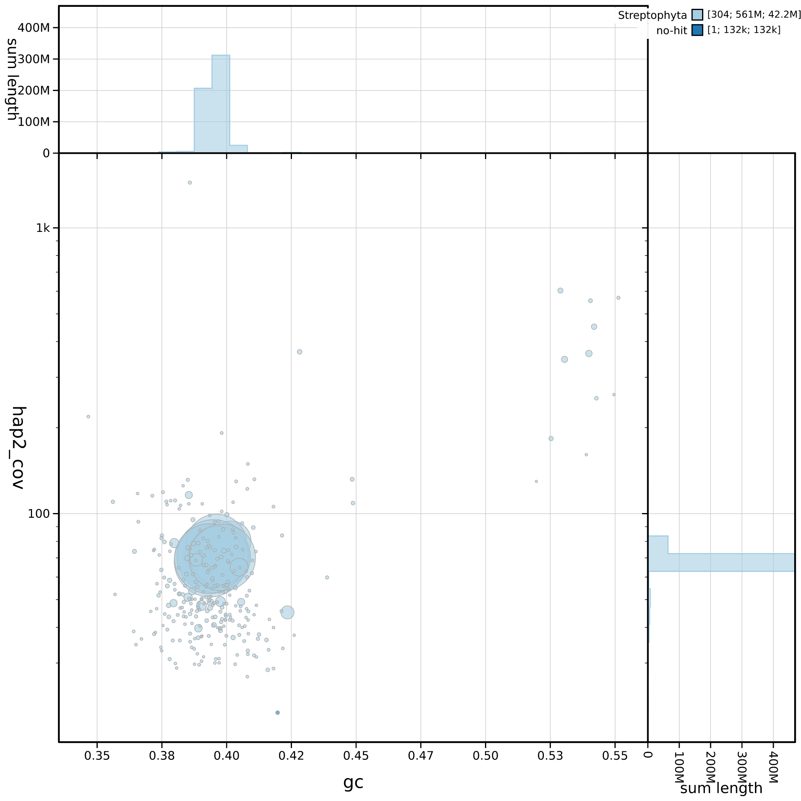  |
|  |  |

It seems that hap1 contains a little bit of contamination from *Ascomycota* (fungi). We should remove these contigs in later stages. 

## <a id="04">Assembly of organelle genomes</a>
I followed <a href="https://github.com/roblanf/MM_genome/tree/initial_trials">Rob's</a> recommendation to assemble the mtDNA and ptDNA genomes. I also asked Claude to generate a Python <a href="./analyses/03_organelle/scripts/oatk_circular_map.py">script</a> to visualise the circular map of each organelle.

```
# create a new directory as not to overwrite the previous results
cd 02_assembly/homcov55/hifiasm_s050 && mkdir -p ec_extract && cd ec_extract

# extract Hifiasm corrected reads
for s in ec.bin ovlp.source.bin ovlp.reverse.bin; do ln -s ../E_phylacis_s050.asm.$s .; done
hifiasm -o E_phylacis_s050.asm -t 128 --ont --write-ec ../../../../01_qc/02_chopper/E_phylacis_filtered.fastq.gz

# change directory
cd ../../../..

# run OatK
oatk -k 1001 \
     -c 30 \
     -t 128 \
     -p 04_organelle/db/magnoliopsida_pltd.fam \
     -m 04_organelle/db/magnoliopsida_mito.fam \
     -o 04_organelle/c30k1001/E_phylacis \
     02_assembly/homcov55/hifiasm_s050/ec_extract/E_phylacis_s050.asm.ec.fq

# save into PNG
python scripts/oatk_circular_map.py \
    04_organelle/c30k1001/E_phylacis.mito.ctg.fasta \
    04_organelle/c30k1001/E_phylacis.mito.ctg.bed \
    -o 04_organelle/c30k1001/mito_map.png

python scripts/oatk_circular_map.py \
    04_organelle/c30k1001/E_phylacis.pltd.ctg.fasta \
    04_organelle/c30k1001/E_phylacis.pltd.ctg.bed \
    -o 04_organelle/c30k1001/pltd_map.png
```

### <a id="04a">mtDNA</a>

```
>ctg000001l     length=355146 wlength=41066840.0 nv=11 circular=false path=u151-,u152+,u150-,u148-,u146-,u147+,u141-,u12277+,u139+,u146-,u138-
>ctg000002l     length=23355 wlength=2312145.0 nv=1 circular=false path=u149+
>ctg000003c     length=79427 wlength=7942700.0 nv=1 circular=true path=u12148-
```

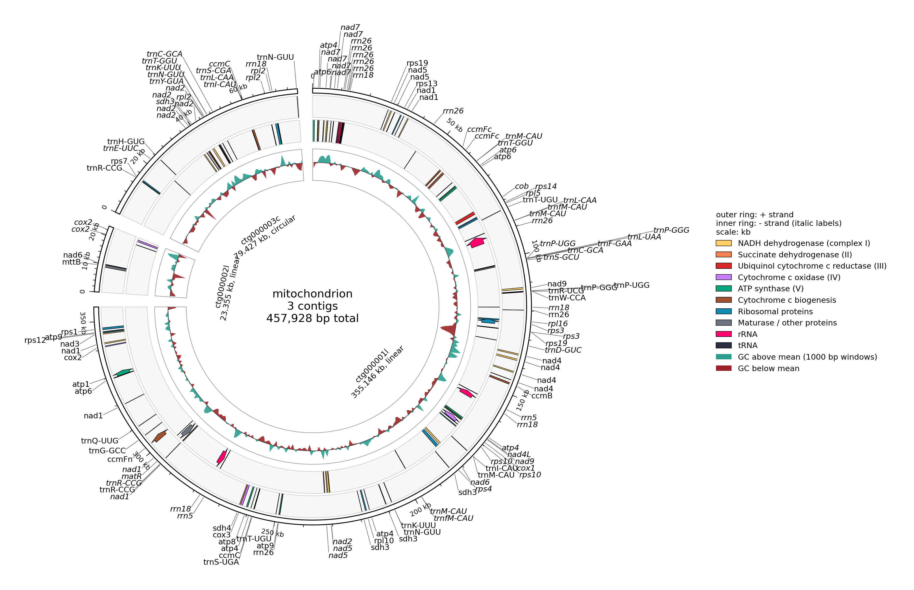

### <a id="04b">ptDNA</a>

```
>ctg000001c     length=160190 wlength=150009126.0 nv=12 circular=true path=u140+,u12277+,u137-,u7+,u12278-,u143-,u142+,u143+,u12278+,u7-,u137+,u12277-
```

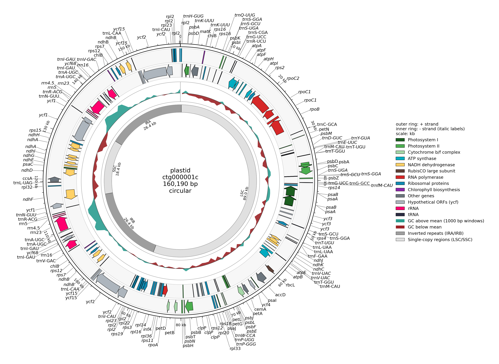

## <a id="05">Assembly of nuclear genome</a>

### <a id="05a">Checking for duplicate contigs</a>
```
# map each haplotype against each other and against itself
minimap2 -cx asm20 -t 128 \
    02_assembly/homcov55/hifiasm_s050/E_phylacis_s050.asm.bp.hap2.p_ctg.fa \
    02_assembly/homcov55/hifiasm_s050/E_phylacis_s050.asm.bp.hap1.p_ctg.fa \
    > 05_nuclear_qc/01_h1h2/h1_vs_h2.paf
minimap2 -cx asm20 -DP -m200 -t 128 \
    02_assembly/homcov55/hifiasm_s050/E_phylacis_s050.asm.bp.hap1.p_ctg.fa \
    02_assembly/homcov55/hifiasm_s050/E_phylacis_s050.asm.bp.hap1.p_ctg.fa \
    > 05_nuclear_qc/01_h1h2/h1_self.paf
minimap2 -cx asm20 -DP -m200 -t 128 \
    02_assembly/homcov55/hifiasm_s050/E_phylacis_s050.asm.bp.hap2.p_ctg.fa \
    02_assembly/homcov55/hifiasm_s050/E_phylacis_s050.asm.bp.hap2.p_ctg.fa \
    > 05_nuclear_qc/01_h1h2/h2_self.paf

# extract necessary columns
cut -f1-12 05_nuclear_qc/01_h1h2/h1_self.paf > 05_nuclear_qc/01_h1h2/h1_self.12.paf
cut -f1-12 05_nuclear_qc/01_h1h2/h2_self.paf > 05_nuclear_qc/01_h1h2/h2_self.12.paf

# generate the dotplots
Rscript scripts/pafCoordsDotPlotly.R \
    -i 05_nuclear_qc/01_h1h2/h1_vs_h2.paf \
    -o h1_vs_h2_dotplot2 -s -t

Rscript scripts/pafCoordsDotPlotly.R \
    -i 05_nuclear_qc/01_h1h2/h1_self.12.paf \
    -o h1_self_dotplot2 -s

Rscript scripts/pafCoordsDotPlotly.R \
    -i 05_nuclear_qc/01_h1h2/h2_self.12.paf \
    -o h2_self_dotplot2 -s
```

|                Hap 1 vs Hap 2                 |                    Hap 1 vs. Hap 1             |                    Hap 2 vs. Hap 2             |
| :-------------------------------------------: | :--------------------------------------------: | :--------------------------------------------: |
|  |   | 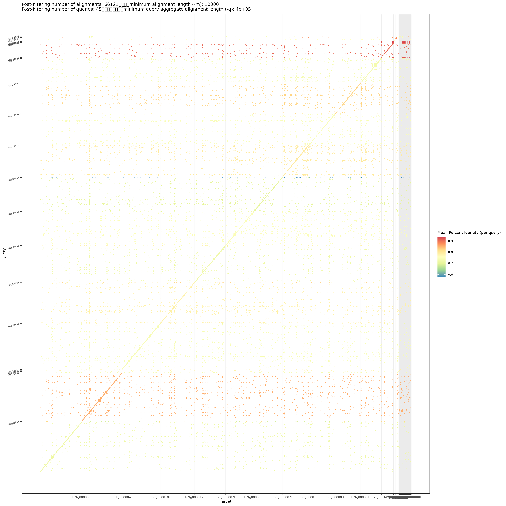  |

It seems that there is a number of duplicates at the top-right corner of the H1 vs. H1 and H2 vs. H2 plots. Let's zoom in more...
```
# remove the long, properly-aligned contigs
awk '!($1==$6 && $3==$8 && $4==$9)' 05_nuclear_qc/01_h1h2/h1_self.12.paf > 05_nuclear_qc/01_h1h2/h1_self.noself.paf
awk '!($1==$6 && $3==$8 && $4==$9)' 05_nuclear_qc/01_h1h2/h2_self.12.paf > 05_nuclear_qc/01_h1h2/h2_self.noself.paf

# repeat the plotting
Rscript scripts/pafCoordsDotPlotly.R \
    -i 05_nuclear_qc/01_h1h2/h1_self.noself.paf \
    -o h1_self_dotplot2_noself -s -m 10000 -q 50000

Rscript scripts/pafCoordsDotPlotly.R \
    -i 05_nuclear_qc/01_h1h2/h2_self.noself.paf \
    -o h2_self_dotplot2_noself -s -m 10000 -q 50000
```

|                    Hap 1 vs. Hap 1             |                    Hap 2 vs. Hap 2             |
| :--------------------------------------------: | :--------------------------------------------: |
|   |   |


### Identity + Mapping Depth

It is still quite tricky to identify those contigs based on the plots. Claude (nicely) generated a Python <a href="./scripts/flag_contained_contigs.py">script</a> to identify putative duplicates based on the following (I will take `hap1` as an example):
- If `hap1` is perfect, then each contig should match 1:1 when mapped against itself. However, from the dotplots, we could see that there are smaller contigs that are better aligned to other longer contigs. The Python script lists every contig with ≥80% of its length lying inside a longer contig, with a minimum of 10kb aligned sites and 90% identity.
- There are four potential reasons how it could happen:
    1. An assembly error, where the same molecule got assembled twice
    2. A phasing error, where both parental alleles were put into hap1
    3. It is a repeat that exists in many copies (e.g., rDNA, a satellite, or organelle DNA)
    4. It is a paralog

    Between these cases, we should remove cases 1-3, but **keep case 4**.
- We can differentiate these four cases by looking at the:
    - Identity
        1. ≥99.9%, because the two assemblies come from the same molecule
        2. ~96.5%, because the median divergence between the two parents are ~3.5%:
            ```
            awk '$11>=100000 {for(i=13;i<=NF;i++) if($i~/^(de|dv):f:/){split($i,a,":"); print 1-a[3]}}' \
                02_assembly/homcov55/hifiasm_s050/compare_h1h2/hap1_vs_hap2.paf | sort -n \
            | awk '{v[NR]=$1} END{printf "n=%d  Q1=%.3f  median=%.3f  Q3=%.3f\n", NR, v[int(NR/4)+1], v[int(NR/2)+1], v[int(NR*3/4)+1]}'
            ```
        3. ≥99.9%, but contained in **several** other contigs
        4. Could be ~96.5% (and thus unidentifiable in regards to case 2)
    - Depth
        1. ~27.5x, because the reads of one locus are shared between two identical copies
        2. ~27.5x, because reads from only one parent would map to the smaller contig
        3. Random
        4. ~55x, because it has its own locus from both parents
- Lastly, instead of setting a fixed cutoff of 27.5x or 55x to keep or remove a contig, we dynamically set a depth threshold for each contig based on it's percentage of contained sites (*f*) with the following formula: `27.5*f* + 55(1 − *f*)`. If the value is lower than the threshold, the contig is more likely to fit either case 1 or 2 and thus should be removed.

```
# identify putative paralogs
python3 scripts/flag_contained_contigs.py 05_nuclear_qc/01_h1h2/h1_self.paf > 05_nuclear_qc/01_h1h2/h1_dups.tsv
python3 scripts/flag_contained_contigs.py 05_nuclear_qc/01_h1h2/h2_self.paf > 05_nuclear_qc/01_h1h2/h2_dups.tsv

# calculate each contig's depth
awk -F'\t' 'NR>1{print $1}' 05_nuclear_qc/01_h1h2/h1_dups.tsv > 05_nuclear_qc/01_h1h2/h1_remove.txt
awk 'NR==FNR{k[$1];next} $1 in k{print $1"\t0\t"$2}' \
    05_nuclear_qc/01_h1h2/h1_remove.txt \
    02_assembly/homcov55/hifiasm_s050/E_phylacis_s050.asm.bp.hap1.p_ctg.fa.fai \
    > 05_nuclear_qc/01_h1h2/h1_remove.bed
mosdepth -t 16 --by 05_nuclear_qc/01_h1h2/h1_remove.bed --no-per-base 05_nuclear_qc/01_h1h2/h1_dups 03_qc/hap1.bam
zcat 05_nuclear_qc/01_h1h2/h1_dups.regions.bed.gz | awk '{printf "%s\t%.1f\n",$1,$4}' | sort -k2,2n

awk -F'\t' 'NR>1{print $1}' 05_nuclear_qc/01_h1h2/h2_dups.tsv > 05_nuclear_qc/01_h1h2/h2_remove.txt
awk 'NR==FNR{k[$1];next} $1 in k{print $1"\t0\t"$2}' \
    05_nuclear_qc/01_h1h2/h2_remove.txt \
    02_assembly/homcov55/hifiasm_s050/E_phylacis_s050.asm.bp.hap2.p_ctg.fa.fai \
    > 05_nuclear_qc/01_h1h2/h2_remove.bed
mosdepth -t 16 --by 05_nuclear_qc/01_h1h2/h2_remove.bed --no-per-base 05_nuclear_qc/01_h1h2/h2_dups 03_qc/hap2.bam
zcat 05_nuclear_qc/01_h1h2/h2_dups.regions.bed.gz | awk '{printf "%s\t%.1f\n",$1,$4}' | sort -k2,2n
```

> [!NOTE]
> - **Remove**: depth ≤ cutoff - potential case 1 or 2
> - **Keep**  : depth > cutoff - potential case 4
> - **Check** : potential case 3

- <b><i>Haplotype 1</b></i> — **62** remove (5.15 Mb), **17** keep (1.37 Mb), **32** check (3.48 Mb)

    <details>
    <summary><i>Click here to view the full table</i></summary>

    | Contig      | Length (bp) | Covered (%) | Max identity (%) | Depth (x) | Cutoff (x) | Contained in                                                    | Verdict |
    | :---------- | ----------: | ----------: | ---------------: | --------: | ---------: | :-------------------------------------------------------------- | :------ |
    | h1tg000348l |      38,223 |        93.4 |            99.98 |       7.1 |          – | h1tg000114l, h1tg000231l, h1tg000016l, h1tg000019l              | Check   |
    | h1tg000160l |      40,059 |       100.0 |            99.99 |      11.4 |       41.2 | h1tg000003l                                                     | Remove  |
    | h1tg000347l |      38,596 |       100.0 |            99.99 |      11.9 |          – | h1tg000101l, h1tg000059l, h1tg000376l, h1tg000121l, h1tg000031l | Check   |
    | h1tg000231l |      57,617 |       100.0 |           100.00 |      12.4 |          – | h1tg000033l, h1tg000016l, h1tg000197l, h1tg000019l, h1tg000268l | Check   |
    | h1tg000284l |      52,359 |       100.0 |            99.99 |      16.1 |          – | h1tg000059l, h1tg000114l, h1tg000019l, h1tg000016l, h1tg000101l | Check   |
    | h1tg000356l |      68,179 |       100.0 |           100.00 |      17.4 |          – | h1tg000059l, h1tg000033l, h1tg000114l, h1tg000019l, h1tg000016l | Check   |
    | h1tg000129l |      43,642 |       100.0 |            99.99 |      20.3 |          – | h1tg000059l, h1tg000114l, h1tg000019l, h1tg000016l, h1tg000031l | Check   |
    | h1tg000029l |      58,330 |        99.9 |           100.00 |      20.5 |          – | h1tg000033l, h1tg000016l, h1tg000019l, h1tg000197l, h1tg000114l | Check   |
    | h1tg000304l |      64,293 |        98.6 |            97.14 |      21.9 |       41.4 | h1tg000005l                                                     | Remove  |
    | h1tg000369l |      50,916 |       100.0 |            95.80 |      22.1 |       41.2 | h1tg000004l                                                     | Remove  |
    | h1tg000114l |     256,182 |       100.0 |           100.00 |      22.6 |          – | h1tg000033l, h1tg000059l, h1tg000019l, h1tg000101l, h1tg000014l | Check   |
    | h1tg000366l |      42,921 |       100.0 |            99.99 |      23.1 |          – | h1tg000033l, h1tg000016l, h1tg000197l, h1tg000019l, h1tg000114l | Check   |
    | h1tg000068l |      77,346 |        88.1 |            96.88 |      23.5 |       42.9 | h1tg000008l                                                     | Remove  |
    | h1tg000357l |      48,044 |       100.0 |            96.49 |      24.5 |       41.2 | h1tg000002l                                                     | Remove  |
    | h1tg000256l |      75,059 |        91.8 |            97.23 |      24.9 |       42.4 | h1tg000002l                                                     | Remove  |
    | h1tg000053l |      68,850 |       100.0 |            99.43 |      25.7 |       41.2 | h1tg000004l, h1tg000102l, h1tg000006l                           | Remove  |
    | h1tg000362l |      56,512 |        84.2 |            95.19 |      26.0 |       43.4 | h1tg000007l                                                     | Remove  |
    | h1tg000159l |      59,911 |        88.0 |            96.30 |      26.2 |       42.9 | h1tg000001l                                                     | Remove  |
    | h1tg000386l |      60,966 |       100.0 |            96.57 |      26.4 |       41.2 | h1tg000004l                                                     | Remove  |
    | h1tg000185l |      61,829 |        90.6 |            96.22 |      26.7 |       42.5 | h1tg000003l                                                     | Remove  |
    | h1tg000198l |      59,360 |        93.8 |            96.61 |      26.8 |       42.1 | h1tg000004l                                                     | Remove  |
    | h1tg000209l |      54,964 |        93.7 |            97.68 |      27.0 |       42.1 | h1tg000003l                                                     | Remove  |
    | h1tg000207l |      62,163 |        98.6 |            96.02 |      27.1 |       41.4 | h1tg000006l                                                     | Remove  |
    | h1tg000392l |      58,378 |        82.8 |            97.10 |      27.2 |       43.6 | h1tg000012l                                                     | Remove  |
    | h1tg000310l |      58,915 |        97.5 |            97.37 |      28.1 |       41.6 | h1tg000005l, h1tg000007l, h1tg000009l, h1tg000071l, h1tg000003l | Remove  |
    | h1tg000010l |      60,816 |       100.0 |           100.00 |      28.3 |          – | h1tg000033l, h1tg000016l, h1tg000197l, h1tg000114l, h1tg000268l | Check   |
    | h1tg000314l |      66,301 |        86.2 |            94.82 |      28.6 |       43.1 | h1tg000004l                                                     | Remove  |
    | h1tg000072l |      74,883 |        80.5 |            97.03 |      29.0 |       43.9 | h1tg000012l                                                     | Remove  |
    | h1tg000137l |      73,968 |        97.9 |            96.80 |      29.7 |       41.5 | h1tg000005l                                                     | Remove  |
    | h1tg000384l |      49,774 |        84.1 |            96.58 |      29.9 |       43.4 | h1tg000004l                                                     | Remove  |
    | h1tg000212l |      77,008 |        88.6 |            96.31 |      30.0 |       42.8 | h1tg000002l                                                     | Remove  |
    | h1tg000171l |      42,060 |       100.0 |            99.99 |      30.3 |          – | h1tg000376l, h1tg000121l, h1tg000101l, h1tg000059l, h1tg000263l | Check   |
    | h1tg000210l |     122,668 |        95.3 |            97.06 |      30.3 |       41.9 | h1tg000012l                                                     | Remove  |
    | h1tg000267l |      59,257 |        95.1 |            94.60 |      30.5 |       41.9 | h1tg000009l                                                     | Remove  |
    | h1tg000105l |      60,672 |        81.4 |            96.21 |      30.6 |       43.8 | h1tg000006l                                                     | Remove  |
    | h1tg000367l |      71,906 |       100.0 |            95.79 |      30.9 |       41.2 | h1tg000008l                                                     | Remove  |
    | h1tg000402l |      32,104 |       100.0 |           100.00 |      30.9 |          – | h1tg000059l, h1tg000376l, h1tg000121l, h1tg000101l, h1tg000031l | Check   |
    | h1tg000234l |      58,540 |        96.8 |            95.50 |      31.1 |       41.7 | h1tg000003l                                                     | Remove  |
    | h1tg000335l |     114,065 |        85.3 |            96.13 |      31.1 |       43.3 | h1tg000003l                                                     | Remove  |
    | h1tg000096l |      61,056 |       100.0 |            95.72 |      31.3 |       41.2 | h1tg000004l                                                     | Remove  |
    | h1tg000239l |      55,435 |        99.4 |            96.96 |      31.4 |       41.3 | h1tg000001l, h1tg000009l                                        | Remove  |
    | h1tg000116l |      56,604 |        95.7 |            95.27 |      31.4 |       41.8 | h1tg000007l                                                     | Remove  |
    | h1tg000099l |      58,344 |        97.1 |            96.48 |      32.1 |       41.6 | h1tg000008l                                                     | Remove  |
    | h1tg000235l |      91,815 |        80.3 |            96.24 |      32.3 |       44.0 | h1tg000005l                                                     | Remove  |
    | h1tg000054l |      46,840 |        84.9 |            95.96 |      32.4 |       43.3 | h1tg000008l                                                     | Remove  |
    | h1tg000385l |      62,848 |        91.9 |            95.49 |      33.1 |       42.4 | h1tg000008l                                                     | Remove  |
    | h1tg000381l |      88,366 |        99.1 |            96.55 |      33.3 |       41.4 | h1tg000012l                                                     | Remove  |
    | h1tg000355l |      61,806 |        96.2 |            95.53 |      33.5 |       41.8 | h1tg000008l                                                     | Remove  |
    | h1tg000278l |      97,489 |        86.3 |            95.99 |      33.6 |       43.1 | h1tg000009l                                                     | Remove  |
    | h1tg000204l |     162,827 |        88.5 |            97.77 |      33.9 |       42.8 | h1tg000295l, h1tg000007l                                        | Remove  |
    | h1tg000102l |     103,537 |       100.0 |            99.60 |      34.0 |       41.2 | h1tg000004l, h1tg000003l, h1tg000009l, h1tg000001l, h1tg000014l | Remove  |
    | h1tg000089l |      99,513 |        87.2 |            96.90 |      34.4 |       43.0 | h1tg000001l                                                     | Remove  |
    | h1tg000138l |     448,249 |        82.6 |            99.38 |      34.5 |       43.6 | h1tg000008l, h1tg000012l, h1tg000295l, h1tg000009l              | Remove  |
    | h1tg000262l |      60,426 |        94.5 |            99.97 |      34.9 |       42.0 | h1tg000004l, h1tg000205l                                        | Remove  |
    | h1tg000157l |      77,595 |        89.1 |            96.85 |      34.9 |       42.7 | h1tg000005l                                                     | Remove  |
    | h1tg000149l |      66,846 |        81.5 |            96.05 |      34.9 |       43.8 | h1tg000003l                                                     | Remove  |
    | h1tg000194l |     101,536 |        89.0 |            95.43 |      35.1 |       42.8 | h1tg000002l                                                     | Remove  |
    | h1tg000192l |      98,955 |        87.5 |            96.01 |      35.2 |       43.0 | h1tg000002l                                                     | Remove  |
    | h1tg000297l |      69,314 |        90.2 |            96.80 |      35.4 |       42.6 | h1tg000295l                                                     | Remove  |
    | h1tg000052l |      57,550 |        98.6 |            95.86 |      35.9 |       41.4 | h1tg000295l                                                     | Remove  |
    | h1tg000020l |      76,640 |        88.7 |            97.35 |      36.4 |       42.8 | h1tg000001l, h1tg000004l, h1tg000295l, h1tg000007l, h1tg000003l | Remove  |
    | h1tg000333l |      66,283 |        87.9 |            96.25 |      36.5 |       42.9 | h1tg000002l                                                     | Remove  |
    | h1tg000383l |      93,603 |        85.7 |            97.46 |      36.5 |       43.2 | h1tg000002l                                                     | Remove  |
    | h1tg000306l |      48,104 |        90.4 |            96.33 |      36.6 |       42.6 | h1tg000008l                                                     | Remove  |
    | h1tg000237l |      69,434 |        93.9 |            96.20 |      36.7 |       42.1 | h1tg000001l, h1tg000005l                                        | Remove  |
    | h1tg000124l |      84,493 |        84.7 |            95.60 |      37.2 |       43.4 | h1tg000009l                                                     | Remove  |
    | h1tg000202l |      54,121 |        86.9 |            95.70 |      37.5 |       43.1 | h1tg000002l                                                     | Remove  |
    | h1tg000019l |     289,545 |       100.0 |           100.00 |      37.8 |          – | h1tg000014l, h1tg000033l, h1tg000059l, h1tg000101l, h1tg000008l | Check   |
    | h1tg000293l |      81,065 |        86.9 |            97.15 |      38.2 |       43.1 | h1tg000002l                                                     | Remove  |
    | h1tg000112l |      60,454 |        84.1 |            97.59 |      38.3 |       43.4 | h1tg000009l                                                     | Remove  |
    | h1tg000324l |      87,889 |        93.1 |            96.69 |      39.7 |       42.2 | h1tg000004l, h1tg000003l, h1tg000005l                           | Remove  |
    | h1tg000073l |      81,226 |       100.0 |            98.50 |      39.9 |       41.2 | h1tg000014l                                                     | Remove  |
    | h1tg000077l |      85,589 |        88.7 |            96.84 |      40.4 |       42.8 | h1tg000008l, h1tg000003l, h1tg000295l                           | Remove  |
    | h1tg000069l |     304,868 |        81.0 |            96.76 |      40.4 |       43.9 | h1tg000009l                                                     | Remove  |
    | h1tg000180l |      55,519 |       100.0 |           100.00 |      41.7 |          – | h1tg000025l, h1tg000373l, h1tg000041l, h1tg000083l, h1tg000005l | Check   |
    | h1tg000352l |      43,085 |       100.0 |           100.00 |      41.7 |          – | h1tg000101l, h1tg000059l, h1tg000121l, h1tg000376l, h1tg000340l | Check   |
    | h1tg000188l |      69,874 |       100.0 |           100.00 |      41.8 |          – | h1tg000033l, h1tg000016l, h1tg000197l, h1tg000019l, h1tg000268l | Check   |
    | h1tg000146l |     142,640 |        89.5 |            98.49 |      41.8 |       42.7 | h1tg000004l, h1tg000005l, h1tg000006l, h1tg000007l, h1tg000071l | Remove  |
    | h1tg000331l |      49,002 |        82.5 |            95.88 |      44.0 |       43.7 | h1tg000008l, h1tg000006l, h1tg000295l, h1tg000005l, h1tg000009l | Keep    |
    | h1tg000043l |      58,740 |        87.1 |            96.78 |      45.2 |       43.0 | h1tg000003l, h1tg000001l                                        | Keep    |
    | h1tg000018l |      87,119 |        88.4 |            98.23 |      45.6 |       42.8 | h1tg000005l, h1tg000009l                                        | Keep    |
    | h1tg000050l |      51,925 |        86.2 |            96.87 |      45.6 |       43.1 | h1tg000009l                                                     | Keep    |
    | h1tg000360l |      65,049 |        81.4 |            96.83 |      46.4 |       43.8 | h1tg000004l, h1tg000071l, h1tg000001l, h1tg000295l, h1tg000006l | Keep    |
    | h1tg000154l |      71,970 |        96.6 |            95.27 |      47.0 |       41.7 | h1tg000012l                                                     | Keep    |
    | h1tg000323l |      67,032 |        85.5 |            98.36 |      47.6 |       43.2 | h1tg000004l, h1tg000007l                                        | Keep    |
    | h1tg000175l |      57,797 |        99.1 |            97.56 |      49.0 |       41.4 | h1tg000295l, h1tg000003l                                        | Keep    |
    | h1tg000325l |      53,329 |        80.6 |            97.73 |      49.5 |       43.9 | h1tg000014l, h1tg000022l, h1tg000001l, h1tg000006l, h1tg000003l | Keep    |
    | h1tg000263l |      56,408 |       100.0 |           100.00 |      52.1 |          – | h1tg000101l, h1tg000059l, h1tg000376l, h1tg000121l, h1tg000031l | Check   |
    | h1tg000299l |      58,740 |        93.4 |            96.90 |      52.5 |       42.2 | h1tg000005l, h1tg000007l                                        | Keep    |
    | h1tg000016l |     201,921 |       100.0 |           100.00 |      53.9 |          – | h1tg000033l, h1tg000114l, h1tg000019l, h1tg000197l, h1tg000059l | Check   |
    | h1tg000047l |     252,734 |        89.8 |            98.49 |      53.9 |       42.7 | h1tg000003l, h1tg000008l                                        | Keep    |
    | h1tg000158l |      56,037 |        88.1 |            95.33 |      57.0 |       42.9 | h1tg000009l                                                     | Keep    |
    | h1tg000197l |     240,577 |       100.0 |           100.00 |      57.7 |          – | h1tg000014l, h1tg000033l, h1tg000019l, h1tg000114l, h1tg000059l | Check   |
    | h1tg000371l |      61,340 |        89.6 |            95.03 |      57.7 |       42.7 | h1tg000008l, h1tg000003l                                        | Keep    |
    | h1tg000195l |      71,957 |       100.0 |           100.00 |      59.2 |          – | h1tg000376l, h1tg000059l, h1tg000121l, h1tg000101l, h1tg000031l | Check   |
    | h1tg000373l |      62,207 |       100.0 |           100.00 |      61.1 |          – | h1tg000025l, h1tg000083l, h1tg000005l                           | Check   |
    | h1tg000031l |     161,493 |       100.0 |           100.00 |      62.8 |          – | h1tg000059l, h1tg000101l, h1tg000121l, h1tg000114l, h1tg000019l | Check   |
    | h1tg000252l |     154,916 |        88.4 |            98.17 |      63.1 |       42.8 | h1tg000001l, h1tg000009l, h1tg000295l, h1tg000002l, h1tg000003l | Keep    |
    | h1tg000121l |     228,093 |       100.0 |           100.00 |      63.3 |          – | h1tg000059l, h1tg000101l, h1tg000114l, h1tg000019l, h1tg000014l | Check   |
    | h1tg000334l |     109,400 |        86.4 |            98.32 |      63.5 |       43.1 | h1tg000005l, h1tg000009l                                        | Keep    |
    | h1tg000211l |      67,208 |       100.0 |           100.00 |      63.7 |          – | h1tg000033l, h1tg000016l, h1tg000019l, h1tg000197l, h1tg000114l | Check   |
    | h1tg000359l |      59,624 |        98.4 |            99.82 |      77.1 |       41.5 | h1tg000002l, h1tg000295l, h1tg000007l, h1tg000009l, h1tg000273l | Keep    |
    | h1tg000309l |      53,645 |       100.0 |           100.00 |      80.0 |          – | h1tg000088l, h1tg000061l, h1tg000141l, h1tg000041l, h1tg000001l | Check   |
    | h1tg000101l |     290,087 |        91.2 |           100.00 |      81.2 |          – | h1tg000059l, h1tg000014l, h1tg000008l, h1tg000033l              | Check   |
    | h1tg000088l |     214,149 |        81.1 |           100.00 |      91.9 |          – | h1tg000041l, h1tg000006l, h1tg000001l, h1tg000007l, h1tg000012l | Check   |
    | h1tg000372l |      57,717 |        84.3 |            97.21 |     104.5 |       43.4 | h1tg000002l                                                     | Keep    |
    | h1tg000376l |     125,158 |       100.0 |           100.00 |     116.9 |          – | h1tg000059l, h1tg000121l, h1tg000101l, h1tg000031l, h1tg000114l | Check   |
    | h1tg000268l |      86,546 |        98.4 |           100.00 |     148.4 |          – | h1tg000033l, h1tg000016l, h1tg000197l, h1tg000019l, h1tg000114l | Check   |
    | h1tg000340l |      89,250 |       100.0 |           100.00 |     149.7 |          – | h1tg000059l, h1tg000376l, h1tg000101l, h1tg000121l, h1tg000031l | Check   |
    | h1tg000141l |      84,386 |       100.0 |           100.00 |     338.6 |          – | h1tg000061l, h1tg000088l, h1tg000041l, h1tg000001l              | Check   |
    | h1tg000061l |     198,533 |        97.5 |           100.00 |     558.2 |          – | h1tg000041l, h1tg000088l, h1tg000001l, h1tg000009l              | Check   |

    </details>
    <br>

- <b><i>Haplotype 2</b></i> — **63** remove (5.07 Mb), **18** keep (1.55 Mb), **11** check (2.02 Mb)

    <details>
    <summary><i>Click here to view the full table</i></summary>

    | Contig      | Length (bp) | Covered (%) | Max identity (%) | Depth (x) | Cutoff (x) | Contained in                                                    | Verdict |
    | :---------- | ----------: | ----------: | ---------------: | --------: | ---------: | :-------------------------------------------------------------- | :------ |
    | h2tg000161l |     131,896 |       100.0 |            99.96 |      13.1 |       41.2 | h2tg000001l                                                     | Remove  |
    | h2tg000260l |      60,635 |        94.1 |            96.69 |      23.9 |       42.1 | h2tg000001l                                                     | Remove  |
    | h2tg000033l |      61,285 |       100.0 |            97.56 |      24.4 |       41.2 | h2tg000012l                                                     | Remove  |
    | h2tg000058l |     122,305 |        97.6 |            96.96 |      25.6 |       41.6 | h2tg000009l                                                     | Remove  |
    | h2tg000269l |      57,239 |       100.0 |            97.22 |      25.7 |       41.2 | h2tg000002l                                                     | Remove  |
    | h2tg000298l |      53,830 |        96.2 |            96.45 |      25.8 |       41.8 | h2tg000005l                                                     | Remove  |
    | h2tg000032l |      67,113 |        96.8 |            96.83 |      25.9 |       41.7 | h2tg000001l                                                     | Remove  |
    | h2tg000133l |      61,627 |        99.8 |            96.80 |      26.0 |       41.3 | h2tg000008l                                                     | Remove  |
    | h2tg000130l |      67,099 |        89.4 |            95.49 |      26.1 |       42.7 | h2tg000007l                                                     | Remove  |
    | h2tg000158l |      65,663 |        86.6 |            96.69 |      26.4 |       43.1 | h2tg000008l                                                     | Remove  |
    | h2tg000080l |      55,702 |        93.9 |            96.43 |      26.6 |       42.1 | h2tg000011l                                                     | Remove  |
    | h2tg000067l |      70,936 |        88.2 |            95.61 |      27.4 |       42.9 | h2tg000001l                                                     | Remove  |
    | h2tg000268l |      66,676 |        86.0 |            95.82 |      27.7 |       43.2 | h2tg000007l                                                     | Remove  |
    | h2tg000187l |      84,820 |        82.3 |            96.72 |      28.1 |       43.7 | h2tg000004l                                                     | Remove  |
    | h2tg000040l |      41,228 |        85.1 |            96.37 |      28.4 |       43.3 | h2tg000036l                                                     | Remove  |
    | h2tg000141l |      65,614 |        95.3 |            96.93 |      28.8 |       41.9 | h2tg000036l                                                     | Remove  |
    | h2tg000134l |      61,652 |        93.3 |            97.48 |      29.6 |       42.2 | h2tg000010l                                                     | Remove  |
    | h2tg000290l |      36,811 |       100.0 |            99.99 |      29.7 |          – | h2tg000005l, h2tg000045l, h2tg000068l, h2tg000025l, h2tg000173l | Check   |
    | h2tg000139l |      66,853 |        89.2 |            96.79 |      30.0 |       42.7 | h2tg000008l                                                     | Remove  |
    | h2tg000074l |      75,235 |        83.2 |            96.98 |      30.2 |       43.6 | h2tg000001l                                                     | Remove  |
    | h2tg000205l |      63,721 |        99.5 |            95.17 |      31.4 |       41.3 | h2tg000011l                                                     | Remove  |
    | h2tg000203l |      74,271 |        96.9 |            97.42 |      31.5 |       41.7 | h2tg000011l                                                     | Remove  |
    | h2tg000226l |     125,977 |        87.6 |            98.58 |      31.5 |       43.0 | h2tg000008l                                                     | Remove  |
    | h2tg000132l |      94,325 |        85.4 |            96.88 |      31.7 |       43.3 | h2tg000010l                                                     | Remove  |
    | h2tg000189l |      58,864 |        99.4 |            95.17 |      31.9 |       41.3 | h2tg000011l                                                     | Remove  |
    | h2tg000159l |     102,704 |        99.1 |            96.25 |      31.9 |       41.4 | h2tg000010l, h2tg000007l                                        | Remove  |
    | h2tg000198l |      81,149 |        95.3 |            96.80 |      31.9 |       41.9 | h2tg000002l                                                     | Remove  |
    | h2tg000199l |      53,314 |        99.5 |            96.11 |      32.2 |       41.3 | h2tg000008l                                                     | Remove  |
    | h2tg000276l |      48,196 |        82.5 |            96.72 |      32.6 |       43.7 | h2tg000008l                                                     | Remove  |
    | h2tg000270l |      89,621 |        87.1 |            96.68 |      32.7 |       43.0 | h2tg000003l, h2tg000009l                                        | Remove  |
    | h2tg000123l |      67,248 |        91.0 |            95.96 |      33.0 |       42.5 | h2tg000008l                                                     | Remove  |
    | h2tg000217l |      74,108 |        83.8 |            97.10 |      33.0 |       43.5 | h2tg000002l                                                     | Remove  |
    | h2tg000279l |      61,497 |        96.4 |            95.29 |      33.6 |       41.7 | h2tg000005l                                                     | Remove  |
    | h2tg000207l |      85,960 |        87.0 |            96.39 |      34.5 |       43.0 | h2tg000001l                                                     | Remove  |
    | h2tg000057l |      43,064 |        87.3 |            94.92 |      34.6 |       43.0 | h2tg000010l                                                     | Remove  |
    | h2tg000192l |      81,168 |        86.1 |            96.77 |      34.7 |       43.2 | h2tg000008l                                                     | Remove  |
    | h2tg000230l |      61,325 |        82.8 |            95.98 |      34.7 |       43.6 | h2tg000008l                                                     | Remove  |
    | h2tg000213l |     177,552 |        89.5 |            96.31 |      34.8 |       42.7 | h2tg000012l                                                     | Remove  |
    | h2tg000062l |      75,593 |        84.1 |            96.67 |      34.9 |       43.4 | h2tg000003l, h2tg000010l, h2tg000005l, h2tg000007l, h2tg000008l | Remove  |
    | h2tg000162l |     100,984 |        92.5 |            97.18 |      35.0 |       42.3 | h2tg000007l                                                     | Remove  |
    | h2tg000244l |      56,932 |        95.4 |            97.07 |      35.3 |       41.9 | h2tg000007l                                                     | Remove  |
    | h2tg000249l |      87,280 |        89.8 |            96.50 |      35.5 |       42.7 | h2tg000012l                                                     | Remove  |
    | h2tg000082l |     134,355 |        84.1 |            96.99 |      35.7 |       43.4 | h2tg000008l                                                     | Remove  |
    | h2tg000173l |     174,305 |       100.0 |           100.00 |      36.0 |          – | h2tg000005l, h2tg000045l, h2tg000068l, h2tg000016l, h2tg000090l | Check   |
    | h2tg000115l |      85,713 |        99.7 |            96.78 |      36.3 |       41.3 | h2tg000011l                                                     | Remove  |
    | h2tg000041l |      63,528 |       100.0 |            96.18 |      36.4 |       41.2 | h2tg000008l, h2tg000004l, h2tg000007l, h2tg000005l, h2tg000006l | Remove  |
    | h2tg000046l |      84,672 |        92.3 |            96.79 |      36.7 |       42.3 | h2tg000012l, h2tg000009l, h2tg000011l, h2tg000001l, h2tg000003l | Remove  |
    | h2tg000110l |      74,609 |        86.5 |            96.19 |      36.8 |       43.1 | h2tg000012l, h2tg000185l                                        | Remove  |
    | h2tg000218l |     105,915 |        90.2 |            95.45 |      37.1 |       42.6 | h2tg000001l                                                     | Remove  |
    | h2tg000195l |     123,740 |        81.4 |            99.05 |      37.1 |       43.8 | h2tg000001l, h2tg000010l                                        | Remove  |
    | h2tg000232l |      73,484 |        84.5 |            96.79 |      37.2 |       43.4 | h2tg000001l                                                     | Remove  |
    | h2tg000127l |      93,705 |        94.5 |            95.99 |      37.6 |       42.0 | h2tg000010l                                                     | Remove  |
    | h2tg000101l |      50,093 |        92.5 |            97.96 |      37.9 |       42.3 | h2tg000001l, h2tg000220l                                        | Remove  |
    | h2tg000272l |      58,866 |        95.3 |            97.06 |      38.7 |       41.9 | h2tg000004l                                                     | Remove  |
    | h2tg000056l |     130,833 |        95.9 |            95.13 |      38.8 |       41.8 | h2tg000005l                                                     | Remove  |
    | h2tg000241l |      98,137 |       100.0 |            97.36 |      39.0 |       41.2 | h2tg000004l, h2tg000009l                                        | Remove  |
    | h2tg000238l |      55,369 |        83.1 |            95.04 |      40.0 |       43.6 | h2tg000004l, h2tg000237l                                        | Remove  |
    | h2tg000085l |      60,254 |       100.0 |            96.00 |      40.1 |       41.2 | h2tg000001l                                                     | Remove  |
    | h2tg000081l |      89,468 |        83.7 |            95.28 |      40.1 |       43.5 | h2tg000010l                                                     | Remove  |
    | h2tg000148l |      76,624 |       100.0 |            96.02 |      40.7 |       41.2 | h2tg000004l, h2tg000006l, h2tg000007l                           | Remove  |
    | h2tg000153l |     142,845 |        99.2 |            99.15 |      41.6 |       41.4 | h2tg000011l, h2tg000012l, h2tg000002l, h2tg000010l, h2tg000009l | Keep    |
    | h2tg000191l |     185,841 |        84.7 |            96.21 |      42.0 |       43.4 | h2tg000012l, h2tg000004l, h2tg000010l                           | Remove  |
    | h2tg000119l |      59,694 |        82.4 |            95.81 |      42.0 |       43.7 | h2tg000004l                                                     | Remove  |
    | h2tg000178l |      60,961 |        91.3 |            98.09 |      42.3 |       42.4 | h2tg000002l, h2tg000137l, h2tg000015l                           | Remove  |
    | h2tg000125l |      46,962 |        80.4 |            94.97 |      42.3 |       43.9 | h2tg000001l                                                     | Remove  |
    | h2tg000015l |     151,173 |        80.2 |            98.27 |      42.9 |       44.0 | h2tg000002l                                                     | Remove  |
    | h2tg000055l |      56,644 |       100.0 |            96.07 |      43.0 |       41.2 | h2tg000011l                                                     | Keep    |
    | h2tg000179l |      49,033 |       100.0 |            97.98 |      43.6 |       41.2 | h2tg000003l, h2tg000042l, h2tg000007l, h2tg000005l              | Keep    |
    | h2tg000140l |      53,753 |        86.0 |            96.28 |      44.0 |       43.2 | h2tg000003l                                                     | Keep    |
    | h2tg000124l |      66,744 |        89.5 |            95.38 |      44.6 |       42.7 | h2tg000005l                                                     | Keep    |
    | h2tg000137l |      63,097 |        92.7 |            98.35 |      46.1 |       42.3 | h2tg000002l, h2tg000015l                                        | Keep    |
    | h2tg000181l |      64,728 |        84.7 |            95.83 |      46.8 |       43.4 | h2tg000002l                                                     | Keep    |
    | h2tg000194l |      72,245 |        84.9 |            94.87 |      49.6 |       43.3 | h2tg000012l                                                     | Keep    |
    | h2tg000175l |      72,915 |        93.7 |            97.10 |      51.1 |       42.1 | h2tg000008l                                                     | Keep    |
    | h2tg000121l |     122,198 |       100.0 |            99.98 |      52.0 |          – | h2tg000005l, h2tg000016l, h2tg000090l, h2tg000068l, h2tg000025l | Check   |
    | h2tg000227l |      62,457 |        86.5 |            96.03 |      52.8 |       43.1 | h2tg000002l                                                     | Keep    |
    | h2tg000176l |     132,719 |        82.8 |            97.55 |      53.3 |       43.6 | h2tg000003l, h2tg000011l, h2tg000004l, h2tg000009l, h2tg000012l | Keep    |
    | h2tg000042l |      77,393 |        93.9 |            97.26 |      53.5 |       42.1 | h2tg000003l, h2tg000002l, h2tg000007l, h2tg000005l              | Keep    |
    | h2tg000186l |     186,095 |        80.2 |            97.38 |      54.4 |       44.0 | h2tg000005l, h2tg000009l, h2tg000011l, h2tg000004l, h2tg000008l | Keep    |
    | h2tg000093l |     181,630 |        94.5 |            96.52 |      54.8 |       42.0 | h2tg000012l, h2tg000007l, h2tg000006l, h2tg000004l, h2tg000005l | Keep    |
    | h2tg000073l |      59,854 |        93.4 |            97.28 |      55.4 |       42.2 | h2tg000012l, h2tg000185l                                        | Keep    |
    | h2tg000214l |      61,942 |        80.6 |            97.27 |      59.8 |       43.9 | h2tg000004l, h2tg000011l, h2tg000012l, h2tg000009l, h2tg000008l | Keep    |
    | h2tg000045l |     393,158 |        97.3 |           100.00 |      75.5 |          – | h2tg000005l, h2tg000016l, h2tg000009l                           | Check   |
    | h2tg000233l |      74,029 |        89.9 |            96.64 |      79.5 |       42.6 | h2tg000005l                                                     | Keep    |
    | h2tg000025l |     137,959 |       100.0 |           100.00 |      86.3 |          – | h2tg000005l, h2tg000045l, h2tg000068l, h2tg000016l, h2tg000090l | Check   |
    | h2tg000072l |      45,906 |       100.0 |           100.00 |      86.4 |          – | h2tg000005l, h2tg000016l, h2tg000090l, h2tg000121l, h2tg000273l | Check   |
    | h2tg000016l |     426,642 |        99.4 |           100.00 |      89.5 |          – | h2tg000005l, h2tg000009l                                        | Check   |
    | h2tg000273l |      92,123 |       100.0 |           100.00 |      92.8 |          – | h2tg000005l, h2tg000016l, h2tg000090l, h2tg000045l, h2tg000068l | Check   |
    | h2tg000090l |     292,667 |       100.0 |           100.00 |      93.0 |          – | h2tg000005l, h2tg000016l, h2tg000045l, h2tg000009l              | Check   |
    | h2tg000068l |     252,652 |       100.0 |            99.99 |      97.2 |          – | h2tg000005l, h2tg000045l, h2tg000016l, h2tg000090l, h2tg000009l | Check   |
    | h2tg000240l |      47,255 |        98.8 |           100.00 |     104.0 |          – | h2tg000005l, h2tg000016l, h2tg000090l, h2tg000121l, h2tg000273l | Check   |
    | h2tg000114l |      71,242 |       100.0 |            98.24 |     144.3 |       41.2 | h2tg000002l, h2tg000109l, h2tg000010l, h2tg000004l              | Keep    |

    </details>

### Organelle Genomes
```
# combine the two organelle genomes
seqkit replace -p '^' -r 'pltd_' 04_organelle/c30k1001/E_phylacis.pltd.ctg.fasta  > 05_nuclear_qc/02_non_nuclear/organelles.fa
seqkit replace -p '^' -r 'mito_' 04_organelle/c30k1001/E_phylacis.mito.ctg.fasta >> 05_nuclear_qc/02_non_nuclear/organelles.fa

# wrap the haplotype sequences for barrnap
seqkit seq -w 60 -u 02_assembly/homcov55/hifiasm_s050/E_phylacis_s050.asm.bp.hap1.p_ctg.fa > 02_assembly/homcov55/hifiasm_s050/hap1.wrapped.fa
seqkit seq -w 60 -u 02_assembly/homcov55/hifiasm_s050/E_phylacis_s050.asm.bp.hap2.p_ctg.fa > 02_assembly/homcov55/hifiasm_s050/hap2.wrapped.fa

# map the reads to the organelle genomes
for h in 1 2; do
  minimap2 -cx asm5 -t 128 05_nuclear_qc/02_non_nuclear/organelles.fa 02_assembly/homcov55/hifiasm_s050/E_phylacis_s050.asm.bp.hap${h}.p_ctg.fa 2>/dev/null \
  | awk '$11>=5000 && $10/$11>=0.98 {print $1"\t"$3"\t"$4"\t"$2"\t"substr($6,1,4)}' \
  | sort -k1,1 -k2,2n | bedtools merge -i - -c 4,5 -o distinct,distinct \
  | awk '{cov[$1]+=$3-$2; len[$1]=$4; org[$1]=$5} END{for(c in cov) printf "%s\t%d\t%.2f\t%s\n", c, len[c], cov[c]/len[c], org[c]}' \
  | sort -k3,3nr > 05_nuclear_qc/02_non_nuclear/hap${h}_organelle.tsv
done
```

- <b><i>Haplotype 1</b></i>

    | Contig      | Length (bp) | Covered (%) | Organelle     | Flagged | Interpretation                                | Verdict |
    | :---------- | ----------: | ----------: | :------------ | :------ | :-------------------------------------------- | :------ |
    | h1tg000061l |     198,533 |         100 | Plastid       | yes     | organelle contig                              | Remove  |
    | h1tg000309l |      53,645 |         100 | Plastid       | yes     | organelle contig                              | Remove  |
    | h1tg000141l |      84,386 |          97 | Plastid       | yes     | organelle contig                              | Remove  |
    | h1tg000041l |     272,541 |         100 | Mitochondrion | no      | organelle contig                              | Remove  |
    | h1tg000088l |     214,149 |         100 | Mitochondrion | yes     | organelle contig                              | Remove  |
    | h1tg000254l |     140,617 |          97 | Mitochondrion | no      | organelle contig                              | Remove  |
    | h1tg000083l |     136,306 |         100 | Mitochondrion | no      | organelle contig                              | Remove  |
    | h1tg000292l |     118,804 |         100 | Mitochondrion | no      | organelle contig                              | Remove  |
    | h1tg000025l |      64,440 |         100 | Mitochondrion | no      | organelle contig                              | Remove  |
    | h1tg000373l |      62,207 |         100 | Mitochondrion | yes     | organelle contig                              | Remove  |
    | h1tg000180l |      55,519 |         100 | Mitochondrion | yes     | organelle contig                              | Remove  |
    | h1tg000007l |  60,272,560 |           0 | Mitochondrion | no      | chromosome with a small insertion (NUMT/NUPT) | Keep    |
    | h1tg000009l |  43,801,841 |           0 | Plastid       | no      | chromosome with a small insertion (NUMT/NUPT) | Keep    |

- <b><i>Haplotype 2</b></i>

    | Contig      | Length (bp) | Covered (%) | Organelle     | Flagged | Interpretation                                | Verdict |
    | :---------- | ----------: | ----------: | :------------ | :------ | :-------------------------------------------- | :------ |
    | h2tg000113l |      94,627 |          87 | Plastid       | no      | organelle contig                              | Remove  |
    | h2tg000037l |     201,570 |         100 | Mitochondrion | no      | organelle contig                              | Remove  |
    | h2tg000202l |     140,617 |          97 | Mitochondrion | no      | organelle contig                              | Remove  |
    | h2tg000220l |     118,804 |         100 | Mitochondrion | no      | organelle contig                              | Remove  |
    | h2tg000006l |  42,197,018 |           0 | Plastid       | no      | chromosome with a small insertion (NUMT/NUPT) | Keep    |
    | h2tg000011l |  39,826,388 |           0 | Plastid       | no      | chromosome with a small insertion (NUMT/NUPT) | Keep    |

    *Note: h1tg000292l/h2tg000220l and h1tg000254l/h2tg000202l are the same contigs written into both haplotypes*

### rRNA
```
# check for rRNA genes
DB=$(dirname "$(readlink -f "$(which barrnap)")")/../db/euk.hmm
nhmmer --rna --cpu 16 --noali -E 1e-6 --w_length 8000 --tblout 05_nuclear_qc/02_non_nuclear/hap1_rrna.tbl -o /dev/null "$DB" 02_assembly/homcov55/hifiasm_s050/hap1.wrapped.fa
nhmmer --rna --cpu 16 --noali -E 1e-6 --w_length 8000 --tblout 05_nuclear_qc/02_non_nuclear/hap2_rrna.tbl -o /dev/null "$DB" 02_assembly/homcov55/hifiasm_s050/hap2.wrapped.fa

# extract contigs with ≥10 hits
for h in 1 2; do
  awk '!/^#/{n[$1 SUBSEP $3]++; c[$1]=1}
       END{split("18S_rRNA 5_8S_rRNA 28S_rRNA 5S_rRNA", g, " ");
           for(k in c){t=0; line=k; for(i=1;i<=4;i++){v=n[k SUBSEP g[i]]+0; t+=v; line=line "\t" v}; print line "\t" t}}' \
      05_nuclear_qc/02_non_nuclear/hap${h}_rrna.tbl | sort -k6,6nr | awk '$6>=5' > hap${h}_rrna_counts.tsv
done
```

- <b><i>Haplotype 1</b></i>

    | Contig      | 18S | 5.8S | 28S |  5S | Total | Interpretation                    | Flagged | Verdict |
    | :---------- | --: | ---: | --: | --: | ----: | :-------------------------------- | :------ | :------ |
    | h1tg000004l |   9 |    1 |   7 | 984 | 1,001 | 5S rDNA array                     | no      | Keep    |
    | h1tg000014l | 136 |   67 |  80 |   0 |   283 | 45S rDNA array                    | no      | Keep    |
    | h1tg000059l |  47 |   30 |  31 |   0 |   108 | 45S rDNA fragment                 | no      | Keep    |
    | h1tg000033l |  34 |   29 |  30 |   0 |    93 | 45S rDNA fragment                 | no      | Keep    |
    | h1tg000019l |  32 |   24 |  25 |   0 |    81 | 45S rDNA fragment                 | yes     | Remove  |
    | h1tg000101l |  32 |   24 |  24 |   0 |    80 | 45S rDNA fragment                 | yes     | Remove  |
    | h1tg000197l |  26 |   23 |  24 |   0 |    73 | 45S rDNA fragment                 | yes     | Remove  |
    | h1tg000114l |  29 |   20 |  21 |   0 |    70 | 45S rDNA fragment                 | yes     | Remove  |
    | h1tg000016l |  22 |   18 |  18 |   0 |    58 | 45S rDNA fragment                 | yes     | Remove  |
    | h1tg000121l |  23 |   17 |  18 |   0 |    58 | 45S rDNA fragment                 | yes     | Remove  |
    | h1tg000031l |  21 |   13 |  13 |   0 |    47 | 45S rDNA fragment                 | yes     | Remove  |
    | h1tg000376l |  14 |   12 |  13 |   0 |    39 | 45S rDNA fragment                 | yes     | Remove  |
    | h1tg000268l |   9 |    9 |   9 |   0 |    27 | 45S rDNA fragment                 | yes     | Remove  |
    | h1tg000340l |  10 |    8 |   9 |   0 |    27 | 45S rDNA fragment                 | yes     | Remove  |
    | h1tg000188l |   8 |    6 |   7 |   0 |    21 | 45S rDNA fragment                 | yes     | Remove  |
    | h1tg000211l |   7 |    7 |   7 |   0 |    21 | 45S rDNA fragment                 | yes     | Remove  |
    | h1tg000195l |   8 |    6 |   6 |   0 |    20 | 45S rDNA fragment                 | yes     | Remove  |
    | h1tg000263l |   8 |    6 |   6 |   0 |    20 | 45S rDNA fragment                 | yes     | Remove  |
    | h1tg000010l |   7 |    6 |   6 |   0 |    19 | 45S rDNA fragment                 | yes     | Remove  |
    | h1tg000029l |   7 |    6 |   6 |   0 |    19 | 45S rDNA fragment                 | yes     | Remove  |
    | h1tg000231l |   9 |    5 |   5 |   0 |    19 | 45S rDNA fragment                 | yes     | Remove  |
    | h1tg000001l |   6 |    0 |   8 |   1 |    15 | chromosome                        | no      | Keep    |
    | h1tg000008l |   7 |    2 |   6 |   0 |    15 | chromosome                        | no      | Keep    |
    | h1tg000352l |   5 |    5 |   5 |   0 |    15 | 45S rDNA fragment                 | yes     | Remove  |
    | h1tg000356l |   7 |    4 |   4 |   0 |    15 | 45S rDNA fragment                 | yes     | Remove  |
    | h1tg000366l |   4 |    4 |   5 |   0 |    13 | 45S rDNA fragment                 | yes     | Remove  |
    | h1tg000061l |   3 |    0 |   9 |   0 |    12 | plastid rRNA (23S/16S homologues) | yes     | Remove  |
    | h1tg000171l |   5 |    3 |   4 |   0 |    12 | 45S rDNA fragment                 | yes     | Remove  |
    | h1tg000284l |   6 |    3 |   3 |   0 |    12 | 45S rDNA fragment                 | yes     | Remove  |
    | h1tg000347l |   4 |    4 |   4 |   0 |    12 | 45S rDNA fragment                 | yes     | Remove  |
    | h1tg000129l |   5 |    3 |   3 |   0 |    11 | 45S rDNA fragment                 | yes     | Remove  |
    | h1tg000402l |   4 |    3 |   3 |   0 |    10 | 45S rDNA fragment                 | yes     | Remove  |

- <b><i>Haplotype 2</b></i>

    | Contig      | 18S | 5.8S | 28S |  5S | Total | Interpretation                     | Flagged | Verdict |
    | :---------- | --: | ---: | --: | --: | ----: | :--------------------------------- | :------ | :------ |
    | h2tg000012l |   9 |    1 |  11 | 851 |   872 | 5S rDNA array                      | no      | Keep    |
    | h2tg000005l | 106 |   72 |  76 |   1 |   255 | 45S rDNA array                     | no      | Keep    |
    | h2tg000016l |  45 |   34 |  35 |   0 |   114 | 45S rDNA fragment                  | yes     | Remove  |
    | h2tg000045l |  49 |   31 |  32 |   0 |   112 | 45S rDNA fragment                  | yes     | Remove  |
    | h2tg000090l |  31 |   25 |  28 |   0 |    84 | 45S rDNA fragment                  | yes     | Remove  |
    | h2tg000068l |  30 |   21 |  22 |   0 |    73 | 45S rDNA fragment                  | yes     | Remove  |
    | h2tg000173l |  21 |   12 |  12 |   0 |    45 | 45S rDNA fragment                  | yes     | Remove  |
    | h2tg000025l |  17 |   13 |  13 |   0 |    43 | 45S rDNA fragment                  | yes     | Remove  |
    | h2tg000121l |  14 |   12 |  13 |   0 |    39 | 45S rDNA fragment                  | yes     | Remove  |
    | h2tg000273l |  10 |    9 |  10 |   0 |    29 | 45S rDNA fragment                  | yes     | Remove  |
    | h2tg000011l |   3 |    0 |  17 |   0 |    20 | chromosome                         | no      | Keep    |
    | h2tg000072l |   6 |    5 |   5 |   0 |    16 | 45S rDNA fragment                  | yes     | Remove  |
    | h2tg000240l |   5 |    4 |   5 |   0 |    14 | 45S rDNA fragment                  | yes     | Remove  |
    | h2tg000002l |   7 |    0 |   4 |   0 |    11 | chromosome                         | no      | Keep    |
    | h2tg000008l |   1 |    1 |   9 |   0 |    11 | chromosome                         | no      | Keep    |
    | h2tg000290l |   4 |    3 |   4 |   0 |    11 | 45S rDNA fragment                  | yes     | Remove  |

### Conclusion

- <b><i>Haplotype 1</b></i> — 53 haplotig (half depth) (4.05 Mb); 2 duplicate (0.10 Mb); 7 repeat (half depth) (1.00 Mb); 26 45S rDNA fragment (2.81 Mb); 3 mitochondrion (0.33 Mb); 3 plastid (0.34 Mb); 17 full depth (1.37 Mb)

    <details>
    <summary><i>Click here to view the full table</i></summary>

    | Contig      | Length (bp) | Covered (%) | Max&nbsp;identity (%) | Depth (x) | Cutoff (x) | Contained in                                                    | Verdict | Reason                |
    | :---------- | ----------: | ----------: | --------------------: | --------: | ---------: | :-------------------------------------------------------------- | :------ | :-------------------- |
    | h1tg000348l |      38,223 |        93.4 |            99.98 |       7.1 |          – | h1tg000114l, h1tg000231l, h1tg000016l, h1tg000019l              | Remove  | 45S rDNA fragment     |
    | h1tg000160l |      40,059 |       100.0 |            99.99 |      11.4 |       41.2 | h1tg000003l                                                     | Remove  | Duplicate             |
    | h1tg000347l |      38,596 |       100.0 |            99.99 |      11.9 |          – | h1tg000101l, h1tg000059l, h1tg000376l, h1tg000121l, h1tg000031l | Remove  | 45S rDNA fragment     |
    | h1tg000231l |      57,617 |       100.0 |           100.00 |      12.4 |          – | h1tg000033l, h1tg000016l, h1tg000197l, h1tg000019l, h1tg000268l | Remove  | 45S rDNA fragment     |
    | h1tg000284l |      52,359 |       100.0 |            99.99 |      16.1 |          – | h1tg000059l, h1tg000114l, h1tg000019l, h1tg000016l, h1tg000101l | Remove  | 45S rDNA fragment     |
    | h1tg000356l |      68,179 |       100.0 |           100.00 |      17.4 |          – | h1tg000059l, h1tg000033l, h1tg000114l, h1tg000019l, h1tg000016l | Remove  | 45S rDNA fragment     |
    | h1tg000129l |      43,642 |       100.0 |            99.99 |      20.3 |          – | h1tg000059l, h1tg000114l, h1tg000019l, h1tg000016l, h1tg000031l | Remove  | 45S rDNA fragment     |
    | h1tg000029l |      58,330 |        99.9 |           100.00 |      20.5 |          – | h1tg000033l, h1tg000016l, h1tg000019l, h1tg000197l, h1tg000114l | Remove  | 45S rDNA fragment     |
    | h1tg000304l |      64,293 |        98.6 |            97.14 |      21.9 |       41.4 | h1tg000005l                                                     | Remove  | Haplotig (half depth) |
    | h1tg000369l |      50,916 |       100.0 |            95.80 |      22.1 |       41.2 | h1tg000004l                                                     | Remove  | Haplotig (half depth) |
    | h1tg000114l |     256,182 |       100.0 |           100.00 |      22.6 |          – | h1tg000033l, h1tg000059l, h1tg000019l, h1tg000101l, h1tg000014l | Remove  | 45S rDNA fragment     |
    | h1tg000366l |      42,921 |       100.0 |            99.99 |      23.1 |          – | h1tg000033l, h1tg000016l, h1tg000197l, h1tg000019l, h1tg000114l | Remove  | 45S rDNA fragment     |
    | h1tg000068l |      77,346 |        88.1 |            96.88 |      23.5 |       42.9 | h1tg000008l                                                     | Remove  | Haplotig (half depth) |
    | h1tg000357l |      48,044 |       100.0 |            96.49 |      24.5 |       41.2 | h1tg000002l                                                     | Remove  | Haplotig (half depth) |
    | h1tg000256l |      75,059 |        91.8 |            97.23 |      24.9 |       42.4 | h1tg000002l                                                     | Remove  | Haplotig (half depth) |
    | h1tg000053l |      68,850 |       100.0 |            99.43 |      25.7 |       41.2 | h1tg000004l, h1tg000102l, h1tg000006l                           | Remove  | Haplotig (half depth) |
    | h1tg000362l |      56,512 |        84.2 |            95.19 |      26.0 |       43.4 | h1tg000007l                                                     | Remove  | Haplotig (half depth) |
    | h1tg000159l |      59,911 |        88.0 |            96.30 |      26.2 |       42.9 | h1tg000001l                                                     | Remove  | Haplotig (half depth) |
    | h1tg000386l |      60,966 |       100.0 |            96.57 |      26.4 |       41.2 | h1tg000004l                                                     | Remove  | Haplotig (half depth) |
    | h1tg000185l |      61,829 |        90.6 |            96.22 |      26.7 |       42.5 | h1tg000003l                                                     | Remove  | Haplotig (half depth) |
    | h1tg000198l |      59,360 |        93.8 |            96.61 |      26.8 |       42.1 | h1tg000004l                                                     | Remove  | Haplotig (half depth) |
    | h1tg000209l |      54,964 |        93.7 |            97.68 |      27.0 |       42.1 | h1tg000003l                                                     | Remove  | Haplotig (half depth) |
    | h1tg000207l |      62,163 |        98.6 |            96.02 |      27.1 |       41.4 | h1tg000006l                                                     | Remove  | Haplotig (half depth) |
    | h1tg000392l |      58,378 |        82.8 |            97.10 |      27.2 |       43.6 | h1tg000012l                                                     | Remove  | Haplotig (half depth) |
    | h1tg000310l |      58,915 |        97.5 |            97.37 |      28.1 |       41.6 | h1tg000005l, h1tg000007l, h1tg000009l, h1tg000071l, h1tg000003l | Remove  | Repeat (half depth)   |
    | h1tg000010l |      60,816 |       100.0 |           100.00 |      28.3 |          – | h1tg000033l, h1tg000016l, h1tg000197l, h1tg000114l, h1tg000268l | Remove  | 45S rDNA fragment     |
    | h1tg000314l |      66,301 |        86.2 |            94.82 |      28.6 |       43.1 | h1tg000004l                                                     | Remove  | Haplotig (half depth) |
    | h1tg000072l |      74,883 |        80.5 |            97.03 |      29.0 |       43.9 | h1tg000012l                                                     | Remove  | Haplotig (half depth) |
    | h1tg000137l |      73,968 |        97.9 |            96.80 |      29.7 |       41.5 | h1tg000005l                                                     | Remove  | Haplotig (half depth) |
    | h1tg000384l |      49,774 |        84.1 |            96.58 |      29.9 |       43.4 | h1tg000004l                                                     | Remove  | Haplotig (half depth) |
    | h1tg000212l |      77,008 |        88.6 |            96.31 |      30.0 |       42.8 | h1tg000002l                                                     | Remove  | Haplotig (half depth) |
    | h1tg000171l |      42,060 |       100.0 |            99.99 |      30.3 |          – | h1tg000376l, h1tg000121l, h1tg000101l, h1tg000059l, h1tg000263l | Remove  | 45S rDNA fragment     |
    | h1tg000210l |     122,668 |        95.3 |            97.06 |      30.3 |       41.9 | h1tg000012l                                                     | Remove  | Haplotig (half depth) |
    | h1tg000267l |      59,257 |        95.1 |            94.60 |      30.5 |       41.9 | h1tg000009l                                                     | Remove  | Haplotig (half depth) |
    | h1tg000105l |      60,672 |        81.4 |            96.21 |      30.6 |       43.8 | h1tg000006l                                                     | Remove  | Haplotig (half depth) |
    | h1tg000367l |      71,906 |       100.0 |            95.79 |      30.9 |       41.2 | h1tg000008l                                                     | Remove  | Haplotig (half depth) |
    | h1tg000402l |      32,104 |       100.0 |           100.00 |      30.9 |          – | h1tg000059l, h1tg000376l, h1tg000121l, h1tg000101l, h1tg000031l | Remove  | 45S rDNA fragment     |
    | h1tg000234l |      58,540 |        96.8 |            95.50 |      31.1 |       41.7 | h1tg000003l                                                     | Remove  | Haplotig (half depth) |
    | h1tg000335l |     114,065 |        85.3 |            96.13 |      31.1 |       43.3 | h1tg000003l                                                     | Remove  | Haplotig (half depth) |
    | h1tg000096l |      61,056 |       100.0 |            95.72 |      31.3 |       41.2 | h1tg000004l                                                     | Remove  | Haplotig (half depth) |
    | h1tg000239l |      55,435 |        99.4 |            96.96 |      31.4 |       41.3 | h1tg000001l, h1tg000009l                                        | Remove  | Haplotig (half depth) |
    | h1tg000116l |      56,604 |        95.7 |            95.27 |      31.4 |       41.8 | h1tg000007l                                                     | Remove  | Haplotig (half depth) |
    | h1tg000099l |      58,344 |        97.1 |            96.48 |      32.1 |       41.6 | h1tg000008l                                                     | Remove  | Haplotig (half depth) |
    | h1tg000235l |      91,815 |        80.3 |            96.24 |      32.3 |       44.0 | h1tg000005l                                                     | Remove  | Haplotig (half depth) |
    | h1tg000054l |      46,840 |        84.9 |            95.96 |      32.4 |       43.3 | h1tg000008l                                                     | Remove  | Haplotig (half depth) |
    | h1tg000385l |      62,848 |        91.9 |            95.49 |      33.1 |       42.4 | h1tg000008l                                                     | Remove  | Haplotig (half depth) |
    | h1tg000381l |      88,366 |        99.1 |            96.55 |      33.3 |       41.4 | h1tg000012l                                                     | Remove  | Haplotig (half depth) |
    | h1tg000355l |      61,806 |        96.2 |            95.53 |      33.5 |       41.8 | h1tg000008l                                                     | Remove  | Haplotig (half depth) |
    | h1tg000278l |      97,489 |        86.3 |            95.99 |      33.6 |       43.1 | h1tg000009l                                                     | Remove  | Haplotig (half depth) |
    | h1tg000204l |     162,827 |        88.5 |            97.77 |      33.9 |       42.8 | h1tg000295l, h1tg000007l                                        | Remove  | Haplotig (half depth) |
    | h1tg000102l |     103,537 |       100.0 |            99.60 |      34.0 |       41.2 | h1tg000004l, h1tg000003l, h1tg000009l, h1tg000001l, h1tg000014l | Remove  | Repeat (half depth)   |
    | h1tg000089l |      99,513 |        87.2 |            96.90 |      34.4 |       43.0 | h1tg000001l                                                     | Remove  | Haplotig (half depth) |
    | h1tg000138l |     448,249 |        82.6 |            99.38 |      34.5 |       43.6 | h1tg000008l, h1tg000012l, h1tg000295l, h1tg000009l              | Remove  | Repeat (half depth)   |
    | h1tg000262l |      60,426 |        94.5 |            99.97 |      34.9 |       42.0 | h1tg000004l, h1tg000205l                                        | Remove  | Duplicate             |
    | h1tg000157l |      77,595 |        89.1 |            96.85 |      34.9 |       42.7 | h1tg000005l                                                     | Remove  | Haplotig (half depth) |
    | h1tg000149l |      66,846 |        81.5 |            96.05 |      34.9 |       43.8 | h1tg000003l                                                     | Remove  | Haplotig (half depth) |
    | h1tg000194l |     101,536 |        89.0 |            95.43 |      35.1 |       42.8 | h1tg000002l                                                     | Remove  | Haplotig (half depth) |
    | h1tg000192l |      98,955 |        87.5 |            96.01 |      35.2 |       43.0 | h1tg000002l                                                     | Remove  | Haplotig (half depth) |
    | h1tg000297l |      69,314 |        90.2 |            96.80 |      35.4 |       42.6 | h1tg000295l                                                     | Remove  | Haplotig (half depth) |
    | h1tg000052l |      57,550 |        98.6 |            95.86 |      35.9 |       41.4 | h1tg000295l                                                     | Remove  | Haplotig (half depth) |
    | h1tg000020l |      76,640 |        88.7 |            97.35 |      36.4 |       42.8 | h1tg000001l, h1tg000004l, h1tg000295l, h1tg000007l, h1tg000003l | Remove  | Repeat (half depth)   |
    | h1tg000333l |      66,283 |        87.9 |            96.25 |      36.5 |       42.9 | h1tg000002l                                                     | Remove  | Haplotig (half depth) |
    | h1tg000383l |      93,603 |        85.7 |            97.46 |      36.5 |       43.2 | h1tg000002l                                                     | Remove  | Haplotig (half depth) |
    | h1tg000306l |      48,104 |        90.4 |            96.33 |      36.6 |       42.6 | h1tg000008l                                                     | Remove  | Haplotig (half depth) |
    | h1tg000237l |      69,434 |        93.9 |            96.20 |      36.7 |       42.1 | h1tg000001l, h1tg000005l                                        | Remove  | Haplotig (half depth) |
    | h1tg000124l |      84,493 |        84.7 |            95.60 |      37.2 |       43.4 | h1tg000009l                                                     | Remove  | Haplotig (half depth) |
    | h1tg000202l |      54,121 |        86.9 |            95.70 |      37.5 |       43.1 | h1tg000002l                                                     | Remove  | Haplotig (half depth) |
    | h1tg000019l |     289,545 |       100.0 |           100.00 |      37.8 |          – | h1tg000014l, h1tg000033l, h1tg000059l, h1tg000101l, h1tg000008l | Remove  | 45S rDNA fragment     |
    | h1tg000293l |      81,065 |        86.9 |            97.15 |      38.2 |       43.1 | h1tg000002l                                                     | Remove  | Haplotig (half depth) |
    | h1tg000112l |      60,454 |        84.1 |            97.59 |      38.3 |       43.4 | h1tg000009l                                                     | Remove  | Haplotig (half depth) |
    | h1tg000324l |      87,889 |        93.1 |            96.69 |      39.7 |       42.2 | h1tg000004l, h1tg000003l, h1tg000005l                           | Remove  | Repeat (half depth)   |
    | h1tg000073l |      81,226 |       100.0 |            98.50 |      39.9 |       41.2 | h1tg000014l                                                     | Remove  | Haplotig (half depth) |
    | h1tg000077l |      85,589 |        88.7 |            96.84 |      40.4 |       42.8 | h1tg000008l, h1tg000003l, h1tg000295l                           | Remove  | Repeat (half depth)   |
    | h1tg000069l |     304,868 |        81.0 |            96.76 |      40.4 |       43.9 | h1tg000009l                                                     | Remove  | Haplotig (half depth) |
    | h1tg000180l |      55,519 |       100.0 |           100.00 |      41.7 |          – | h1tg000025l, h1tg000373l, h1tg000041l, h1tg000083l, h1tg000005l | Remove  | Mitochondrion         |
    | h1tg000352l |      43,085 |       100.0 |           100.00 |      41.7 |          – | h1tg000101l, h1tg000059l, h1tg000121l, h1tg000376l, h1tg000340l | Remove  | 45S rDNA fragment     |
    | h1tg000188l |      69,874 |       100.0 |           100.00 |      41.8 |          – | h1tg000033l, h1tg000016l, h1tg000197l, h1tg000019l, h1tg000268l | Remove  | 45S rDNA fragment     |
    | h1tg000146l |     142,640 |        89.5 |            98.49 |      41.8 |       42.7 | h1tg000004l, h1tg000005l, h1tg000006l, h1tg000007l, h1tg000071l | Remove  | Repeat (half depth)   |
    | h1tg000331l |      49,002 |        82.5 |            95.88 |      44.0 |       43.7 | h1tg000008l, h1tg000006l, h1tg000295l, h1tg000005l, h1tg000009l | Keep    | Full depth            |
    | h1tg000043l |      58,740 |        87.1 |            96.78 |      45.2 |       43.0 | h1tg000003l, h1tg000001l                                        | Keep    | Full depth            |
    | h1tg000018l |      87,119 |        88.4 |            98.23 |      45.6 |       42.8 | h1tg000005l, h1tg000009l                                        | Keep    | Full depth            |
    | h1tg000050l |      51,925 |        86.2 |            96.87 |      45.6 |       43.1 | h1tg000009l                                                     | Keep    | Full depth            |
    | h1tg000360l |      65,049 |        81.4 |            96.83 |      46.4 |       43.8 | h1tg000004l, h1tg000071l, h1tg000001l, h1tg000295l, h1tg000006l | Keep    | Full depth            |
    | h1tg000154l |      71,970 |        96.6 |            95.27 |      47.0 |       41.7 | h1tg000012l                                                     | Keep    | Full depth            |
    | h1tg000323l |      67,032 |        85.5 |            98.36 |      47.6 |       43.2 | h1tg000004l, h1tg000007l                                        | Keep    | Full depth            |
    | h1tg000175l |      57,797 |        99.1 |            97.56 |      49.0 |       41.4 | h1tg000295l, h1tg000003l                                        | Keep    | Full depth            |
    | h1tg000325l |      53,329 |        80.6 |            97.73 |      49.5 |       43.9 | h1tg000014l, h1tg000022l, h1tg000001l, h1tg000006l, h1tg000003l | Keep    | Full depth            |
    | h1tg000263l |      56,408 |       100.0 |           100.00 |      52.1 |          – | h1tg000101l, h1tg000059l, h1tg000376l, h1tg000121l, h1tg000031l | Remove  | 45S rDNA fragment     |
    | h1tg000299l |      58,740 |        93.4 |            96.90 |      52.5 |       42.2 | h1tg000005l, h1tg000007l                                        | Keep    | Full depth            |
    | h1tg000016l |     201,921 |       100.0 |           100.00 |      53.9 |          – | h1tg000033l, h1tg000114l, h1tg000019l, h1tg000197l, h1tg000059l | Remove  | 45S rDNA fragment     |
    | h1tg000047l |     252,734 |        89.8 |            98.49 |      53.9 |       42.7 | h1tg000003l, h1tg000008l                                        | Keep    | Full depth            |
    | h1tg000158l |      56,037 |        88.1 |            95.33 |      57.0 |       42.9 | h1tg000009l                                                     | Keep    | Full depth            |
    | h1tg000197l |     240,577 |       100.0 |           100.00 |      57.7 |          – | h1tg000014l, h1tg000033l, h1tg000019l, h1tg000114l, h1tg000059l | Remove  | 45S rDNA fragment     |
    | h1tg000371l |      61,340 |        89.6 |            95.03 |      57.7 |       42.7 | h1tg000008l, h1tg000003l                                        | Keep    | Full depth            |
    | h1tg000195l |      71,957 |       100.0 |           100.00 |      59.2 |          – | h1tg000376l, h1tg000059l, h1tg000121l, h1tg000101l, h1tg000031l | Remove  | 45S rDNA fragment     |
    | h1tg000373l |      62,207 |       100.0 |           100.00 |      61.1 |          – | h1tg000025l, h1tg000083l, h1tg000005l                           | Remove  | Mitochondrion         |
    | h1tg000031l |     161,493 |       100.0 |           100.00 |      62.8 |          – | h1tg000059l, h1tg000101l, h1tg000121l, h1tg000114l, h1tg000019l | Remove  | 45S rDNA fragment     |
    | h1tg000252l |     154,916 |        88.4 |            98.17 |      63.1 |       42.8 | h1tg000001l, h1tg000009l, h1tg000295l, h1tg000002l, h1tg000003l | Keep    | Full depth            |
    | h1tg000121l |     228,093 |       100.0 |           100.00 |      63.3 |          – | h1tg000059l, h1tg000101l, h1tg000114l, h1tg000019l, h1tg000014l | Remove  | 45S rDNA fragment     |
    | h1tg000334l |     109,400 |        86.4 |            98.32 |      63.5 |       43.1 | h1tg000005l, h1tg000009l                                        | Keep    | Full depth            |
    | h1tg000211l |      67,208 |       100.0 |           100.00 |      63.7 |          – | h1tg000033l, h1tg000016l, h1tg000019l, h1tg000197l, h1tg000114l | Remove  | 45S rDNA fragment     |
    | h1tg000359l |      59,624 |        98.4 |            99.82 |      77.1 |       41.5 | h1tg000002l, h1tg000295l, h1tg000007l, h1tg000009l, h1tg000273l | Keep    | Full depth            |
    | h1tg000309l |      53,645 |       100.0 |           100.00 |      80.0 |          – | h1tg000088l, h1tg000061l, h1tg000141l, h1tg000041l, h1tg000001l | Remove  | Plastid               |
    | h1tg000101l |     290,087 |        91.2 |           100.00 |      81.2 |          – | h1tg000059l, h1tg000014l, h1tg000008l, h1tg000033l              | Remove  | 45S rDNA fragment     |
    | h1tg000088l |     214,149 |        81.1 |           100.00 |      91.9 |          – | h1tg000041l, h1tg000006l, h1tg000001l, h1tg000007l, h1tg000012l | Remove  | Mitochondrion         |
    | h1tg000372l |      57,717 |        84.3 |            97.21 |     104.5 |       43.4 | h1tg000002l                                                     | Keep    | Full depth            |
    | h1tg000376l |     125,158 |       100.0 |           100.00 |     116.9 |          – | h1tg000059l, h1tg000121l, h1tg000101l, h1tg000031l, h1tg000114l | Remove  | 45S rDNA fragment     |
    | h1tg000268l |      86,546 |        98.4 |           100.00 |     148.4 |          – | h1tg000033l, h1tg000016l, h1tg000197l, h1tg000019l, h1tg000114l | Remove  | 45S rDNA fragment     |
    | h1tg000340l |      89,250 |       100.0 |           100.00 |     149.7 |          – | h1tg000059l, h1tg000376l, h1tg000101l, h1tg000121l, h1tg000031l | Remove  | 45S rDNA fragment     |
    | h1tg000141l |      84,386 |       100.0 |           100.00 |     338.6 |          – | h1tg000061l, h1tg000088l, h1tg000041l, h1tg000001l              | Remove  | Plastid               |
    | h1tg000061l |     198,533 |        97.5 |           100.00 |     558.2 |          – | h1tg000041l, h1tg000088l, h1tg000001l, h1tg000009l              | Remove  | Plastid               |

    </details>
    <br>

- <b><i>Haplotype 2</b></i> — 57 haplotig (half depth) (4.45 Mb); 1 duplicate (0.13 Mb); 5 repeat (half depth) (0.49 Mb); 11 45S rDNA fragment (2.02 Mb); 18 full depth (1.55 Mb)

    <details>
    <summary><i>Click here to view the full table</i></summary>

    | Contig      | Length (bp) | Covered (%) | Max&nbsp;identity (%) | Depth (x) | Cutoff (x) | Contained in                                                    | Verdict | Reason                |
    | :---------- | ----------: | ----------: | --------------------: | --------: | ---------: | :-------------------------------------------------------------- | :------ | :-------------------- |
    | h2tg000161l |     131,896 |       100.0 |            99.96 |      13.1 |       41.2 | h2tg000001l                                                     | Remove  | Duplicate             |
    | h2tg000260l |      60,635 |        94.1 |            96.69 |      23.9 |       42.1 | h2tg000001l                                                     | Remove  | Haplotig (half&nbsp;depth) |
    | h2tg000033l |      61,285 |       100.0 |            97.56 |      24.4 |       41.2 | h2tg000012l                                                     | Remove  | Haplotig (half depth) |
    | h2tg000058l |     122,305 |        97.6 |            96.96 |      25.6 |       41.6 | h2tg000009l                                                     | Remove  | Haplotig (half depth) |
    | h2tg000269l |      57,239 |       100.0 |            97.22 |      25.7 |       41.2 | h2tg000002l                                                     | Remove  | Haplotig (half depth) |
    | h2tg000298l |      53,830 |        96.2 |            96.45 |      25.8 |       41.8 | h2tg000005l                                                     | Remove  | Haplotig (half depth) |
    | h2tg000032l |      67,113 |        96.8 |            96.83 |      25.9 |       41.7 | h2tg000001l                                                     | Remove  | Haplotig (half depth) |
    | h2tg000133l |      61,627 |        99.8 |            96.80 |      26.0 |       41.3 | h2tg000008l                                                     | Remove  | Haplotig (half depth) |
    | h2tg000130l |      67,099 |        89.4 |            95.49 |      26.1 |       42.7 | h2tg000007l                                                     | Remove  | Haplotig (half depth) |
    | h2tg000158l |      65,663 |        86.6 |            96.69 |      26.4 |       43.1 | h2tg000008l                                                     | Remove  | Haplotig (half depth) |
    | h2tg000080l |      55,702 |        93.9 |            96.43 |      26.6 |       42.1 | h2tg000011l                                                     | Remove  | Haplotig (half depth) |
    | h2tg000067l |      70,936 |        88.2 |            95.61 |      27.4 |       42.9 | h2tg000001l                                                     | Remove  | Haplotig (half depth) |
    | h2tg000268l |      66,676 |        86.0 |            95.82 |      27.7 |       43.2 | h2tg000007l                                                     | Remove  | Haplotig (half depth) |
    | h2tg000187l |      84,820 |        82.3 |            96.72 |      28.1 |       43.7 | h2tg000004l                                                     | Remove  | Haplotig (half depth) |
    | h2tg000040l |      41,228 |        85.1 |            96.37 |      28.4 |       43.3 | h2tg000036l                                                     | Remove  | Haplotig (half depth) |
    | h2tg000141l |      65,614 |        95.3 |            96.93 |      28.8 |       41.9 | h2tg000036l                                                     | Remove  | Haplotig (half depth) |
    | h2tg000134l |      61,652 |        93.3 |            97.48 |      29.6 |       42.2 | h2tg000010l                                                     | Remove  | Haplotig (half depth) |
    | h2tg000290l |      36,811 |       100.0 |            99.99 |      29.7 |          – | h2tg000005l, h2tg000045l, h2tg000068l, h2tg000025l, h2tg000173l | Remove  | 45S rDNA fragment     |
    | h2tg000139l |      66,853 |        89.2 |            96.79 |      30.0 |       42.7 | h2tg000008l                                                     | Remove  | Haplotig (half depth) |
    | h2tg000074l |      75,235 |        83.2 |            96.98 |      30.2 |       43.6 | h2tg000001l                                                     | Remove  | Haplotig (half depth) |
    | h2tg000205l |      63,721 |        99.5 |            95.17 |      31.4 |       41.3 | h2tg000011l                                                     | Remove  | Haplotig (half depth) |
    | h2tg000203l |      74,271 |        96.9 |            97.42 |      31.5 |       41.7 | h2tg000011l                                                     | Remove  | Haplotig (half depth) |
    | h2tg000226l |     125,977 |        87.6 |            98.58 |      31.5 |       43.0 | h2tg000008l                                                     | Remove  | Haplotig (half depth) |
    | h2tg000132l |      94,325 |        85.4 |            96.88 |      31.7 |       43.3 | h2tg000010l                                                     | Remove  | Haplotig (half depth) |
    | h2tg000189l |      58,864 |        99.4 |            95.17 |      31.9 |       41.3 | h2tg000011l                                                     | Remove  | Haplotig (half depth) |
    | h2tg000159l |     102,704 |        99.1 |            96.25 |      31.9 |       41.4 | h2tg000010l, h2tg000007l                                        | Remove  | Haplotig (half depth) |
    | h2tg000198l |      81,149 |        95.3 |            96.80 |      31.9 |       41.9 | h2tg000002l                                                     | Remove  | Haplotig (half depth) |
    | h2tg000199l |      53,314 |        99.5 |            96.11 |      32.2 |       41.3 | h2tg000008l                                                     | Remove  | Haplotig (half depth) |
    | h2tg000276l |      48,196 |        82.5 |            96.72 |      32.6 |       43.7 | h2tg000008l                                                     | Remove  | Haplotig (half depth) |
    | h2tg000270l |      89,621 |        87.1 |            96.68 |      32.7 |       43.0 | h2tg000003l, h2tg000009l                                        | Remove  | Haplotig (half depth) |
    | h2tg000123l |      67,248 |        91.0 |            95.96 |      33.0 |       42.5 | h2tg000008l                                                     | Remove  | Haplotig (half depth) |
    | h2tg000217l |      74,108 |        83.8 |            97.10 |      33.0 |       43.5 | h2tg000002l                                                     | Remove  | Haplotig (half depth) |
    | h2tg000279l |      61,497 |        96.4 |            95.29 |      33.6 |       41.7 | h2tg000005l                                                     | Remove  | Haplotig (half depth) |
    | h2tg000207l |      85,960 |        87.0 |            96.39 |      34.5 |       43.0 | h2tg000001l                                                     | Remove  | Haplotig (half depth) |
    | h2tg000057l |      43,064 |        87.3 |            94.92 |      34.6 |       43.0 | h2tg000010l                                                     | Remove  | Haplotig (half depth) |
    | h2tg000192l |      81,168 |        86.1 |            96.77 |      34.7 |       43.2 | h2tg000008l                                                     | Remove  | Haplotig (half depth) |
    | h2tg000230l |      61,325 |        82.8 |            95.98 |      34.7 |       43.6 | h2tg000008l                                                     | Remove  | Haplotig (half depth) |
    | h2tg000213l |     177,552 |        89.5 |            96.31 |      34.8 |       42.7 | h2tg000012l                                                     | Remove  | Haplotig (half depth) |
    | h2tg000062l |      75,593 |        84.1 |            96.67 |      34.9 |       43.4 | h2tg000003l, h2tg000010l, h2tg000005l, h2tg000007l, h2tg000008l | Remove  | Repeat (half depth)   |
    | h2tg000162l |     100,984 |        92.5 |            97.18 |      35.0 |       42.3 | h2tg000007l                                                     | Remove  | Haplotig (half depth) |
    | h2tg000244l |      56,932 |        95.4 |            97.07 |      35.3 |       41.9 | h2tg000007l                                                     | Remove  | Haplotig (half depth) |
    | h2tg000249l |      87,280 |        89.8 |            96.50 |      35.5 |       42.7 | h2tg000012l                                                     | Remove  | Haplotig (half depth) |
    | h2tg000082l |     134,355 |        84.1 |            96.99 |      35.7 |       43.4 | h2tg000008l                                                     | Remove  | Haplotig (half depth) |
    | h2tg000173l |     174,305 |       100.0 |           100.00 |      36.0 |          – | h2tg000005l, h2tg000045l, h2tg000068l, h2tg000016l, h2tg000090l | Remove  | 45S rDNA fragment     |
    | h2tg000115l |      85,713 |        99.7 |            96.78 |      36.3 |       41.3 | h2tg000011l                                                     | Remove  | Haplotig (half depth) |
    | h2tg000041l |      63,528 |       100.0 |            96.18 |      36.4 |       41.2 | h2tg000008l, h2tg000004l, h2tg000007l, h2tg000005l, h2tg000006l | Remove  | Repeat (half depth)   |
    | h2tg000046l |      84,672 |        92.3 |            96.79 |      36.7 |       42.3 | h2tg000012l, h2tg000009l, h2tg000011l, h2tg000001l, h2tg000003l | Remove  | Repeat (half depth)   |
    | h2tg000110l |      74,609 |        86.5 |            96.19 |      36.8 |       43.1 | h2tg000012l, h2tg000185l                                        | Remove  | Haplotig (half depth) |
    | h2tg000218l |     105,915 |        90.2 |            95.45 |      37.1 |       42.6 | h2tg000001l                                                     | Remove  | Haplotig (half depth) |
    | h2tg000195l |     123,740 |        81.4 |            99.05 |      37.1 |       43.8 | h2tg000001l, h2tg000010l                                        | Remove  | Haplotig (half depth) |
    | h2tg000232l |      73,484 |        84.5 |            96.79 |      37.2 |       43.4 | h2tg000001l                                                     | Remove  | Haplotig (half depth) |
    | h2tg000127l |      93,705 |        94.5 |            95.99 |      37.6 |       42.0 | h2tg000010l                                                     | Remove  | Haplotig (half depth) |
    | h2tg000101l |      50,093 |        92.5 |            97.96 |      37.9 |       42.3 | h2tg000001l, h2tg000220l                                        | Remove  | Haplotig (half depth) |
    | h2tg000272l |      58,866 |        95.3 |            97.06 |      38.7 |       41.9 | h2tg000004l                                                     | Remove  | Haplotig (half depth) |
    | h2tg000056l |     130,833 |        95.9 |            95.13 |      38.8 |       41.8 | h2tg000005l                                                     | Remove  | Haplotig (half depth) |
    | h2tg000241l |      98,137 |       100.0 |            97.36 |      39.0 |       41.2 | h2tg000004l, h2tg000009l                                        | Remove  | Haplotig (half depth) |
    | h2tg000238l |      55,369 |        83.1 |            95.04 |      40.0 |       43.6 | h2tg000004l, h2tg000237l                                        | Remove  | Haplotig (half depth) |
    | h2tg000085l |      60,254 |       100.0 |            96.00 |      40.1 |       41.2 | h2tg000001l                                                     | Remove  | Haplotig (half depth) |
    | h2tg000081l |      89,468 |        83.7 |            95.28 |      40.1 |       43.5 | h2tg000010l                                                     | Remove  | Haplotig (half depth) |
    | h2tg000148l |      76,624 |       100.0 |            96.02 |      40.7 |       41.2 | h2tg000004l, h2tg000006l, h2tg000007l                           | Remove  | Repeat (half depth)   |
    | h2tg000153l |     142,845 |        99.2 |            99.15 |      41.6 |       41.4 | h2tg000011l, h2tg000012l, h2tg000002l, h2tg000010l, h2tg000009l | Keep    | Full depth            |
    | h2tg000191l |     185,841 |        84.7 |            96.21 |      42.0 |       43.4 | h2tg000012l, h2tg000004l, h2tg000010l                           | Remove  | Repeat (half depth)   |
    | h2tg000119l |      59,694 |        82.4 |            95.81 |      42.0 |       43.7 | h2tg000004l                                                     | Remove  | Haplotig (half depth) |
    | h2tg000178l |      60,961 |        91.3 |            98.09 |      42.3 |       42.4 | h2tg000002l, h2tg000137l, h2tg000015l                           | Remove  | Haplotig (half depth) |
    | h2tg000125l |      46,962 |        80.4 |            94.97 |      42.3 |       43.9 | h2tg000001l                                                     | Remove  | Haplotig (half depth) |
    | h2tg000015l |     151,173 |        80.2 |            98.27 |      42.9 |       44.0 | h2tg000002l                                                     | Remove  | Haplotig (half depth) |
    | h2tg000055l |      56,644 |       100.0 |            96.07 |      43.0 |       41.2 | h2tg000011l                                                     | Keep    | Full depth            |
    | h2tg000179l |      49,033 |       100.0 |            97.98 |      43.6 |       41.2 | h2tg000003l, h2tg000042l, h2tg000007l, h2tg000005l              | Keep    | Full depth            |
    | h2tg000140l |      53,753 |        86.0 |            96.28 |      44.0 |       43.2 | h2tg000003l                                                     | Keep    | Full depth            |
    | h2tg000124l |      66,744 |        89.5 |            95.38 |      44.6 |       42.7 | h2tg000005l                                                     | Keep    | Full depth            |
    | h2tg000137l |      63,097 |        92.7 |            98.35 |      46.1 |       42.3 | h2tg000002l, h2tg000015l                                        | Keep    | Full depth            |
    | h2tg000181l |      64,728 |        84.7 |            95.83 |      46.8 |       43.4 | h2tg000002l                                                     | Keep    | Full depth            |
    | h2tg000194l |      72,245 |        84.9 |            94.87 |      49.6 |       43.3 | h2tg000012l                                                     | Keep    | Full depth            |
    | h2tg000175l |      72,915 |        93.7 |            97.10 |      51.1 |       42.1 | h2tg000008l                                                     | Keep    | Full depth            |
    | h2tg000121l |     122,198 |       100.0 |            99.98 |      52.0 |          – | h2tg000005l, h2tg000016l, h2tg000090l, h2tg000068l, h2tg000025l | Remove  | 45S rDNA fragment     |
    | h2tg000227l |      62,457 |        86.5 |            96.03 |      52.8 |       43.1 | h2tg000002l                                                     | Keep    | Full depth            |
    | h2tg000176l |     132,719 |        82.8 |            97.55 |      53.3 |       43.6 | h2tg000003l, h2tg000011l, h2tg000004l, h2tg000009l, h2tg000012l | Keep    | Full depth            |
    | h2tg000042l |      77,393 |        93.9 |            97.26 |      53.5 |       42.1 | h2tg000003l, h2tg000002l, h2tg000007l, h2tg000005l              | Keep    | Full depth            |
    | h2tg000186l |     186,095 |        80.2 |            97.38 |      54.4 |       44.0 | h2tg000005l, h2tg000009l, h2tg000011l, h2tg000004l, h2tg000008l | Keep    | Full depth            |
    | h2tg000093l |     181,630 |        94.5 |            96.52 |      54.8 |       42.0 | h2tg000012l, h2tg000007l, h2tg000006l, h2tg000004l, h2tg000005l | Keep    | Full depth            |
    | h2tg000073l |      59,854 |        93.4 |            97.28 |      55.4 |       42.2 | h2tg000012l, h2tg000185l                                        | Keep    | Full depth            |
    | h2tg000214l |      61,942 |        80.6 |            97.27 |      59.8 |       43.9 | h2tg000004l, h2tg000011l, h2tg000012l, h2tg000009l, h2tg000008l | Keep    | Full depth            |
    | h2tg000045l |     393,158 |        97.3 |           100.00 |      75.5 |          – | h2tg000005l, h2tg000016l, h2tg000009l                           | Remove  | 45S rDNA fragment     |
    | h2tg000233l |      74,029 |        89.9 |            96.64 |      79.5 |       42.6 | h2tg000005l                                                     | Keep    | Full depth            |
    | h2tg000025l |     137,959 |       100.0 |           100.00 |      86.3 |          – | h2tg000005l, h2tg000045l, h2tg000068l, h2tg000016l, h2tg000090l | Remove  | 45S rDNA fragment     |
    | h2tg000072l |      45,906 |       100.0 |           100.00 |      86.4 |          – | h2tg000005l, h2tg000016l, h2tg000090l, h2tg000121l, h2tg000273l | Remove  | 45S rDNA fragment     |
    | h2tg000016l |     426,642 |        99.4 |           100.00 |      89.5 |          – | h2tg000005l, h2tg000009l                                        | Remove  | 45S rDNA fragment     |
    | h2tg000273l |      92,123 |       100.0 |           100.00 |      92.8 |          – | h2tg000005l, h2tg000016l, h2tg000090l, h2tg000045l, h2tg000068l | Remove  | 45S rDNA fragment     |
    | h2tg000090l |     292,667 |       100.0 |           100.00 |      93.0 |          – | h2tg000005l, h2tg000016l, h2tg000045l, h2tg000009l              | Remove  | 45S rDNA fragment     |
    | h2tg000068l |     252,652 |       100.0 |            99.99 |      97.2 |          – | h2tg000005l, h2tg000045l, h2tg000016l, h2tg000090l, h2tg000009l | Remove  | 45S rDNA fragment     |
    | h2tg000240l |      47,255 |        98.8 |           100.00 |     104.0 |          – | h2tg000005l, h2tg000016l, h2tg000090l, h2tg000121l, h2tg000273l | Remove  | 45S rDNA fragment     |
    | h2tg000114l |      71,242 |       100.0 |            98.24 |     144.3 |       41.2 | h2tg000002l, h2tg000109l, h2tg000010l, h2tg000004l              | Keep    | Full depth            |

    </details>
    <br>

- <b><i>Other contigs</b></i>

    <details>
    <summary><i>Click here to view the full table</i></summary>

    | Contig      | Organelle     | Verdict |
    | :---------- | :------------ | :------ |
    | h1tg000025l | Mitochondrion | Remove  |
    | h1tg000041l | Mitochondrion | Remove  |
    | h1tg000083l | Mitochondrion | Remove  |
    | h1tg000292l | Mitochondrion | Remove  |
    | h1tg000254l | Mitochondrion | Remove  |
    | h2tg000037l | Mitochondrion | Remove  |
    | h2tg000220l | Mitochondrion | Remove  |
    | h2tg000202l | Mitochondrion | Remove  |
    | h2tg000113l | Plastid       | Remove  |
    | h1tg000014l | 45S rDNA      | Keep    |
    | h1tg000059l | 45S rDNA      | Keep    |
    | h1tg000033l | 45S rDNA      | Keep    |

    </details>
    <br>

Based on these tables, there are <a href="./files/h1_remove.txt">99 contigs</a> that should be removed from haplotype 1, and <a href="./files/h2_remove.txt">78 contigs</a> from haplotype 2. Let's filter these contigs out!
```
for h in 1 2; do
    seqkit grep -v \
        -f 05_nuclear_qc/03_filtered/h${h}_remove.txt \
        02_assembly/homcov55/hifiasm_s050/E_phylacis_s050.asm.bp.hap${h}.p_ctg.fa \
        > 05_nuclear_qc/03_filtered/hap${h}.purged.fa
    seqkit grep \
        -f 05_nuclear_qc/03_filtered/h${h}_remove.txt \
        02_assembly/homcov55/hifiasm_s050/E_phylacis_s050.asm.bp.hap${h}.p_ctg.fa \
        > 05_nuclear_qc/03_filtered/hap${h}.removed.fa
done
cat 05_nuclear_qc/03_filtered/hap1.purged.fa 05_nuclear_qc/03_filtered/hap2.purged.fa > 05_nuclear_qc/03_filtered/union.purged.fa
```

### Seqkit
```
seqkit stats 05_nuclear_qc/03_filtered/hap?.purged.fa 05_nuclear_qc/03_filtered/union.purged.fa
```

- <b><i>Haplotype 1</b></i>

    | Metric            | Before purge | After purge |           Removed |
    | :---------------- | -----------: | ----------: | ----------------: |
    | Contigs           |          402 |         303 |                99 |
    | Total length (bp) |  574,198,743 | 564,835,398 | 9,363,345 (1.63%) |
    | Min (bp)          |       24,809 |      24,809 |                 – |
    | Mean (bp)         |    1,428,355 |   1,864,143 |                 – |
    | Max (bp)          |   65,682,487 |  65,682,487 |                 – |

- <b><i>Haplotype 2</b></i>

    | Metric            | Before purge | After purge |           Removed |
    | :---------------- | -----------: | ----------: | ----------------: |
    | Contigs           |          305 |         227 |                78 |
    | Total length (bp) |  560,735,642 | 553,092,091 | 7,643,551 (1.36%) |
    | Min (bp)          |       36,811 |      44,597 |                 – |
    | Mean (bp)         |    1,838,478 |   2,436,529 |                 – |
    | Max (bp)          |   61,702,390 |  61,702,390 |                 – |

- <b><i>Union (hap1 + hap2)</b></i>

    | Metric            |  Before purge |   After purge |            Removed |
    | :---------------- | ------------: | ------------: | -----------------: |
    | Contigs           |           707 |           530 |                177 |
    | Total length (bp) | 1,134,934,385 | 1,117,927,489 | 17,006,896 (1.50%) |
    | Min (bp)          |        24,809 |        24,809 |                  – |
    | Mean (bp)         |     1,605,282 |     2,109,297 |                  – |
    | Max (bp)          |    65,682,487 |    65,682,487 |                  – |

### Compleasm + Merqury
```
# compleasm
for a in hap1 hap2 union; do
    compleasm run -a 05_nuclear_qc/03_filtered/${a}.purged.fa \
        -o 05_nuclear_qc/03_filtered/compleasm/${a} \
        -l eudicotyledons --odb odb12 \
        -t 128 \
        -L 02_assembly/default/busco_lineages/
done

# merqury
for a in hap1 hap2 union; do
    mkdir -p 05_nuclear_qc/03_filtered/merqury/${a} && cd 05_nuclear_qc/03_filtered/merqury/${a}
    merqury.sh ../../../../02_assembly/homcov55/merqury/reads.meryl ../../${a}.purged.fa ${a}_merq
    cd ../../../..
done
```

- <b><i>Compleasm</b></i>

    | Metric                | hap1 before | hap1 after | hap2 before | hap2 after | union before | union after |
    | :-------------------- | ----------: | ---------: | ----------: | ---------: | -----------: | ----------: |
    | BUSCO S (%)           |       93.44 |      95.19 |       94.40 |      95.83 |         2.92 |        2.99 |
    | BUSCO D (%)           |        6.20 |       4.46 |        5.28 |       3.85 |        96.86 |       96.79 |
    | BUSCO F (%)           |        0.32 |       0.32 |        0.29 |       0.29 |         0.18 |        0.18 |
    | BUSCO&nbsp;M&nbsp;(%) |        0.04 |       0.04 |        0.04 |       0.04 |         0.04 |        0.04 |

- <b><i>Merqury</b></i>

    | Metric                      | hap1 before | hap1 after | hap2 before | hap2 after | union before | union after |
    | :-------------------------- | ----------: | ---------: | ----------: | ---------: | -----------: | ----------: |
    | k-mer completeness&nbsp;(%) |       65.94 |      65.54 |       65.25 |      64.87 |        99.31 |       99.27 |
    | Solid k-mers found (M)      |       396.4 |      394.0 |       392.3 |      389.9 |        597.0 |       596.7 |
    | QV                          |       64.43 |      64.92 |       65.62 |      66.07 |        64.98 |       65.46 |
    | Asm-only k-mers             |       4,326 |      3,801 |       3,227 |      2,865 |        7,553 |       6,666 |

- <b><i>Copy number of het-peak (14–44x) and hom-peak (44–69x) read k-mers (%)</b></i>

    | Metric               | hap1 before | hap1 after | hap2 before | hap2 after | union before | union after |
    | :------------------- | ----------: | ---------: | ----------: | ---------: | -----------: | ----------: |
    | het k-mers: 0x       |        45.3 |       45.8 |        46.0 |       46.4 |          0.6 |         0.6 |
    | het k-mers: 1x       |        54.3 |       53.9 |        53.7 |       53.2 |         89.6 |        90.5 |
    | het k-mers:&nbsp;≥2x |         0.4 |        0.4 |         0.4 |        0.3 |          9.8 |         8.9 |
    | hom k-mers: 0x       |         8.7 |        8.8 |         9.4 |        9.5 |          0.2 |         0.2 |
    | hom k-mers: 1x       |        78.5 |       79.6 |        78.7 |       79.8 |          4.2 |         4.3 |
    | hom k-mers: 2x       |        12.6 |       11.4 |        11.6 |       10.4 |         84.7 |        86.9 |
    | hom k-mers:&nbsp;≥3x |         0.3 |        0.2 |         0.3 |        0.3 |         10.9 |         8.6 |

While the proportion of single-copy BUSCO increases for both haplotypes, two BUSCO that were first duplicated in the union are now only found in one haplotype:
- 742808at71240 (h2tg000002l): likely due to compleasm different scoring (as we did not touch its respective contig) 
- 904132at71240 (h1tg000159l): half-depth haplotig, likely due to case 2 (see above)

I think we can move on to the next step!

### <a id="05b">Aligning haplotypes against each other</a>
```
# align hap1 to hap2
minimap2 -cx asm20 --secondary=no -t 128 \
    05_nuclear_qc/03_filtered/hap2.purged.fa \
    05_nuclear_qc/03_filtered/hap1.purged.fa \
    > 05_nuclear_qc/04_alignment/h1_vs_h2.paf

# align hap2 to hap1
minimap2 -cx asm20 --secondary=no -t 128 \
    05_nuclear_qc/03_filtered/hap1.purged.fa \
    05_nuclear_qc/03_filtered/hap2.purged.fa \
    > 05_nuclear_qc/04_alignment/h2_vs_h1.paf

# combine both pairwise comparisons
awk 'BEGIN{OFS="\t"} {t=$1;$1=$6;$6=t; t=$2;$2=$7;$7=t; t=$3;$3=$8;$8=t; t=$4;$4=$9;$9=t; print}' \
    05_nuclear_qc/04_alignment/h2_vs_h1.paf | cat 05_nuclear_qc/04_alignment/h1_vs_h2.paf - > 05_nuclear_qc/04_alignment/both.paf

# generate dotplot
cut -f1-12 05_nuclear_qc/04_alignment/both.paf > 05_nuclear_qc/04_alignment/both.12.paf
Rscript scripts/pafCoordsDotPlotly.R \
    -i 05_nuclear_qc/04_alignment/both.12.paf \
    -o both_dotplot -s -l -m 10000 -q 1

# generate pairwise coverage table
python3 scripts/pair_coverage.py 05_nuclear_qc/04_alignment/both.paf \
    --prefix 05_nuclear_qc/04_alignment/both
```

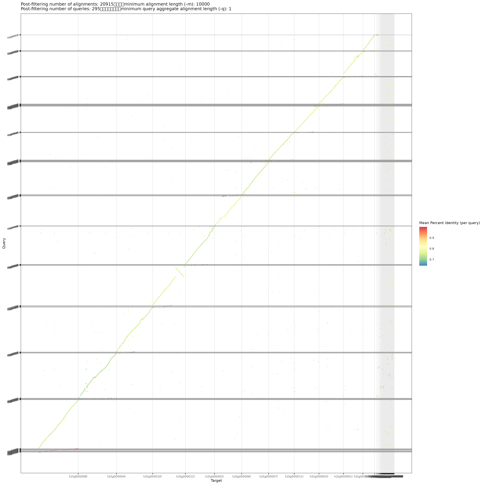

- <b><i>Chromosome-scale homologous pairs</b></i>

    | hap1 contig | Length (bp) | hap2 contig | Length (bp) | Identity (%) | hap1&nbsp;cov (%) | hap2&nbsp;cov (%) | Note          |
    | :---------- | ----------: | :---------- | ----------: | -----------: | ----------------: | ----------------: | :------------ |
    | h1tg000003l |  65,682,487 | h2tg000008l |  61,702,390 |        95.77 |                55 |                58 |               |
    | h1tg000295l |  60,519,633 | h2tg000004l |  59,378,024 |        95.55 |                48 |                49 |               |
    | h1tg000007l |  60,272,560 | h2tg000010l |  56,292,565 |        95.74 |                55 |                57 |               |
    | h1tg000004l |  54,056,000 | h2tg000012l |  51,144,738 |        95.94 |                71 |                72 | 5S&nbsp;rDNA  |
    | h1tg000001l |  51,330,377 | h2tg000002l |  45,193,510 |        95.78 |                51 |                55 |               |
    | h1tg000009l |  43,801,841 | h2tg000007l |  41,957,526 |        95.73 |                59 |                60 |               |
    | h1tg000006l |  39,646,165 | h2tg000006l |  42,197,018 |        96.04 |                71 |                67 |               |
    | h1tg000005l |  36,525,735 | h2tg000011l |  39,826,388 |        95.95 |                70 |                66 |               |
    | h1tg000012l |  35,966,191 | h2tg000001l |  38,016,435 |        95.82 |                58 |                57 |               |
    | h1tg000002l |  34,632,737 | h2tg000003l |  38,512,742 |        96.01 |                66 |                62 |               |
    | h1tg000008l |  33,387,292 | h2tg000009l |  30,255,385 |        95.66 |                54 |                60 |               |
    | h1tg000014l |  20,449,059 | h2tg000005l |  18,310,092 |        95.70 |                51 |                53 | 45S&nbsp;rDNA |

- <b><i>Placement of the small contigs (< 10 Mb)</b></i>

    | Haplotype | Small contigs |    ≥80% covered by a chromosome&nbsp;contig    | Covered&nbsp;by&nbsp;a small&nbsp;contig |     50–80% covered    | No partner |
    | :-------- | ------------: | :--------------------------------------------- | ---------------------------------------: | --------------------: | ---------: |
    | hap1      |           291 | 279 (26.89 Mb)<br>- ≥99: 265<br>- 94-99%: 14 |                              2 (0.95 Mb) | 2&nbsp;(0.19&nbsp;Mb) |          8 |
    | hap2      |           215 | 214 (28.46 Mb)<br>- ≥99: 204<br>- 94-99%: 10 |                                        0 | 1&nbsp;(1.85&nbsp;Mb) |          0 |

### <a id="05c">Generating parental k-mers</a>
```
# change working directory
cd 06_parental_assign/parents/

# E. decipiens
wget https://sra-downloadb.be-md.ncbi.nlm.nih.gov/sos9/sra-pub-zq-922/SRR025/25119/SRR25119757/SRR25119757.lite.1
fasterq-dump SRR25119757.lite.1 --split-files --threads 16 --progress && pigz -p 16 *.fastq
mv SRR25119757.lite.1_1.fastq.gz E_decipiens_R1.fastq.gz
mv SRR25119757.lite.1_2.fastq.gz E_decipiens_R2.fastq.gz

# E. virginea
wget https://sra-downloadb.be-md.ncbi.nlm.nih.gov/sos9/sra-pub-zq-922/SRR025/25119/SRR25119786/SRR25119786.lite.1
fasterq-dump SRR25119786.lite.1 --split-files --threads 16 --progress && pigz -p 16 *.fastq
mv SRR25119786.lite.1_1.fastq.gz E_virginea_R1.fastq.gz
mv SRR25119786.lite.1_2.fastq.gz E_virginea_R2.fastq.gz

# create a meryl database with k=31
meryl k=31 count threads=128 \
    output E_virginea.meryl \
    E_virginea_R1.fastq.gz E_virginea_R2.fastq.gz

meryl k=31 count threads=128 memory=1200G \
    output E_decipiens.meryl \
    E_decipiens_R1.fastq.gz E_decipiens_R2.fastq.gz

# filter out k-mers <6 occurrences
meryl threads=128 greater-than 5 \
    output E_virginea.filtered.meryl \
    E_virginea.meryl

meryl threads=128 greater-than 5 \
    output E_decipiens.filtered.meryl \
    E_decipiens.meryl

# extract unique k-mers
meryl difference threads=128 \
    E_virginea.filtered.meryl E_decipiens.filtered.meryl \
    output E_virginea.unique.meryl

meryl difference threads=128 \
    E_decipiens.filtered.meryl E_virginea.filtered.meryl \
    output E_decipiens.unique.meryl

meryl symmetric-difference threads=128 \
    E_decipiens.filtered.meryl E_virginea.filtered.meryl \
    output union.unique.meryl

# run Merqury
mkdir merqury && cd merqury

merqury.sh \
    ../union.unique.meryl \
    ../E_virginea.unique.meryl \
    ../E_decipiens.unique.meryl \
    ../../../05_nuclear_qc/03_filtered/hap1.purged.fa \
    ../../../05_nuclear_qc/03_filtered/hap2.purged.fa \
    E_phylacis_map

# change working directory
cd ../../..
```

### Phased blocks per haplotype (blocks broken by ≥ 100 opposite hapmers spanning ≥ 20 kb)
|                  Haplotype 1                  |                    Haplotype 2                 |
| :-------------------------------------------: | :--------------------------------------------: |
| 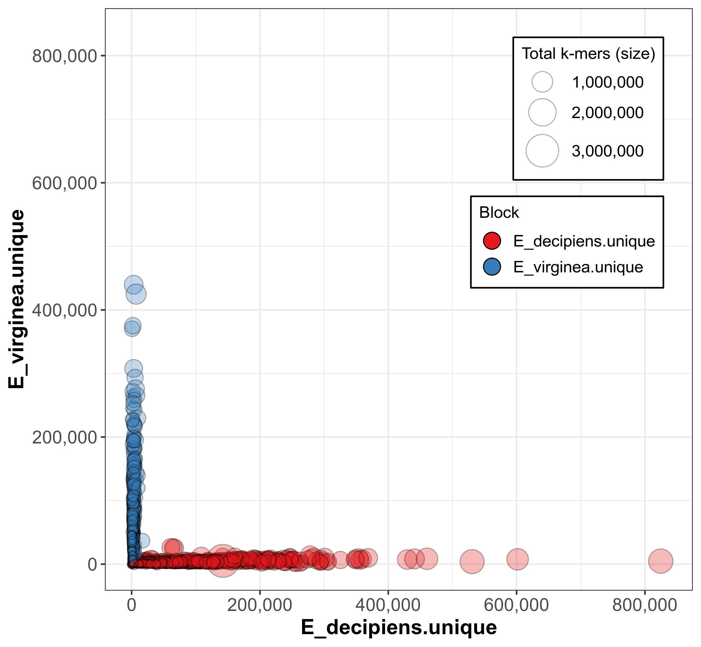 |   |

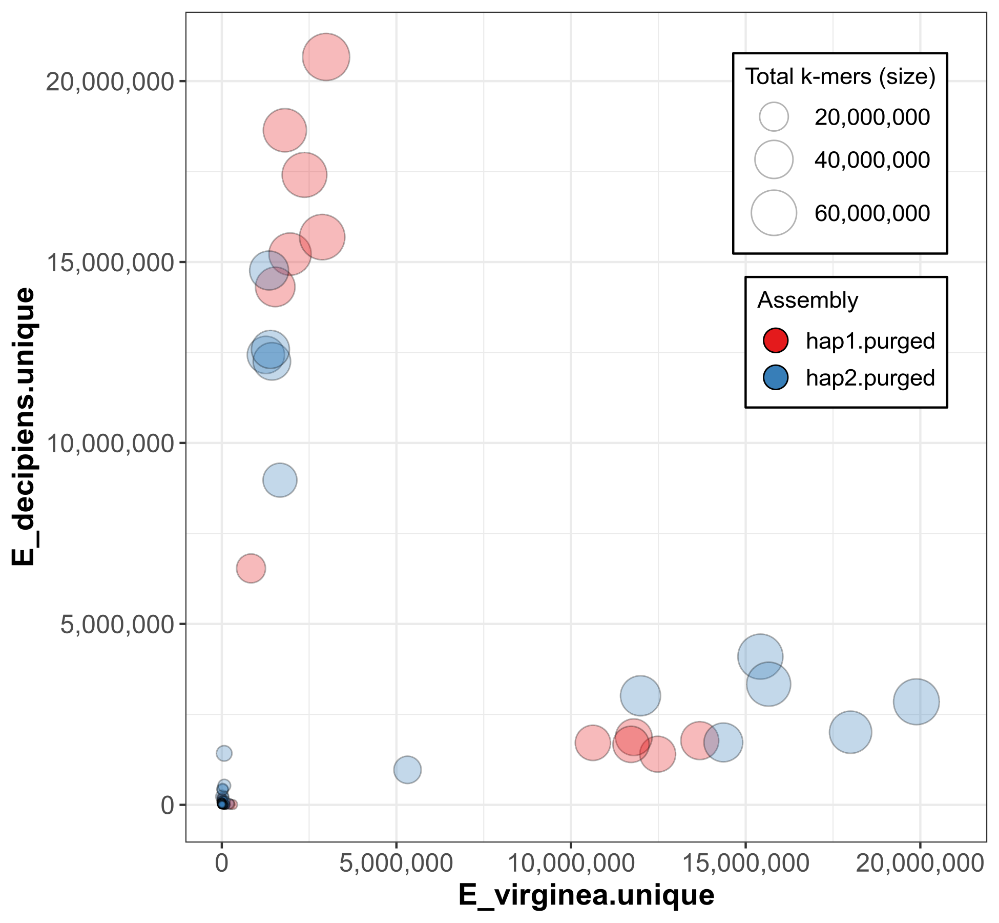

| Assembly | Blocks | Total (Mb) | Mean (kb) | N50 (kb) | Max (Mb) | Switch&nbsp;hapmers (M) | Total&nbsp;hapmers (M) | Switch&nbsp;error (%) | Minority&nbsp;hapmers (%) |
| :------- | -----: | ---------: | --------: | -------: | -------: | -----------------: | ----------------: | ---------------: | -------------------: |
| hap1     | 21,091 |      563.3 |      26.7 |    101.1 |     3.09 |               14.7 |             200.8 |             7.31 |                 11.8 |
| hap2     | 22,021 |      551.1 |      25.0 |     91.8 |     2.53 |               15.2 |             197.3 |             7.71 |                 13.2 | 

### Parental assignment of the chromosome pairs (V: virginea-specfic; D: decipiens-specific)

| hap1 contig | V&nbsp;(%) | D&nbsp;(%) | Minority&nbsp;(%) | Putative&nbsp;Parent | hap2 contig | V&nbsp;(%) | D&nbsp;(%) | Minority&nbsp;(%) | Putative&nbsp;Parent |
| :---------- | ----: | ----: | -----------: | :------------- | :---------- | ----: | ----: | -----------: | :------------- |
| h1tg000003l |   4.5 |  31.5 |         12.6 | decipiens-like | h2tg000008l |  32.2 |   4.6 |         12.5 | virginea-like  |
| h1tg000295l |   4.0 |  29.7 |         12.0 | decipiens-like | h2tg000004l |  26.0 |   6.9 |         21.0 | virginea-like  |
| h1tg000007l |   4.8 |  26.0 |         15.5 | decipiens-like | h2tg000010l |  27.8 |   5.9 |         17.6 | virginea-like  |
| h1tg000004l |   3.3 |  34.5 |          8.8 | decipiens-like | h2tg000012l |  35.2 |   3.9 |         10.0 | virginea-like  |
| h1tg000001l |   3.8 |  29.6 |         11.4 | decipiens-like | h2tg000002l |  26.5 |   6.7 |         20.1 | virginea-like  |
| h1tg000009l |   3.5 |  32.7 |          9.7 | decipiens-like | h2tg000007l |  34.2 |   4.1 |         10.7 | virginea-like  |
| h1tg000006l |  34.5 |   4.5 |         11.5 | virginea-like  | h2tg000006l |   3.2 |  35.0 |          8.4 | decipiens-like |
| h1tg000005l |  32.3 |   5.1 |         13.7 | virginea-like  | h2tg000011l |   3.5 |  31.6 |         10.0 | decipiens-like |
| h1tg000012l |  32.9 |   4.7 |         12.5 | virginea-like  | h2tg000001l |   3.3 |  32.7 |          9.2 | decipiens-like |
| h1tg000002l |  36.0 |   4.0 |         10.1 | virginea-like  | h2tg000003l |   3.7 |  31.8 |         10.5 | decipiens-like |
| h1tg000008l |  31.8 |   5.1 |         13.9 | virginea-like  | h2tg000009l |   5.5 |  29.7 |         15.7 | decipiens-like |
| h1tg000014l |   4.1 |  31.9 |         11.4 | decipiens-like | h2tg000005l |  30.1 |   5.5 |         15.4 | virginea-like  |

From these results, the 12 longest contigs seem to clearly prefer one parent over another. The ~12% minority hapmers likely reflect homozygous regions across the two haplotypes, resulting in a frequent switching between decipiens- and virginea-derived kmers. Now, let's try to redo this analysis using the filtered ONT reads to assess k-mer completeness.

```
# change working directory
cd 06_parental_assign/e_phylacis/

# create a meryl database with k=31
meryl k=31 count threads=128 \
    output E_phylacis.meryl \
    ../../01_qc/02_chopper/E_phylacis_filtered.fastq.gz

# check for trough
meryl statistics E_phylacis.meryl | head -n 30

# filter out k-mers <10 occurrences
meryl threads=128 greater-than 9 \
    output E_phylacis.filtered.meryl \
    E_phylacis.meryl

# run Merqury
mkdir merqury && cd merqury

merqury.sh \
    ../E_phylacis.filtered.meryl \
    ../../parents/E_virginea.unique.meryl \
    ../../parents/E_decipiens.unique.meryl \
    ../../../05_nuclear_qc/03_filtered/hap1.purged.fa \
    ../../../05_nuclear_qc/03_filtered/hap2.purged.fa \
    E_phylacis_trio

# change working directory
cd ../../..
```

### K-mer copy number spectrum

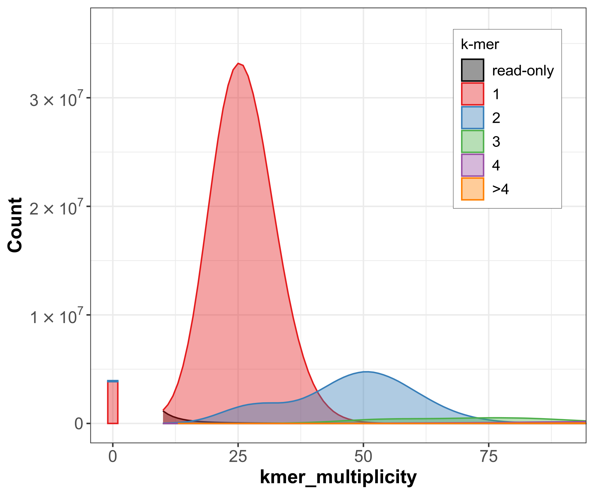

### Species-specific k-mers found in each haplotype

| Hapmer set            |       Total | In&nbsp;hap1 (%) | In&nbsp;hap2 (%) | In&nbsp;union (%) | In&nbsp;both&nbsp;haplotypes (% of those in union) |
| :-------------------- | ----------: | ---------------: | ---------------: | ----------------: | -------------------------------------------------: |
| E.&nbsp;virginea–specific  | 334,998,162 |        22.0 |        30.2 |         46.7 |                                     11.7 |
| E.&nbsp;decipiens–specific | 401,534,689 |        26.5 |        19.2 |         40.2 |                                     13.7 |

> [!NOTE]
> The phased blocks and parental assignment results are identical to the previous run.

Consistent with `hifiasm` and `GenomeScope2`, the heterozygous k‑mers (red, one copy in the union) peak at ~27x, while homozygous k‑mers (blue, two copies — one per haplotype) peak at ~52x. The elevated number of asm-only k-mers (i.e., x==0) is caused by the threshold set when generating the `meryl` database (i.e., at least 10 occurrences). Moreover, the k-mer completeness table affirms that the ~12% minority hapmers on each haplotype (alongside ~7% switch error and relatively-low 100kb N50) are due to shared ancestry between the two parents.

### <a id="05d">Mapping to reference assemblies</a>
I first downloaded the genome assemblies of both *E. decipiens* and *E. virginea* from NCBI, and changed the chromosome names to 1-11 for readability.
```
# change working directory
cd 06_parental_assign/parents/

# download the reference assemblies
datasets download genome accession GCA_014182575.1 --filename E_decipiens.zip
unzip E_decipiens.zip -d E_decipiens_assemblies
mv E_decipiens_assemblies/ncbi_dataset/data/GCA_014182575.1/*.fna E_decipiens_raw.fa

datasets download genome accession GCA_014182375.1 --filename E_virginea.zip
unzip E_virginea.zip -d E_virginea_assemblies
mv E_virginea_assemblies/ncbi_dataset/data/GCA_014182375.1/*.fna E_virginea_raw.fa

# update the chromosome names
awk '
BEGIN {
    map["CM024609.1"] = "1";
    map["CM024610.1"] = "2";
    map["CM024611.1"] = "3";
    map["CM024612.1"] = "4";
    map["CM024613.1"] = "5";
    map["CM024614.1"] = "6";
    map["CM024615.1"] = "7";
    map["CM024616.1"] = "8";
    map["CM024617.1"] = "9";
    map["CM024618.1"] = "10";
    map["CM024619.1"] = "11";
    map["CM024632.1"] = "Pltd";
}
/^>/ {
    header = $1;
    sub(/^>/, "", header);
    if (header in map) {
        print ">" map[header];
    } else {
        print $0; # Leaves unplaced scaffolds/contigs unchanged
    }
    next;
}
{ print }
' E_decipiens_raw.fa > E_decipiens.fa

# Virginea
awk '
BEGIN {
    map["CM024514.1"] = "1";
    map["CM024515.1"] = "2";
    map["CM024516.1"] = "3";
    map["CM024517.1"] = "4";
    map["CM024518.1"] = "5";
    map["CM024519.1"] = "6";
    map["CM024520.1"] = "7";
    map["CM024521.1"] = "8";
    map["CM024522.1"] = "9";
    map["CM024523.1"] = "10";
    map["CM024524.1"] = "11";
    map["CM024525.1"] = "Pltd";
}
/^>/ {
    header = $1;
    sub(/^>/, "", header);
    if (header in map) {
        print ">" map[header];
    } else {
        print $0;
    }
    next;
}
{ print }
' E_virginea_raw.fa > E_virginea.fa

# change working directory
cd ../..
```

Now, we should map each haplotype to each reference assembly.
```
# set variables
ref_decipiens=06_parental_assign/parents/E_decipiens.fa
ref_virginea=06_parental_assign/parents/E_virginea.fa
hap1=05_nuclear_qc/03_filtered/hap1.purged.fa
hap2=05_nuclear_qc/03_filtered/hap2.purged.fa
outdir=06_parental_assign/alignment/

# hap1 aligned to decipiens
minimap2 -x asm20 -N 1000 -c --secondary=no -t 128 $ref_decipiens $hap1 > "${outdir}/hap1_vs_decipiens.paf"

# hap1 aligned to virginea
minimap2 -x asm20 -N 1000 -c --secondary=no -t 128 $ref_virginea $hap1 > "${outdir}/hap1_vs_virginea.paf"

# hap2 aligned to decipiens
minimap2 -x asm20 -N 1000 -c --secondary=no -t 128 $ref_decipiens $hap2 > "${outdir}/hap2_vs_decipiens.paf"

# hap2 aligned to virginea
minimap2 -x asm20 -N 1000 -c --secondary=no -t 128 $ref_virginea $hap2 > "${outdir}/hap2_vs_virginea.paf"
```

I modified the bash script from the <a href="https://github.com/roblanf/MM_genome/tree/genome_assembly">`genome_assembly`</a> branch to score each contig on its percentage of aligned sites (alignments ≥1 kb at ≥80% identity) and alignment identity (see <a href="./scripts/dv_scoring.py">here</a>). 
```
python3 scripts/dv_scoring.py \
    --h1h2   05_nuclear_qc/04_alignment/h1_vs_h2.paf \
    --h1-dec 06_parental_assign/alignment/hap1_vs_decipiens.paf \
    --h1-vir 06_parental_assign/alignment/hap1_vs_virginea.paf \
    --h2-dec 06_parental_assign/alignment/hap2_vs_decipiens.paf \
    --h2-vir 06_parental_assign/alignment/hap2_vs_virginea.paf \
    --blob1  03_qc/hap1_btk.tsv \
    --blob2  03_qc/hap2_btk.tsv \
    --md  06_parental_assign/alignment/dv_scoring.md \
    --tsv 06_parental_assign/alignment/dv_scoring.tsv
```

> [!NOTE]
> - **decipiens**: Δ ID ≥ +0.5
> - **virginea** : Δ ID ≤ −0.5
> - **ambiguous**: -0.5 ≤ Δ ID ≤ +0.5

<details>
<summary><i>Click here to view the full table</i></summary>

| Contig      | Hap  |     Length |  GC% |   Cov | Phylum       | Chr&nbsp;(D) | Chr&nbsp;(V) | %&nbsp;Aligned&nbsp;(D) | %&nbsp;Aligned&nbsp;(V) | %&nbsp;ID&nbsp;(D) | %&nbsp;ID&nbsp;(V) | Δ&nbsp;ID | Aligned&nbsp;ratio | Call      | Partner&nbsp;contig | Partner&nbsp;Δ&nbsp;ID | Partner&nbsp;call | Reciprocal |
| :---------- | :--- | ---------: | ---: | ----: | :----------- | :---------------- | :---------------- | ------------------: | -----------------: | -------------: | ------------: | -----: | ------------: | :-------- | :---------- | -----------: | :----------- | :--------- |
| h1tg000003l | hap1 | 65,682,487 | 39.5 |  65.6 | Streptophyta | 8                 | 8                 |                80.4 |               65.5 |          97.65 |         95.48 |  +2.17 |          1.23 | decipiens | h2tg000008l |        -2.34 | virginea     | yes        |
| h1tg000295l | hap1 | 60,519,633 | 39.3 |  68.5 | Streptophyta | 5                 | 5                 |                70.7 |               58.5 |          97.05 |         94.90 |  +2.14 |          1.21 | decipiens | h2tg000004l |        -2.37 | virginea     | yes        |
| h1tg000007l | hap1 | 60,272,560 | 39.4 |  67.6 | Streptophyta | 3                 | 3                 |                70.9 |               57.8 |          96.99 |         95.22 |  +1.77 |          1.23 | decipiens | h2tg000010l |        -2.06 | virginea     | yes        |
| h1tg000004l | hap1 | 54,056,000 | 39.8 |  65.8 | Streptophyta | 6                 | 6                 |                85.8 |               70.4 |          97.99 |         95.61 |  +2.38 |          1.22 | decipiens | h2tg000012l |        -2.63 | virginea     | yes        |
| h1tg000001l | hap1 | 51,330,377 | 39.3 |  65.7 | Streptophyta | 7                 | 7                 |                78.5 |               63.0 |          97.12 |         95.03 |  +2.09 |          1.25 | decipiens | h2tg000002l |        -1.86 | virginea     | yes        |
| h1tg000009l | hap1 | 43,801,841 | 39.6 |  65.3 | Streptophyta | 1                 | 1                 |                82.4 |               66.7 |          97.65 |         95.41 |  +2.24 |          1.24 | decipiens | h2tg000007l |        -2.68 | virginea     | yes        |
| h1tg000006l | hap1 | 39,646,165 | 39.6 |  72.1 | Streptophyta | 11                | 11                |                73.0 |               86.5 |          95.70 |         98.34 |  -2.64 |          0.84 | virginea  | h2tg000006l |        +2.52 | decipiens    | yes        |
| h1tg000005l | hap1 | 36,525,735 | 39.7 |  74.0 | Streptophyta | 9                 | 9                 |                71.1 |               85.1 |          95.55 |         97.98 |  -2.44 |          0.84 | virginea  | h2tg000011l |        +2.27 | decipiens    | yes        |
| h1tg000012l | hap1 | 35,966,191 | 39.4 |  75.4 | Streptophyta | 4                 | 4                 |                68.3 |               83.7 |          95.51 |         97.88 |  -2.38 |          0.82 | virginea  | h2tg000001l |        +2.55 | decipiens    | yes        |
| h1tg000002l | hap1 | 34,632,737 | 39.9 |  70.5 | Streptophyta | 10                | 10                |                72.7 |               87.1 |          95.74 |         98.31 |  -2.57 |          0.84 | virginea  | h2tg000003l |        +2.24 | decipiens    | yes        |
| h1tg000008l | hap1 | 33,387,292 | 39.6 |  71.8 | Streptophyta | 2                 | 2                 |                71.6 |               79.7 |          95.39 |         97.67 |  -2.28 |          0.90 | virginea  | h2tg000009l |        +1.97 | decipiens    | yes        |
| h1tg000014l | hap1 | 20,449,059 | 40.1 |  70.4 | Streptophyta | 2                 | 2                 |                76.1 |               60.9 |          97.21 |         95.34 |  +1.87 |          1.25 | decipiens | h2tg000005l |        -2.26 | virginea     | yes        |
| h1tg000058l | hap1 |    890,562 | 41.5 |  82.6 | Streptophyta | JABKBM010000014.1 | 5                 |                65.0 |               59.9 |          86.44 |         85.81 |  +0.63 |          1.09 | decipiens | h2tg000019l |        +3.83 | decipiens    | no         |
| h1tg000071l | hap1 |    674,550 | 39.4 |  73.1 | Streptophyta | 7                 | 6                 |                46.3 |               88.9 |          94.34 |         97.40 |  -3.05 |          0.52 | virginea  | h2tg000012l |        -2.63 | virginea     | no         |
| h1tg000055l | hap1 |    576,070 | 39.7 |  53.3 | Streptophyta | 8                 | 8                 |                63.7 |               95.5 |          94.35 |         99.27 |  -4.91 |          0.67 | virginea  | h2tg000008l |        -2.34 | virginea     | no         |
| h1tg000026l | hap1 |    373,533 | 40.1 | 243.4 | Streptophyta | 11                | 7                 |               100.0 |               71.3 |          99.77 |         93.56 |  +6.21 |          1.40 | decipiens | h2tg000006l |        +2.52 | decipiens    | no         |
| h1tg000039l | hap1 |    365,422 | 38.3 |  76.6 | Streptophyta | 8                 | 8                 |                93.1 |               97.2 |          96.04 |         98.59 |  -2.54 |          0.96 | virginea  | h2tg000008l |        -2.34 | virginea     | no         |
| h1tg000059l | hap1 |    356,182 | 53.2 | 290.4 | Streptophyta | 2                 | 3                 |                99.4 |               99.2 |          96.17 |         97.86 |  -1.69 |          1.00 | virginea  | h2tg000005l |        -2.26 | virginea     | no         |
| h1tg000070l | hap1 |    313,939 | 38.5 |  39.3 | Streptophyta | 11                | 11                |                75.4 |               80.3 |          98.05 |         94.67 |  +3.38 |          0.94 | decipiens | h2tg000006l |        +2.52 | decipiens    | no         |
| h1tg000033l | hap1 |    297,002 | 55.0 | 123.1 | Streptophyta | 2                 | 2                 |                98.5 |               89.2 |          97.80 |         97.53 |  +0.28 |          1.10 | ambiguous | h2tg000005l |        -2.26 | virginea     | no         |
| h1tg000150l | hap1 |    273,399 | 40.6 |  70.4 | Streptophyta | 8                 | 8                 |                54.4 |               65.3 |          94.06 |         94.35 |  -0.29 |          0.83 | ambiguous | h2tg000008l |        -2.34 | virginea     | no         |
| h1tg000047l | hap1 |    252,734 | 39.4 |  68.1 | Streptophyta | 8                 | 8                 |                69.8 |               79.8 |          95.97 |         95.16 |  +0.81 |          0.87 | decipiens | h2tg000008l |        -2.34 | virginea     | yes        |
| h1tg000135l | hap1 |    241,662 | 40.1 |  40.1 | Streptophyta | 10                | 10                |                81.0 |               71.6 |          96.84 |         95.73 |  +1.11 |          1.13 | decipiens | h2tg000003l |        +2.24 | decipiens    | no         |
| h1tg000122l | hap1 |    240,915 | 39.8 |  33.2 | Streptophyta | 9                 | 9                 |               100.0 |               81.3 |          98.96 |         97.00 |  +1.96 |          1.23 | decipiens | h2tg000011l |        +2.27 | decipiens    | no         |
| h1tg000081l | hap1 |    237,998 | 39.6 |  61.2 | Streptophyta | 3                 | 3                 |                60.9 |               56.4 |          94.91 |         95.72 |  -0.81 |          1.08 | virginea  | h2tg000010l |        -2.06 | virginea     | no         |
| h1tg000038l | hap1 |    232,632 | 40.0 |  46.9 | Streptophyta | 4                 | 4                 |                94.2 |               86.6 |          97.44 |         95.17 |  +2.28 |          1.09 | decipiens | h2tg000001l |        +2.55 | decipiens    | no         |
| h1tg000213l | hap1 |    224,856 | 38.6 |  78.9 | Streptophyta | 5                 | 5                 |                71.7 |               89.3 |          94.88 |         97.25 |  -2.37 |          0.80 | virginea  | h2tg000004l |        -2.37 | virginea     | no         |
| h1tg000329l | hap1 |    217,880 | 40.8 |  47.8 | Streptophyta | 5                 | 5                 |                47.9 |               67.9 |          93.12 |         92.35 |  +0.77 |          0.71 | decipiens | h2tg000004l |        -2.37 | virginea     | yes        |
| h1tg000067l | hap1 |    216,612 | 39.9 |  46.8 | Streptophyta | 6                 | 11                |                73.8 |               95.0 |          93.70 |         97.66 |  -3.96 |          0.78 | virginea  | h2tg000012l |        -2.63 | virginea     | no         |
| h1tg000108l | hap1 |    214,375 | 39.1 |  96.4 | Streptophyta | 7                 | 7                 |                76.0 |               69.3 |          93.03 |         92.92 |  +0.12 |          1.10 | ambiguous | h2tg000001l |        +2.55 | decipiens    | no         |
| h1tg000045l | hap1 |    199,013 | 39.1 |  44.3 | Streptophyta | 8                 | 8                 |                88.1 |               90.2 |          94.78 |         97.22 |  -2.44 |          0.98 | virginea  | h2tg000008l |        -2.34 | virginea     | no         |
| h1tg000027l | hap1 |    197,600 | 40.4 | 166.5 | Streptophyta | 9                 | 8                 |                44.8 |               10.0 |          81.67 |         87.51 |  -5.84 |          4.49 | virginea  | h2tg000004l |        -2.37 | virginea     | no         |
| h1tg000169l | hap1 |    194,925 | 39.8 |  51.0 | Streptophyta | 11                | 11                |                81.4 |               90.5 |          95.60 |         95.07 |  +0.53 |          0.90 | decipiens | h2tg000006l |        +2.52 | decipiens    | no         |
| h1tg000236l | hap1 |    192,890 | 39.1 |  57.9 | Streptophyta | 10                | 7                 |                76.8 |               77.6 |          93.96 |         93.32 |  +0.64 |          0.99 | decipiens | h2tg000003l |        +2.24 | decipiens    | no         |
| h1tg000060l | hap1 |    191,742 | 37.7 |  67.9 | Streptophyta | 7                 | 7                 |                70.8 |              100.0 |          94.50 |         99.65 |  -5.15 |          0.71 | virginea  | h2tg000002l |        -1.86 | virginea     | no         |
| h1tg000086l | hap1 |    188,388 | 39.4 |  49.5 | Streptophyta | 11                | 11                |                83.9 |               80.9 |          97.40 |         94.61 |  +2.79 |          1.04 | decipiens | h2tg000006l |        +2.52 | decipiens    | no         |
| h1tg000079l | hap1 |    188,018 | 39.4 |  42.8 | Streptophyta | 11                | 11                |                99.7 |               82.7 |          98.47 |         95.85 |  +2.62 |          1.21 | decipiens | h2tg000006l |        +2.52 | decipiens    | no         |
| h1tg000048l | hap1 |    186,908 | 39.0 |  72.4 | Streptophyta | 3                 | 3                 |                47.5 |               79.5 |          94.42 |         95.91 |  -1.49 |          0.60 | virginea  | h2tg000010l |        -2.06 | virginea     | no         |
| h1tg000230l | hap1 |    184,462 | 38.2 |  49.0 | Streptophyta | 4                 | 4                 |                92.1 |               80.2 |          97.69 |         94.47 |  +3.21 |          1.15 | decipiens | h2tg000001l |        +2.55 | decipiens    | no         |
| h1tg000240l | hap1 |    174,109 | 37.4 |  43.6 | Streptophyta | 7                 | 7                 |                72.8 |               99.9 |          95.14 |         99.07 |  -3.93 |          0.73 | virginea  | h2tg000002l |        -1.86 | virginea     | no         |
| h1tg000022l | hap1 |    170,643 | 38.1 |  61.9 | Streptophyta | 2                 | 2                 |                58.1 |               45.0 |          94.55 |         94.20 |  +0.35 |          1.29 | ambiguous | h2tg000005l |        -2.26 | virginea     | no         |
| h1tg000092l | hap1 |    166,648 | 39.6 |  93.6 | Streptophyta | 5                 | 5                 |                76.5 |              100.0 |          95.28 |         99.32 |  -4.04 |          0.77 | virginea  | h2tg000004l |        -2.37 | virginea     | no         |
| h1tg000173l | hap1 |    162,650 | 38.7 |  50.8 | Streptophyta | 4                 | 4                 |                91.8 |               67.2 |          98.19 |         94.10 |  +4.09 |          1.37 | decipiens | h2tg000001l |        +2.55 | decipiens    | no         |
| h1tg000082l | hap1 |    162,411 | 39.9 |  33.7 | Streptophyta | 1                 | 1                 |                87.6 |               99.8 |          96.74 |         98.92 |  -2.18 |          0.88 | virginea  | h2tg000007l |        -2.68 | virginea     | no         |
| h1tg000037l | hap1 |    161,373 | 37.8 |  43.0 | Streptophyta | 9                 | 9                 |                92.8 |               62.0 |          98.29 |         95.32 |  +2.97 |          1.50 | decipiens | h2tg000011l |        +2.27 | decipiens    | no         |
| h1tg000087l | hap1 |    160,192 | 38.5 |  59.7 | Streptophyta | 4                 | 4                 |                97.2 |               66.7 |          97.94 |         94.96 |  +2.99 |          1.46 | decipiens | h2tg000001l |        +2.55 | decipiens    | no         |
| h1tg000203l | hap1 |    159,337 | 40.5 | 144.3 | Streptophyta | 2                 | 2                 |                53.4 |               56.1 |          90.33 |         91.14 |  -0.81 |          0.95 | virginea  | h2tg000009l |        +1.97 | decipiens    | yes        |
| h1tg000288l | hap1 |    156,792 | 38.5 |  69.5 | Streptophyta | 2                 | 2                 |                42.3 |               63.3 |          91.57 |         94.92 |  -3.35 |          0.67 | virginea  | h2tg000005l |        -2.26 | virginea     | no         |
| h1tg000252l | hap1 |    154,916 | 38.9 | 103.0 | Streptophyta | 6                 | 7                 |                58.5 |              100.0 |          97.28 |         98.68 |  -1.41 |          0.58 | virginea  | h2tg000002l |        -1.86 | virginea     | no         |
| h1tg000106l | hap1 |    154,828 | 39.0 |  63.0 | Streptophyta | 8                 | 8                 |                72.0 |               72.6 |          93.93 |         95.01 |  -1.08 |          0.99 | virginea  | h2tg000008l |        -2.34 | virginea     | no         |
| h1tg000290l | hap1 |    153,569 | 38.9 |  71.1 | Streptophyta | 3                 | 10                |                74.2 |               64.3 |          93.86 |         94.11 |  -0.25 |          1.16 | ambiguous | h2tg000010l |        -2.06 | virginea     | no         |
| h1tg000328l | hap1 |    152,637 | 39.4 |  59.7 | Streptophyta | 4                 | 8                 |                99.2 |               76.3 |          98.47 |         96.42 |  +2.05 |          1.30 | decipiens | h2tg000001l |        +2.55 | decipiens    | no         |
| h1tg000062l | hap1 |    150,044 | 40.6 |  46.2 | Streptophyta | 8                 | 8                 |                83.5 |               96.2 |          95.62 |         98.58 |  -2.96 |          0.87 | virginea  | h2tg000008l |        -2.34 | virginea     | no         |
| h1tg000109l | hap1 |    143,943 | 40.0 |  55.9 | Streptophyta | 5                 | 5                 |                68.5 |              100.0 |          94.73 |         98.54 |  -3.81 |          0.69 | virginea  | h2tg000004l |        -2.37 | virginea     | no         |
| h1tg000251l | hap1 |    143,285 | 38.9 |  71.3 | Streptophyta | 8                 | 8                 |                64.5 |               57.0 |          93.44 |         94.96 |  -1.52 |          1.13 | virginea  | h2tg000008l |        -2.34 | virginea     | no         |
| h1tg000241l | hap1 |    141,655 | 40.1 |  51.2 | Streptophyta | 7                 | 7                 |                60.3 |               99.7 |          95.33 |         98.65 |  -3.32 |          0.61 | virginea  | h2tg000002l |        -1.86 | virginea     | no         |
| h1tg000279l | hap1 |    141,228 | 39.2 |  54.0 | Streptophyta | 3                 | 3                 |                83.7 |               51.3 |          95.24 |         96.33 |  -1.09 |          1.63 | virginea  | h2tg000010l |        -2.06 | virginea     | no         |
| h1tg000190l | hap1 |    140,450 | 40.7 |  74.9 | no-hit       | 6                 | 6                 |                 4.5 |               86.9 |          81.79 |         82.40 |  -0.61 |          0.05 | virginea  | h2tg000004l |        -2.37 | virginea     | no         |
| h1tg000093l | hap1 |    139,552 | 39.4 |  50.2 | Streptophyta | 8                 | 6                 |                94.4 |               98.6 |          94.61 |         96.67 |  -2.06 |          0.96 | virginea  | h2tg000008l |        -2.34 | virginea     | no         |
| h1tg000187l | hap1 |    136,297 | 39.9 |  75.6 | Streptophyta | 11                | 11                |                76.6 |               82.8 |          95.46 |         94.27 |  +1.19 |          0.93 | decipiens | h2tg000006l |        +2.52 | decipiens    | no         |
| h1tg000301l | hap1 |    135,646 | 39.9 |  59.3 | Streptophyta | 2                 | 2                 |                72.6 |               91.3 |          95.72 |         96.86 |  -1.14 |          0.79 | virginea  | h2tg000005l |        -2.26 | virginea     | no         |
| h1tg000140l | hap1 |    133,362 | 40.0 |  51.1 | Streptophyta | 2                 | 2                 |                49.0 |               56.5 |          93.56 |         92.60 |  +0.96 |          0.87 | decipiens | h2tg000005l |        -2.26 | virginea     | yes        |
| h1tg000298l | hap1 |    129,761 | 37.8 |  39.9 | Streptophyta | 1                 | 1                 |                74.0 |              100.0 |          93.47 |         99.48 |  -6.01 |          0.74 | virginea  | h2tg000007l |        -2.68 | virginea     | no         |
| h1tg000098l | hap1 |    126,554 | 36.9 |  39.5 | Streptophyta | 8                 | 8                 |                88.2 |               81.9 |          94.67 |         95.91 |  -1.24 |          1.08 | virginea  | h2tg000008l |        -2.34 | virginea     | no         |
| h1tg000051l | hap1 |    124,889 | 37.9 |  84.0 | Streptophyta | 7                 | 7                 |                43.4 |               53.6 |          93.49 |         95.13 |  -1.64 |          0.81 | virginea  | h2tg000002l |        -1.86 | virginea     | no         |
| h1tg000172l | hap1 |    124,759 | 38.6 |  41.6 | Streptophyta | 11                | 11                |                95.6 |               87.0 |          97.97 |         95.04 |  +2.92 |          1.10 | decipiens | h2tg000006l |        +2.52 | decipiens    | no         |
| h1tg000258l | hap1 |    120,974 | 39.8 |  38.7 | Streptophyta | 3                 | 3                 |                87.1 |               98.8 |          95.63 |         98.29 |  -2.66 |          0.88 | virginea  | h2tg000010l |        -2.06 | virginea     | no         |
| h1tg000161l | hap1 |    119,217 | 39.3 |  55.1 | Streptophyta | 3                 | 3                 |                89.2 |               85.6 |          94.57 |         95.31 |  -0.75 |          1.04 | virginea  | h2tg000010l |        -2.06 | virginea     | no         |
| h1tg000153l | hap1 |    118,498 | 36.8 |  67.1 | Streptophyta | 6                 | 6                 |                69.7 |              100.0 |          94.92 |         99.59 |  -4.67 |          0.70 | virginea  | h2tg000012l |        -2.63 | virginea     | no         |
| h1tg000064l | hap1 |    117,344 | 38.4 | 121.5 | Streptophyta | 5                 | 5                 |                81.0 |               91.9 |          94.77 |         94.14 |  +0.63 |          0.88 | decipiens | h2tg000004l |        -2.37 | virginea     | yes        |
| h1tg000277l | hap1 |    115,230 | 38.4 |  45.8 | Streptophyta | 3                 | 3                 |                87.5 |               82.5 |          95.36 |         98.00 |  -2.64 |          1.06 | virginea  | h2tg000010l |        -2.06 | virginea     | no         |
| h1tg000186l | hap1 |    110,551 | 41.3 | 129.0 | Streptophyta | 7                 | 7                 |                47.8 |               42.2 |          92.62 |         94.22 |  -1.60 |          1.13 | virginea  | h2tg000002l |        -1.86 | virginea     | no         |
| h1tg000334l | hap1 |    109,400 | 38.6 |  95.4 | Streptophyta | 9                 | 9                 |               100.0 |               45.4 |          98.85 |         95.50 |  +3.35 |          2.20 | decipiens | h2tg000011l |        +2.27 | decipiens    | no         |
| h1tg000242l | hap1 |    109,382 | 40.7 |  52.5 | Streptophyta | 5                 | 5                 |                83.5 |              100.0 |          95.71 |         99.49 |  -3.78 |          0.84 | virginea  | h2tg000004l |        -2.37 | virginea     | no         |
| h1tg000107l | hap1 |    109,200 | 39.3 |  40.3 | Streptophyta | 2                 | 2                 |                78.8 |               84.1 |          95.55 |         98.75 |  -3.20 |          0.94 | virginea  | h2tg000005l |        -2.26 | virginea     | no         |
| h1tg000281l | hap1 |    108,470 | 39.8 |  32.3 | Streptophyta | 10                | 10                |                64.7 |               75.5 |          97.15 |         96.14 |  +1.01 |          0.86 | decipiens | h2tg000003l |        +2.24 | decipiens    | no         |
| h1tg000111l | hap1 |    108,286 | 39.9 |  62.9 | Streptophyta | 2                 | 2                 |                54.0 |              100.0 |          96.08 |         99.73 |  -3.65 |          0.54 | virginea  | h2tg000005l |        -2.26 | virginea     | no         |
| h1tg000221l | hap1 |    106,878 | 36.8 |  58.2 | Streptophyta | 6                 | 11                |                45.8 |               76.0 |          90.59 |         94.43 |  -3.84 |          0.60 | virginea  | h2tg000012l |        -2.63 | virginea     | no         |
| h1tg000113l | hap1 |    105,571 | 42.2 |  47.5 | Streptophyta | 5                 | 5                 |                68.5 |               68.8 |          95.44 |         97.66 |  -2.22 |          1.00 | virginea  | h2tg000004l |        -2.37 | virginea     | no         |
| h1tg000119l | hap1 |    104,002 | 38.6 |  49.2 | Streptophyta | 8                 | 8                 |                72.2 |               71.7 |          95.67 |         96.19 |  -0.52 |          1.01 | virginea  | h2tg000008l |        -2.34 | virginea     | no         |
| h1tg000084l | hap1 |    103,763 | 37.9 |  65.2 | Streptophyta | 4                 | 5                 |                80.3 |               70.2 |          97.39 |         94.14 |  +3.24 |          1.14 | decipiens | h2tg000001l |        +2.55 | decipiens    | no         |
| h1tg000205l | hap1 |    102,889 | 40.8 |  61.9 | Streptophyta | 6                 | 6                 |                48.9 |               74.8 |          92.80 |         94.59 |  -1.79 |          0.65 | virginea  | h2tg000012l |        -2.63 | virginea     | no         |
| h1tg000206l | hap1 |    102,031 | 41.4 |  86.2 | Streptophyta | 8                 | 3                 |                48.9 |               52.9 |          91.74 |         89.97 |  +1.77 |          0.93 | decipiens | h2tg000010l |        -2.06 | virginea     | yes        |
| h1tg000316l | hap1 |    101,730 | 41.7 |  88.1 | Streptophyta | JABKBM010000014.1 | 6                 |                67.0 |               79.9 |          84.37 |         83.86 |  +0.51 |          0.84 | decipiens | h2tg000004l |        -2.37 | virginea     | yes        |
| h1tg000260l | hap1 |    101,233 | 40.2 |  65.3 | Streptophyta | 7                 | 7                 |                84.4 |               98.9 |          92.21 |         97.24 |  -5.03 |          0.85 | virginea  | h2tg000002l |        -1.86 | virginea     | no         |
| h1tg000339l | hap1 |     99,918 | 39.4 |  67.7 | Streptophyta | 3                 | 3                 |                54.0 |               48.1 |          94.14 |         93.42 |  +0.71 |          1.12 | decipiens | h2tg000010l |        -2.06 | virginea     | yes        |
| h1tg000120l | hap1 |     99,369 | 39.8 |  60.4 | Streptophyta | 8                 | 8                 |                76.7 |               92.7 |          95.24 |         97.53 |  -2.29 |          0.83 | virginea  | h2tg000008l |        -2.34 | virginea     | no         |
| h1tg000152l | hap1 |     98,521 | 41.0 |  44.4 | Streptophyta | 11                | 11                |               100.0 |               78.1 |          98.76 |         96.91 |  +1.85 |          1.28 | decipiens | h2tg000006l |        +2.52 | decipiens    | no         |
| h1tg000183l | hap1 |     98,201 | 38.4 |  40.9 | Streptophyta | 9                 | 11                |                99.1 |               77.1 |          98.89 |         96.05 |  +2.84 |          1.29 | decipiens | h2tg000011l |        +2.27 | decipiens    | no         |
| h1tg000181l | hap1 |     96,651 | 43.0 |  34.3 | Streptophyta | 10                | 10                |                94.4 |               91.4 |          98.10 |         95.84 |  +2.26 |          1.03 | decipiens | h2tg000003l |        +2.24 | decipiens    | no         |
| h1tg000132l | hap1 |     96,432 | 39.8 |  34.4 | Streptophyta | 8                 | 8                 |                79.4 |               81.8 |          94.91 |         98.09 |  -3.18 |          0.97 | virginea  | h2tg000008l |        -2.34 | virginea     | no         |
| h1tg000315l | hap1 |     95,037 | 40.0 |  74.4 | Streptophyta | 7                 | 7                 |                45.7 |               66.5 |          92.33 |         90.81 |  +1.52 |          0.69 | decipiens | h2tg000002l |        -1.86 | virginea     | yes        |
| h1tg000282l | hap1 |     93,358 | 38.9 |  58.7 | Streptophyta | 11                | 11                |                80.8 |               67.2 |          96.74 |         95.40 |  +1.34 |          1.20 | decipiens | h2tg000006l |        +2.52 | decipiens    | no         |
| h1tg000028l | hap1 |     93,280 | 38.8 |  82.9 | Streptophyta | 11                | 8                 |                27.4 |               88.8 |          90.76 |         99.27 |  -8.51 |          0.31 | virginea  | h2tg000008l |        -2.34 | virginea     | no         |
| h1tg000110l | hap1 |     93,134 | 37.1 |  51.2 | Streptophyta | 7                 | 7                 |                57.9 |               80.1 |          93.68 |         93.12 |  +0.55 |          0.72 | decipiens | h2tg000002l |        -1.86 | virginea     | yes        |
| h1tg000393l | hap1 |     92,246 | 39.9 |  42.8 | Streptophyta | 2                 | 2                 |                67.7 |               59.0 |          93.01 |         92.94 |  +0.08 |          1.15 | ambiguous | h2tg000009l |        +1.97 | decipiens    | no         |
| h1tg000257l | hap1 |     92,205 | 38.6 |  66.3 | Streptophyta | 9                 | 9                 |                99.3 |               66.1 |          97.47 |         94.69 |  +2.78 |          1.50 | decipiens | h2tg000011l |        +2.27 | decipiens    | no         |
| h1tg000130l | hap1 |     91,628 | 40.3 |  36.5 | Streptophyta | 11                | 11                |                99.6 |               90.9 |          98.59 |         96.18 |  +2.41 |          1.10 | decipiens | h2tg000006l |        +2.52 | decipiens    | no         |
| h1tg000391l | hap1 |     90,779 | 39.7 |  84.3 | Streptophyta | 8                 | 8                 |                86.1 |               98.5 |          96.16 |         99.55 |  -3.39 |          0.87 | virginea  | h2tg000008l |        -2.34 | virginea     | no         |
| h1tg000174l | hap1 |     89,582 | 39.4 |  56.2 | Streptophyta | 1                 | 1                 |                92.6 |               90.8 |          95.27 |         95.69 |  -0.42 |          1.02 | ambiguous | h2tg000007l |        -2.68 | virginea     | no         |
| h1tg000214l | hap1 |     89,199 | 40.6 |  42.8 | Streptophyta | 5                 | 5                 |                77.6 |               91.6 |          94.66 |         98.64 |  -3.98 |          0.85 | virginea  | h2tg000004l |        -2.37 | virginea     | no         |
| h1tg000168l | hap1 |     88,341 | 39.8 |  40.0 | Streptophyta | 6                 | 7                 |                96.8 |               92.1 |          96.05 |         98.61 |  -2.56 |          1.05 | virginea  | h2tg000008l |        -2.34 | virginea     | no         |
| h1tg000018l | hap1 |     87,119 | 38.7 |  59.2 | Streptophyta | 9                 | 9                 |               100.0 |               81.1 |          98.77 |         95.33 |  +3.44 |          1.23 | decipiens | h2tg000011l |        +2.27 | decipiens    | no         |
| h1tg000176l | hap1 |     86,517 | 40.7 |  46.9 | Streptophyta | 5                 | 5                 |                52.4 |              100.0 |          94.80 |         99.42 |  -4.62 |          0.52 | virginea  | h2tg000004l |        -2.37 | virginea     | no         |
| h1tg000139l | hap1 |     86,328 | 40.6 |  53.3 | Streptophyta | 8                 | 8                 |                77.3 |               79.4 |          94.52 |         97.70 |  -3.18 |          0.97 | virginea  | h2tg000008l |        -2.34 | virginea     | no         |
| h1tg000080l | hap1 |     84,460 | 37.5 |  57.5 | Streptophyta | 6                 | 6                 |                94.0 |               93.4 |          97.11 |         99.31 |  -2.20 |          1.01 | virginea  | h2tg000012l |        -2.63 | virginea     | no         |
| h1tg000358l | hap1 |     84,247 | 38.3 |  52.4 | Streptophyta | 7                 | 7                 |                42.0 |               48.7 |          91.34 |         91.95 |  -0.61 |          0.86 | virginea  | h2tg000008l |        -2.34 | virginea     | no         |
| h1tg000243l | hap1 |     84,200 | 39.9 | 168.4 | Streptophyta | 7                 | 7                 |                77.3 |               62.2 |          92.87 |         92.10 |  +0.77 |          1.24 | decipiens | h2tg000002l |        -1.86 | virginea     | yes        |
| h1tg000023l | hap1 |     84,140 | 40.0 |  68.4 | Streptophyta | 7                 | 7                 |                58.9 |               89.9 |          94.50 |         98.49 |  -4.00 |          0.65 | virginea  | h2tg000002l |        -1.86 | virginea     | no         |
| h1tg000382l | hap1 |     84,136 | 40.4 |  40.7 | Streptophyta | 4                 | 4                 |                92.9 |               82.7 |          95.18 |         95.08 |  +0.10 |          1.12 | ambiguous | h2tg000001l |        +2.55 | decipiens    | no         |
| h1tg000222l | hap1 |     83,142 | 40.0 |  42.9 | Streptophyta | 8                 | 8                 |                67.0 |               61.0 |          96.82 |         95.66 |  +1.15 |          1.10 | decipiens | h2tg000008l |        -2.34 | virginea     | yes        |
| h1tg000145l | hap1 |     81,907 | 38.8 |  65.9 | Streptophyta | 9                 | 8                 |                72.2 |               67.3 |          94.94 |         95.20 |  -0.26 |          1.07 | ambiguous | h2tg000011l |        +2.27 | decipiens    | no         |
| h1tg000342l | hap1 |     81,593 | 42.8 | 166.4 | no-hit       | 10                | 5                 |                61.0 |               59.1 |          91.64 |         87.75 |  +3.89 |          1.03 | decipiens | h2tg000006l |        +2.52 | decipiens    | no         |
| h1tg000265l | hap1 |     80,777 | 40.0 |  43.1 | Streptophyta | 8                 | 7                 |                67.9 |              100.0 |          94.04 |         99.52 |  -5.48 |          0.68 | virginea  | h2tg000008l |        -2.34 | virginea     | no         |
| h1tg000147l | hap1 |     80,682 | 38.4 |  36.3 | Streptophyta | 8                 | 8                 |                82.6 |               92.8 |          95.58 |         97.83 |  -2.25 |          0.89 | virginea  | h2tg000008l |        -2.34 | virginea     | no         |
| h1tg000065l | hap1 |     80,116 | 39.1 |  61.4 | Streptophyta | 5                 | 5                 |                58.0 |               82.3 |          92.46 |         92.70 |  -0.24 |          0.70 | ambiguous | h2tg000004l |        -2.37 | virginea     | no         |
| h1tg000142l | hap1 |     79,777 | 39.0 |  72.7 | Streptophyta | 1                 | 1                 |                70.6 |               68.5 |          92.08 |         91.55 |  +0.53 |          1.03 | decipiens | h2tg000007l |        -2.68 | virginea     | yes        |
| h1tg000291l | hap1 |     79,175 | 38.9 |  53.9 | Streptophyta | 4                 | 10                |                65.8 |               64.3 |          91.51 |         88.67 |  +2.84 |          1.02 | decipiens | h2tg000001l |        +2.55 | decipiens    | no         |
| h1tg000035l | hap1 |     78,921 | 40.0 |  46.1 | Streptophyta | 6                 | 6                 |                64.9 |              100.0 |          95.38 |         99.73 |  -4.35 |          0.65 | virginea  | h2tg000012l |        -2.63 | virginea     | no         |
| h1tg000350l | hap1 |     78,695 | 38.4 | 124.9 | Streptophyta | 6                 | 7                 |                91.1 |               89.1 |          94.11 |         93.49 |  +0.62 |          1.02 | decipiens | h2tg000008l |        -2.34 | virginea     | yes        |
| h1tg000400l | hap1 |     78,168 | 38.5 |  35.4 | Streptophyta | 11                | 11                |                97.4 |               85.1 |          97.10 |         96.34 |  +0.76 |          1.15 | decipiens | h2tg000006l |        +2.52 | decipiens    | no         |
| h1tg000217l | hap1 |     78,165 | 39.8 |  46.0 | Streptophyta | 4                 | 4                 |                85.0 |               63.7 |          97.78 |         94.41 |  +3.37 |          1.33 | decipiens | h2tg000001l |        +2.55 | decipiens    | no         |
| h1tg000143l | hap1 |     77,797 | 41.2 |  88.4 | Streptophyta | 6                 | 6                 |                77.4 |              100.0 |          94.86 |         98.55 |  -3.69 |          0.77 | virginea  | h2tg000012l |        -2.63 | virginea     | no         |
| h1tg000269l | hap1 |     77,681 | 40.5 |  78.1 | Streptophyta | 9                 | 9                 |                72.5 |               83.4 |          93.25 |         93.01 |  +0.23 |          0.87 | ambiguous | h2tg000011l |        +2.27 | decipiens    | no         |
| h1tg000196l | hap1 |     77,447 | 40.5 |  76.3 | Streptophyta | 10                | 10                |                74.2 |               92.0 |          95.34 |         95.84 |  -0.50 |          0.81 | virginea  | h2tg000003l |        +2.24 | decipiens    | yes        |
| h1tg000250l | hap1 |     77,262 | 38.0 |  76.4 | Streptophyta | 2                 | 2                 |               100.0 |               51.0 |          98.70 |         93.24 |  +5.46 |          1.96 | decipiens | h2tg000009l |        +1.97 | decipiens    | no         |
| h1tg000326l | hap1 |     77,156 | 39.6 |  74.6 | Streptophyta | 10                | 10                |                64.7 |               78.6 |          91.29 |         91.74 |  -0.45 |          0.82 | ambiguous | h2tg000003l |        +2.24 | decipiens    | no         |
| h1tg000302l | hap1 |     77,043 | 39.8 |  48.6 | Streptophyta | 1                 | 1                 |                72.7 |               80.8 |          93.79 |         95.58 |  -1.79 |          0.90 | virginea  | h2tg000007l |        -2.68 | virginea     | no         |
| h1tg000370l | hap1 |     77,017 | 36.6 |  45.9 | Streptophyta | 7                 | 7                 |                77.2 |              100.0 |          93.69 |         99.38 |  -5.69 |          0.77 | virginea  | h2tg000002l |        -1.86 | virginea     | no         |
| h1tg000317l | hap1 |     75,927 | 38.9 |  69.6 | Streptophyta | 5                 | 5                 |                42.0 |              100.0 |          93.29 |         99.14 |  -5.85 |          0.42 | virginea  | h2tg000004l |        -2.37 | virginea     | no         |
| h1tg000303l | hap1 |     75,770 | 39.5 | 161.9 | Streptophyta | 10                | 10                |                99.3 |               64.1 |          97.28 |         92.58 |  +4.70 |          1.55 | decipiens | h2tg000003l |        +2.24 | decipiens    | no         |
| h1tg000319l | hap1 |     75,628 | 39.6 | 123.4 | Streptophyta | 7                 | 7                 |                84.3 |               62.6 |          94.74 |         91.94 |  +2.79 |          1.35 | decipiens | h2tg000002l |        -1.86 | virginea     | yes        |
| h1tg000199l | hap1 |     75,613 | 40.7 |  43.5 | Streptophyta | 10                | 10                |                98.2 |               95.0 |          96.62 |         95.40 |  +1.22 |          1.03 | decipiens | h2tg000003l |        +2.24 | decipiens    | no         |
| h1tg000285l | hap1 |     75,540 | 39.3 |  63.4 | Streptophyta | 6                 | 7                 |                66.9 |              100.0 |          91.12 |         99.41 |  -8.29 |          0.67 | virginea  | h2tg000008l |        -2.34 | virginea     | no         |
| h1tg000036l | hap1 |     75,285 | 36.3 |  54.1 | Streptophyta | 4                 | 4                 |                91.1 |               74.3 |          93.97 |         90.92 |  +3.05 |          1.23 | decipiens | h2tg000001l |        +2.55 | decipiens    | no         |
| h1tg000289l | hap1 |     75,200 | 39.7 |  98.1 | Streptophyta | 7                 | 7                 |                67.7 |               58.1 |          94.60 |         90.62 |  +3.99 |          1.17 | decipiens | h2tg000002l |        -1.86 | virginea     | yes        |
| h1tg000399l | hap1 |     75,179 | 40.2 |  32.2 | Streptophyta | 9                 | 9                 |                94.5 |               94.9 |          97.56 |         95.87 |  +1.70 |          1.00 | decipiens | h2tg000011l |        +2.27 | decipiens    | no         |
| h1tg000395l | hap1 |     74,972 | 38.3 |  89.4 | Streptophyta | 6                 | 7                 |                67.5 |              100.0 |          91.95 |         99.24 |  -7.29 |          0.68 | virginea  | h2tg000008l |        -2.34 | virginea     | no         |
| h1tg000200l | hap1 |     74,715 | 37.6 | 156.9 | Streptophyta | 3                 | 10                |                74.1 |               55.9 |          91.91 |         89.78 |  +2.13 |          1.33 | decipiens | h2tg000010l |        -2.06 | virginea     | yes        |
| h1tg000261l | hap1 |     74,406 | 38.6 |  33.6 | Streptophyta | 10                | 10                |               100.0 |               99.2 |          98.05 |         95.82 |  +2.23 |          1.01 | decipiens | h2tg000003l |        +2.24 | decipiens    | no         |
| h1tg000379l | hap1 |     74,387 | 39.6 |  37.9 | Streptophyta | 4                 | 4                 |                85.2 |               85.1 |          97.38 |         94.90 |  +2.48 |          1.00 | decipiens | h2tg000001l |        +2.55 | decipiens    | no         |
| h1tg000226l | hap1 |     74,368 | 39.3 |  82.6 | Streptophyta | 11                | 11                |                99.8 |               80.7 |          98.84 |         94.65 |  +4.19 |          1.24 | decipiens | h2tg000006l |        +2.52 | decipiens    | no         |
| h1tg000094l | hap1 |     74,314 | 40.0 |  39.3 | Streptophyta | 7                 | 7                 |                77.9 |               97.2 |          96.13 |         99.13 |  -3.00 |          0.80 | virginea  | h2tg000002l |        -1.86 | virginea     | no         |
| h1tg000193l | hap1 |     74,274 | 39.0 |  60.2 | Streptophyta | 4                 | 4                 |                86.4 |               56.4 |          96.54 |         93.56 |  +2.98 |          1.53 | decipiens | h2tg000001l |        +2.55 | decipiens    | no         |
| h1tg000332l | hap1 |     74,224 | 40.3 |  48.6 | Streptophyta | 3                 | 5                 |                60.4 |               60.1 |          93.96 |         93.88 |  +0.08 |          1.00 | ambiguous | h2tg000003l |        +2.24 | decipiens    | no         |
| h1tg000330l | hap1 |     74,191 | 40.2 |  39.2 | Streptophyta | 9                 | 11                |                88.7 |               84.5 |          97.09 |         95.35 |  +1.74 |          1.05 | decipiens | h2tg000006l |        +2.52 | decipiens    | no         |
| h1tg000117l | hap1 |     74,003 | 38.1 |  70.3 | Streptophyta | 9                 | 9                 |                57.3 |               65.2 |          97.13 |         95.98 |  +1.15 |          0.88 | decipiens | h2tg000011l |        +2.27 | decipiens    | no         |
| h1tg000343l | hap1 |     73,921 | 40.8 |  86.6 | Streptophyta | 7                 | 4                 |                70.2 |               82.4 |          92.79 |         93.32 |  -0.53 |          0.85 | virginea  | h2tg000001l |        +2.55 | decipiens    | yes        |
| h1tg000063l | hap1 |     73,690 | 39.1 |  46.1 | Streptophyta | 3                 | 3                 |                55.7 |               65.1 |          89.57 |         89.81 |  -0.24 |          0.86 | ambiguous | h2tg000008l |        -2.34 | virginea     | no         |
| h1tg000273l | hap1 |     73,679 | 40.2 | 118.3 | Streptophyta | 10                | 10                |                87.8 |               61.5 |          95.88 |         94.00 |  +1.89 |          1.43 | decipiens | h2tg000003l |        +2.24 | decipiens    | no         |
| h1tg000311l | hap1 |     73,565 | 41.2 |  54.4 | Streptophyta | 3                 | 3                 |                74.5 |              100.0 |          94.57 |         98.08 |  -3.51 |          0.74 | virginea  | h2tg000010l |        -2.06 | virginea     | no         |
| h1tg000259l | hap1 |     73,473 | 38.3 |  60.2 | Streptophyta | 9                 | 11                |               100.0 |               74.8 |          99.01 |         95.55 |  +3.46 |          1.34 | decipiens | h2tg000011l |        +2.27 | decipiens    | no         |
| h1tg000307l | hap1 |     73,437 | 37.5 |  36.0 | Streptophyta | 6                 | 7                 |                81.1 |               96.1 |          97.08 |         99.16 |  -2.07 |          0.84 | virginea  | h2tg000002l |        -1.86 | virginea     | no         |
| h1tg000040l | hap1 |     73,210 | 38.8 |  30.6 | Streptophyta | 8                 | 8                 |                72.1 |               97.0 |          95.56 |         97.44 |  -1.88 |          0.74 | virginea  | h2tg000008l |        -2.34 | virginea     | no         |
| h1tg000134l | hap1 |     73,195 | 39.7 |  77.3 | Streptophyta | 2                 | 2                 |               100.0 |               64.0 |          98.86 |         92.53 |  +6.33 |          1.56 | decipiens | h2tg000009l |        +1.97 | decipiens    | no         |
| h1tg000125l | hap1 |     72,868 | 39.1 |  69.6 | Streptophyta | 8                 | 8                 |                88.1 |               71.9 |          94.41 |         95.34 |  -0.93 |          1.23 | virginea  | h2tg000008l |        -2.34 | virginea     | no         |
| h1tg000228l | hap1 |     72,687 | 36.9 |  38.4 | Streptophyta | 1                 | 1                 |                91.5 |               99.7 |          94.53 |         99.17 |  -4.64 |          0.92 | virginea  | h2tg000007l |        -2.68 | virginea     | no         |
| h1tg000030l | hap1 |     72,612 | 39.1 |  27.7 | Streptophyta | 2                 | 2                 |                62.4 |               58.2 |          95.45 |         94.52 |  +0.94 |          1.07 | decipiens | h2tg000009l |        +1.97 | decipiens    | no         |
| h1tg000353l | hap1 |     72,486 | 40.1 |  46.4 | Streptophyta | 7                 | 7                 |                75.1 |               68.7 |          96.54 |         96.25 |  +0.29 |          1.09 | ambiguous | h2tg000002l |        -1.86 | virginea     | no         |
| h1tg000215l | hap1 |     72,343 | 39.0 |  54.6 | Streptophyta | 5                 | 5                 |                86.7 |               78.3 |          93.51 |         93.96 |  -0.45 |          1.11 | ambiguous | h2tg000004l |        -2.37 | virginea     | no         |
| h1tg000368l | hap1 |     72,277 | 37.9 |  38.8 | Streptophyta | 8                 | 8                 |                90.6 |              100.0 |          94.72 |         99.46 |  -4.74 |          0.91 | virginea  | h2tg000008l |        -2.34 | virginea     | no         |
| h1tg000154l | hap1 |     71,970 | 38.5 |  63.8 | Streptophyta | 4                 | 4                 |                97.0 |               96.8 |          97.13 |         95.56 |  +1.57 |          1.00 | decipiens | h2tg000001l |        +2.55 | decipiens    | no         |
| h1tg000049l | hap1 |     71,860 | 38.7 |  44.9 | Streptophyta | 5                 | 5                 |                84.2 |              100.0 |          95.97 |         99.27 |  -3.30 |          0.84 | virginea  | h2tg000004l |        -2.37 | virginea     | no         |
| h1tg000270l | hap1 |     71,784 | 40.4 |  28.0 | Streptophyta | 2                 | 2                 |                98.9 |               66.2 |          98.56 |         95.49 |  +3.07 |          1.49 | decipiens | h2tg000009l |        +1.97 | decipiens    | no         |
| h1tg000327l | hap1 |     71,082 | 39.8 |  57.3 | Streptophyta | 6                 | 6                 |                73.0 |              100.0 |          91.71 |         99.80 |  -8.09 |          0.73 | virginea  | h2tg000012l |        -2.63 | virginea     | no         |
| h1tg000015l | hap1 |     70,843 | 40.8 |  88.9 | Streptophyta | 6                 | 11                |                79.4 |               54.7 |          96.32 |         95.53 |  +0.78 |          1.45 | decipiens | h2tg000012l |        -2.63 | virginea     | yes        |
| h1tg000163l | hap1 |     70,593 | 40.4 |  38.2 | Streptophyta | 8                 | 7                 |                42.1 |               93.7 |          93.71 |         96.43 |  -2.72 |          0.45 | virginea  | h2tg000008l |        -2.34 | virginea     | no         |
| h1tg000312l | hap1 |     70,017 | 42.0 |  85.1 | Streptophyta | 7                 | 7                 |                63.4 |               50.2 |          92.78 |         96.20 |  -3.42 |          1.26 | virginea  | h2tg000002l |        -1.86 | virginea     | no         |
| h1tg000127l | hap1 |     69,860 | 36.9 | 161.6 | Streptophyta | 6                 | 8                 |                80.6 |              100.0 |          92.13 |         99.39 |  -7.26 |          0.81 | virginea  | h2tg000012l |        -2.63 | virginea     | no         |
| h1tg000389l | hap1 |     69,858 | 39.8 | 116.1 | Streptophyta | 8                 | 8                 |                48.5 |               77.9 |          92.08 |         96.00 |  -3.91 |          0.62 | virginea  | h2tg000008l |        -2.34 | virginea     | no         |
| h1tg000363l | hap1 |     69,760 | 39.3 |  57.3 | Streptophyta | 3                 | 1                 |                66.0 |               63.2 |          90.25 |         90.07 |  +0.18 |          1.04 | ambiguous | h2tg000008l |        -2.34 | virginea     | no         |
| h1tg000244l | hap1 |     69,559 | 41.0 |  68.2 | Streptophyta | 5                 | 8                 |                65.0 |              100.0 |          92.64 |         99.28 |  -6.64 |          0.65 | virginea  | h2tg000008l |        -2.34 | virginea     | no         |
| h1tg000100l | hap1 |     69,444 | 39.2 |  34.4 | Streptophyta | 4                 | 4                 |                92.3 |               83.9 |          97.98 |         95.89 |  +2.09 |          1.10 | decipiens | h2tg000001l |        +2.55 | decipiens    | no         |
| h1tg000123l | hap1 |     69,178 | 39.4 |  43.5 | Streptophyta | 6                 | 6                 |                63.1 |               88.0 |          95.19 |         96.88 |  -1.70 |          0.72 | virginea  | h2tg000012l |        -2.63 | virginea     | no         |
| h1tg000341l | hap1 |     68,785 | 40.6 |  71.2 | Streptophyta | 4                 | 4                 |                95.5 |               58.1 |          97.38 |         93.16 |  +4.22 |          1.64 | decipiens | h2tg000001l |        +2.55 | decipiens    | no         |
| h1tg000034l | hap1 |     68,578 | 39.7 |  39.9 | Streptophyta | 4                 | 4                 |               100.0 |               67.3 |          99.22 |         95.96 |  +3.26 |          1.48 | decipiens | h2tg000001l |        +2.55 | decipiens    | no         |
| h1tg000248l | hap1 |     68,091 | 40.1 |  59.8 | Streptophyta | 11                | 11                |                99.2 |               81.6 |          98.56 |         95.10 |  +3.46 |          1.22 | decipiens | h2tg000006l |        +2.52 | decipiens    | no         |
| h1tg000133l | hap1 |     68,000 | 37.9 |  97.7 | Streptophyta | 3                 | 3                 |                57.8 |               52.5 |          90.12 |         91.64 |  -1.52 |          1.10 | virginea  | h2tg000010l |        -2.06 | virginea     | no         |
| h1tg000201l | hap1 |     67,977 | 38.5 |  45.5 | Streptophyta | 6                 | 6                 |                91.9 |              100.0 |          94.48 |         99.56 |  -5.08 |          0.92 | virginea  | h2tg000012l |        -2.63 | virginea     | no         |
| h1tg000074l | hap1 |     67,766 | 39.0 |  39.4 | Streptophyta | 9                 | 11                |                78.3 |               71.3 |          97.91 |         96.45 |  +1.46 |          1.10 | decipiens | h2tg000011l |        +2.27 | decipiens    | no         |
| h1tg000078l | hap1 |     67,303 | 37.2 |  39.7 | Streptophyta | 2                 | 2                 |                58.7 |               49.6 |          92.84 |         92.39 |  +0.44 |          1.18 | ambiguous | h2tg000009l |        +1.97 | decipiens    | no         |
| h1tg000401l | hap1 |     67,276 | 38.9 |  74.2 | Streptophyta | 1                 | 1                 |                65.1 |               67.8 |          93.27 |         93.43 |  -0.16 |          0.96 | ambiguous | h2tg000007l |        -2.68 | virginea     | no         |
| h1tg000255l | hap1 |     67,248 | 41.0 |  46.4 | Streptophyta | 5                 | 3                 |                69.4 |              100.0 |          89.57 |         99.70 | -10.13 |          0.69 | virginea  | h2tg000010l |        -2.06 | virginea     | no         |
| h1tg000323l | hap1 |     67,032 | 39.1 |  56.6 | Streptophyta | 6                 | 6                 |                92.6 |              100.0 |          96.54 |         99.57 |  -3.03 |          0.93 | virginea  | h2tg000012l |        -2.63 | virginea     | no         |
| h1tg000247l | hap1 |     66,981 | 38.5 |  84.1 | Streptophyta | 4                 | 8                 |                68.5 |               93.3 |          95.56 |         94.62 |  +0.94 |          0.73 | decipiens | h2tg000001l |        +2.55 | decipiens    | no         |
| h1tg000042l | hap1 |     66,844 | 39.9 |  52.3 | Streptophyta | 5                 | 5                 |                44.7 |              100.0 |          96.23 |         98.82 |  -2.59 |          0.45 | virginea  | h2tg000004l |        -2.37 | virginea     | no         |
| h1tg000219l | hap1 |     66,018 | 40.3 |  38.6 | Streptophyta | 7                 | 7                 |                63.0 |               87.5 |          95.37 |         96.34 |  -0.97 |          0.72 | virginea  | h2tg000002l |        -1.86 | virginea     | no         |
| h1tg000276l | hap1 |     65,540 | 40.3 |  81.6 | Streptophyta | 4                 | 8                 |                98.5 |               74.8 |          98.62 |         93.17 |  +5.45 |          1.32 | decipiens | h2tg000001l |        +2.55 | decipiens    | no         |
| h1tg000249l | hap1 |     65,481 | 39.9 |  52.8 | Streptophyta | 1                 | 1                 |                97.2 |              100.0 |          95.38 |         98.33 |  -2.95 |          0.97 | virginea  | h2tg000007l |        -2.68 | virginea     | no         |
| h1tg000046l | hap1 |     65,459 | 38.4 |  41.0 | Streptophyta | 10                | 10                |                44.3 |               64.9 |          93.06 |         92.85 |  +0.22 |          0.68 | ambiguous | h2tg000003l |        +2.24 | decipiens    | no         |
| h1tg000144l | hap1 |     65,246 | 40.3 |  82.4 | Streptophyta | 11                | 11                |                98.2 |               86.0 |          99.38 |         93.04 |  +6.34 |          1.14 | decipiens | h2tg000006l |        +2.52 | decipiens    | no         |
| h1tg000360l | hap1 |     65,049 | 38.9 |  79.4 | Streptophyta | 6                 | 6                 |                85.7 |               96.0 |          95.65 |         95.90 |  -0.26 |          0.89 | ambiguous | h2tg000012l |        -2.63 | virginea     | no         |
| h1tg000233l | hap1 |     64,654 | 40.5 |  60.5 | Streptophyta | 10                | 10                |                85.4 |               85.1 |          95.65 |         94.27 |  +1.38 |          1.00 | decipiens | h2tg000003l |        +2.24 | decipiens    | no         |
| h1tg000208l | hap1 |     64,626 | 39.1 |  43.4 | Streptophyta | 11                | 11                |                57.4 |               60.9 |          93.35 |         95.14 |  -1.79 |          0.94 | virginea  | h2tg000006l |        +2.52 | decipiens    | yes        |
| h1tg000097l | hap1 |     64,595 | 36.3 | 144.6 | Streptophyta | 5                 | 5                 |                92.1 |               77.8 |          95.25 |         95.26 |  -0.01 |          1.18 | ambiguous | h2tg000004l |        -2.37 | virginea     | no         |
| h1tg000253l | hap1 |     64,531 | 38.7 |  41.0 | Streptophyta | 8                 | 8                 |                84.5 |               93.6 |          94.34 |         98.16 |  -3.82 |          0.90 | virginea  | h2tg000008l |        -2.34 | virginea     | no         |
| h1tg000126l | hap1 |     64,257 | 40.2 |  60.4 | Streptophyta | 8                 | 8                 |                75.6 |               98.6 |          94.44 |         98.02 |  -3.57 |          0.77 | virginea  | h2tg000008l |        -2.34 | virginea     | no         |
| h1tg000095l | hap1 |     63,615 | 41.3 |  41.9 | Streptophyta | 2                 | 2                 |               100.0 |               89.0 |          99.14 |         94.60 |  +4.54 |          1.12 | decipiens | h2tg000009l |        +1.97 | decipiens    | no         |
| h1tg000388l | hap1 |     63,558 | 39.4 |  79.7 | Streptophyta | 2                 | 5                 |                97.0 |               88.1 |          99.17 |         90.11 |  +9.05 |          1.10 | decipiens | h2tg000009l |        +1.97 | decipiens    | no         |
| h1tg000057l | hap1 |     63,294 | 38.3 | 114.5 | Streptophyta | 6                 | 6                 |                88.5 |              100.0 |          94.54 |         99.58 |  -5.04 |          0.89 | virginea  | h2tg000012l |        -2.63 | virginea     | no         |
| h1tg000305l | hap1 |     63,232 | 39.5 |  37.3 | Streptophyta | 2                 | 2                 |                75.3 |               97.8 |          98.82 |         95.86 |  +2.96 |          0.77 | decipiens | h2tg000009l |        +1.97 | decipiens    | no         |
| h1tg000167l | hap1 |     63,177 | 39.8 |  52.6 | Streptophyta | 3                 | 8                 |                58.0 |               41.8 |          93.91 |         92.25 |  +1.65 |          1.39 | decipiens | h2tg000003l |        +2.24 | decipiens    | no         |
| h1tg000275l | hap1 |     62,942 | 40.0 |  63.5 | Streptophyta | 10                | 7                 |                70.2 |               75.7 |          94.49 |         93.98 |  +0.51 |          0.93 | decipiens | h2tg000003l |        +2.24 | decipiens    | no         |
| h1tg000245l | hap1 |     62,714 | 40.4 |  51.5 | Streptophyta | 2                 | 2                 |               100.0 |               79.0 |          99.32 |         95.23 |  +4.09 |          1.27 | decipiens | h2tg000009l |        +1.97 | decipiens    | no         |
| h1tg000166l | hap1 |     62,472 | 39.4 |  50.8 | Streptophyta | 10                | 1                 |                75.2 |               47.5 |          92.29 |         94.22 |  -1.93 |          1.58 | virginea  | h2tg000011l |        +2.27 | decipiens    | yes        |
| h1tg000011l | hap1 |     62,380 | 40.5 |  36.8 | Streptophyta | 10                | 10                |                87.5 |               69.8 |          96.61 |         95.06 |  +1.55 |          1.25 | decipiens | h2tg000003l |        +2.24 | decipiens    | no         |
| h1tg000318l | hap1 |     62,345 | 40.0 |  47.0 | Streptophyta | 4                 | 4                 |                64.7 |               82.8 |          91.74 |         93.39 |  -1.65 |          0.78 | virginea  | h2tg000001l |        +2.55 | decipiens    | yes        |
| h1tg000345l | hap1 |     61,957 | 40.5 | 141.2 | Streptophyta | 10                | 4                 |               100.0 |               79.0 |          99.61 |         88.56 | +11.05 |          1.27 | decipiens | h2tg000003l |        +2.24 | decipiens    | no         |
| h1tg000032l | hap1 |     61,719 | 40.9 |  60.2 | Streptophyta | 9                 | 9                 |                97.2 |               67.1 |          98.13 |         95.09 |  +3.05 |          1.45 | decipiens | h2tg000011l |        +2.27 | decipiens    | no         |
| h1tg000165l | hap1 |     61,635 | 39.8 |  85.0 | Streptophyta | 4                 | 4                 |                99.6 |               67.5 |          98.57 |         95.43 |  +3.14 |          1.47 | decipiens | h2tg000001l |        +2.55 | decipiens    | no         |
| h1tg000091l | hap1 |     61,585 | 40.0 |  73.9 | Streptophyta | 2                 | 2                 |                91.8 |               87.0 |          92.63 |         92.51 |  +0.12 |          1.06 | ambiguous | h2tg000009l |        +1.97 | decipiens    | no         |
| h1tg000371l | hap1 |     61,340 | 37.9 |  80.8 | Streptophyta | 2                 | 2                 |                88.8 |               72.7 |          91.94 |         93.94 |  -2.01 |          1.22 | virginea  | h2tg000009l |        +1.97 | decipiens    | yes        |
| h1tg000287l | hap1 |     61,331 | 38.7 |  39.2 | Streptophyta | 9                 | 9                 |                86.0 |               77.6 |          98.46 |         95.08 |  +3.38 |          1.11 | decipiens | h2tg000011l |        +2.27 | decipiens    | no         |
| h1tg000300l | hap1 |     60,826 | 40.8 |  42.2 | Streptophyta | 2                 | 2                 |               100.0 |               95.9 |          99.52 |         95.87 |  +3.65 |          1.04 | decipiens | h2tg000009l |        +1.97 | decipiens    | no         |
| h1tg000218l | hap1 |     60,724 | 38.7 |  72.2 | Streptophyta | 3                 | 3                 |                70.8 |              100.0 |          89.87 |         99.59 |  -9.72 |          0.71 | virginea  | h2tg000010l |        -2.06 | virginea     | no         |
| h1tg000128l | hap1 |     60,609 | 39.0 |  62.1 | Streptophyta | 1                 | 1                 |                95.4 |              100.0 |          95.74 |         99.29 |  -3.55 |          0.95 | virginea  | h2tg000007l |        -2.68 | virginea     | no         |
| h1tg000349l | hap1 |     60,204 | 39.8 |  72.1 | Streptophyta | 7                 | 7                 |                66.1 |               48.1 |          94.50 |         94.63 |  -0.13 |          1.37 | ambiguous | h2tg000002l |        -1.86 | virginea     | no         |
| h1tg000103l | hap1 |     60,098 | 38.3 |  39.8 | Streptophyta | 1                 | 1                 |                84.2 |              100.0 |          95.57 |         98.00 |  -2.43 |          0.84 | virginea  | h2tg000007l |        -2.68 | virginea     | no         |
| h1tg000224l | hap1 |     60,014 | 39.2 | 113.9 | Streptophyta | 3                 | 3                 |                89.3 |               98.9 |          93.58 |         97.57 |  -3.99 |          0.90 | virginea  | h2tg000010l |        -2.06 | virginea     | no         |
| h1tg000013l | hap1 |     59,960 | 40.6 |  38.5 | Streptophyta | 2                 | 2                 |               100.0 |               45.3 |          98.44 |         94.88 |  +3.56 |          2.21 | decipiens | h2tg000036l |        +2.47 | decipiens    | no         |
| h1tg000336l | hap1 |     59,647 | 37.0 |  43.7 | Streptophyta | 3                 | 3                 |                24.9 |              100.0 |          89.10 |         99.38 | -10.28 |          0.25 | virginea  | h2tg000010l |        -2.06 | virginea     | no         |
| h1tg000359l | hap1 |     59,624 | 40.2 | 114.9 | Streptophyta | 10                | 10                |                88.2 |               82.3 |          94.86 |         93.85 |  +1.01 |          1.07 | decipiens | h2tg000003l |        +2.24 | decipiens    | no         |
| h1tg000104l | hap1 |     59,622 | 40.8 |  71.3 | Streptophyta | 7                 | 2                 |                80.9 |               61.5 |          96.13 |         96.20 |  -0.07 |          1.32 | ambiguous | h2tg000002l |        -1.86 | virginea     | no         |
| h1tg000085l | hap1 |     59,515 | 39.8 | 143.9 | Streptophyta | 5                 | 5                 |                53.9 |               49.4 |          93.55 |         95.04 |  -1.49 |          1.09 | virginea  | h2tg000004l |        -2.37 | virginea     | no         |
| h1tg000178l | hap1 |     59,370 | 40.0 |  41.2 | Streptophyta | 1                 | 1                 |                60.3 |               74.2 |          94.24 |         94.45 |  -0.21 |          0.81 | ambiguous | h2tg000007l |        -2.68 | virginea     | no         |
| h1tg000155l | hap1 |     59,148 | 39.4 |  34.9 | Streptophyta | 9                 | 11                |                92.0 |               57.7 |          98.42 |         96.70 |  +1.72 |          1.59 | decipiens | h2tg000011l |        +2.27 | decipiens    | no         |
| h1tg000346l | hap1 |     58,950 | 39.5 |  50.9 | Streptophyta | 2                 | 2                 |                71.5 |               91.8 |          92.25 |         98.14 |  -5.88 |          0.78 | virginea  | h2tg000005l |        -2.26 | virginea     | no         |
| h1tg000223l | hap1 |     58,922 | 39.4 |  64.0 | Streptophyta | 9                 | 9                 |                83.2 |               88.2 |          93.85 |         91.49 |  +2.36 |          0.94 | decipiens | h2tg000011l |        +2.27 | decipiens    | no         |
| h1tg000043l | hap1 |     58,740 | 39.4 |  56.6 | Streptophyta | 8                 | 8                 |                88.3 |               96.9 |          95.16 |         98.60 |  -3.44 |          0.91 | virginea  | h2tg000008l |        -2.34 | virginea     | no         |
| h1tg000299l | hap1 |     58,740 | 40.2 | 106.9 | Streptophyta | 9                 | 11                |               100.0 |               74.7 |          99.40 |         95.56 |  +3.84 |          1.34 | decipiens | h2tg000011l |        +2.27 | decipiens    | no         |
| h1tg000164l | hap1 |     58,513 | 42.4 |  84.0 | Streptophyta | 1                 | 1                 |                65.0 |              100.0 |          95.12 |         98.52 |  -3.40 |          0.65 | virginea  | h2tg000007l |        -2.68 | virginea     | no         |
| h1tg000322l | hap1 |     58,401 | 40.0 |  40.0 | Streptophyta | 8                 | 8                 |                92.9 |               89.8 |          95.61 |         98.96 |  -3.36 |          1.03 | virginea  | h2tg000008l |        -2.34 | virginea     | no         |
| h1tg000151l | hap1 |     58,158 | 37.2 |  40.8 | Streptophyta | 1                 | 1                 |                83.7 |               85.7 |          93.04 |         93.03 |  +0.01 |          0.98 | ambiguous | h2tg000007l |        -2.68 | virginea     | no         |
| h1tg000344l | hap1 |     58,099 | 38.2 |  32.8 | Streptophyta | 10                | 10                |               100.0 |               93.9 |          98.45 |         95.55 |  +2.90 |          1.06 | decipiens | h2tg000003l |        +2.24 | decipiens    | no         |
| h1tg000313l | hap1 |     57,809 | 37.0 |  53.2 | Streptophyta | 6                 | 6                 |                82.9 |              100.0 |          95.43 |         99.23 |  -3.80 |          0.83 | virginea  | h2tg000012l |        -2.63 | virginea     | no         |
| h1tg000375l | hap1 |     57,804 | 41.1 |  54.2 | Streptophyta | 3                 | 3                 |                75.4 |               95.0 |          94.37 |         96.14 |  -1.77 |          0.79 | virginea  | h2tg000010l |        -2.06 | virginea     | no         |
| h1tg000175l | hap1 |     57,797 | 39.1 |  88.4 | Streptophyta | 8                 | 8                 |                79.3 |               99.6 |          96.87 |         99.57 |  -2.70 |          0.80 | virginea  | h2tg000008l |        -2.34 | virginea     | no         |
| h1tg000372l | hap1 |     57,717 | 40.4 | 125.2 | Streptophyta | 10                | 10                |               100.0 |               77.4 |          98.98 |         95.66 |  +3.32 |          1.29 | decipiens | h2tg000003l |        +2.24 | decipiens    | no         |
| h1tg000394l | hap1 |     57,418 | 37.9 |  41.7 | Streptophyta | 7                 | 8                 |                58.2 |               50.5 |          91.58 |         90.90 |  +0.68 |          1.15 | decipiens | h2tg000002l |        -1.86 | virginea     | yes        |
| h1tg000274l | hap1 |     57,292 | 41.3 |  86.3 | Streptophyta | 1                 | 1                 |                82.8 |              100.0 |          93.43 |         99.75 |  -6.32 |          0.83 | virginea  | h2tg000007l |        -2.68 | virginea     | no         |
| h1tg000229l | hap1 |     57,290 | 41.9 |  37.2 | Streptophyta | 1                 | 1                 |                95.3 |              100.0 |          95.04 |         97.89 |  -2.85 |          0.95 | virginea  | h2tg000007l |        -2.68 | virginea     | no         |
| h1tg000189l | hap1 |     57,093 | 38.0 | 116.0 | Streptophyta | 8                 | 8                 |                89.7 |               87.4 |          94.62 |         95.65 |  -1.02 |          1.03 | virginea  | h2tg000008l |        -2.34 | virginea     | no         |
| h1tg000220l | hap1 |     56,980 | 39.8 |  50.5 | Streptophyta | 1                 | 1                 |                41.4 |              100.0 |          93.62 |         98.66 |  -5.04 |          0.41 | virginea  | h2tg000007l |        -2.68 | virginea     | no         |
| h1tg000066l | hap1 |     56,707 | 38.3 |  55.9 | Streptophyta | 2                 | 2                 |                54.8 |               76.6 |          95.15 |         93.39 |  +1.76 |          0.72 | decipiens | h2tg000009l |        +1.97 | decipiens    | no         |
| h1tg000390l | hap1 |     56,493 | 39.0 |  52.1 | Streptophyta | 7                 | 7                 |                91.8 |               90.5 |          93.31 |         97.99 |  -4.68 |          1.01 | virginea  | h2tg000002l |        -1.86 | virginea     | no         |
| h1tg000076l | hap1 |     56,479 | 37.9 |  87.7 | Streptophyta | 8                 | 8                 |                62.9 |               99.9 |          95.43 |         99.56 |  -4.13 |          0.63 | virginea  | h2tg000008l |        -2.34 | virginea     | no         |
| h1tg000272l | hap1 |     56,225 | 39.9 |  46.5 | Streptophyta | 1                 | 3                 |                45.4 |               47.6 |          90.21 |         89.31 |  +0.90 |          0.95 | decipiens | h2tg000008l |        -2.34 | virginea     | yes        |
| h1tg000337l | hap1 |     56,106 | 39.1 |  53.2 | Streptophyta | 10                | 10                |                93.6 |               59.9 |          94.91 |         95.90 |  -0.99 |          1.56 | virginea  | h2tg000003l |        +2.24 | decipiens    | yes        |
| h1tg000115l | hap1 |     56,087 | 39.2 |  38.6 | Streptophyta | 1                 | 1                 |                78.9 |               99.6 |          95.89 |         99.59 |  -3.70 |          0.79 | virginea  | h2tg000007l |        -2.68 | virginea     | no         |
| h1tg000158l | hap1 |     56,037 | 40.9 |  81.0 | Streptophyta | 1                 | 1                 |                88.2 |               88.1 |          95.13 |         98.10 |  -2.98 |          1.00 | virginea  | h2tg000007l |        -2.68 | virginea     | no         |
| h1tg000264l | hap1 |     55,264 | 40.2 |  91.4 | Streptophyta | 4                 | 6                 |                45.3 |              100.0 |          93.24 |         99.15 |  -5.91 |          0.45 | virginea  | h2tg000012l |        -2.63 | virginea     | no         |
| h1tg000227l | hap1 |     55,221 | 40.0 |  48.7 | Streptophyta | 10                | 10                |                93.7 |               73.5 |          97.38 |         94.65 |  +2.72 |          1.28 | decipiens | h2tg000003l |        +2.24 | decipiens    | no         |
| h1tg000177l | hap1 |     55,185 | 40.6 |  35.2 | Streptophyta | 4                 | 4                 |                88.8 |               94.5 |          98.35 |         96.24 |  +2.11 |          0.94 | decipiens | h2tg000001l |        +2.55 | decipiens    | no         |
| h1tg000238l | hap1 |     55,143 | 40.7 |  42.9 | Streptophyta | 2                 | 2                 |               100.0 |               66.3 |          98.82 |         96.27 |  +2.55 |          1.51 | decipiens | h2tg000009l |        +1.97 | decipiens    | no         |
| h1tg000232l | hap1 |     55,027 | 39.4 |  30.0 | Streptophyta | 1                 | 1                 |                93.6 |               99.9 |          95.83 |         98.49 |  -2.66 |          0.94 | virginea  | h2tg000007l |        -2.68 | virginea     | no         |
| h1tg000266l | hap1 |     55,014 | 39.7 |  55.3 | Streptophyta | 4                 | 7                 |                77.9 |               81.5 |          92.63 |         91.75 |  +0.87 |          0.96 | decipiens | h2tg000002l |        -1.86 | virginea     | yes        |
| h1tg000396l | hap1 |     54,785 | 39.6 |  41.5 | Streptophyta | 10                | 10                |                75.7 |               76.9 |          95.20 |         95.00 |  +0.20 |          0.98 | ambiguous | h2tg000003l |        +2.24 | decipiens    | no         |
| h1tg000156l | hap1 |     54,620 | 35.5 |  64.2 | Streptophyta | 11                | 7                 |               100.0 |               90.8 |          99.44 |         91.96 |  +7.48 |          1.10 | decipiens | h2tg000006l |        +2.52 | decipiens    | no         |
| h1tg000216l | hap1 |     54,574 | 38.9 |  40.4 | Streptophyta | 10                | 10                |                93.0 |               70.2 |          95.84 |         94.36 |  +1.48 |          1.32 | decipiens | h2tg000003l |        +2.24 | decipiens    | no         |
| h1tg000374l | hap1 |     54,498 | 37.6 |  57.0 | Streptophyta | 6                 | 6                 |                90.7 |               84.3 |          94.22 |         97.38 |  -3.16 |          1.08 | virginea  | h2tg000012l |        -2.63 | virginea     | no         |
| h1tg000090l | hap1 |     54,417 | 39.9 |  55.7 | Streptophyta | 4                 | 7                 |                78.7 |               72.8 |          91.74 |         91.98 |  -0.24 |          1.08 | ambiguous | h2tg000001l |        +2.55 | decipiens    | no         |
| h1tg000351l | hap1 |     54,303 | 42.0 |  33.7 | Streptophyta | 5                 | 5                 |                78.0 |               90.4 |          94.56 |         96.88 |  -2.32 |          0.86 | virginea  | h2tg000004l |        -2.37 | virginea     | no         |
| h1tg000280l | hap1 |     53,869 | 37.6 |  39.2 | Streptophyta | 4                 | 4                 |               100.0 |               74.9 |          96.81 |         94.56 |  +2.25 |          1.34 | decipiens | h2tg000001l |        +2.55 | decipiens    | no         |
| h1tg000271l | hap1 |     53,652 | 39.9 |  57.0 | Streptophyta | 8                 | 8                 |                65.9 |               82.0 |          95.53 |         96.82 |  -1.29 |          0.80 | virginea  | h2tg000008l |        -2.34 | virginea     | no         |
| h1tg000397l | hap1 |     53,423 | 41.9 |  52.3 | Streptophyta | 8                 | 8                 |                97.5 |               70.7 |          95.04 |         94.97 |  +0.07 |          1.38 | ambiguous | h2tg000008l |        -2.34 | virginea     | no         |
| h1tg000325l | hap1 |     53,329 | 38.4 |  91.4 | Streptophyta | 2                 | 2                 |                90.1 |               84.9 |          96.42 |         96.63 |  -0.21 |          1.06 | ambiguous | h2tg000005l |        -2.26 | virginea     | no         |
| h1tg000118l | hap1 |     53,228 | 39.1 |  50.9 | Streptophyta | 2                 | 2                 |                92.1 |               82.1 |          95.74 |         94.43 |  +1.30 |          1.12 | decipiens | h2tg000009l |        +1.97 | decipiens    | no         |
| h1tg000294l | hap1 |     53,218 | 40.0 |  53.4 | Streptophyta | 9                 | 9                 |                94.2 |               69.4 |          94.92 |         94.75 |  +0.17 |          1.36 | ambiguous | h2tg000011l |        +2.27 | decipiens    | no         |
| h1tg000075l | hap1 |     53,211 | 39.9 |  63.3 | Streptophyta | 10                | 10                |                67.6 |               49.7 |          93.70 |         93.11 |  +0.59 |          1.36 | decipiens | h2tg000003l |        +2.24 | decipiens    | no         |
| h1tg000387l | hap1 |     52,839 | 39.8 |  61.8 | Streptophyta | 10                | 10                |                93.1 |               98.4 |          95.16 |         94.90 |  +0.27 |          0.95 | ambiguous | h2tg000003l |        +2.24 | decipiens    | no         |
| h1tg000246l | hap1 |     52,792 | 38.3 |  40.9 | Streptophyta | 5                 | 5                 |                35.5 |               79.1 |          95.06 |         88.74 |  +6.32 |          0.45 | decipiens | h2tg000004l |        -2.37 | virginea     | yes        |
| h1tg000377l | hap1 |     52,667 | 39.5 |  43.3 | Streptophyta | 8                 | 8                 |                64.1 |               54.1 |          94.05 |         92.80 |  +1.25 |          1.19 | decipiens | h2tg000008l |        -2.34 | virginea     | yes        |
| h1tg000182l | hap1 |     52,582 | 40.1 |  78.9 | Streptophyta | 2                 | 2                 |               100.0 |               63.0 |          99.56 |         90.76 |  +8.80 |          1.59 | decipiens | h2tg000009l |        +1.97 | decipiens    | no         |
| h1tg000056l | hap1 |     51,975 | 37.4 |  41.2 | Streptophyta | 1                 | 1                 |                92.5 |               97.4 |          95.81 |         98.50 |  -2.69 |          0.95 | virginea  | h2tg000007l |        -2.68 | virginea     | no         |
| h1tg000050l | hap1 |     51,925 | 35.4 |  55.9 | Streptophyta | 1                 | 11                |                94.0 |              100.0 |          96.67 |         99.08 |  -2.41 |          0.94 | virginea  | h2tg000007l |        -2.68 | virginea     | no         |
| h1tg000170l | hap1 |     51,613 | 39.4 |  49.9 | Streptophyta | 1                 | 1                 |                30.9 |               43.0 |          91.26 |         93.33 |  -2.08 |          0.72 | virginea  | h2tg000007l |        -2.68 | virginea     | no         |
| h1tg000354l | hap1 |     51,461 | 39.3 |  36.5 | Streptophyta | 8                 | 8                 |                66.9 |               95.6 |          95.41 |         96.97 |  -1.55 |          0.70 | virginea  | h2tg000008l |        -2.34 | virginea     | no         |
| h1tg000136l | hap1 |     50,361 | 38.6 |  89.2 | Streptophyta | 9                 | 9                 |                88.5 |               78.8 |          97.78 |         93.50 |  +4.28 |          1.12 | decipiens | h2tg000011l |        +2.27 | decipiens    | no         |
| h1tg000184l | hap1 |     50,302 | 30.7 |  22.6 | Ascomycota   | -                 | JABKBC010000014.1 |                 0.0 |               10.1 |              - |         96.56 |      - |             - | unaligned | -           |            - | -            | no         |
| h1tg000365l | hap1 |     49,577 | 41.0 |  57.0 | Streptophyta | 7                 | 7                 |                83.2 |               99.0 |          95.46 |         97.55 |  -2.09 |          0.84 | virginea  | h2tg000002l |        -1.86 | virginea     | no         |
| h1tg000044l | hap1 |     49,453 | 39.6 |  78.6 | Streptophyta | 4                 | 8                 |               100.0 |               97.7 |          98.77 |         95.07 |  +3.70 |          1.02 | decipiens | h2tg000001l |        +2.55 | decipiens    | no         |
| h1tg000283l | hap1 |     49,446 | 38.9 |  51.2 | Streptophyta | 6                 | 8                 |                75.8 |               87.8 |          94.49 |         98.71 |  -4.23 |          0.86 | virginea  | h2tg000012l |        -2.63 | virginea     | no         |
| h1tg000286l | hap1 |     49,192 | 39.5 |  48.1 | Streptophyta | 4                 | 4                 |                94.1 |               65.9 |          98.41 |         94.87 |  +3.54 |          1.43 | decipiens | h2tg000001l |        +2.55 | decipiens    | no         |
| h1tg000331l | hap1 |     49,002 | 38.2 |  47.8 | Streptophyta | 2                 | 2                 |                88.8 |               78.4 |          93.43 |         92.93 |  +0.50 |          1.13 | decipiens | h2tg000009l |        +1.97 | decipiens    | no         |
| h1tg000380l | hap1 |     48,905 | 38.4 |  46.3 | Streptophyta | 9                 | 9                 |                97.7 |               85.3 |          98.65 |         95.81 |  +2.84 |          1.14 | decipiens | h2tg000011l |        +2.27 | decipiens    | no         |
| h1tg000338l | hap1 |     48,699 | 38.0 |  36.1 | Streptophyta | 6                 | 6                 |                95.3 |              100.0 |          96.54 |         99.31 |  -2.77 |          0.95 | virginea  | h2tg000012l |        -2.63 | virginea     | no         |
| h1tg000398l | hap1 |     47,224 | 40.3 |  92.4 | Streptophyta | 8                 | 8                 |                69.2 |               64.0 |          94.73 |         92.82 |  +1.91 |          1.08 | decipiens | h2tg000008l |        -2.34 | virginea     | yes        |
| h1tg000378l | hap1 |     47,152 | 38.5 |  54.0 | Streptophyta | 8                 | 8                 |                35.6 |               67.8 |          92.16 |         94.39 |  -2.23 |          0.53 | virginea  | h2tg000008l |        -2.34 | virginea     | no         |
| h1tg000024l | hap1 |     46,767 | 39.5 |  83.9 | Streptophyta | 8                 | 1                 |                62.2 |              100.0 |          95.18 |         99.69 |  -4.51 |          0.62 | virginea  | h2tg000007l |        -2.68 | virginea     | no         |
| h1tg000021l | hap1 |     46,544 | 40.2 |  63.6 | Streptophyta | 10                | 7                 |                84.1 |               56.3 |          94.86 |         94.91 |  -0.05 |          1.49 | ambiguous | h2tg000008l |        -2.34 | virginea     | no         |
| h1tg000162l | hap1 |     44,949 | 37.7 |  57.4 | Streptophyta | 7                 | 7                 |                80.1 |              100.0 |          92.30 |         99.31 |  -7.01 |          0.80 | virginea  | h2tg000002l |        -1.86 | virginea     | no         |
| h1tg000308l | hap1 |     44,531 | 39.4 |  32.9 | Streptophyta | 2                 | 2                 |                85.4 |               87.4 |          96.67 |         96.16 |  +0.50 |          0.98 | decipiens | h2tg000009l |        +1.97 | decipiens    | no         |
| h1tg000296l | hap1 |     44,039 | 39.1 | 122.8 | Streptophyta | 5                 | 5                 |                93.4 |               95.2 |          96.40 |         97.13 |  -0.74 |          0.98 | virginea  | h2tg000004l |        -2.37 | virginea     | no         |
| h1tg000148l | hap1 |     43,345 | 40.0 |  59.0 | Streptophyta | 8                 | 8                 |                61.1 |               80.6 |          94.12 |         95.77 |  -1.65 |          0.76 | virginea  | h2tg000008l |        -2.34 | virginea     | no         |
| h1tg000364l | hap1 |     41,737 | 38.0 |  44.4 | Streptophyta | 5                 | 5                 |                70.0 |               64.4 |          92.04 |         97.54 |  -5.50 |          1.09 | virginea  | h2tg000004l |        -2.37 | virginea     | no         |
| h1tg000225l | hap1 |     24,809 | 39.4 | 150.8 | Streptophyta | 5                 | 6                 |                97.0 |               67.5 |          98.92 |         94.39 |  +4.53 |          1.44 | decipiens | h2tg000004l |        -2.37 | virginea     | yes        |
| h2tg000008l | hap2 | 61,702,390 | 39.5 |  71.0 | Streptophyta | 8                 | 8                 |                67.7 |               83.4 |          95.43 |         97.76 |  -2.34 |          0.81 | virginea  | h1tg000003l |        +2.17 | decipiens    | yes        |
| h2tg000004l | hap2 | 59,378,024 | 39.4 |  68.2 | Streptophyta | 5                 | 5                 |                60.5 |               73.4 |          94.43 |         96.80 |  -2.37 |          0.82 | virginea  | h1tg000295l |        +2.14 | decipiens    | yes        |
| h2tg000010l | hap2 | 56,292,565 | 39.3 |  69.5 | Streptophyta | 3                 | 3                 |                62.1 |               75.8 |          95.13 |         97.19 |  -2.06 |          0.82 | virginea  | h1tg000007l |        +1.77 | decipiens    | yes        |
| h2tg000012l | hap2 | 51,144,738 | 39.8 |  70.2 | Streptophyta | 6                 | 6                 |                73.8 |               88.3 |          95.63 |         98.26 |  -2.63 |          0.84 | virginea  | h1tg000004l |        +2.38 | decipiens    | yes        |
| h2tg000002l | hap2 | 45,193,510 | 39.3 |  71.3 | Streptophyta | 7                 | 7                 |                65.9 |               77.4 |          95.42 |         97.29 |  -1.86 |          0.85 | virginea  | h1tg000001l |        +2.09 | decipiens    | yes        |
| h2tg000006l | hap2 | 42,197,018 | 39.6 |  78.0 | Streptophyta | 11                | 11                |                87.3 |               70.2 |          98.12 |         95.60 |  +2.52 |          1.24 | decipiens | h1tg000006l |        -2.64 | virginea     | yes        |
| h2tg000007l | hap2 | 41,957,526 | 39.7 |  70.4 | Streptophyta | 1                 | 1                 |                69.2 |               84.9 |          95.39 |         98.07 |  -2.68 |          0.81 | virginea  | h1tg000009l |        +2.24 | decipiens    | yes        |
| h2tg000011l | hap2 | 39,826,388 | 39.7 |  71.3 | Streptophyta | 9                 | 9                 |                81.4 |               68.4 |          97.65 |         95.39 |  +2.27 |          1.19 | decipiens | h1tg000005l |        -2.44 | virginea     | yes        |
| h2tg000003l | hap2 | 38,512,742 | 39.8 |  70.5 | Streptophyta | 10                | 10                |                82.7 |               68.6 |          97.87 |         95.63 |  +2.24 |          1.21 | decipiens | h1tg000002l |        -2.57 | virginea     | yes        |
| h2tg000001l | hap2 | 38,016,435 | 39.4 |  69.2 | Streptophyta | 4                 | 4                 |                81.7 |               69.3 |          97.53 |         94.98 |  +2.55 |          1.18 | decipiens | h1tg000012l |        -2.38 | virginea     | yes        |
| h2tg000009l | hap2 | 30,255,385 | 39.6 |  71.0 | Streptophyta | 2                 | 2                 |                81.3 |               67.1 |          97.28 |         95.32 |  +1.97 |          1.21 | decipiens | h1tg000008l |        -2.28 | virginea     | yes        |
| h2tg000005l | hap2 | 18,310,092 | 40.2 |  80.2 | Streptophyta | 2                 | 2                 |                64.7 |               75.5 |          95.43 |         97.69 |  -2.26 |          0.86 | virginea  | h1tg000014l |        +1.87 | decipiens    | yes        |
| h2tg000036l | hap2 |  3,499,031 | 40.5 |  65.0 | Streptophyta | 2                 | 2                 |                98.1 |               85.3 |          98.80 |         96.33 |  +2.47 |          1.15 | decipiens | h1tg000008l |        -2.28 | virginea     | yes        |
| h2tg000019l | hap2 |  1,848,943 | 42.4 |  45.1 | Streptophyta | JABKBM010000014.1 | 8                 |                82.7 |               78.8 |          88.21 |         84.38 |  +3.83 |          1.05 | decipiens | h1tg000058l |        +0.63 | decipiens    | no         |
| h2tg000049l | hap2 |  1,702,289 | 38.8 |  68.9 | Streptophyta | 5                 | 5                 |                73.0 |               53.6 |          97.30 |         94.75 |  +2.55 |          1.36 | decipiens | h1tg000295l |        +2.14 | decipiens    | no         |
| h2tg000030l | hap2 |  1,054,068 | 39.8 |  49.3 | Streptophyta | 3                 | 3                 |                76.3 |               62.6 |          98.36 |         94.93 |  +3.43 |          1.22 | decipiens | h1tg000007l |        +1.77 | decipiens    | no         |
| h2tg000018l | hap2 |  1,041,332 | 39.0 |  47.7 | Streptophyta | 3                 | 3                 |                94.5 |               71.3 |          98.09 |         94.93 |  +3.16 |          1.33 | decipiens | h1tg000007l |        +1.77 | decipiens    | no         |
| h2tg000014l | hap2 |    904,300 | 38.0 |  78.9 | Streptophyta | 3                 | 5                 |                52.2 |               74.8 |          96.19 |         94.22 |  +1.98 |          0.70 | decipiens | h1tg000295l |        +2.14 | decipiens    | no         |
| h2tg000087l | hap2 |    704,881 | 38.5 |  50.9 | Streptophyta | 3                 | 3                 |                61.5 |               58.0 |          95.38 |         95.03 |  +0.35 |          1.06 | ambiguous | h1tg000007l |        +1.77 | decipiens    | no         |
| h2tg000099l | hap2 |    608,624 | 38.9 |  39.7 | Streptophyta | 2                 | 2                 |                69.2 |               91.0 |          95.45 |         97.94 |  -2.49 |          0.76 | virginea  | h1tg000008l |        -2.28 | virginea     | no         |
| h2tg000135l | hap2 |    543,111 | 38.0 |  48.6 | Streptophyta | 9                 | 9                 |                82.8 |               80.6 |          96.13 |         96.06 |  +0.07 |          1.03 | ambiguous | h1tg000005l |        -2.44 | virginea     | no         |
| h2tg000083l | hap2 |    542,065 | 38.7 |  53.5 | Streptophyta | 5                 | 5                 |                67.5 |               52.1 |          96.77 |         94.65 |  +2.12 |          1.30 | decipiens | h1tg000295l |        +2.14 | decipiens    | no         |
| h2tg000059l | hap2 |    535,687 | 40.6 |  49.1 | Streptophyta | 6                 | 7                 |                90.3 |               78.9 |          97.20 |         95.89 |  +1.32 |          1.14 | decipiens | h1tg000005l |        -2.44 | virginea     | yes        |
| h2tg000144l | hap2 |    523,800 | 38.5 | 116.2 | Streptophyta | 3                 | 5                 |                61.1 |               67.9 |          94.43 |         93.50 |  +0.93 |          0.90 | decipiens | h1tg000295l |        +2.14 | decipiens    | no         |
| h2tg000079l | hap2 |    257,791 | 38.5 |  69.9 | Streptophyta | 3                 | 3                 |                63.5 |               66.4 |          95.49 |         93.84 |  +1.65 |          0.96 | decipiens | h1tg000007l |        +1.77 | decipiens    | no         |
| h2tg000168l | hap2 |    229,815 | 39.4 |  46.7 | Streptophyta | 5                 | 5                 |                62.1 |               54.2 |          97.12 |         94.21 |  +2.90 |          1.15 | decipiens | -           |            - | -            | no         |
| h2tg000154l | hap2 |    216,522 | 39.9 |  74.1 | Streptophyta | 6                 | 6                 |                84.6 |               70.8 |          98.24 |         95.89 |  +2.35 |          1.20 | decipiens | h1tg000295l |        +2.14 | decipiens    | no         |
| h2tg000197l | hap2 |    213,068 | 39.5 |  40.8 | Streptophyta | 2                 | 2                 |                76.8 |              100.0 |          94.33 |         99.10 |  -4.77 |          0.77 | virginea  | h1tg000003l |        +2.17 | decipiens    | yes        |
| h2tg000186l | hap2 |    186,095 | 38.5 |  76.0 | Streptophyta | 2                 | 2                 |                66.2 |               78.1 |          94.59 |         94.76 |  -0.17 |          0.85 | ambiguous | -           |            - | -            | no         |
| h2tg000093l | hap2 |    181,630 | 38.7 |  78.6 | Streptophyta | 6                 | 6                 |                97.9 |               75.1 |          98.78 |         96.02 |  +2.77 |          1.30 | decipiens | -           |            - | -            | no         |
| h2tg000169l | hap2 |    176,287 | 37.8 |  58.4 | Streptophyta | 3                 | 3                 |               100.0 |               75.8 |          99.41 |         96.21 |  +3.20 |          1.32 | decipiens | h1tg000007l |        +1.77 | decipiens    | no         |
| h2tg000184l | hap2 |    166,640 | 40.0 |  99.1 | Streptophyta | 7                 | 7                 |                82.1 |               57.0 |          93.52 |         93.59 |  -0.07 |          1.44 | ambiguous | h1tg000001l |        +2.09 | decipiens    | no         |
| h2tg000264l | hap2 |    157,988 | 38.7 |  95.2 | Streptophyta | 7                 | 2                 |                65.0 |               68.6 |          92.92 |         90.85 |  +2.07 |          0.95 | decipiens | h1tg000001l |        +2.09 | decipiens    | no         |
| h2tg000111l | hap2 |    153,416 | 36.4 |  73.8 | Streptophyta | 6                 | 8                 |                99.7 |               96.5 |          98.55 |         96.24 |  +2.31 |          1.03 | decipiens | h1tg000003l |        +2.17 | decipiens    | no         |
| h2tg000084l | hap2 |    151,886 | 39.8 |  39.0 | Streptophyta | 9                 | 11                |                64.2 |               94.0 |          95.27 |         98.06 |  -2.79 |          0.68 | virginea  | -           |            - | -            | no         |
| h2tg000054l | hap2 |    148,148 | 40.0 |  56.1 | Streptophyta | 8                 | 4                 |                90.4 |               89.3 |          93.98 |         95.76 |  -1.78 |          1.01 | virginea  | h1tg000012l |        -2.38 | virginea     | no         |
| h2tg000265l | hap2 |    147,578 | 40.0 |  53.5 | Streptophyta | 8                 | 8                 |                67.4 |               68.3 |          95.31 |         95.33 |  -0.02 |          0.99 | ambiguous | -           |            - | -            | no         |
| h2tg000026l | hap2 |    144,589 | 37.7 |  55.8 | Streptophyta | 8                 | 8                 |                93.2 |               74.1 |          97.67 |         96.26 |  +1.41 |          1.26 | decipiens | h1tg000003l |        +2.17 | decipiens    | no         |
| h2tg000153l | hap2 |    142,845 | 38.9 |  78.9 | Streptophyta | 9                 | 9                 |                48.6 |               72.7 |          94.23 |         96.88 |  -2.65 |          0.67 | virginea  | -           |            - | -            | no         |
| h2tg000039l | hap2 |    138,633 | 39.2 |  45.7 | Streptophyta | 9                 | 9                 |                76.7 |               99.1 |          95.79 |         97.84 |  -2.05 |          0.77 | virginea  | h1tg000005l |        -2.44 | virginea     | no         |
| h2tg000246l | hap2 |    138,276 | 40.3 |  55.0 | Streptophyta | 6                 | 6                 |                95.4 |               48.4 |          98.43 |         96.02 |  +2.41 |          1.97 | decipiens | h1tg000003l |        +2.17 | decipiens    | no         |
| h2tg000176l | hap2 |    132,719 | 39.8 |  70.5 | Streptophyta | 10                | 10                |                98.2 |              100.0 |          95.99 |         99.47 |  -3.48 |          0.98 | virginea  | h1tg000002l |        -2.57 | virginea     | no         |
| h2tg000183l | hap2 |    131,363 | 39.6 |  56.0 | Streptophyta | 9                 | 9                 |                81.0 |               90.2 |          95.40 |         97.12 |  -1.73 |          0.90 | virginea  | h1tg000005l |        -2.44 | virginea     | no         |
| h2tg000013l | hap2 |    131,260 | 39.2 |  66.1 | Streptophyta | 7                 | 7                 |                90.5 |               90.7 |          92.58 |         93.77 |  -1.20 |          1.00 | virginea  | h1tg000001l |        +2.09 | decipiens    | yes        |
| h2tg000231l | hap2 |    129,770 | 38.5 |  61.4 | Streptophyta | 10                | 10                |                68.2 |              100.0 |          94.62 |         98.89 |  -4.27 |          0.68 | virginea  | h1tg000002l |        -2.57 | virginea     | no         |
| h2tg000211l | hap2 |    124,078 | 39.2 |  42.2 | Streptophyta | 7                 | 7                 |                73.8 |               87.6 |          96.63 |         94.24 |  +2.39 |          0.84 | decipiens | h1tg000001l |        +2.09 | decipiens    | no         |
| h2tg000157l | hap2 |    122,773 | 40.4 |  76.5 | Streptophyta | 4                 | 4                 |                65.5 |               95.8 |          95.26 |         96.89 |  -1.63 |          0.68 | virginea  | h1tg000012l |        -2.38 | virginea     | no         |
| h2tg000061l | hap2 |    122,550 | 41.0 |  89.4 | Streptophyta | 9                 | 11                |                23.1 |               91.6 |          96.31 |         97.81 |  -1.50 |          0.25 | virginea  | h1tg000003l |        +2.17 | decipiens    | yes        |
| h2tg000091l | hap2 |    121,867 | 37.6 |  79.6 | Streptophyta | 7                 | 7                 |                96.0 |               72.0 |          97.80 |         94.89 |  +2.91 |          1.33 | decipiens | h1tg000001l |        +2.09 | decipiens    | no         |
| h2tg000188l | hap2 |    120,920 | 41.5 |  36.1 | Streptophyta | 10                | 10                |                78.1 |               98.5 |          95.36 |         98.52 |  -3.15 |          0.79 | virginea  | h1tg000007l |        +1.77 | decipiens    | yes        |
| h2tg000156l | hap2 |    115,914 | 38.3 |  52.1 | Streptophyta | 7                 | 7                 |                88.8 |               66.2 |          97.65 |         93.68 |  +3.96 |          1.34 | decipiens | h1tg000001l |        +2.09 | decipiens    | no         |
| h2tg000066l | hap2 |    115,206 | 39.3 |  49.6 | Streptophyta | 10                | 10                |                60.7 |               97.2 |          93.95 |         97.12 |  -3.17 |          0.62 | virginea  | h1tg000002l |        -2.57 | virginea     | no         |
| h2tg000237l | hap2 |    114,851 | 38.6 |  71.5 | Streptophyta | 5                 | 7                 |                51.8 |               72.4 |          92.73 |         94.36 |  -1.63 |          0.72 | virginea  | h1tg000295l |        +2.14 | decipiens    | yes        |
| h2tg000077l | hap2 |    113,652 | 38.6 |  44.6 | Streptophyta | 10                | 10                |                76.7 |               79.9 |          92.50 |         94.31 |  -1.81 |          0.96 | virginea  | -           |            - | -            | no         |
| h2tg000112l | hap2 |    112,015 | 40.0 |  56.3 | Streptophyta | 3                 | 3                 |                99.3 |               82.5 |          96.86 |         93.63 |  +3.23 |          1.20 | decipiens | -           |            - | -            | no         |
| h2tg000174l | hap2 |    111,161 | 41.2 |  37.8 | Streptophyta | 8                 | 8                 |                97.0 |               82.4 |          97.89 |         95.34 |  +2.55 |          1.18 | decipiens | h1tg000003l |        +2.17 | decipiens    | no         |
| h2tg000096l | hap2 |    109,509 | 37.5 |  63.5 | Streptophyta | 5                 | 5                 |                71.2 |               45.5 |          93.89 |         95.57 |  -1.69 |          1.56 | virginea  | -           |            - | -            | no         |
| h2tg000252l | hap2 |    108,656 | 37.5 |  82.0 | Streptophyta | 7                 | 7                 |                45.7 |               48.7 |          94.41 |         93.60 |  +0.82 |          0.94 | decipiens | h1tg000001l |        +2.09 | decipiens    | no         |
| h2tg000152l | hap2 |    108,538 | 39.5 |  59.4 | Streptophyta | 8                 | 8                 |                87.7 |               64.9 |          94.67 |         92.36 |  +2.31 |          1.35 | decipiens | h1tg000295l |        +2.14 | decipiens    | no         |
| h2tg000108l | hap2 |    107,481 | 38.4 |  49.1 | Streptophyta | 1                 | 1                 |                60.4 |               68.8 |          95.83 |         93.71 |  +2.12 |          0.88 | decipiens | -           |            - | -            | no         |
| h2tg000254l | hap2 |    105,657 | 40.8 |  33.1 | Streptophyta | 8                 | 8                 |                74.9 |               84.0 |          96.86 |         95.01 |  +1.85 |          0.89 | decipiens | -           |            - | -            | no         |
| h2tg000031l | hap2 |    105,097 | 35.6 | 110.0 | Streptophyta | 2                 | 2                 |                99.2 |               46.8 |          98.53 |         94.22 |  +4.31 |          2.12 | decipiens | h1tg000295l |        +2.14 | decipiens    | no         |
| h2tg000209l | hap2 |    103,225 | 37.4 |  51.7 | Streptophyta | 6                 | 8                 |               100.0 |               85.7 |          98.96 |         95.45 |  +3.51 |          1.17 | decipiens | h1tg000003l |        +2.17 | decipiens    | no         |
| h2tg000146l | hap2 |    101,595 | 39.2 |  51.1 | Streptophyta | 9                 | 9                 |                66.1 |               89.0 |          94.58 |         98.43 |  -3.86 |          0.74 | virginea  | h1tg000005l |        -2.44 | virginea     | no         |
| h2tg000300l | hap2 |    100,469 | 39.9 |  88.1 | Streptophyta | 2                 | 2                 |                49.5 |               52.7 |          92.75 |         93.31 |  -0.56 |          0.94 | virginea  | h1tg000014l |        +1.87 | decipiens    | yes        |
| h2tg000243l | hap2 |     96,783 | 39.1 |  71.3 | Streptophyta | 8                 | 8                 |                77.4 |               88.1 |          96.97 |         95.54 |  +1.42 |          0.88 | decipiens | h1tg000003l |        +2.17 | decipiens    | no         |
| h2tg000075l | hap2 |     95,456 | 38.9 |  55.5 | Streptophyta | 2                 | 2                 |                75.1 |               74.9 |          94.62 |         95.47 |  -0.84 |          1.00 | virginea  | -           |            - | -            | no         |
| h2tg000094l | hap2 |     94,967 | 39.4 |  76.1 | Streptophyta | 5                 | 5                 |                77.1 |               74.5 |          96.19 |         94.41 |  +1.78 |          1.04 | decipiens | h1tg000007l |        +1.77 | decipiens    | no         |
| h2tg000280l | hap2 |     94,561 | 39.5 |  74.5 | Streptophyta | 4                 | 10                |                81.6 |              100.0 |          93.67 |         99.71 |  -6.04 |          0.82 | virginea  | h1tg000012l |        -2.38 | virginea     | no         |
| h2tg000302l | hap2 |     94,551 | 39.6 |  55.8 | Streptophyta | 1                 | 1                 |               100.0 |               37.7 |          99.23 |         94.56 |  +4.67 |          2.65 | decipiens | h1tg000001l |        +2.09 | decipiens    | no         |
| h2tg000215l | hap2 |     94,485 | 39.8 |  42.7 | Streptophyta | 7                 | 7                 |               100.0 |               88.6 |          98.39 |         95.97 |  +2.42 |          1.13 | decipiens | -           |            - | -            | no         |
| h2tg000166l | hap2 |     94,421 | 40.0 |  43.8 | Streptophyta | 1                 | 1                 |               100.0 |               84.2 |          98.19 |         95.48 |  +2.71 |          1.19 | decipiens | h1tg000009l |        +2.24 | decipiens    | no         |
| h2tg000285l | hap2 |     94,335 | 39.3 |  80.3 | Streptophyta | 5                 | 5                 |                61.6 |               81.0 |          96.80 |         95.61 |  +1.19 |          0.76 | decipiens | h1tg000295l |        +2.14 | decipiens    | no         |
| h2tg000225l | hap2 |     93,932 | 42.1 |  83.8 | Streptophyta | 3                 | 3                 |                75.6 |               70.3 |          95.62 |         95.60 |  +0.02 |          1.08 | ambiguous | h1tg000007l |        +1.77 | decipiens    | no         |
| h2tg000064l | hap2 |     93,832 | 39.2 |  55.6 | Streptophyta | 1                 | 1                 |                90.5 |               93.8 |          96.95 |         95.98 |  +0.97 |          0.96 | decipiens | h1tg000009l |        +2.24 | decipiens    | no         |
| h2tg000222l | hap2 |     92,136 | 39.8 |  41.7 | Streptophyta | 5                 | 6                 |               100.0 |               81.3 |          99.28 |         94.78 |  +4.50 |          1.23 | decipiens | h1tg000295l |        +2.14 | decipiens    | no         |
| h2tg000182l | hap2 |     92,022 | 40.8 |  59.9 | Streptophyta | 9                 | 9                 |                52.0 |               55.7 |          95.80 |         95.85 |  -0.05 |          0.93 | ambiguous | h1tg000005l |        -2.44 | virginea     | no         |
| h2tg000098l | hap2 |     92,011 | 43.9 |  59.8 | Streptophyta | 9                 | 9                 |                78.3 |               87.1 |          94.33 |         97.68 |  -3.36 |          0.90 | virginea  | h1tg000005l |        -2.44 | virginea     | no         |
| h2tg000142l | hap2 |     91,863 | 39.0 |  73.5 | Streptophyta | 5                 | 5                 |                99.9 |               60.7 |          98.18 |         93.58 |  +4.60 |          1.65 | decipiens | -           |            - | -            | no         |
| h2tg000245l | hap2 |     91,655 | 37.8 |  31.0 | Streptophyta | 4                 | 4                 |                89.1 |              100.0 |          95.56 |         99.35 |  -3.79 |          0.89 | virginea  | h1tg000012l |        -2.38 | virginea     | no         |
| h2tg000017l | hap2 |     91,315 | 40.1 |  57.7 | Streptophyta | 4                 | 4                 |                74.7 |               94.2 |          95.31 |         99.07 |  -3.76 |          0.79 | virginea  | -           |            - | -            | no         |
| h2tg000200l | hap2 |     90,463 | 40.6 |  92.5 | Streptophyta | 5                 | 5                 |                63.7 |               60.5 |          97.53 |         96.29 |  +1.24 |          1.05 | decipiens | h1tg000295l |        +2.14 | decipiens    | no         |
| h2tg000065l | hap2 |     88,651 | 39.7 |  94.0 | Streptophyta | 2                 | 2                 |                46.8 |               46.0 |          97.05 |         94.32 |  +2.73 |          1.02 | decipiens | h1tg000007l |        +1.77 | decipiens    | no         |
| h2tg000253l | hap2 |     88,118 | 38.8 |  57.7 | Streptophyta | 4                 | 4                 |                81.1 |               75.5 |          96.44 |         95.46 |  +0.98 |          1.07 | decipiens | -           |            - | -            | no         |
| h2tg000263l | hap2 |     86,486 | 39.3 |  51.0 | Streptophyta | 4                 | 4                 |                92.7 |               77.3 |          97.73 |         96.09 |  +1.64 |          1.20 | decipiens | h1tg000012l |        -2.38 | virginea     | yes        |
| h2tg000092l | hap2 |     86,441 | 39.8 |  45.4 | Streptophyta | 4                 | 4                 |                75.6 |               88.6 |          92.84 |         96.16 |  -3.33 |          0.85 | virginea  | h1tg000012l |        -2.38 | virginea     | no         |
| h2tg000223l | hap2 |     86,261 | 38.5 | 131.3 | Streptophyta | 2                 | 10                |                71.3 |               42.7 |          96.16 |         95.15 |  +1.01 |          1.67 | decipiens | h1tg000014l |        +1.87 | decipiens    | no         |
| h2tg000022l | hap2 |     85,740 | 39.6 |  69.5 | Streptophyta | 11                | 11                |                53.4 |              100.0 |          91.87 |         99.52 |  -7.65 |          0.53 | virginea  | h1tg000006l |        -2.64 | virginea     | no         |
| h2tg000275l | hap2 |     85,673 | 40.5 |  37.7 | Streptophyta | 8                 | 8                 |                81.3 |               93.1 |          95.76 |         94.09 |  +1.66 |          0.87 | decipiens | h1tg000003l |        +2.17 | decipiens    | no         |
| h2tg000286l | hap2 |     84,528 | 39.3 |  62.5 | Streptophyta | 4                 | 4                 |                71.2 |              100.0 |          89.51 |         99.58 | -10.07 |          0.71 | virginea  | h1tg000005l |        -2.44 | virginea     | no         |
| h2tg000185l | hap2 |     84,040 | 38.0 | 111.2 | Streptophyta | 6                 | 6                 |                78.2 |               73.4 |          96.09 |         94.32 |  +1.77 |          1.07 | decipiens | h1tg000004l |        +2.38 | decipiens    | no         |
| h2tg000029l | hap2 |     83,892 | 38.0 |  56.8 | Streptophyta | 6                 | 6                 |                97.2 |               52.3 |          99.04 |         95.63 |  +3.41 |          1.86 | decipiens | -           |            - | -            | no         |
| h2tg000221l | hap2 |     83,032 | 39.3 |  48.5 | Streptophyta | 4                 | 4                 |                83.2 |              100.0 |          94.81 |         98.99 |  -4.18 |          0.83 | virginea  | h1tg000012l |        -2.38 | virginea     | no         |
| h2tg000038l | hap2 |     82,001 | 39.5 |  43.3 | Streptophyta | 5                 | 6                 |                70.8 |               71.3 |          94.28 |         92.96 |  +1.32 |          0.99 | decipiens | h1tg000295l |        +2.14 | decipiens    | no         |
| h2tg000116l | hap2 |     81,831 | 39.8 |  39.8 | Streptophyta | 1                 | 1                 |                99.9 |               84.7 |          98.57 |         96.11 |  +2.46 |          1.18 | decipiens | -           |            - | -            | no         |
| h2tg000076l | hap2 |     81,443 | 39.5 |  47.9 | Streptophyta | 10                | 10                |                67.3 |              100.0 |          92.44 |         99.65 |  -7.21 |          0.67 | virginea  | h1tg000002l |        -2.57 | virginea     | no         |
| h2tg000105l | hap2 |     81,253 | 37.7 | 110.2 | Streptophyta | 5                 | 5                 |                63.8 |               50.8 |          92.99 |         94.21 |  -1.22 |          1.26 | virginea  | -           |            - | -            | no         |
| h2tg000128l | hap2 |     80,624 | 39.3 |  77.2 | Streptophyta | 3                 | 3                 |                49.9 |               64.4 |          93.96 |         93.36 |  +0.60 |          0.77 | decipiens | -           |            - | -            | no         |
| h2tg000118l | hap2 |     80,611 | 40.8 |  51.6 | Streptophyta | 8                 | 8                 |                81.4 |               85.1 |          93.63 |         93.55 |  +0.08 |          0.96 | ambiguous | h1tg000003l |        +2.17 | decipiens    | no         |
| h2tg000103l | hap2 |     79,839 | 39.5 |  48.7 | Streptophyta | 4                 | 4                 |                55.1 |               59.3 |          95.41 |         95.97 |  -0.56 |          0.93 | virginea  | h1tg000007l |        +1.77 | decipiens    | yes        |
| h2tg000224l | hap2 |     79,356 | 40.0 |  68.2 | Streptophyta | 9                 | 9                 |                60.5 |              100.0 |          94.73 |         99.55 |  -4.82 |          0.61 | virginea  | h1tg000001l |        +2.09 | decipiens    | yes        |
| h2tg000150l | hap2 |     79,325 | 39.2 |  75.9 | Streptophyta | 10                | 10                |                78.1 |              100.0 |          93.07 |         98.89 |  -5.82 |          0.78 | virginea  | -           |            - | -            | no         |
| h2tg000216l | hap2 |     78,911 | 37.7 |  39.3 | Streptophyta | 6                 | 6                 |                95.3 |               86.1 |          97.02 |         94.24 |  +2.78 |          1.11 | decipiens | h1tg000004l |        +2.38 | decipiens    | no         |
| h2tg000149l | hap2 |     77,857 | 39.5 |  40.6 | Streptophyta | 4                 | 4                 |                45.3 |               96.6 |          94.67 |         98.98 |  -4.32 |          0.47 | virginea  | -           |            - | -            | no         |
| h2tg000088l | hap2 |     77,840 | 42.1 |  45.6 | Streptophyta | 2                 | 2                 |                37.9 |               66.0 |          92.06 |         94.37 |  -2.32 |          0.57 | virginea  | -           |            - | -            | no         |
| h2tg000070l | hap2 |     77,812 | 37.6 |  59.7 | Streptophyta | 5                 | 6                 |                69.9 |               62.6 |          94.18 |         93.26 |  +0.92 |          1.12 | decipiens | -           |            - | -            | no         |
| h2tg000171l | hap2 |     77,571 | 38.9 |  45.6 | Streptophyta | 7                 | 7                 |                97.4 |               91.6 |          98.39 |         95.95 |  +2.44 |          1.06 | decipiens | h1tg000001l |        +2.09 | decipiens    | no         |
| h2tg000143l | hap2 |     77,518 | 40.3 |  63.0 | Streptophyta | 1                 | 1                 |                99.1 |               38.9 |          98.94 |         95.49 |  +3.45 |          2.55 | decipiens | h1tg000009l |        +2.24 | decipiens    | no         |
| h2tg000042l | hap2 |     77,393 | 40.1 |  74.6 | Streptophyta | 10                | 9                 |               100.0 |               76.8 |          97.09 |         91.39 |  +5.70 |          1.30 | decipiens | -           |            - | -            | no         |
| h2tg000120l | hap2 |     76,810 | 37.5 | 118.8 | Streptophyta | 3                 | 3                 |                86.3 |               61.4 |          94.53 |         93.31 |  +1.22 |          1.40 | decipiens | h1tg000007l |        +1.77 | decipiens    | no         |
| h2tg000043l | hap2 |     76,389 | 40.7 |  35.8 | Streptophyta | 1                 | 1                 |               100.0 |               81.9 |          98.67 |         96.69 |  +1.98 |          1.22 | decipiens | -           |            - | -            | no         |
| h2tg000258l | hap2 |     75,494 | 40.4 | 129.6 | Streptophyta | 8                 | 7                 |                73.8 |               37.8 |          92.26 |         92.03 |  +0.23 |          1.95 | ambiguous | h1tg000005l |        -2.44 | virginea     | no         |
| h2tg000129l | hap2 |     74,906 | 40.1 |  67.7 | Streptophyta | 5                 | 5                 |                65.3 |               64.9 |          92.23 |         90.58 |  +1.65 |          1.01 | decipiens | h1tg000295l |        +2.14 | decipiens    | no         |
| h2tg000109l | hap2 |     74,901 | 41.1 | 131.8 | Streptophyta | 5                 | 7                 |               100.0 |               73.6 |          98.92 |         95.12 |  +3.80 |          1.36 | decipiens | h1tg000001l |        +2.09 | decipiens    | no         |
| h2tg000190l | hap2 |     74,707 | 40.0 |  44.4 | Streptophyta | 2                 | 2                 |                78.0 |               72.2 |          94.90 |         94.31 |  +0.59 |          1.08 | decipiens | h1tg000007l |        +1.77 | decipiens    | no         |
| h2tg000301l | hap2 |     74,403 | 37.1 | 115.5 | Streptophyta | 7                 | 7                 |                59.1 |               38.0 |          92.74 |         91.56 |  +1.18 |          1.56 | decipiens | h1tg000004l |        +2.38 | decipiens    | no         |
| h2tg000233l | hap2 |     74,029 | 36.6 |  93.7 | Streptophyta | 2                 | 2                 |               100.0 |               62.5 |          99.24 |         94.63 |  +4.61 |          1.60 | decipiens | -           |            - | -            | no         |
| h2tg000051l | hap2 |     73,890 | 38.1 |  64.7 | Streptophyta | 4                 | 4                 |                56.5 |               94.9 |          95.42 |         99.61 |  -4.20 |          0.60 | virginea  | h1tg000012l |        -2.38 | virginea     | no         |
| h2tg000028l | hap2 |     73,873 | 39.5 |  48.4 | Streptophyta | 1                 | 1                 |                97.3 |               81.8 |          97.60 |         94.86 |  +2.75 |          1.19 | decipiens | -           |            - | -            | no         |
| h2tg000229l | hap2 |     73,670 | 39.5 |  65.1 | Streptophyta | 4                 | 1                 |                56.5 |               56.4 |          90.60 |         90.65 |  -0.06 |          1.00 | ambiguous | h1tg000012l |        -2.38 | virginea     | no         |
| h2tg000095l | hap2 |     73,650 | 40.5 |  40.7 | Streptophyta | 4                 | 4                 |                75.7 |               96.1 |          95.67 |         96.98 |  -1.31 |          0.79 | virginea  | h1tg000012l |        -2.38 | virginea     | no         |
| h2tg000283l | hap2 |     73,031 | 39.1 |  66.0 | Streptophyta | 10                | 10                |                61.6 |               79.0 |          92.83 |         94.19 |  -1.36 |          0.78 | virginea  | h1tg000002l |        -2.57 | virginea     | no         |
| h2tg000175l | hap2 |     72,915 | 40.3 |  85.9 | Streptophyta | 8                 | 8                 |                69.3 |               89.4 |          95.31 |         96.01 |  -0.69 |          0.78 | virginea  | h1tg000003l |        +2.17 | decipiens    | yes        |
| h2tg000122l | hap2 |     72,732 | 38.3 |  43.7 | Streptophyta | 9                 | 7                 |                69.7 |               69.5 |          96.91 |         94.45 |  +2.46 |          1.00 | decipiens | h1tg000001l |        +2.09 | decipiens    | no         |
| h2tg000289l | hap2 |     72,560 | 39.8 |  61.0 | Streptophyta | 5                 | 6                 |               100.0 |               94.6 |          99.39 |         93.59 |  +5.80 |          1.06 | decipiens | -           |            - | -            | no         |
| h2tg000259l | hap2 |     72,462 | 40.5 |  64.7 | Streptophyta | 5                 | 5                 |               100.0 |               34.7 |          98.80 |         92.99 |  +5.81 |          2.88 | decipiens | -           |            - | -            | no         |
| h2tg000194l | hap2 |     72,245 | 38.4 |  56.0 | Streptophyta | 6                 | 6                 |               100.0 |               95.3 |          98.28 |         94.17 |  +4.11 |          1.05 | decipiens | -           |            - | -            | no         |
| h2tg000305l | hap2 |     71,837 | 40.5 |  47.3 | Streptophyta | 7                 | 7                 |                96.1 |               90.3 |          93.64 |         92.53 |  +1.11 |          1.06 | decipiens | -           |            - | -            | no         |
| h2tg000304l | hap2 |     71,656 | 40.8 | 122.0 | Streptophyta | 9                 | 6                 |                68.9 |               66.6 |          92.39 |         91.05 |  +1.34 |          1.04 | decipiens | h1tg000009l |        +2.24 | decipiens    | no         |
| h2tg000114l | hap2 |     71,242 | 39.8 | 191.5 | Streptophyta | 7                 | 7                 |               100.0 |               69.9 |          98.83 |         94.18 |  +4.65 |          1.43 | decipiens | h1tg000001l |        +2.09 | decipiens    | no         |
| h2tg000071l | hap2 |     71,180 | 39.1 |  50.5 | Streptophyta | 7                 | 7                 |                95.7 |               46.2 |          96.43 |         93.83 |  +2.60 |          2.07 | decipiens | h1tg000001l |        +2.09 | decipiens    | no         |
| h2tg000242l | hap2 |     71,037 | 40.0 |  48.4 | Streptophyta | 7                 | 7                 |                64.4 |               29.7 |          94.04 |         90.04 |  +4.00 |          2.17 | decipiens | h1tg000001l |        +2.09 | decipiens    | no         |
| h2tg000052l | hap2 |     70,793 | 39.9 |  55.9 | Streptophyta | 6                 | 6                 |               100.0 |               98.9 |          99.01 |         93.48 |  +5.53 |          1.01 | decipiens | -           |            - | -            | no         |
| h2tg000206l | hap2 |     69,411 | 41.8 | 105.8 | Streptophyta | 2                 | 2                 |                83.9 |               83.9 |          99.23 |         93.28 |  +5.94 |          1.00 | decipiens | h1tg000003l |        +2.17 | decipiens    | no         |
| h2tg000047l | hap2 |     69,200 | 39.5 |  58.4 | Streptophyta | 6                 | 8                 |               100.0 |               54.0 |          99.32 |         91.07 |  +8.25 |          1.85 | decipiens | h1tg000006l |        -2.64 | virginea     | yes        |
| h2tg000234l | hap2 |     69,200 | 39.7 |  53.2 | Streptophyta | 8                 | 8                 |               100.0 |               39.5 |          96.60 |         93.89 |  +2.71 |          2.53 | decipiens | h1tg000003l |        +2.17 | decipiens    | no         |
| h2tg000138l | hap2 |     69,170 | 39.1 |  53.2 | Streptophyta | 2                 | 2                 |                38.9 |               39.3 |          93.21 |         92.59 |  +0.62 |          0.99 | decipiens | h1tg000014l |        +1.87 | decipiens    | no         |
| h2tg000281l | hap2 |     69,103 | 39.5 |  93.4 | Streptophyta | 3                 | 3                 |                44.5 |               56.1 |          93.02 |         94.66 |  -1.64 |          0.79 | virginea  | h1tg000007l |        +1.77 | decipiens    | yes        |
| h2tg000235l | hap2 |     68,868 | 40.0 |  42.5 | Streptophyta | 3                 | 3                 |               100.0 |               77.2 |          97.27 |         95.25 |  +2.02 |          1.29 | decipiens | -           |            - | -            | no         |
| h2tg000027l | hap2 |     68,513 | 38.2 |  52.5 | Streptophyta | 8                 | 8                 |               100.0 |               65.5 |          98.92 |         94.51 |  +4.40 |          1.53 | decipiens | h1tg000003l |        +2.17 | decipiens    | no         |
| h2tg000219l | hap2 |     68,423 | 37.9 |  78.3 | Streptophyta | 8                 | 8                 |               100.0 |               75.1 |          97.24 |         93.09 |  +4.15 |          1.33 | decipiens | h1tg000003l |        +2.17 | decipiens    | no         |
| h2tg000255l | hap2 |     68,395 | 36.4 |  38.7 | Streptophyta | 5                 | 5                 |                99.1 |               60.0 |          96.93 |         91.47 |  +5.46 |          1.65 | decipiens | h1tg000295l |        +2.14 | decipiens    | no         |
| h2tg000020l | hap2 |     68,290 | 40.9 |  53.8 | Streptophyta | 8                 | 8                 |               100.0 |               80.2 |          98.94 |         96.04 |  +2.90 |          1.25 | decipiens | h1tg000003l |        +2.17 | decipiens    | no         |
| h2tg000151l | hap2 |     67,825 | 37.6 |  44.5 | Streptophyta | 3                 | 3                 |                40.6 |               68.1 |          93.58 |         92.75 |  +0.83 |          0.60 | decipiens | h1tg000007l |        +1.77 | decipiens    | no         |
| h2tg000256l | hap2 |     67,446 | 38.8 |  33.6 | Streptophyta | 11                | 11                |                96.4 |               97.8 |          95.13 |         97.86 |  -2.73 |          0.99 | virginea  | -           |            - | -            | no         |
| h2tg000044l | hap2 |     67,440 | 38.2 |  46.8 | Streptophyta | 4                 | 4                 |                42.7 |               72.7 |          90.27 |         93.80 |  -3.53 |          0.59 | virginea  | h1tg000012l |        -2.38 | virginea     | no         |
| h2tg000024l | hap2 |     67,289 | 40.7 |  40.4 | Streptophyta | 5                 | 5                 |                97.4 |               86.1 |          97.44 |         95.48 |  +1.96 |          1.13 | decipiens | -           |            - | -            | no         |
| h2tg000124l | hap2 |     66,744 | 38.0 |  54.1 | Streptophyta | 2                 | 2                 |                82.5 |               67.4 |          95.15 |         93.49 |  +1.66 |          1.22 | decipiens | -           |            - | -            | no         |
| h2tg000228l | hap2 |     66,696 | 40.1 |  44.3 | Streptophyta | 2                 | 2                 |                85.3 |              100.0 |          95.49 |         99.12 |  -3.63 |          0.85 | virginea  | -           |            - | -            | no         |
| h2tg000160l | hap2 |     66,418 | 38.3 |  46.9 | Streptophyta | 8                 | 8                 |                98.4 |               95.3 |          99.12 |         94.79 |  +4.33 |          1.03 | decipiens | h1tg000003l |        +2.17 | decipiens    | no         |
| h2tg000086l | hap2 |     66,274 | 41.1 |  73.7 | Streptophyta | 5                 | 9                 |                45.7 |               51.2 |          90.63 |         90.79 |  -0.16 |          0.89 | ambiguous | h1tg000007l |        +1.77 | decipiens    | no         |
| h2tg000291l | hap2 |     66,027 | 38.6 |  48.4 | Streptophyta | 7                 | 11                |                75.1 |               71.0 |          90.43 |         90.19 |  +0.24 |          1.06 | ambiguous | h1tg000004l |        +2.38 | decipiens    | no         |
| h2tg000181l | hap2 |     64,728 | 39.9 |  53.2 | Streptophyta | 7                 | 7                 |                93.1 |               91.9 |          96.64 |         94.47 |  +2.17 |          1.01 | decipiens | h1tg000001l |        +2.09 | decipiens    | no         |
| h2tg000196l | hap2 |     64,242 | 39.0 |  87.5 | Streptophyta | 8                 | 8                 |               100.0 |               88.5 |          97.77 |         93.33 |  +4.44 |          1.13 | decipiens | -           |            - | -            | no         |
| h2tg000089l | hap2 |     64,153 | 39.6 |  49.0 | Streptophyta | 1                 | 1                 |                65.1 |               57.4 |          94.04 |         93.72 |  +0.32 |          1.13 | ambiguous | h1tg000009l |        +2.24 | decipiens    | no         |
| h2tg000097l | hap2 |     63,721 | 39.6 |  65.8 | Streptophyta | 6                 | 6                 |                65.0 |               70.4 |          90.14 |         91.41 |  -1.27 |          0.92 | virginea  | -           |            - | -            | no         |
| h2tg000107l | hap2 |     63,151 | 40.5 |  45.7 | Streptophyta | 1                 | 1                 |                60.1 |               62.4 |          95.53 |         94.60 |  +0.93 |          0.96 | decipiens | -           |            - | -            | no         |
| h2tg000250l | hap2 |     63,114 | 40.8 | 149.2 | Streptophyta | 8                 | 8                 |                95.0 |               80.6 |          98.17 |         96.29 |  +1.89 |          1.18 | decipiens | h1tg000003l |        +2.17 | decipiens    | no         |
| h2tg000137l | hap2 |     63,097 | 37.3 |  56.9 | Streptophyta | 6                 | 7                 |                92.0 |               99.9 |          98.04 |         98.61 |  -0.57 |          0.92 | virginea  | -           |            - | -            | no         |
| h2tg000292l | hap2 |     62,850 | 37.8 |  73.8 | Streptophyta | 3                 | 5                 |                57.2 |               48.1 |          94.65 |         93.06 |  +1.59 |          1.19 | decipiens | h1tg000295l |        +2.14 | decipiens    | no         |
| h2tg000167l | hap2 |     62,561 | 36.5 |  34.8 | Streptophyta | 9                 | 9                 |                45.9 |              100.0 |          95.28 |         99.69 |  -4.41 |          0.46 | virginea  | -           |            - | -            | no         |
| h2tg000227l | hap2 |     62,457 | 34.7 | 218.5 | Streptophyta | 7                 | 7                 |                96.4 |               87.7 |          96.88 |         94.86 |  +2.03 |          1.10 | decipiens | -           |            - | -            | no         |
| h2tg000165l | hap2 |     62,424 | 39.8 | 101.9 | Streptophyta | 6                 | 6                 |                99.7 |               51.7 |          98.01 |         94.45 |  +3.55 |          1.93 | decipiens | h1tg000004l |        +2.38 | decipiens    | no         |
| h2tg000126l | hap2 |     62,360 | 39.4 |  51.3 | Streptophyta | 5                 | 5                 |                97.1 |               89.5 |          94.87 |         95.02 |  -0.15 |          1.08 | ambiguous | -           |            - | -            | no         |
| h2tg000299l | hap2 |     62,078 | 40.8 |  38.0 | Streptophyta | 8                 | 8                 |                99.6 |               83.8 |          98.17 |         94.98 |  +3.19 |          1.19 | decipiens | h1tg000003l |        +2.17 | decipiens    | no         |
| h2tg000214l | hap2 |     61,942 | 40.2 |  88.2 | Streptophyta | 5                 | 5                 |                83.9 |               75.9 |          94.04 |         96.35 |  -2.30 |          1.10 | virginea  | h1tg000295l |        +2.14 | decipiens    | yes        |
| h2tg000236l | hap2 |     61,928 | 40.4 |  32.0 | Streptophyta | 6                 | 6                 |               100.0 |               79.3 |          98.34 |         95.41 |  +2.93 |          1.26 | decipiens | h1tg000004l |        +2.38 | decipiens    | no         |
| h2tg000294l | hap2 |     61,429 | 39.9 |  48.4 | Streptophyta | 6                 | 6                 |               100.0 |               50.3 |          98.47 |         93.04 |  +5.43 |          1.99 | decipiens | -           |            - | -            | no         |
| h2tg000261l | hap2 |     61,271 | 41.0 |  68.6 | Streptophyta | 5                 | 5                 |                88.8 |               82.7 |          96.84 |         95.56 |  +1.28 |          1.07 | decipiens | -           |            - | -            | no         |
| h2tg000060l | hap2 |     60,187 | 38.4 |  41.0 | Streptophyta | 9                 | 9                 |                96.9 |               85.6 |          93.19 |         96.28 |  -3.09 |          1.13 | virginea  | -           |            - | -            | no         |
| h2tg000145l | hap2 |     60,160 | 38.5 | 108.2 | Streptophyta | JABKBM010000013.1 | 11                |                40.0 |               39.8 |          95.17 |         93.93 |  +1.24 |          1.00 | decipiens | h1tg000295l |        +2.14 | decipiens    | no         |
| h2tg000147l | hap2 |     59,907 | 39.4 |  98.6 | Streptophyta | 7                 | 7                 |               100.0 |               74.9 |          99.46 |         95.22 |  +4.24 |          1.34 | decipiens | -           |            - | -            | no         |
| h2tg000266l | hap2 |     59,871 | 38.4 |  43.5 | Streptophyta | 4                 | 4                 |                58.5 |               98.6 |          93.59 |         97.75 |  -4.16 |          0.59 | virginea  | h1tg000012l |        -2.38 | virginea     | no         |
| h2tg000073l | hap2 |     59,854 | 37.2 |  74.3 | Streptophyta | 6                 | 6                 |                88.0 |               82.7 |          93.90 |         95.15 |  -1.25 |          1.06 | virginea  | h1tg000004l |        +2.38 | decipiens    | yes        |
| h2tg000295l | hap2 |     59,835 | 38.6 |  46.0 | Streptophyta | 4                 | 4                 |                74.5 |               92.2 |          95.91 |         97.80 |  -1.88 |          0.81 | virginea  | h1tg000012l |        -2.38 | virginea     | no         |
| h2tg000053l | hap2 |     59,714 | 41.6 |  42.7 | Streptophyta | 5                 | 5                 |                97.9 |               80.0 |          98.59 |         96.19 |  +2.40 |          1.22 | decipiens | h1tg000295l |        +2.14 | decipiens    | no         |
| h2tg000282l | hap2 |     59,312 | 39.0 |  37.1 | Streptophyta | 4                 | 4                 |                96.5 |              100.0 |          95.45 |         99.78 |  -4.33 |          0.96 | virginea  | -           |            - | -            | no         |
| h2tg000172l | hap2 |     59,294 | 37.8 | 111.0 | Streptophyta | 3                 | 3                 |               100.0 |               94.6 |          98.17 |         93.26 |  +4.91 |          1.06 | decipiens | h1tg000007l |        +1.77 | decipiens    | no         |
| h2tg000297l | hap2 |     59,182 | 40.8 |  42.4 | Streptophyta | 8                 | 7                 |               100.0 |               40.5 |          98.07 |         91.96 |  +6.11 |          2.47 | decipiens | h1tg000003l |        +2.17 | decipiens    | no         |
| h2tg000204l | hap2 |     58,862 | 38.4 |  45.3 | Streptophyta | 5                 | 5                 |               100.0 |               79.8 |          98.42 |         93.83 |  +4.59 |          1.25 | decipiens | h1tg000295l |        +2.14 | decipiens    | no         |
| h2tg000106l | hap2 |     58,776 | 37.2 |  75.0 | Streptophyta | 7                 | 5                 |                68.9 |               64.8 |          95.36 |         91.62 |  +3.75 |          1.06 | decipiens | h1tg000295l |        +2.14 | decipiens    | no         |
| h2tg000035l | hap2 |     58,577 | 40.1 |  42.5 | Streptophyta | 10                | 10                |                83.2 |              100.0 |          95.11 |         99.44 |  -4.33 |          0.83 | virginea  | -           |            - | -            | no         |
| h2tg000201l | hap2 |     58,541 | 37.7 | 107.5 | Streptophyta | 5                 | 5                 |                76.2 |               82.2 |          93.90 |         93.33 |  +0.57 |          0.93 | decipiens | h1tg000001l |        +2.09 | decipiens    | no         |
| h2tg000247l | hap2 |     58,353 | 38.2 | 103.9 | Streptophyta | 2                 | 2                 |                73.8 |               63.0 |          94.33 |         92.81 |  +1.52 |          1.17 | decipiens | -           |            - | -            | no         |
| h2tg000164l | hap2 |     58,320 | 39.7 |  30.1 | Streptophyta | 3                 | 3                 |                85.7 |               81.5 |          96.45 |         95.19 |  +1.26 |          1.05 | decipiens | h1tg000007l |        +1.77 | decipiens    | no         |
| h2tg000287l | hap2 |     57,952 | 39.7 |  82.9 | Streptophyta | 4                 | 4                 |                67.1 |               77.9 |          95.31 |         97.46 |  -2.14 |          0.86 | virginea  | -           |            - | -            | no         |
| h2tg000034l | hap2 |     57,594 | 38.0 |  29.9 | Streptophyta | 6                 | 6                 |               100.0 |              100.0 |          98.73 |         96.50 |  +2.23 |          1.00 | decipiens | -           |            - | -            | no         |
| h2tg000180l | hap2 |     57,518 | 38.7 |  41.3 | Streptophyta | 10                | 10                |                96.6 |               98.4 |          95.91 |         98.80 |  -2.90 |          0.98 | virginea  | -           |            - | -            | no         |
| h2tg000251l | hap2 |     57,448 | 37.4 |  71.7 | Streptophyta | 6                 | 6                 |                72.0 |               30.6 |          96.92 |         93.24 |  +3.68 |          2.35 | decipiens | h1tg000004l |        +2.38 | decipiens    | no         |
| h2tg000050l | hap2 |     57,024 | 38.2 | 106.9 | Streptophyta | 1                 | 1                 |                94.0 |               70.1 |          94.74 |         93.17 |  +1.56 |          1.34 | decipiens | -           |            - | -            | no         |
| h2tg000239l | hap2 |     56,921 | 39.0 |  46.1 | Streptophyta | 8                 | 8                 |                69.1 |               67.8 |          93.74 |         93.60 |  +0.14 |          1.02 | ambiguous | -           |            - | -            | no         |
| h2tg000170l | hap2 |     56,857 | 39.1 | 108.2 | Streptophyta | 6                 | 2                 |                67.6 |               83.6 |          95.54 |         92.90 |  +2.64 |          0.81 | decipiens | -           |            - | -            | no         |
| h2tg000055l | hap2 |     56,644 | 39.3 |  63.4 | Streptophyta | 9                 | 9                 |                84.6 |               94.4 |          92.47 |         96.71 |  -4.24 |          0.90 | virginea  | h1tg000005l |        -2.44 | virginea     | no         |
| h2tg000078l | hap2 |     56,574 | 37.4 |  53.1 | Streptophyta | 10                | 10                |                80.9 |               99.5 |          93.44 |         97.96 |  -4.51 |          0.81 | virginea  | -           |            - | -            | no         |
| h2tg000104l | hap2 |     56,291 | 37.5 |  33.1 | Streptophyta | 4                 | 4                 |                58.7 |              100.0 |          97.10 |         99.08 |  -1.98 |          0.59 | virginea  | h1tg000012l |        -2.38 | virginea     | no         |
| h2tg000021l | hap2 |     56,188 | 39.4 |  54.6 | Streptophyta | 5                 | 2                 |                37.5 |               33.8 |          88.81 |         90.87 |  -2.06 |          1.11 | virginea  | h1tg000295l |        +2.14 | decipiens    | yes        |
| h2tg000303l | hap2 |     55,516 | 40.2 |  43.3 | Streptophyta | 2                 | 2                 |                85.7 |               97.5 |          95.15 |         99.34 |  -4.19 |          0.88 | virginea  | h1tg000008l |        -2.28 | virginea     | no         |
| h2tg000177l | hap2 |     55,274 | 39.4 |  49.9 | Streptophyta | 7                 | 7                 |                69.2 |               60.2 |          96.55 |         95.77 |  +0.77 |          1.15 | decipiens | h1tg000001l |        +2.09 | decipiens    | no         |
| h2tg000102l | hap2 |     55,103 | 40.4 |  47.6 | Streptophyta | 10                | 10                |                76.3 |              100.0 |          96.67 |         99.61 |  -2.94 |          0.76 | virginea  | h1tg000004l |        +2.38 | decipiens    | yes        |
| h2tg000271l | hap2 |     54,871 | 38.8 |  68.6 | Streptophyta | 9                 | 9                 |                85.8 |               81.6 |          92.07 |         93.15 |  -1.08 |          1.05 | virginea  | -           |            - | -            | no         |
| h2tg000100l | hap2 |     53,876 | 38.8 |  29.7 | Streptophyta | 7                 | 7                 |                93.8 |               77.4 |          98.51 |         95.04 |  +3.47 |          1.21 | decipiens | -           |            - | -            | no         |
| h2tg000277l | hap2 |     53,844 | 38.3 | 125.2 | Streptophyta | 8                 | 11                |                50.0 |               90.5 |          95.12 |         96.33 |  -1.20 |          0.55 | virginea  | h1tg000003l |        +2.17 | decipiens    | yes        |
| h2tg000278l | hap2 |     53,824 | 39.2 |  56.4 | Streptophyta | 8                 | 8                 |               100.0 |              100.0 |          97.92 |         95.29 |  +2.63 |          1.00 | decipiens | -           |            - | -            | no         |
| h2tg000140l | hap2 |     53,753 | 37.3 |  46.5 | Streptophyta | 10                | 10                |                92.0 |              100.0 |          94.64 |         99.37 |  -4.73 |          0.92 | virginea  | h1tg000002l |        -2.57 | virginea     | no         |
| h2tg000069l | hap2 |     53,717 | 41.1 |  44.3 | Streptophyta | 2                 | 2                 |                72.8 |               71.8 |          92.67 |         92.43 |  +0.24 |          1.01 | ambiguous | -           |            - | -            | no         |
| h2tg000048l | hap2 |     53,583 | 38.1 |  28.8 | Streptophyta | 5                 | 5                 |                85.0 |               70.7 |          97.40 |         94.81 |  +2.59 |          1.20 | decipiens | h1tg000295l |        +2.14 | decipiens    | no         |
| h2tg000163l | hap2 |     53,449 | 39.0 |  37.3 | Streptophyta | 7                 | 7                 |                82.1 |               75.0 |          94.33 |         95.30 |  -0.97 |          1.10 | virginea  | h1tg000001l |        +2.09 | decipiens    | yes        |
| h2tg000117l | hap2 |     53,035 | 37.2 |  38.4 | Streptophyta | 5                 | 7                 |                56.8 |               73.1 |          92.22 |         92.08 |  +0.15 |          0.78 | ambiguous | h1tg000295l |        +2.14 | decipiens    | no         |
| h2tg000296l | hap2 |     52,642 | 38.8 |  50.2 | Streptophyta | 6                 | 6                 |               100.0 |               85.5 |          98.58 |         96.83 |  +1.75 |          1.17 | decipiens | -           |            - | -            | no         |
| h2tg000284l | hap2 |     52,074 | 41.8 |  39.9 | Streptophyta | 8                 | 8                 |                94.8 |               93.1 |          97.83 |         95.30 |  +2.53 |          1.02 | decipiens | h1tg000003l |        +2.17 | decipiens    | no         |
| h2tg000193l | hap2 |     51,392 | 39.0 |  40.4 | Streptophyta | 9                 | 9                 |                43.2 |               42.8 |          94.19 |         94.34 |  -0.15 |          1.01 | ambiguous | h1tg000005l |        -2.44 | virginea     | no         |
| h2tg000063l | hap2 |     50,243 | 40.0 |  42.4 | Streptophyta | 6                 | 6                 |               100.0 |               86.8 |          99.02 |         95.03 |  +3.99 |          1.15 | decipiens | h1tg000006l |        -2.64 | virginea     | yes        |
| h2tg000208l | hap2 |     50,200 | 40.6 |  74.8 | Streptophyta | 7                 | 8                 |               100.0 |               68.2 |          98.67 |         93.94 |  +4.73 |          1.47 | decipiens | -           |            - | -            | no         |
| h2tg000155l | hap2 |     50,026 | 36.6 | 117.6 | Streptophyta | 8                 | 8                 |               100.0 |               75.9 |          98.26 |         95.00 |  +3.25 |          1.32 | decipiens | h1tg000009l |        +2.24 | decipiens    | no         |
| h2tg000136l | hap2 |     49,900 | 40.1 |  51.8 | Streptophyta | 8                 | 8                 |                98.2 |               50.4 |          97.99 |         94.79 |  +3.21 |          1.95 | decipiens | h1tg000003l |        +2.17 | decipiens    | no         |
| h2tg000248l | hap2 |     49,650 | 38.9 |  48.6 | Streptophyta | 2                 | 2                 |                69.7 |               60.8 |          91.75 |         92.63 |  -0.88 |          1.15 | virginea  | h1tg000014l |        +1.87 | decipiens    | yes        |
| h2tg000179l | hap2 |     49,033 | 40.4 |  82.4 | Streptophyta | 10                | 1                 |               100.0 |               81.9 |          97.89 |         93.36 |  +4.53 |          1.22 | decipiens | h1tg000002l |        -2.57 | virginea     | yes        |
| h2tg000267l | hap2 |     48,605 | 42.6 |  37.5 | Streptophyta | 8                 | 8                 |                50.0 |               65.3 |          97.60 |         94.92 |  +2.68 |          0.77 | decipiens | h1tg000003l |        +2.17 | decipiens    | no         |
| h2tg000131l | hap2 |     48,445 | 39.6 |  39.9 | Streptophyta | 9                 | 9                 |                71.5 |              100.0 |          94.94 |         99.43 |  -4.49 |          0.71 | virginea  | -           |            - | -            | no         |
| h2tg000210l | hap2 |     48,399 | 41.1 |  47.8 | Streptophyta | 6                 | 11                |               100.0 |               33.2 |          98.87 |         87.06 | +11.81 |          3.01 | decipiens | h1tg000004l |        +2.38 | decipiens    | no         |
| h2tg000257l | hap2 |     48,127 | 37.5 |  40.6 | Streptophyta | 9                 | 11                |                73.4 |              100.0 |          94.66 |         99.72 |  -5.06 |          0.73 | virginea  | -           |            - | -            | no         |
| h2tg000293l | hap2 |     47,997 | 40.2 |  71.9 | Streptophyta | 1                 | 1                 |               100.0 |               60.9 |          99.28 |         97.14 |  +2.14 |          1.64 | decipiens | h1tg000009l |        +2.24 | decipiens    | no         |
| h2tg000288l | hap2 |     47,495 | 40.6 |  40.0 | Streptophyta | 10                | 10                |                88.7 |               99.8 |          96.31 |         95.40 |  +0.91 |          0.89 | decipiens | h1tg000002l |        -2.57 | virginea     | yes        |
| h2tg000212l | hap2 |     46,988 | 40.1 |  54.3 | Streptophyta | 5                 | 5                 |                99.9 |               98.1 |          99.46 |         95.57 |  +3.89 |          1.02 | decipiens | -           |            - | -            | no         |
| h2tg000262l | hap2 |     46,929 | 38.6 |  75.3 | Streptophyta | 7                 | 7                 |                48.9 |               53.3 |          91.98 |         92.36 |  -0.39 |          0.92 | ambiguous | h1tg000001l |        +2.09 | decipiens    | no         |
| h2tg000023l | hap2 |     45,786 | 39.1 |  48.4 | Streptophyta | 10                | 10                |                52.8 |              100.0 |          93.37 |         99.59 |  -6.22 |          0.53 | virginea  | h1tg000002l |        -2.57 | virginea     | no         |
| h2tg000274l | hap2 |     44,597 | 40.8 |  62.9 | Streptophyta | 7                 | 7                 |                27.7 |               38.8 |          88.01 |         87.40 |  +0.61 |          0.71 | decipiens | h1tg000007l |        +1.77 | decipiens    | no         |

</details>

Across all contigs, there are 523 contigs categorised as:
- **255** decipiens-like
- **214** virginea-like
- **53** ambiguous
- **1** unaligned

However, there are only 40 contigs with reciprocality (i.e., the paired contigs assigned different parents). Instead, we should categorise each contig based on the following criteria (in the order of importance):
1. Assign each chromosome‑scale contig, including `h2tg000036l` (whose partner is chromosome-scale `h1tg000008l`), to its respective parents
2. Assign other contig fragments whose best partner in the other haplotype is a chromosome contig covering ≥ 50% of the fragment
3. Assign the rest of contigs that did not map to a chromosome contig based on its `ID` or hapmers assignment

Claude created a Python <a href="./scripts/split_parents.py">script</a> to do this.
```
# extract the parent of each chromosome
awk -F'\t' 'NR>1 {len=$3; gsub(",","",len)}
            NR>1 && (len+0 >= 10000000 || $1=="h2tg000036l") && ($15=="decipiens" || $15=="virginea") {print $1"\t"$15}' \
    06_parental_assign/alignment/dv_scoring.tsv > 06_parental_assign/alignment/parent_of_chromosome.tsv

# index FASTA files
samtools faidx 05_nuclear_qc/03_filtered/hap1.purged.fa
samtools faidx 05_nuclear_qc/03_filtered/hap2.purged.fa

# split contigs to each parent
python3 scripts/split_parents.py \
    --pairs   05_nuclear_qc/04_alignment/both.pairs.tsv \
    --chrom   06_parental_assign/alignment/parent_of_chromosome.tsv \
    --fai     05_nuclear_qc/03_filtered/hap1.purged.fa.fai 05_nuclear_qc/03_filtered/hap2.purged.fa.fai \
    --dv      06_parental_assign/alignment/dv_scoring.tsv \
    --hapmers 06_parental_assign/e_phylacis/merqury/E_phylacis_trio.hapmers.count \
    --out     06_parental_assign/alignment/parent_of_contig.tsv
```

This generated two files:
- `decipiens.txt`: a set of decipiens-like contigs (13 chromosome-scale [548.42 Mb], 231 fragments [23.22 Mb], 3 others [2.79 Mb])
- `virginea.txt`: a set of virginea-like contigs (12 chromosome-scale [514.14 Mb], 264 fragments [28.88 Mb])
- Unassigned: 7 [0.48 Mb]

Across the 7 unassigned and 3 decipiens-like others, 8 were detected to come as coming from *Ascomycota* from BlobTools, while the other two (h1tg000058l and h2tg000019l) paired to each other with 0.993 identity, and both mapped to *E. decipiens*. This might reflect a genomic region with very low heterozygosity between the two parents and thus was failed to be differentiated based on the k-mers. Thus, we should assign h2tg000019l to *E. decipiens* (because it is larger and thus has stronger call for *E. decipiens*) and h1tg000058l to *E. virginea*.

### Phasing and SeqKit
```
# change the working directory
cd 06_parental_assign/final/

# remove contaminated contigs
printf 'h1tg000017l\nh1tg000131l\nh1tg000179l\nh1tg000184l\nh1tg000191l\nh1tg000320l\nh1tg000321l\nh1tg000361l\n' > excluded_ascomycota.txt
grep -v -x -f excluded_ascomycota.txt ../alignment/decipiens.txt > tmp && mv tmp decipiens.txt
grep -v -x -f excluded_ascomycota.txt ../alignment/virginea.txt  > tmp && mv tmp virginea.txt

# add h2tg000019l to decipiens, add h1tg000058l to virginea
grep -v -x h1tg000058l decipiens.txt > tmp && mv tmp decipiens.txt
grep -q -x h2tg000019l decipiens.txt || echo h2tg000019l >> decipiens.txt
grep -q -x h1tg000058l virginea.txt  || echo h1tg000058l >> virginea.txt

# updated the table
awk -F'\t' 'BEGIN{OFS="\t"}
    FNR==NR {ex[$1]=1; next}
    ($1 in ex)          {$4="excluded"; $5="excluded"; $11="Ascomycota (blobtools)"}
    $1=="h1tg000058l"   {$4="manual";   $5="virginea"; $11="homozygous pair, one copy per parent"}
    {print}' excluded_ascomycota.txt ../alignment/parent_of_contig.tsv > tmp && mv tmp parent_of_contig.tsv

# rebuild the parental assemblies
seqkit grep -f virginea.txt  ../../06_parental_assign/roadies/all.purged.fa > E_phylacis_virginea_like.fa
seqkit grep -f decipiens.txt ../../06_parental_assign/roadies/all.purged.fa > E_phylacis_decipiens_like.fa
seqkit stats E_phylacis_*_like.fa

# change the working directory
cd ../..
```

| Metric            | decipiens-like | virginea-like |
| :---------------- | -------------: | ------------: |
| Contigs           |            245 |           277 |
| Total length (bp) |    573,483,914 |   543,908,916 |
| Min (bp)          |         24,809 |        44,531 |
| Mean (bp)         |      2,340,751 |     1,963,570 |
| Max (bp)          |     65,682,487 |    61,702,390 |

### Compleasm + Merqury
```
# compleasm
compleasm run -a 06_parental_assign/final/E_phylacis_virginea_like.fa -o 06_parental_assign/final/compleasm/virginea -l eudicotyledons --odb odb12 -t 128 -L 02_assembly/default/busco_lineages/
compleasm run -a 06_parental_assign/final/E_phylacis_decipiens_like.fa -o 06_parental_assign/final/compleasm/decipiens -l eudicotyledons --odb odb12 -t 128 -L 02_assembly/default/busco_lineages/

# run merqury for haplotype 1
mkdir -p 06_parental_assign/final/merqury && cd 06_parental_assign/final/merqury
merqury.sh \
    ../../e_phylacis/E_phylacis.meryl \
    ../../parents/E_virginea.unique.meryl \
    ../../parents/E_decipiens.unique.meryl \
    ../E_phylacis_virginea_like.fa \
    ../E_phylacis_decipiens_like.fa \
    E_phylacis_parents

cd ../../..
```

- <b><i>Compleasm</b></i>

    | Metric                | decipiens   | virginea   |
    | :-------------------- | ----------: | ---------: |
    | BUSCO S (%)           |       95.29 |      95.69 |
    | BUSCO D (%)           |        4.35 |       3.96 |
    | BUSCO F (%)           |        0.32 |       0.32 |
    | BUSCO&nbsp;M&nbsp;(%) |        0.04 |       0.04 |

- <b><i>Merqury</b></i>

    | Metric                       | virginea-like | decipiens-like |       Both |
    | :--------------------------- | ------------: | -------------: | ---------: |
    | QV                           |         62.39 |          62.76 |      62.58 |
    | Error rate                   |      5.77e-07 |       5.29e-07 |   5.52e-07 |
    | Asm-only k-mers              |         9,709 |          9,376 |     19,085 |
    | k-mer completeness&nbsp;(%)  |         60.00 |          61.54 |      99.32 |

- <b><i>Species-specific k-mers found in each haplotype</i></b>

    | Hapmer set            |       Total | In&nbsp;virginea-like (%) | In&nbsp;decipiens-like (%) | In&nbsp;union (%) | In&nbsp;both&nbsp;haplotypes (% of those in union) |
    | :-------------------- | ----------: | ------------------------: | -------------------------: | ----------------: | -------------------------------------------------: |
    | virginea–specific  |        156.5 |                 95.3 |                  16.1 |              11.4 |                                 4.7 |
    | decipiens–specific |        161.5 |                 18.9 |                  94.3 |              13.2 |                                 5.7 |

- <b><i>Phased blocks</b></i>

    | Assembly       | Blocks | N50 (kb) | Max (Mb) | Switch error (%) |
    | :------------- | -----: | -------: | -------: | ---------------: |
    | decipiens-like | 20,024 |    114.5 |     3.09 |             7.24 |
    | virginea-like  | 23,078 |     82.5 |     2.53 |             7.78 |

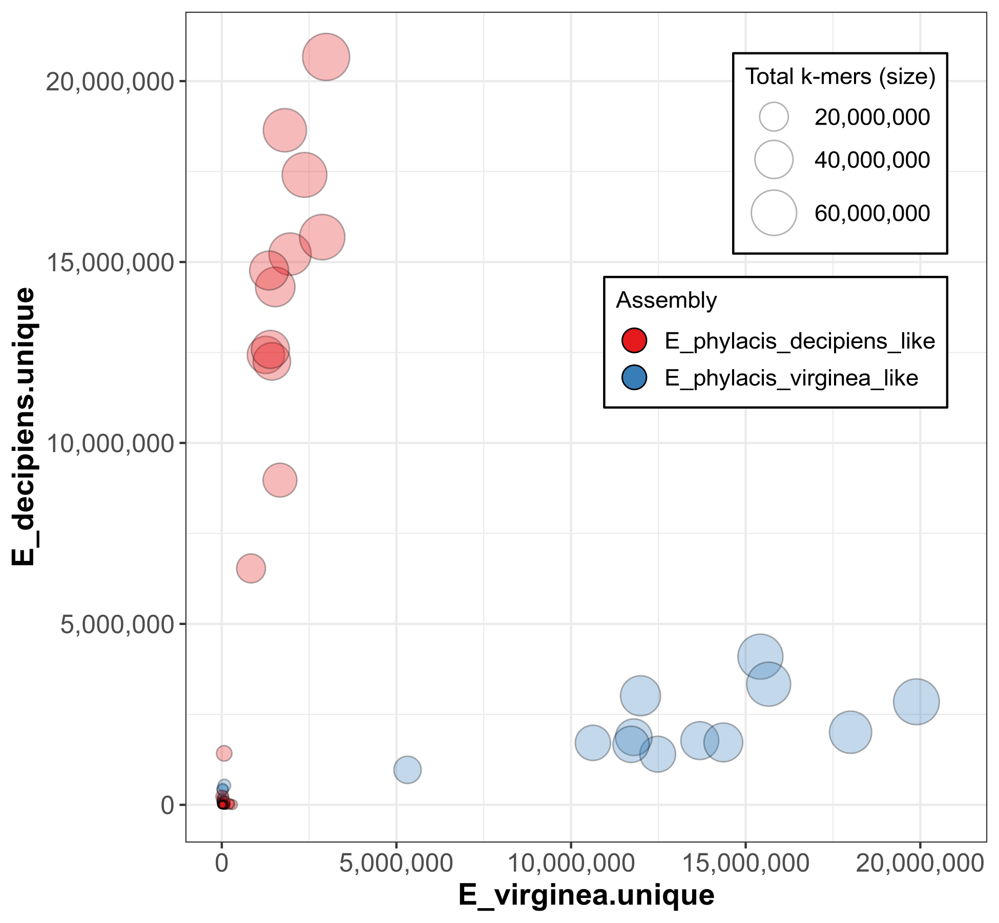

The results look pretty good! The two assemblies have high BUSCO completeness scores, and ~95% of the k-mers agree to the hypothesised parents.

### <a id="05e">Scaffolding</a>

Now, let's scaffold the contigs to their respective parents.
```
# change working directory
cd 07_scaffolding/

# virginea-like to virginea
ragtag.py scaffold -t 128 --mm2-params "-x asm20" -f 10000 -u -s 0.1 \
    -o virginea_like ../06_parental_assign/parents/roadies/Eucalyptus_virginea_GCA_014182375.1.fna \
    ../06_parental_assign/final/E_phylacis_virginea_like.fa

# decipiens-like to decipiens
ragtag.py scaffold -t 128 --mm2-params "-x asm20" -f 10000 -u -s 0.1 \
    -o decipiens_like ../06_parental_assign/parents/roadies/Eucalyptus_decipiens_GCA_014182575.1.fna \
    ../06_parental_assign/final/E_phylacis_decipiens_like.fa

# virginea-like to regnans
ragtag.py scaffold -t 128 --mm2-params "-x asm20" -f 10000 -u -s 0.1 \
    -o virginea_like ../06_parental_assign/parents/roadies/Eucalyptus_regnans_GCA_037349125.1.fna \
    ../06_parental_assign/final/E_phylacis_virginea_like.fa

# decipiens-like to regnans
ragtag.py scaffold -t 128 --mm2-params "-x asm20" -f 10000 -u -s 0.1 \
    -o decipiens_like ../06_parental_assign/parents/roadies/Eucalyptus_regnans_GCA_037349125.1.fna \
    ../06_parental_assign/final/E_phylacis_decipiens_like.fa

# change working directory
cd ..
```

### OUTPUT
| Metric               | virginea-like,<br>ref. *E. virginea* | virginea-like,<br>ref. *E. regnans* | decipiens-like,<br>ref. *E. decipiens* | decipiens-like,<br>ref. *E. regnans* |
| :------------------- | -----------------------------------: | ----------------------------------: | -------------------------------------: | -----------------------------------: |
| Input contigs        |                             277 |                            277 |                               245 |                             245 |
| Chromosome scaffolds |                              11 |                             11 |                                11 |                              11 |
| Contigs placed       |                             193 |                            159 |                               181 |                             153 |
| Placed (bp)          |                     534,221,985 |                    530,423,308 |                       565,214,048 |                     561,954,513 |
| Placed (%)           |                            98.2 |                           97.5 |                              98.6 |                            98.0 |
| Contigs unplaced     |                              84 |                            118 |                                64 |                              92 |
| `-s` < 0.1 (Mb)      |                       20 (5.19) |                      32 (5.96) |                         21 (2.43) |                       32 (5.99) |
| Unplaced (bp)        |                       9,686,931 |                     13,485,608 |                         8,269,866 |                      11,529,401 |
| Gaps (100 N)         |                             182 |                            147 |                               169 |                             142 |

### <a id="05f">Gap closing</a>
```
# create another set of longer, filtered reads
pigz -dc -p 16 00_raw_data/*.fastq.gz | \
chopper -q 7 -l 50000 | \
bgzip -@ 128 > 01_qc/02_chopper/E_phylacis_filtered_Q750k.fastq.gz

# combine the two haplotypes
seqkit replace -p '^' -r 'vir_' 07_scaffold/virginea_like_a01/ragtag.scaffold.fasta  > 08_gapclose/vir.fa
seqkit replace -p '^' -r 'dec_' 07_scaffold/decipiens_like_a01/ragtag.scaffold.fasta > 08_gapclose/dec.fa
cat 08_gapclose/vir.fa 08_gapclose/dec.fa > 08_gapclose/both_parents.fa

# map filtered reads to both parents
minimap2 -x map-ont -t 128 --secondary=no 08_gapclose/both_parents.fa \
    01_qc/02_chopper/E_phylacis_filtered_Q750k.fastq.gz > 08_gapclose/reads_vs_parents.paf

# change working directory
mkdir -p 08_gapclose/decipiens/
mkdir -p 08_gapclose/virginea/

# change working directory
cd 08_gapclose/decipiens/

# extract gap windows (±100 kb) on the decipiens scaffolds, named as in both_parents.fa
awk -F'\t' '$5=="U" {s=$2-100000; if (s<1) s=1; print "dec_"$1"\t"s"\t"$3+100000}' \
    ../../07_scaffold/decipiens_like_a01/ragtag.scaffold.agp > dec_gaps.bed

# extract all reads with an alignment overlapping a gap window
awk '$6 ~ /^dec_/ {print $6"\t"$8"\t"$9"\t"$1}' ../reads_vs_parents.paf \
    | bedtools intersect -u -a - -b dec_gaps.bed | cut -f4 | sort -u > dec_gap_reads.txt
seqkit grep -f dec_gap_reads.txt ../../01_qc/02_chopper/E_phylacis_filtered_Q750k.fastq.gz | seqkit fq2fa > dec_gap_reads.fa

tgsgapcloser --scaff ../dec.fa --reads dec_gap_reads.fa --output dec_closed --tgstype ont \
    --racon /home/jeremias/anaconda3/envs/btk/bin/racon --thread 32 > dec_closed.log 2>&1

# change working directory
cd ../virginea/

# do the same with virginea
awk -F'\t' '$5=="U" {s=$2-100000; if (s<1) s=1; print "vir_"$1"\t"s"\t"$3+100000}' \
    ../../07_scaffold/virginea_like_a01/ragtag.scaffold.agp > vir_gaps.bed

awk '$6 ~ /^vir_/ {print $6"\t"$8"\t"$9"\t"$1}' ../reads_vs_parents.paf \
    | bedtools intersect -u -a - -b vir_gaps.bed | cut -f4 | sort -u > vir_gap_reads.txt
seqkit grep -f vir_gap_reads.txt ../../01_qc/02_chopper/E_phylacis_filtered_Q750k.fastq.gz | seqkit fq2fa > vir_gap_reads.fa

tgsgapcloser --scaff ../vir.fa --reads vir_gap_reads.fa --output vir_closed --tgstype ont \
    --racon /home/jeremias/anaconda3/envs/btk/bin/racon --thread 32 > vir_closed.log 2>&1

# combine two sets of reads
# cat vir_gap_reads.fa extra_gap_reads.fa | seqkit rmdup -n > vir_gap_reads_all.fa

# change working directory
cd ../..
```

| Reads                                  |                    decipiens-like                  |                   virginea-like                    |
| :------------------------------------- | :------------------------------------------------: | :------------------------------------------------: |
| Q&nbsp;≥&nbsp;7, len&nbsp;≥&nbsp;50kb  | 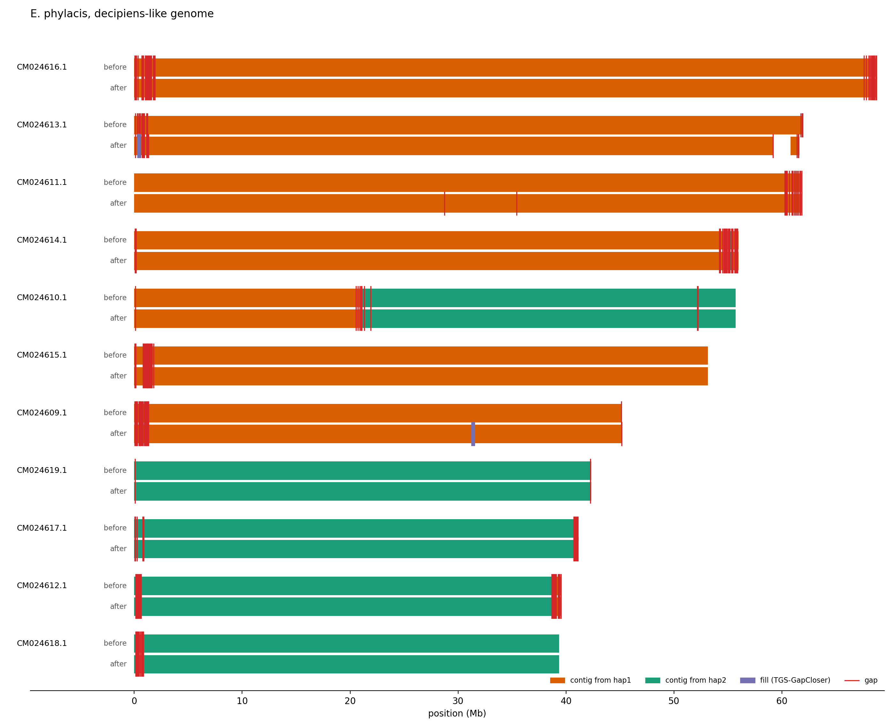   | 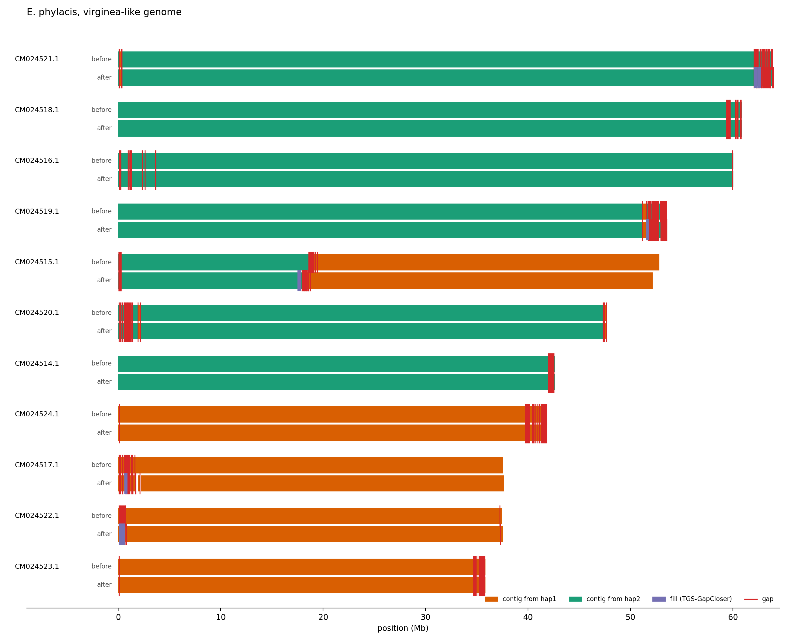   |
| Q&nbsp;≥&nbsp;10, len&nbsp;≥&nbsp;15kb |  |  |
| Both                                   |     |     |

In these plots, runs of Ns are not coloured, so chromosome 5 on decipiens-like haplotype (`CM024613.1`) does not lose a contig. The original contig has Ns in the middle of it, which was not shown on `before` but explicitly marked on `after`. Moreover, it seems like TGS-GapCloser trimmed long, repetitive regions on chromosome 2 of virginea-like haplotype (`CM024515.1`), which resulted in a shorter chromosome length. Let's try using a stricter `--min_idy 0.8 --min_match 2000`, meaning that each flanking sequence must be at least 80% identical with the contig across ≥2 kb. I repeated the analysis using the combined set of reads.

|                    decipiens-like                  |                   virginea-like                    |
| :------------------------------------------------: | :------------------------------------------------: |
|     |     |

It seems that the trimmed repetitive sequences on chromosome 2 of virginea-like haplotype have identical 10kb flanking sequences and thus cannot really be fixed... I think we should exclude the chromosome from TGS-GapCloser analysis.

```
# change working directory
cd 08_gapclose/virginea_nochr2/

# virginea-like
seqkit grep -v -p vir_CM024515.1_RagTag ../virginea/vir.fa > vir_noChr2.fa
seqkit grep    -p vir_CM024515.1_RagTag ../virginea/vir.fa > vir_chr2.fa

tgsgapcloser --scaff vir_noChr2.fa --reads ../virginea/vir_gap_reads_all.fa --output vir_final --tgstype ont \
    --racon /home/jeremias/anaconda3/envs/btk/bin/racon --thread 32 > vir_final.log 2>&1

cat vir_final.scaff_seqs vir_chr2.fa > vir_closed_final.fa

# change working directory
cd ../decipiens_nochr2/

# decipiens-like
seqkit grep -v -p dec_CM024610.1_RagTag ../decipiens/dec.fa > dec_noChr2.fa
seqkit grep    -p dec_CM024610.1_RagTag ../decipiens/dec.fa > dec_chr2.fa

gsgapcloser --scaff dec_noChr2.fa --reads ../decipiens/dec_gap_reads_all.fa --output dec_final --tgstype ont \
    --racon /home/jeremias/anaconda3/envs/btk/bin/racon --thread 32 > dec_final.log 2>&1

cat dec_final.scaff_seqs dec_chr2.fa > dec_closed_final.fa
```

### OUTPUT

- <b><i>Karyotypes</b></i>

    |                    decipiens-like                  |                   virginea-like                    |
    | :------------------------------------------------: | :------------------------------------------------: |
    | 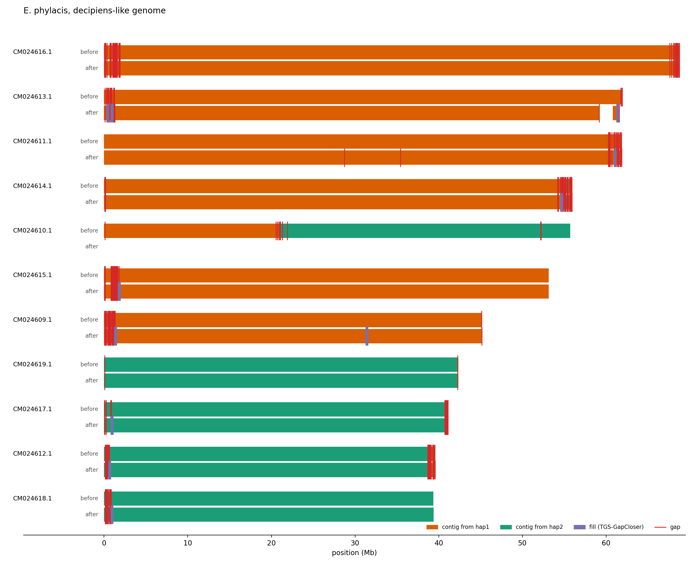         | 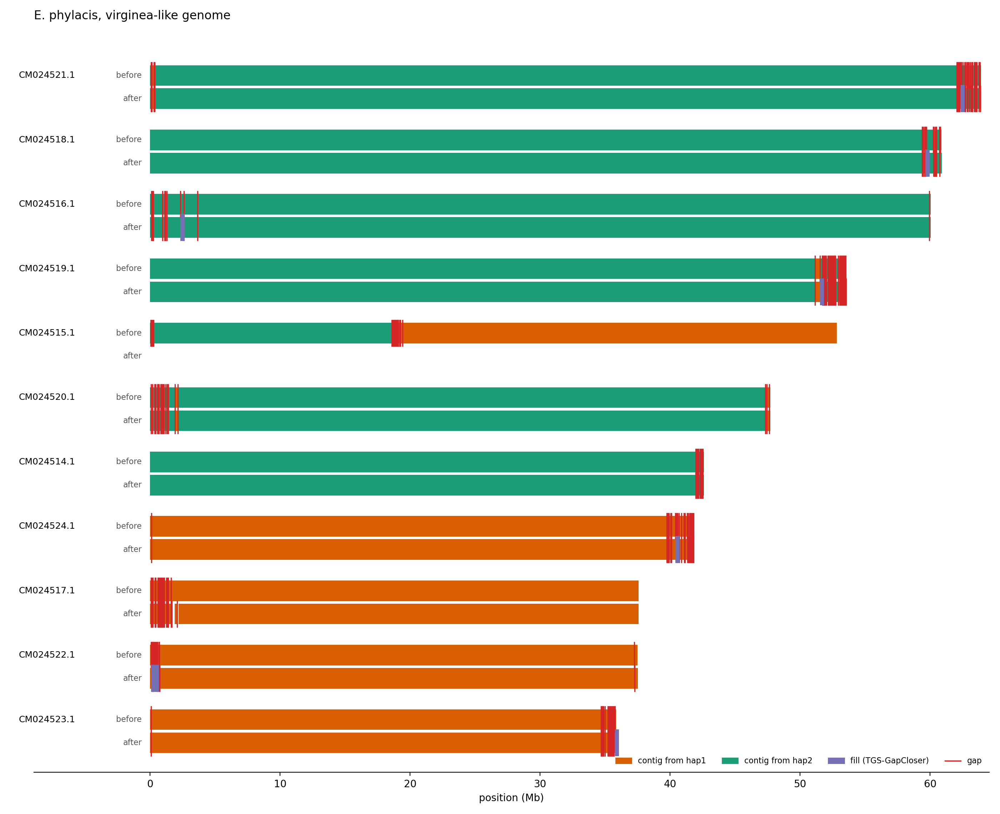         |


- <b><i>TGS-GapCloser + SeqKit</b></i>

    | Metric                                        | virginea-like  |       decipiens-like |
    | :-------------------------------------------- | -------------: | -------------------: |
    | Sequences                                     |             95 |                   76 |
    | Total length before (bp)                      |    543,927,116 |          573,500,814 |
    | Total length after (bp)                       |    544,002,914 |          573,225,500 |
    | RagTag gaps before                            |            182 |                  169 |
    | RagTag gaps attempted (exclude chr2)          |            166 |                  162 |
    | — filled with read sequence                   |  8 (76,745 bp) |       10 (97,427 bp) |
    | — overlapping ends merged                     |      1 (47 bp) |                    0 |
    | — left open                                   |            157 |                  152 |
    | RagTag gaps after                             |            173 |                  159 |
    | Contig-internal N runs (hifiasm)              |       2 (open) | 4 (1 filled; 3 open) |
    | Original sequence removed (bp)                |             47 |                    0 |

- <b><i>Compleasm</b></i>

    | Metric                | decipiens-like   | virginea-like   |
    | :-------------------- | ---------------: | --------------: |
    | BUSCO S (%)           |       95.26 |      95.69 |
    | BUSCO D (%)           |        4.39 |       3.96 |
    | BUSCO F (%)           |        0.32 |       0.32 |
    | BUSCO&nbsp;M&nbsp;(%) |        0.04 |       0.04 |

    The difference in the decipiens-like haplotype comprises 3 differentially-classified BUSCO that are not found around the gap-filled regions, meaning that they reflect compleasm’s run‑to‑run variation.


### <a id="06">Tree inference</a>

---
*Last update: 11 November 2026 by Jeremias Ivan*