# Summary of the Genome Assembly Trials

This branch is purposed to: (i) summarise the findings from the other two branches, and (ii) finalise the parameters and steps conducted to assemble the *Eucalyptus x phylacis* genome.

## Table of Contents
- <a href="#01">Prerequisites</a>
- <a href="#02">QC</a>
    - <a href="#02a">Running Chopper</a>
    - <a href="#02b">Running Kraken2</a>
    - <a href="#02c">Running GenomeScope2</a>
- <a href="#03">Assembly using Hifiasm</a>
    - <a href="#03a">Using default parameters</a>
    - <a href="#03b">Estimating the peak homozygous coverage</a>
    - <a href="#03c">Rerunning with `--hom-cov 55`</a>
    - <a href="#03d">Trying other `-s` values</a>
    - <a href="#03e">Conclusion</a>
- <a href="#04">Assembly of organelle genomes</a>
    - <a href="#04a">mtDNA</a>
    - <a href="#04b">ptDNA</a>
- <a href="#05">Assembly of nuclear genome</a>
    - <a href="#05a">Checking for duplicates contigs</a>

## <a id="01">Prerequisites</a>
This analysis requires a number of software and R packages to run. Here, I am going to install them using `conda`:
```
conda create -n meelupmallee
conda activate meelupmallee
conda install -c conda-forge -c bioconda \
    barrnap=0.9 \
    blobtoolkit \
    chopper \
    compleasm \
    quast \
    genomescope2 \
    gfatools \
    hifiasm \
    kmc \
    kraken2 \
    merqury \
    meryl \
    mosdepth \
    nanoplot \
    oatk \
    pycirclize \
    r-optparse \
    r-plotly \
    r-tidyverse \
    seqkit
```

> [!NOTE]
> The raw ONT (Oxford Nanopore Technologies) long reads are stored as 70 compressed FASTQ files at `00_raw_data/`.

## <a id="02">QC</a>

### <a id="02a">Running Chopper</a>
First, I filtered the raw ONT reads with Chopper with a minimum read length of **15kb** and read quality of **10**.
```
# run NanoPlot pre-filtering
NanoPlot \
    -t 128 \
    --fastq 00_raw_data/*.fastq.gz \
    -o 01_qc/01_nanoplot \
    --title "E_phylacis_Raw_ONT"

# pipe pigz (decompression) -> Chopper (filtering) -> bgzip (compression)
pigz -dc -p 16 00_raw_data/*.fastq.gz | \
chopper -q 10 -l 15000 | \
bgzip -@ 128 > 01_qc/02_chopper/E_phylacis_filtered.fastq.gz

# run NanoPlot post-filtering
NanoPlot \
    -t 128 \
    --fastq 01_qc/02_chopper/E_phylacis_filtered.fastq.gz \
    -o 01_qc/03_nanoplot \
    --title "E_phylacis_Filtered_ONT"
```

### OUTPUT
|        Metric       |         Raw       |      Filtered     |
| :------------------ | -----------------:| -----------------:|
| Total bases         | 44,326,974,907.0  | 33,967,234,187.0  |
| Number of reads     | 3,064,194.0       | 1,345,923.0       |
| Mean read length    | 14,466.1          | 25,237.1          |
| Median read length  | 12,334.0          | 22,752.0          |
| Read length N50     | 22,177.0          | 25,598.0          |
| STDEV read length   | 11,705.0          | 9,033.2           |
| Mean read quality   | 17.2              | 17.8              |
| Median read quality | 19.6              | 20.2              |
| >Q10                | 3051048 (99.6%)   | 1345923 (100.0%)  |
| >Q15                | 2547395 (83.1%)   | 1165231 (86.6%)   |
| >Q20                | 1396296 (45.6%)   | 696853 (51.8%)    |
| >Q25                | 66131 (2.2%)      | 32580 (2.4%)      |
| >Q30                | 992 (0.0%)        | 10 (0.0%)         |

### <a id="02b">Running Kraken2</a>
I performed an additional analysis using Kraken2 to detect foreign DNA on the filtered ONT reads. First, I have to download the PlusPFP database:
```
wget https://genome-idx.s3.amazonaws.com/kraken/k2_pluspfp_20261022.tar.gz
tar -xzf k2_pluspfp_*.tar.gz
```

I then ran Kraken2 with two confidence thresholds: **0** (default) and **0.2**. At default, a read is assigned to a taxonomic group on the basis of a single matching k-mer and thus might capture an increased proportion of false positives. Setting this threshold higher should better capture true positives from the dataset.
```
# run Kraken2 with default parameter
kraken2 \
    --db 01_qc/04_kraken/pluspfp \
    --threads 128 \
    --gzip-compressed \
    --report 01_qc/04_kraken/default.kreport \
    --report-minimizer-data \
    --use-names \
    --output 01_qc/04_kraken/default.kraken \
    01_qc/02_chopper/E_phylacis_filtered.fastq.gz

# run Kraken2 with --conf 0.2
kraken2 \
    --db 01_qc/04_kraken/pluspfp \
    --threads 128 \
    --confidence 0.2 \
    --gzip-compressed \
    --report 01_qc/04_kraken/conf02.kreport \
    --report-minimizer-data \
    --use-names \
    --output 01_qc/04_kraken/conf02.kraken \
    01_qc/02_chopper/E_phylacis_filtered.fastq.gz
```

### OUTPUT
| Category                        |  `--confidence 0`  |  `--confidence 0.2`  |
| :------------------------------ | -----------------: | -------------------: |
| Total reads                     | 1,345,923          | 1,345,923            |
| **Streptophyta (land plants)**  | 1,336,060 (99.27%) | 1,222,485 (90.83%)   |
| – *Eucalyptus* (*E. grandis*)   | 1,332,485 (99.00%) | 1,118,097 (83.07%)   |
| – Other plant genera            | 3,165 (0.24%)      | 96 (0.01%)           |
| – Unresolved at genus level     | 410 (0.03%)        | 104,292 (7.75%)      |
| **Human (*Homo sapiens*)**      | 3,661 (0.27%)      | 116 (0.01%)          |
| **Fungi**                       | 3,496 (0.26%)      | 0                    |
| **Unresolved at kingdom level** | 180 (0.01%)        | 10,842 (0.81%)       |
| **Bacteria**                    | 1,704 (0.13%)      | 18 (<0.01%)          |
| **Archaea**                     | 6 (<0.01%)         | 0                    |
| **Viruses**                     | 0                  | 0                    |
| **Other sequences**             | 2 (<0.01%)         | 0                    |
| **Unresolved at domain level**  | 681 (0.05%)        | 4,009 (0.30%)        |
| **Unclassified**                | 133 (0.01%)        | 108,453 (8.06%)      |

The proportion of foreign reads in the dataset is very low and unlikely to pass the depth criteria during contig formation, so I think we can go directly to the assembly step.

### <a id="02c">Running GenomeScope2</a>
I ran KMC and GenomeScope2 to estimate the heterozygosity and genome size of *E. x phylacis* based on the filtered ONT reads.
```
# store the path to the filtered reads
find 01_qc/02_chopper/ -name "*.fastq.gz" > 01_qc/05_genomescope/files.txt

# run KMC and create the histogram
kmc \
    -k21 \
    -t128 \
    -ci1 -cs10000 \
    @01_qc/05_genomescope/files.txt \
    01_qc/05_genomescope/kmc_db \
    01_qc/05_genomescope/

kmc_tools transform \
    01_qc/05_genomescope/kmc_db \
    histogram \
    01_qc/05_genomescope/histogram.txt \
    -ci1 -cs10000

# run GenomeScope2
genomescope2 \
    -i 01_qc/05_genomescope/histogram.txt \
    -o 01_qc/05_genomescope/ \
    -k 21 -p 2
```

### OUTPUT
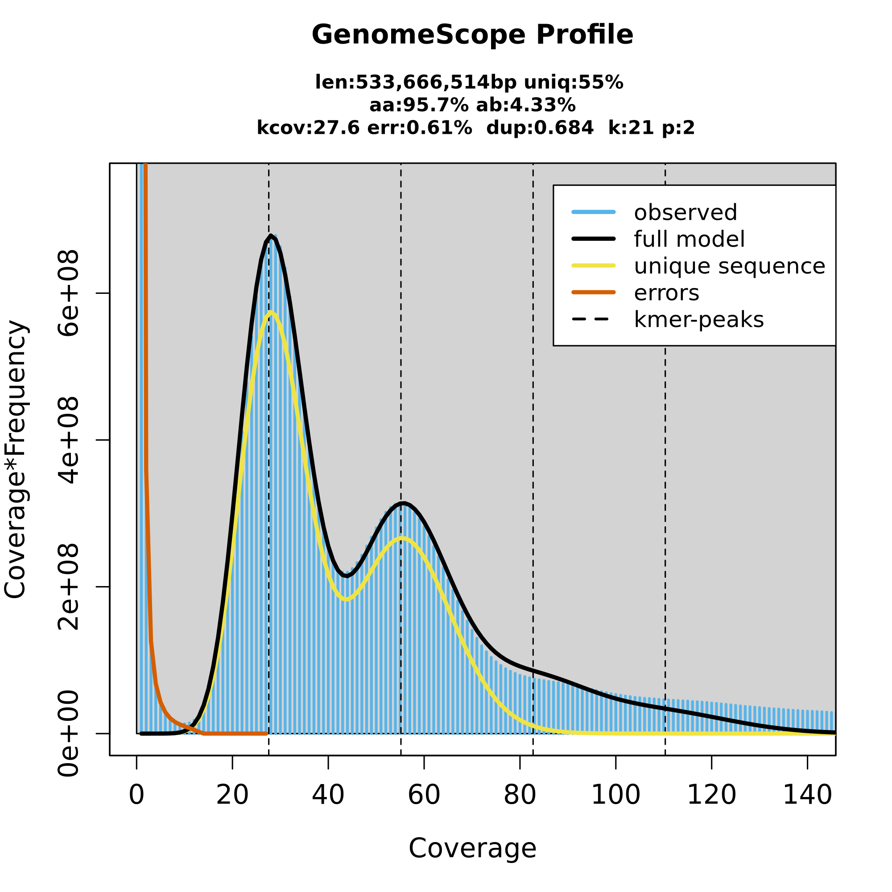

## <a id="03">Assembly using Hifiasm</a>

### <a id="03a">Using default parameters</a>
```
hifiasm \
    -o 02_assembly/default/E_phylacis_asm \
    -t 128 \
    --ont \
    -l 3 \
    --telo-m AAACCCT \
    --dual-scaf \
    01_qc/02_chopper/E_phylacis_filtered.fastq.gz \
    2>&1 | tee 02_assembly/default/hifiasm_restart.log
```

After the third correction round, Hifiasm automatically sets the homozygous read coverage threshold to be **52**, even though the peak homozygous coverage ranges between 54 to 56 based on the histogram:

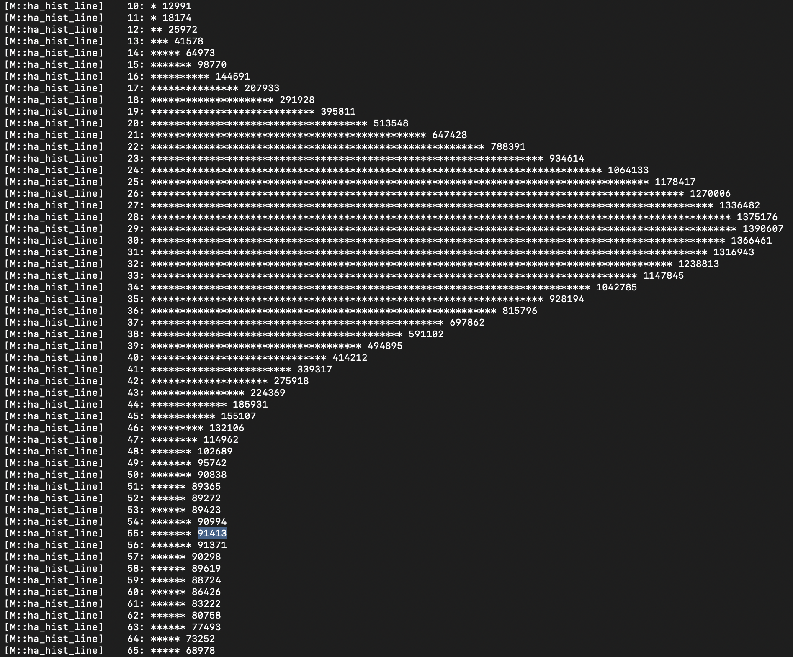

### <a id="03b">Estimating the peak homozygous coverage</a>
To empirically set the homozygous peak coverage, I calculated the median BUSCO coverage across the two haplotypes. First, I concatenated the two haplotypes inferred from the default run and remapped the filtered ONT reads.
```
# change the working directory
cd 02_assembly/default/

# convert GFA to FASTA format
gfatools gfa2fa E_phylacis_asm.bp.hap1.p_ctg.gfa > hap1.fa
gfatools gfa2fa E_phylacis_asm.bp.hap2.p_ctg.gfa > hap2.fa

# concatenate both haplotypes
cat hap1.fa hap2.fa > both_haps.fa

# map the filtered ONT reads to both haplotypes
minimap2 \
    -t 128 \
    -ax lr:hq both_haps.fa \
    ../../01_qc/02_chopper/E_phylacis_filtered.fastq.gz | \
    samtools sort -@16 -o both_haps.bam
samtools index both_haps.bam
```

I then ran compleasm on each haplotype, extracted all single-copy BUSCO, and calculated the depth statistics across loci.
```
# download the ODB database
compleasm download eudicotyledons --odb odb12 -L busco_lineages/

# run compleasm on each haplotype
compleasm run -a hap1.fa -o compleasm/compleasm_hap1 -l eudicotyledons --odb odb12 -t 128 -L busco_lineages/
compleasm run -a hap2.fa -o compleasm/compleasm_hap2 -l eudicotyledons --odb odb12 -t 128 -L busco_lineages/

# extract all single-copy BUSCO
for h in hap1 hap2; do
  awk -F'\t' 'NR>1 && $2=="Single"{print $3"\t"$4-1"\t"$5"\t"$1}' compleasm/compleasm_$h/eudicotyledons_odb12/full_table.tsv
done | sort -k1,1 -k2,2n > compleasm/busco_single.bed

# calculate the depth across BUSCO
mosdepth -t 16 --by compleasm/busco_single.bed --no-per-base compleasm/busco both_haps.bam

# extract the Q1, Q2, and Q3 depth across BUSCO
zcat compleasm/busco.regions.bed.gz | \
    cut -f5 | sort -n | \
    awk '{a[NR]=$1} END{printf "n=%d  Q1=%.1f  median=%.1f  Q3=%.1f\n", NR, a[int(NR*0.25)], a[int(NR*0.5)], a[int(NR*0.75)]}'

# change the working directory
cd ../..
```

This command prints the following: `n=5173  Q1=23.6  median=27.9  Q3=32.2`. The median closely matches the heterozygosity peak from <a href="#03a">Hifiasm</a> and <a href="#03b">GenomeScope2</a>. Thus, we should redo the Hifiasm run with **`--hom-cov 55`**.

### <a id="03c">Rerunning with `--hom-cov 55`</a>
```
hifiasm \
    -o 02_assembly/homcov55/E_phylacis_asm \
    -t 128 \
    --ont \
    -l 3 \
    --telo-m AAACCCT \
    --hom-cov 55 \
    --dual-scaf \
    01_qc/02_chopper/E_phylacis_filtered.fastq.gz \
    2>&1 | tee 02_assembly/homcov55/hifiasm_restart.log
```

The next question is whether we need to adjust the `-s` flag, which reflects the *"similarity threshold for duplicate haplotigs that should be purged"*. At `-l 3`, the default threshold is 0.55, meaning that a pair of contigs need to have at least 55% cross-parent overlap to be considered as homologous. This might be too strict for an F1 hybrid genome.

### <a id="03d">Trying other `-s` values</a>
Let's try different `-s` values (0.30, 0.35, 0.40, 0.45, 0.50, 0.60, 0.65, 0.70, 0.75) based on the corrected reads from the Hifiasm run. I also tried a stricter `-l 2` with four different `-s` values (0.45, 0.55, 0.65, 0.75). Here's the example code for one Hifiasm run:
```
# change the working directory
cd 02_assembly/homcov55

# set path to the original run
ORIG=/home/jeremias/meelupmallee/long_reads/02_assembly/homcov55/E_phylacis_asm

# set output path
NEW=E_phylacis_s050.asm

# create a new directory and shortcuts
mkdir -p hifiasm_s050 && cd hifiasm_s050
for f in ec.bin ovlp.source.bin ovlp.reverse.bin; do
    ln -s ${ORIG}.${f} ${NEW}.${f}
done

# re-run Hifiasm under the new parameter
hifiasm --ont -t 128 -o ${NEW} --hom-cov 55 -l 3 -s 0.50 --dual-scaf --telo-m AAACCCT /dev/null 2> ${NEW}.log

# change the working directory
cd ../../..
```

I then converted all GFA outputs to FASTA format.
```
for g in 02_assembly/homcov55/hifiasm_s0*/*.p_ctg.gfa; do
    gfatools gfa2fa "$g" > "${g%.gfa}.fa"
done
```

### SeqKit
```
seqkit stats 02_assembly/homcov55/hifiasm_s0*/*.p_ctg.fa > hifiasm_all_seqkit.txt
```

- <b><i>Haplotype 1</b></i>

    | `-l` | `-s` | Contigs | Total length (bp) | Min (bp) | Mean (bp) |   Max (bp) |
    | :--: | :--: | ------: | ----------------: | -------: | --------: | ---------: |
    |  3   | 0.30 |     449 |       583,208,380 |   30,917 | 1,298,905 | 65,682,487 |
    |  3   | 0.35 |     405 |       579,832,984 |   24,809 | 1,431,686 | 65,682,487 |
    |  3   | 0.40 |     421 |       573,216,200 |   24,809 | 1,361,559 | 65,682,487 |
    |  3   | 0.45 |     431 |       576,202,291 |   24,809 | 1,336,896 | 65,682,487 |
    |  3   | 0.50 |     402 |       574,198,743 |   24,809 | 1,428,355 | 65,682,487 |
    |  3   | 0.55 |     440 |       575,869,290 |   24,809 | 1,308,794 | 65,682,487 |
    |  3   | 0.60 |     402 |       570,069,076 |   24,809 | 1,418,082 | 65,682,487 |
    |  3   | 0.65 |     414 |       546,652,395 |   24,809 | 1,320,416 | 65,682,487 |
    |  3   | 0.70 |     413 |       601,523,016 |   30,917 | 1,456,472 | 61,713,612 |
    |  3   | 0.75 |     329 |       697,630,498 |   30,917 | 2,120,457 | 65,682,489 |
    |  2   | 0.45 |     423 |       581,017,343 |   24,809 | 1,373,564 | 65,682,487 |
    |  2   | 0.55 |     406 |       570,533,238 |   30,917 | 1,405,254 | 65,682,487 |
    |  2   | 0.65 |     418 |       596,630,555 |   30,917 | 1,427,346 | 65,682,487 |
    |  2   | 0.75 |     410 |       620,392,369 |   30,917 | 1,513,152 | 65,682,489 |

- <b><i>Haplotype 2</b></i>

    | `-l` | `-s` | Contigs | Total length (bp) | Min (bp) | Mean (bp) |   Max (bp) |
    | :--: | :--: | ------: | ----------------: | -------: | --------: | ---------: |
    |  3   | 0.30 |     308 |       563,732,156 |   24,809 | 1,830,299 | 61,702,390 |
    |  3   | 0.35 |     348 |       565,571,274 |   36,811 | 1,625,205 | 61,702,390 |
    |  3   | 0.40 |     319 |       571,160,799 |   36,811 | 1,790,473 | 61,702,390 |
    |  3   | 0.45 |     320 |       566,439,604 |   36,811 | 1,770,124 | 61,702,390 |
    |  3   | 0.50 |     305 |       560,735,642 |   36,811 | 1,838,478 | 61,702,390 |
    |  3   | 0.55 |     293 |       559,542,586 |   36,811 | 1,909,702 | 61,702,390 |
    |  3   | 0.60 |     351 |       567,535,942 |   43,064 | 1,616,912 | 61,702,390 |
    |  3   | 0.65 |     329 |       589,961,923 |   41,601 | 1,793,197 | 61,702,390 |
    |  3   | 0.70 |     285 |       638,319,662 |   24,809 | 2,239,718 | 65,543,494 |
    |  3   | 0.75 |     325 |       587,982,618 |   35,019 | 1,809,177 | 65,543,479 |
    |  2   | 0.45 |     328 |       560,484,069 |   36,811 | 1,708,793 | 61,702,390 |
    |  2   | 0.55 |     321 |       564,637,389 |   42,060 | 1,758,995 | 61,702,390 |
    |  2   | 0.65 |     330 |       539,894,173 |   36,811 | 1,636,043 | 61,702,390 |
    |  2   | 0.75 |     266 |       669,882,354 |   35,019 | 2,518,355 | 65,543,479 |

- <b><i>Primary</b></i>

    | `-l` | `-s` | Contigs | Total length (bp) | Min (bp) |  Mean (bp) |   Max (bp) |
    | :--: | :--: | ------: | ----------------: | -------: | ---------: | ---------: |
    |  3   | 0.30 |      55 |       538,510,568 |   30,917 |  9,791,101 | 61,704,473 |
    |  3   | 0.35 |      54 |       538,043,526 |   30,917 |  9,963,769 | 61,704,473 |
    |  3   | 0.40 |      53 |       538,126,685 |   30,917 | 10,153,334 | 61,704,473 |
    |  3   | 0.45 |      52 |       538,070,186 |   30,917 | 10,347,504 | 61,704,473 |
    |  3   | 0.50 |      56 |       538,678,952 |   30,917 |  9,619,267 | 61,704,473 |
    |  3   | 0.55 |      58 |       545,448,847 |   30,917 |  9,404,290 | 61,704,473 |
    |  3   | 0.60 |      57 |       608,733,002 |   30,917 | 10,679,526 | 61,704,473 |
    |  3   | 0.65 |      58 |       633,708,634 |   30,917 | 10,926,011 | 61,704,473 |
    |  3   | 0.70 |      63 |       844,781,570 |   30,917 | 13,409,231 | 61,713,612 |
    |  3   | 0.75 |      64 |       960,983,357 |   30,917 | 15,015,365 | 65,682,489 |
    |  2   | 0.45 |      56 |       544,895,664 |   30,917 |  9,730,280 | 61,704,473 |
    |  2   | 0.55 |      56 |       545,452,896 |   30,917 |  9,740,230 | 61,704,473 |
    |  2   | 0.65 |      58 |       635,269,094 |   30,917 | 10,952,915 | 61,704,473 |
    |  2   | 0.75 |      64 |       961,221,210 |   30,917 | 15,019,081 | 65,682,489 |

### Compleasm + Merqury
First, we need to create a k-mer database from the filtered ONT reads.
```
meryl count k=21 threads=128 01_qc/02_chopper/E_phylacis_filtered.fastq.gz output 02_assembly/homcov55/merqury/reads.meryl
```

Now, let's check each haplotype's BUSCO completeness and k-mer completeness. Here's the example code for one set of haplotypes:
```
# change the working directory
cd 02_assembly/homcov55/

# run compleasm
compleasm run -a hifiasm_s030/E_phylacis_s030.asm.bp.hap1.p_ctg.fa -o compleasm/s030_hap1 -l eudicotyledons --odb odb12 -t 128 -L ../default/busco_lineages/
compleasm run -a hifiasm_s030/E_phylacis_s030.asm.bp.hap2.p_ctg.fa -o compleasm/s030_hap2 -l eudicotyledons --odb odb12 -t 128 -L ../default/busco_lineages/
compleasm run -a hifiasm_s030/E_phylacis_s030.union.fa -o compleasm/s030_union -l eudicotyledons --odb odb12 -t 128 -L ../default/busco_lineages/

# run merqury for haplotype 1
mkdir -p merqury/s030_hap1 && cd merqury/s030_hap1
merqury.sh ../reads.meryl ../../hifiasm_s030/E_phylacis_s030.asm.bp.hap1.p_ctg.fa s030_hap1_merq
cd ../..

# run merqury for haplotype 2
mkdir -p merqury/s030_hap2 && cd merqury/s030_hap2
merqury.sh ../reads.meryl ../../hifiasm_s030/E_phylacis_s030.asm.bp.hap2.p_ctg.fa s030_hap2_merq
cd ../..

# run merqury for the combined haplotypes
mkdir -p merqury/s030_union && cd merqury/s030_union
merqury.sh ../reads.meryl ../../hifiasm_s030/E_phylacis_s030.union.fa s030_union_merq
cd ../..

# change the working directory
cd ../..
```

I asked Claude to generate a python <a href="./scripts/summarise_s_sweep.py">script</a> to summarise the results. The following tables show the statistics across 2,805 BUSCOs (for Compleasm) and 601,145,508 solid read k-mers (for Merqury) per run:

- <b><i>Haplotype 1</b></i>

    | Metric                      |  0.30 |  0.35 |  0.40 |  0.45 |  0.50 |  0.55 |  0.60 |  0.65 |  0.70 |  0.75 | 0.45 (l2) | 0.55 (l2) | 0.65 (l2) | 0.75 (l2) |
    | --------------------------- | ----: | ----: | ----: | ----: | ----: | ----: | ----: | ----: | ----: | ----: | --------: | --------: | --------: | --------: |
    | BUSCO S (%)                 | 92.16 | 93.05 | 92.55 | 92.73 | 93.44 | 92.69 | 93.58 | 91.30 | 63.28 | 48.70 |     92.30 |     93.19 |     85.78 |     50.41 |
    | BUSCO D (%)                 |  7.42 |  6.56 |  7.09 |  6.88 |  6.20 |  6.95 |  5.49 |  5.42 | 22.07 | 37.58 |      7.31 |      5.88 |     10.98 |     31.41 |
    | BUSCO F (%)                 |  0.39 |  0.36 |  0.32 |  0.36 |  0.32 |  0.32 |  0.39 |  0.57 |  1.25 |  0.86 |      0.36 |      0.39 |      0.53 |      1.18 |
    | BUSCO&nbsp;M&nbsp;(%)       |  0.04 |  0.04 |  0.04 |  0.04 |  0.04 |  0.04 |  0.53 |  2.71 | 13.40 | 12.87 |      0.04 |      0.53 |      2.71 |     17.01 |
    | k-mer completeness&nbsp;(%) | 66.68 | 66.29 | 65.96 | 66.13 | 65.94 | 66.13 | 65.55 | 63.06 | 63.65 | 71.98 |     66.46 |     65.46 |     66.57 |     64.97 |
    | Solid k-mers found (M)      | 400.8 | 398.5 | 396.5 | 397.5 | 396.4 | 397.5 | 394.1 | 379.1 | 382.6 | 432.7 |     399.5 |     393.5 |     400.2 |     390.6 |
    | QV                          | 64.32 | 64.56 | 64.25 | 64.44 | 64.43 | 64.41 | 64.55 | 64.47 | 64.35 | 64.93 |     64.60 |     64.58 |     64.40 |     64.62 |
    | Asm-only k-mers             | 4,521 | 4,243 | 4,507 | 4,332 | 4,326 | 4,357 | 4,197 | 4,093 | 4,614 | 4,702 |     4,203 |     4,156 |     4,546 |     4,478 |

- <b><i>Haplotype 2</b></i>

    | Metric                      |  0.30 |  0.35 |  0.40 |  0.45 |  0.50 |  0.55 |  0.60 |  0.65 |  0.70 |  0.75 | 0.45 (l2) | 0.55 (l2) | 0.65 (l2) | 0.75 (l2) |
    | --------------------------- | ----: | ----: | ----: | ----: | ----: | ----: | ----: | ----: | ----: | ----: | --------: | --------: | --------: | --------: |
    | BUSCO S (%)                 | 94.01 | 93.26 | 93.94 | 94.08 | 94.40 | 93.90 | 93.19 | 91.19 | 63.53 | 56.08 |     93.69 |     93.58 |     87.31 |     56.08 |
    | BUSCO D (%)                 |  5.70 |  6.45 |  5.74 |  5.63 |  5.28 |  5.17 |  6.52 |  8.52 | 27.59 | 28.98 |      5.42 |      6.13 |      7.81 |     34.33 |
    | BUSCO F (%)                 |  0.25 |  0.25 |  0.29 |  0.25 |  0.29 |  0.32 |  0.25 |  0.25 |  0.82 |  1.28 |      0.29 |      0.25 |      0.71 |      1.00 |
    | BUSCO&nbsp;M&nbsp;(%)       |  0.04 |  0.04 |  0.04 |  0.04 |  0.04 |  0.61 |  0.04 |  0.04 |  8.06 | 13.65 |      0.61 |      0.04 |      4.17 |      8.59 |
    | k-mer completeness&nbsp;(%) | 65.40 | 65.69 | 65.91 | 65.61 | 65.25 | 64.94 | 65.64 | 67.22 | 67.91 | 63.26 |     65.05 |     65.57 |     62.04 |     70.06 |
    | Solid k-mers found (M)      | 393.1 | 394.9 | 396.2 | 394.4 | 392.3 | 390.4 | 394.6 | 404.1 | 408.3 | 380.3 |     391.0 |     394.2 |     373.0 |     421.2 |
    | QV                          | 65.58 | 65.36 | 65.75 | 65.45 | 65.62 | 65.99 | 65.43 | 65.61 | 65.56 | 65.15 |     65.32 |     65.53 |     65.67 |     65.33 |
    | Asm-only k-mers             | 3,265 | 3,457 | 3,193 | 3,389 | 3,227 | 2,961 | 3,401 | 3,387 | 3,695 | 3,775 |     3,455 |     3,321 |     3,058 |     4,122 |

- <b><i>Union (hap1 + hap2)</b></i>

    | Metric                      |  0.30 |  0.35 |  0.40 |  0.45 |  0.50 |  0.55 |  0.60 |  0.65 |  0.70 |  0.75 | 0.45 (l2) | 0.55 (l2) | 0.65 (l2) | 0.75 (l2) |
    | --------------------------- | ----: | ----: | ----: | ----: | ----: | ----: | ----: | ----: | ----: | ----: | --------: | --------: | --------: | --------: |
    | BUSCO S (%)                 |  2.96 |  2.96 |  2.89 |  2.92 |  2.92 |  2.85 |  2.92 |  2.92 |  2.78 |  2.57 |      2.89 |      2.96 |      2.89 |      2.60 |
    | BUSCO D (%)                 | 96.83 | 96.83 | 96.90 | 96.86 | 96.86 | 96.93 | 96.86 | 96.86 | 97.01 | 97.22 |     96.90 |     96.83 |     96.90 |     97.18 |
    | BUSCO F (%)                 |  0.18 |  0.18 |  0.18 |  0.18 |  0.18 |  0.18 |  0.18 |  0.18 |  0.18 |  0.18 |      0.18 |      0.18 |      0.18 |      0.18 |
    | BUSCO&nbsp;M&nbsp;(%)       |  0.04 |  0.04 |  0.04 |  0.04 |  0.04 |  0.04 |  0.04 |  0.04 |  0.04 |  0.04 |      0.04 |      0.04 |      0.04 |      0.04 |
    | k-mer completeness&nbsp;(%) | 99.31 | 99.31 | 99.31 | 99.31 | 99.31 | 99.31 | 99.31 | 99.31 | 99.31 | 99.31 |     99.31 |     99.31 |     99.31 |     99.31 |
    | Solid k-mers found (M)      | 597.0 | 597.0 | 597.0 | 597.0 | 597.0 | 597.0 | 597.0 | 597.0 | 597.0 | 597.0 |     597.0 |     597.0 |     597.0 |     597.0 |
    | QV                          | 64.90 | 64.94 | 64.93 | 64.91 | 64.98 | 65.12 | 64.96 | 65.02 | 64.93 | 65.03 |     64.94 |     65.02 |     64.95 |     64.98 |
    | Asm-only k-mers             | 7,786 | 7,700 | 7,700 | 7,721 | 7,553 | 7,318 | 7,598 | 7,480 | 8,309 | 8,477 |     7,658 |     7,477 |     7,604 |     8,600 |

We also calculated the copy number of heterozygous peak (14–44x) and homozygous peak (44–69x) read k-mers in the assembly (from Merqury `spectra-cn.hist`).

> [!NOTE]
> - For one haplotype, `het k-mers: 0x` and `het k-mers: 1x` should be ~50% each, while `hom k-mers: 1x` should be ~100%
> - For the union, `het k-mers: 1x` and `hom k-mers: 2x` should be ~100% each
> - `het k-mers: ≥2x` and `hom k-mers: ≥3x` mark regions present as both parental copies in both haplotypes

- <b><i>Haplotype 1</b></i>

    | Metric               | 0.30 | 0.35 | 0.40 | 0.45 | 0.50 | 0.55 | 0.60 | 0.65 | 0.70 | 0.75 | 0.45 (l2) | 0.55 (l2) | 0.65 (l2) | 0.75 (l2) |
    | -------------------- | ---: | ---: | ---: | ---: | ---: | ---: | ---: | ---: | ---: | ---: | --------: | --------: | --------: | --------: |
    | het k-mers: 0x       | 44.4 | 44.8 | 45.2 | 45.0 | 45.3 | 45.0 | 45.6 | 47.9 | 43.9 | 34.2 |      44.5 |      45.7 |      43.4 |      41.5 |
    | het k-mers: 1x       | 55.2 | 54.7 | 54.4 | 54.6 | 54.3 | 54.6 | 54.0 | 51.8 | 55.1 | 63.9 |      55.0 |      53.9 |      55.9 |      57.0 |
    | het k-mers:&nbsp;≥2x |  0.4 |  0.4 |  0.4 |  0.4 |  0.4 |  0.4 |  0.4 |  0.4 |  1.0 |  1.8 |       0.4 |       0.4 |       0.6 |       1.5 |
    | hom k-mers: 0x       |  8.5 |  8.6 |  8.9 |  8.8 |  8.7 |  8.9 |  9.4 | 12.5 | 21.0 | 15.3 |       8.8 |       9.5 |      11.0 |      22.2 |
    | hom k-mers: 1x       | 77.6 | 78.2 | 77.6 | 77.7 | 78.5 | 77.5 | 78.0 | 75.6 | 50.6 | 43.1 |      77.3 |      78.1 |      70.3 |      42.6 |
    | hom k-mers: 2x       | 13.7 | 13.0 | 13.2 | 13.2 | 12.6 | 13.3 | 12.4 | 11.7 | 27.8 | 40.8 |      13.6 |      12.2 |      18.4 |      34.5 |
    | hom k-mers:&nbsp;≥3x |  0.3 |  0.3 |  0.2 |  0.3 |  0.3 |  0.3 |  0.2 |  0.2 |  0.5 |  0.8 |       0.3 |       0.2 |       0.4 |       0.7 |

- <b><i>Haplotype 2</b></i>

    | Metric               | 0.30 | 0.35 | 0.40 | 0.45 | 0.50 | 0.55 | 0.60 | 0.65 | 0.70 | 0.75 | 0.45 (l2) | 0.55 (l2) | 0.65 (l2) | 0.75 (l2) |
    | -------------------- | ---: | ---: | ---: | ---: | ---: | ---: | ---: | ---: | ---: | ---: | --------: | --------: | --------: | --------: |
    | het k-mers: 0x       | 45.8 | 45.4 | 45.2 | 45.6 | 46.0 | 46.3 | 45.5 | 43.5 | 39.2 | 44.2 |      46.2 |      45.6 |      48.2 |      36.7 |
    | het k-mers: 1x       | 53.8 | 54.2 | 54.4 | 54.0 | 53.7 | 53.3 | 54.1 | 56.0 | 59.4 | 54.6 |      53.5 |      54.0 |      51.3 |      61.8 |
    | het k-mers:&nbsp;≥2x |  0.4 |  0.4 |  0.4 |  0.4 |  0.4 |  0.4 |  0.4 |  0.5 |  1.4 |  1.2 |       0.4 |       0.4 |       0.5 |       1.5 |
    | hom k-mers: 0x       |  9.3 |  9.2 |  8.9 |  9.1 |  9.4 |  9.6 |  9.1 |  8.4 | 16.4 | 21.3 |       9.6 |       9.1 |      15.1 |      15.3 |
    | hom k-mers: 1x       | 78.3 | 77.9 | 78.5 | 78.5 | 78.7 | 78.8 | 78.2 | 76.0 | 50.4 | 49.0 |      78.2 |      78.1 |      71.1 |      47.4 |
    | hom k-mers: 2x       | 12.2 | 12.7 | 12.3 | 12.1 | 11.6 | 11.3 | 12.5 | 15.2 | 32.5 | 29.2 |      11.9 |      12.5 |      13.5 |      36.7 |
    | hom k-mers:&nbsp;≥3x |  0.3 |  0.3 |  0.3 |  0.3 |  0.3 |  0.2 |  0.3 |  0.3 |  0.6 |  0.5 |       0.2 |       0.3 |       0.3 |       0.7 |

- <b><i>Union (hap1 + hap2)</b></i>

    | Metric               | 0.30 | 0.35 | 0.40 | 0.45 | 0.50 | 0.55 | 0.60 | 0.65 | 0.70 | 0.75 | 0.45 (l2) | 0.55 (l2) | 0.65 (l2) | 0.75 (l2) |
    | -------------------- | ---: | ---: | ---: | ---: | ---: | ---: | ---: | ---: | ---: | ---: | --------: | --------: | --------: | --------: |
    | het k-mers: 0x       |  0.6 |  0.6 |  0.6 |  0.6 |  0.6 |  0.6 |  0.6 |  0.6 |  0.6 |  0.6 |       0.6 |       0.6 |       0.6 |       0.6 |
    | het k-mers: 1x       | 88.5 | 88.6 | 88.8 | 88.9 | 89.6 | 89.6 | 89.4 | 89.6 | 80.6 | 75.8 |      89.0 |      89.6 |      89.6 |      75.5 |
    | het k-mers:&nbsp;≥2x | 10.9 | 10.8 | 10.7 | 10.5 |  9.8 |  9.8 | 10.0 |  9.8 | 18.9 | 23.7 |      10.4 |       9.8 |       9.8 |      23.9 |
    | hom k-mers: 0x       |  0.2 |  0.2 |  0.2 |  0.2 |  0.2 |  0.2 |  0.2 |  0.2 |  0.2 |  0.2 |       0.2 |       0.2 |       0.2 |       0.2 |
    | hom k-mers: 1x       |  4.1 |  4.1 |  4.2 |  4.2 |  4.2 |  4.3 |  4.2 |  4.3 |  3.7 |  3.6 |       4.2 |       4.2 |       4.3 |       3.5 |
    | hom k-mers: 2x       | 83.0 | 83.2 | 83.3 | 83.5 | 84.7 | 84.6 | 84.4 | 84.6 | 76.3 | 68.9 |      83.7 |      84.6 |      84.6 |      68.5 |
    | hom k-mers:&nbsp;≥3x | 12.7 | 12.5 | 12.3 | 12.1 | 10.9 | 11.0 | 11.2 | 11.0 | 19.8 | 27.4 |      11.9 |      11.0 |      11.0 |      27.8 |

### Quast
```
# change the working directory
cd 02_assembly/homcov55/

# run Quast
mkdir -p quast
for part in hap1 hap2; do
    files=(); labels=()
    for d in hifiasm_s0*/ hifiasm_l2_s0*/; do
        d=${d%/}; label=${d#hifiasm_}
        files+=("${d}/E_phylacis_${label}.asm.bp.${part}.p_ctg.fa")
        labels+=("$label")
    done
    quast.py --large --est-ref-size 534000000 \
        -o quast/${part} -l "$(IFS=,; echo "${labels[*]}")" "${files[@]}"
done

# change the working directory
cd ../..
```

- <b><i>Haplotype 1</b></i>

    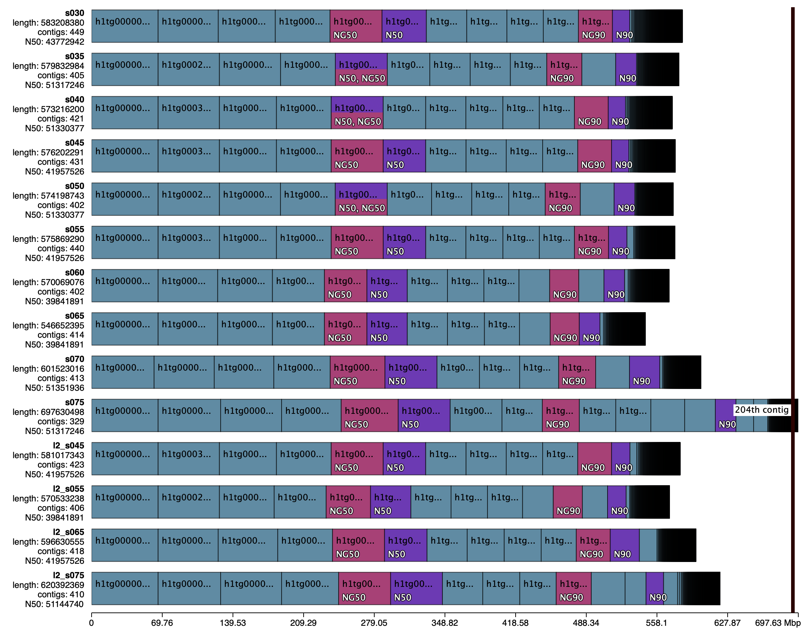

    | `l`  | `s`  |   N50 (bp) | L50 |  NG50 (bp) |   N90 (bp) | L90 |  NG90 (bp) |   auN (bp) | N's&nbsp;per&nbsp;100&nbsp;kb |
    | :--: | :--: | ---------: | --: | ---------: | ---------: | --: | ---------: | ---------: | ----------------------------: |
    |  3   | 0.30 | 43,772,942 |   6 | 51,317,246 | 17,090,617 |  12 | 33,590,266 | 43,842,519 |                         110.3 |
    |  3   | 0.35 | 51,317,246 |   5 | 51,317,246 | 20,641,050 |  12 | 34,632,737 | 45,079,273 |                         428.9 |
    |  3   | 0.40 | 51,330,377 |   5 | 51,330,377 | 17,090,617 |  12 | 33,387,292 | 44,105,774 |                         429.1 |
    |  3   | 0.45 | 41,957,526 |   6 | 51,317,246 | 17,090,617 |  12 | 33,387,292 | 44,313,252 |                         426.8 |
    |  3   | 0.50 | 51,330,377 |   5 | 51,330,377 | 20,449,059 |  12 | 34,632,737 | 45,320,782 |                         406.7 |
    |  3   | 0.55 | 41,957,526 |   6 | 51,359,987 | 18,186,819 |  12 | 33,662,322 | 44,075,504 |                         567.1 |
    |  3   | 0.60 | 39,841,891 |   6 | 41,957,526 | 20,394,891 |  13 | 28,751,543 | 41,292,460 |                         134.2 |
    |  3   | 0.65 | 39,841,891 |   6 | 41,957,526 | 20,394,891 |  12 | 28,751,543 | 41,997,972 |                         236.6 |
    |  3   | 0.70 | 51,351,936 |   6 | 54,056,018 | 29,899,960 |  12 | 36,525,735 | 45,920,878 |                         471.2 |
    |  3   | 0.75 | 51,317,246 |   6 | 56,292,571 | 20,394,891 |  14 | 36,525,735 | 45,842,407 |                         109.6 |
    |  2   | 0.45 | 41,957,526 |   6 | 51,317,246 | 18,177,790 |  12 | 33,387,292 | 44,085,185 |                         539.0 |
    |  2   | 0.55 | 39,841,891 |   6 | 43,799,538 | 18,352,263 |  13 | 28,751,543 | 41,751,729 |                         528.5 |
    |  2   | 0.65 | 41,957,526 |   6 | 51,359,987 | 28,751,543 |  12 | 33,549,482 | 44,094,347 |                         154.1 |
    |  2   | 0.75 | 51,144,740 |   6 | 51,317,246 | 17,320,306 |  13 | 34,632,737 | 44,526,071 |                         325.9 |

- <b><i>Haplotype 2</b></i>

    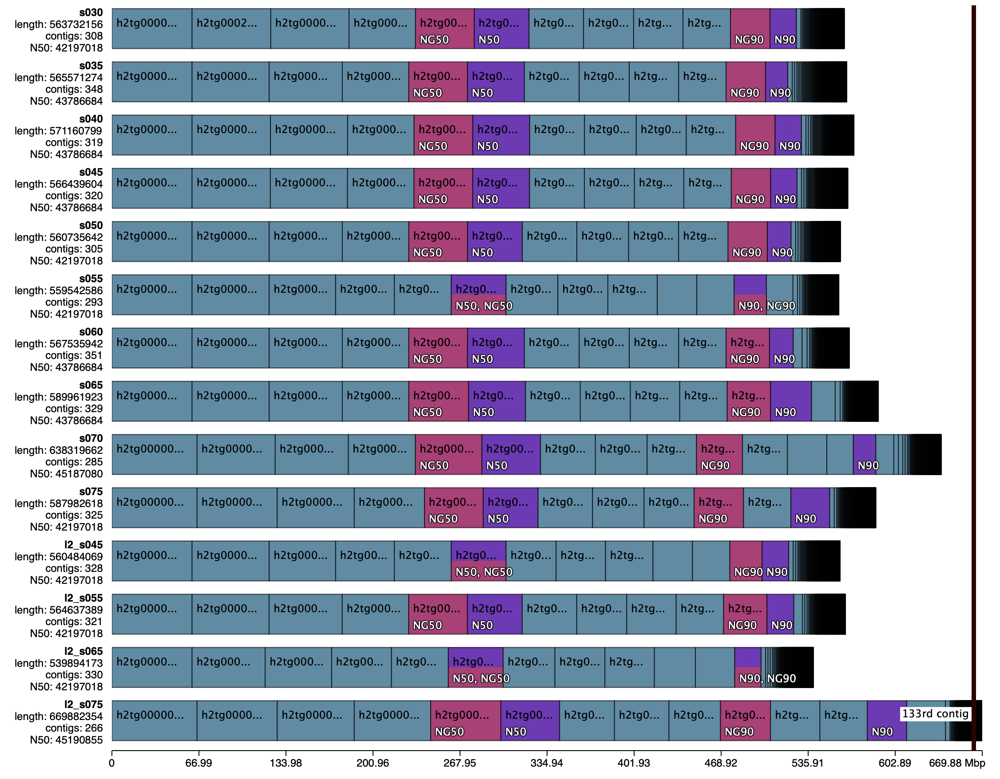

    | `l`  | `s`  |   N50 (bp) | L50 |  NG50 (bp) |   N90 (bp) | L90 |  NG90 (bp) |   auN (bp) | N's&nbsp;per&nbsp;100&nbsp;kb |
    | :--: | :--: | ---------: | --: | ---------: | ---------: | --: | ---------: | ---------: | ----------------------------: |
    |  3   | 0.30 | 42,197,018 |   6 | 45,190,855 | 20,289,095 |  12 | 30,438,125 | 44,221,886 |                         264.7 |
    |  3   | 0.35 | 43,786,684 |   6 | 45,190,855 | 17,142,888 |  12 | 30,327,973 | 43,077,801 |                           0.0 |
    |  3   | 0.40 | 43,786,684 |   6 | 45,187,080 | 20,289,095 |  12 | 30,311,269 | 44,128,093 |                          30.3 |
    |  3   | 0.45 | 43,786,684 |   6 | 45,190,855 | 20,289,095 |  12 | 30,311,269 | 44,029,941 |                          30.6 |
    |  3   | 0.50 | 42,197,018 |   6 | 45,193,510 | 18,310,092 |  12 | 30,255,385 | 43,679,519 |                         117.5 |
    |  3   | 0.55 | 42,197,018 |   6 | 42,197,018 | 24,839,503 |  12 | 24,839,503 | 41,131,917 |                           0.0 |
    |  3   | 0.60 | 43,786,684 |   6 | 45,190,855 | 18,318,392 |  12 | 33,387,292 | 43,416,672 |                         447.7 |
    |  3   | 0.65 | 43,786,684 |   6 | 46,025,662 | 31,562,876 |  12 | 33,387,292 | 43,494,742 |                         525.0 |
    |  3   | 0.70 | 45,187,080 |   6 | 51,144,740 | 17,291,453 |  14 | 35,385,602 | 43,126,439 |                         729.4 |
    |  3   | 0.75 | 42,197,018 |   6 | 45,190,855 | 29,899,960 |  12 | 38,016,435 | 45,700,235 |                          11.1 |
    |  2   | 0.45 | 42,197,018 |   6 | 42,197,018 | 20,442,954 |  13 | 24,839,503 | 40,614,434 |                           0.0 |
    |  2   | 0.55 | 42,197,018 |   6 | 45,190,855 | 20,627,072 |  12 | 33,387,292 | 43,479,232 |                           0.0 |
    |  2   | 0.65 | 42,197,018 |   6 | 42,197,018 | 20,289,095 |  12 | 20,289,095 | 41,264,420 |                         437.7 |
    |  2   | 0.75 | 45,190,855 |   6 | 54,056,018 | 30,311,269 |  13 | 38,519,572 | 46,639,921 |                          40.7 |

### <a id="03e">Conclusion</a>
From all these tests, it seems that `-l 3 -s 0.50` has the most consistent results and is never an outlier compared to other parameters.

### Dotplot
```
# change the working directory
cd 02_assembly/homcov55/s050

# map both haplotypes
minimap2 -x asm20 -t 128 -N 1000 --secondary=no \
    E_phylacis_s050.asm.bp.hap1.p_ctg.fa \
    E_phylacis_s050.asm.bp.hap2.p_ctg.fa \
    > hap1_vs_hap2.paf

# generate the dotplot
Rscript scripts/pafCoordsDotPlotly.R \
    -i hap1_vs_hap2.paf \
    -o hap1_vs_hap2_dotplot2 -s -t

# change the working directory
cd ../../..
```


### Contamination check
```
# map the filtered ONT reads to the union
minimap2 -t 128 -ax lr:hq \
    02_assembly/homcov55/hifiasm_s050/E_phylacis_s050.asm.bp.hap1.p_ctg.fa \
    01_qc/02_chopper/E_phylacis_filtered.fastq.gz \
    | samtools sort -@16 -o 03_qc/hap1.bam

minimap2 -t 128 -ax lr:hq \
    02_assembly/homcov55/hifiasm_s050/E_phylacis_s050.asm.bp.hap2.p_ctg.fa \
    01_qc/02_chopper/E_phylacis_filtered.fastq.gz \
    | samtools sort -@16 -o 03_qc/hap2.bam

# index the BAM file
samtools index -c 03_qc/hap1.bam
samtools index -c 03_qc/hap2.bam

# index each haplotype
samtools faidx 02_assembly/homcov55/hifiasm_s050/E_phylacis_s050.asm.bp.hap1.p_ctg.fa
samtools faidx 02_assembly/homcov55/hifiasm_s050/E_phylacis_s050.asm.bp.hap2.p_ctg.fa

# download the taxonomy metadata
mkdir -p 03_qc/taxdump && cd 03_qc/taxdump
curl -L https://ftp.ncbi.nlm.nih.gov/pub/taxonomy/new_taxdump/new_taxdump.tar.gz | tar xzf -
cd ../..

# download core_nt database
mkdir -p 03_qc/blastdb && cd 03_qc/blastdb
update_blastdb.pl --decompress --num_threads 128 --source ncbi core_nt
update_blastdb.pl --decompress --source ncbi taxdb
cd ../..

# download UniProt / Swiss-Prot database
mkdir -p 03_qc/uniprot && cd 03_qc/uniprot
wget https://ftp.uniprot.org/pub/databases/uniprot/current_release/knowledgebase/complete/uniprot_sprot.fasta.gz
wget https://ftp.ncbi.nlm.nih.gov/pub/taxonomy/accession2taxid/prot.accession2taxid.gz
diamond makedb --in uniprot_sprot.fasta.gz -d uniprot_sprot \
    --taxonmap prot.accession2taxid.gz \
    --taxonnodes ../taxdump/nodes.dmp
cd ../..

# generate 100kb sliding-windows
seqkit sliding -s 100000 -W 100000 -g 02_assembly/homcov55/hifiasm_s050/E_phylacis_s050.asm.bp.hap1.p_ctg.fa > 03_qc/hap1.chunks.fa
seqkit sliding -s 100000 -W 100000 -g 02_assembly/homcov55/hifiasm_s050/E_phylacis_s050.asm.bp.hap2.p_ctg.fa > 03_qc/hap2.chunks.fa

# check windows against core_nt
blastn -task megablast -db 03_qc/blastdb/core_nt -query 03_qc/hap1.chunks.fa \
    -outfmt "6 qseqid staxids bitscore std" -max_target_seqs 10 -max_hsps 1 \
    -evalue 1e-25 -num_threads 128 \
    | sed 's/_sliding:[0-9]*-[0-9]*//' > 03_qc/hap1.blastn.out

blastn -task megablast -db 03_qc/blastdb/core_nt -query 03_qc/hap2.chunks.fa \
    -outfmt "6 qseqid staxids bitscore std" -max_target_seqs 10 -max_hsps 1 \
    -evalue 1e-25 -num_threads 128 \
    | sed 's/_sliding:[0-9]*-[0-9]*//' > 03_qc/hap2.blastn.out

# check windows against UniProt / Swiss-Prot
diamond blastx --query 03_qc/hap1.chunks.fa --db 03_qc/uniprot/uniprot_sprot.dmnd \
    --outfmt 6 qseqid staxids bitscore qseqid sseqid pident length mismatch gapopen qstart qend sstart send evalue bitscore \
    --sensitive --max-target-seqs 1 --evalue 1e-25 --threads 128 \
    | sed 's/_sliding:[0-9]*-[0-9]*//' > 03_qc/hap1.diamond.out

diamond blastx --query 03_qc/hap2.chunks.fa --db 03_qc/uniprot/uniprot_sprot.dmnd \
    --outfmt 6 qseqid staxids bitscore qseqid sseqid pident length mismatch gapopen qstart qend sstart send evalue bitscore \
    --sensitive --max-target-seqs 1 --evalue 1e-25 --threads 128 \
    | sed 's/_sliding:[0-9]*-[0-9]*//' > 03_qc/hap2.diamond.out

# change compleasm output table
sed -e '1s/^# compleasm version is: .*/# BUSCO version is: 6.1.0/' \
    -e 's/\tSingle\t/\tComplete\t/; s/\tInterspaced\t/\tFragmented\t/' \
    02_assembly/homcov55/compleasm/s050_hap1/eudicotyledons_odb12/full_table_busco_format.tsv \
    > 03_qc/s050_hap1_busco_btk.tsv

sed -e '1s/^# compleasm version is: .*/# BUSCO version is: 6.1.0/' \
    -e 's/\tSingle\t/\tComplete\t/; s/\tInterspaced\t/\tFragmented\t/' \
    02_assembly/homcov55/compleasm/s050_hap2/eudicotyledons_odb12/full_table_busco_format.tsv \
    > 03_qc/s050_hap2_busco_btk.tsv

# build the Blobdir
blobtools create \
    --fasta 02_assembly/homcov55/hifiasm_s050/E_phylacis_s050.asm.bp.hap1.p_ctg.fa \
    --taxid 3932 --taxdump 03_qc/taxdump/ 03_qc/hap1_btk
blobtools add --cov 03_qc/hap1.bam --threads 16 03_qc/hap1_btk
blobtools add --hits 03_qc/hap1.blastn.out --hits 03_qc/hap1.diamond.out \
    --taxrule bestsumorder --taxdump 03_qc/taxdump/ 03_qc/hap1_btk
blobtools add --busco 03_qc/s050_hap1_busco_btk.tsv 03_qc/hap1_btk

blobtools create \
    --fasta 02_assembly/homcov55/hifiasm_s050/E_phylacis_s050.asm.bp.hap2.p_ctg.fa \
    --taxid 3932 --taxdump 03_qc/taxdump/ 03_qc/hap2_btk
blobtools add --cov 03_qc/hap2.bam --threads 16 03_qc/hap2_btk
blobtools add --hits 03_qc/hap2.blastn.out --hits 03_qc/hap2.diamond.out \
    --taxrule bestsumorder --taxdump 03_qc/taxdump/ 03_qc/hap2_btk
blobtools add --busco 03_qc/s050_hap2_busco_btk.tsv 03_qc/hap2_btk

# export the output
blobtools filter --table 03_qc/hap1_btk.tsv 03_qc/hap1_btk
blobtools filter --table 03_qc/hap2_btk.tsv 03_qc/hap2_btk

# generate plots
blobtk plot -v blob -d 03_qc/hap1_btk -o 03_qc/hap1_blob.png
blobtk plot -v snail -d 03_qc/hap1_btk -o 03_qc/hap1_snail.svg

blobtk plot -v blob -d 03_qc/hap2_btk -o 03_qc/hap2_blob.png
blobtk plot -v snail -d 03_qc/hap2_btk -o 03_qc/hap2_snail.svg
```

|                   Haplotype 1               |                   Haplotype 2               |
| :-----------------------------------------: | :-----------------------------------------: |
| 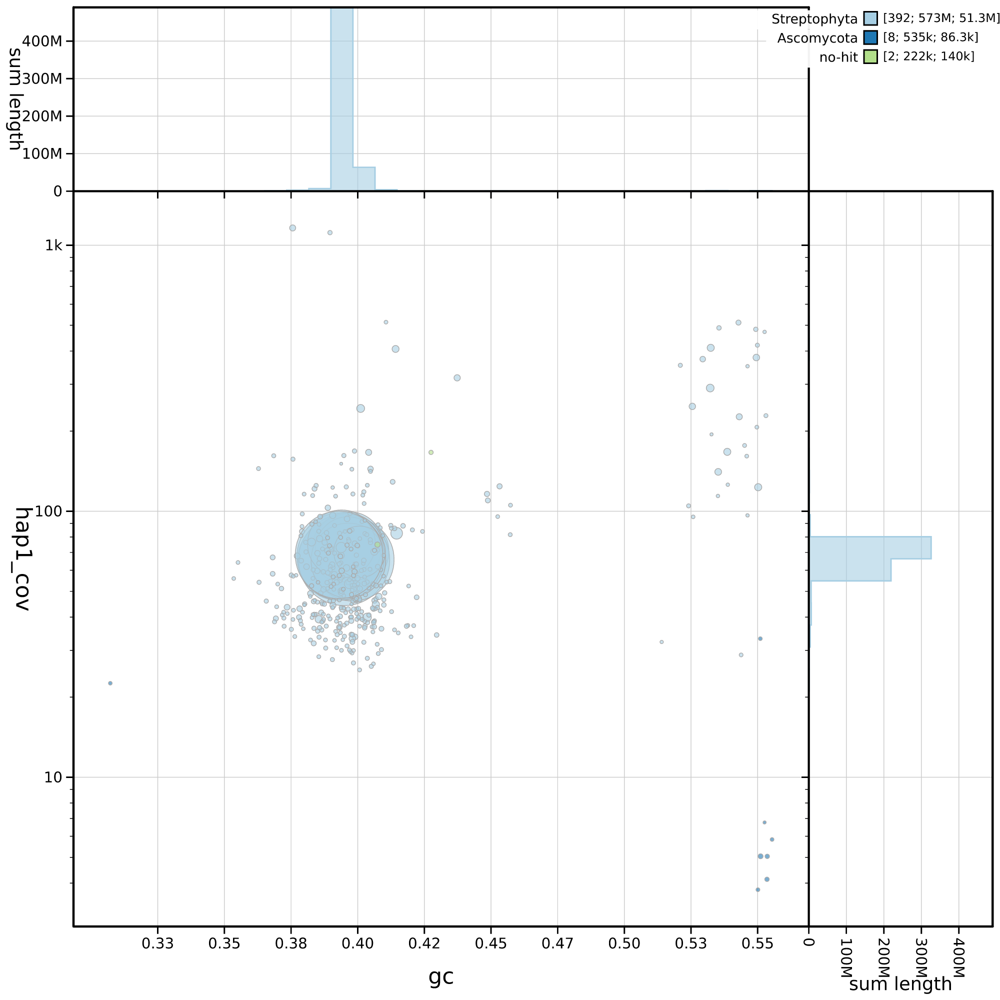  |   |
| 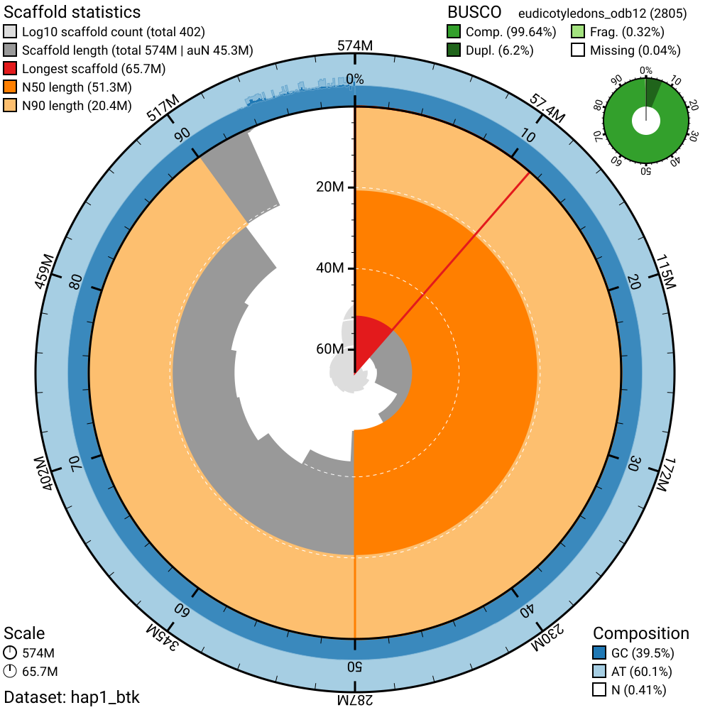 | 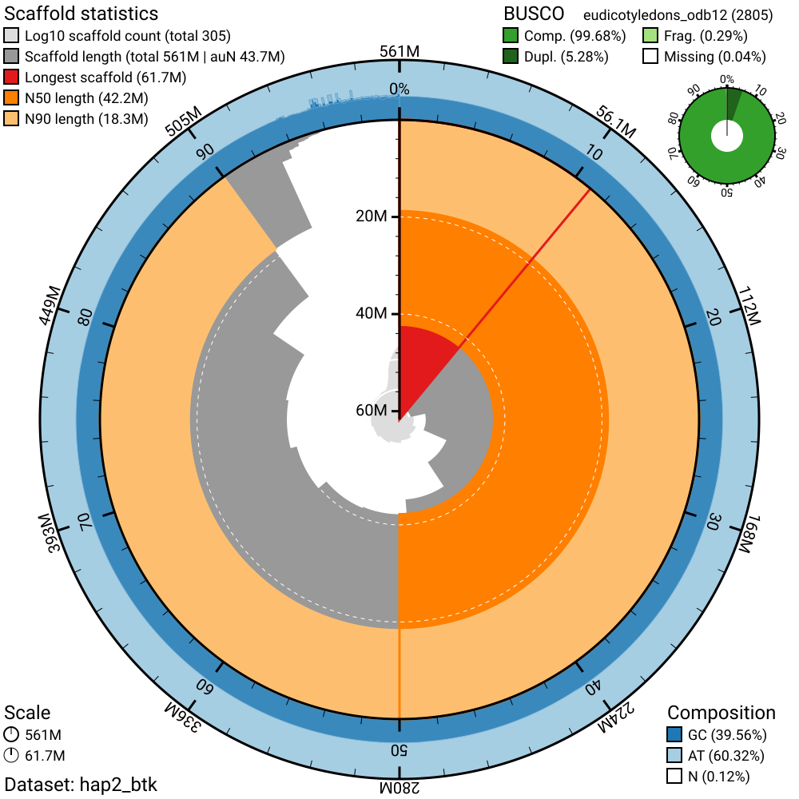 |

## <a id="04">Assembly of organelle genomes</a>
First, we need to download the organelle database.
```
db_dir="04_organelle/db"
base_url="https://raw.githubusercontent.com/c-zhou/OatkDB/main/v20230921"

files=(
    "magnoliopsida_mito.fam"
    "magnoliopsida_mito.fam.h3f"
    "magnoliopsida_mito.fam.h3i"
    "magnoliopsida_mito.fam.h3m"
    "magnoliopsida_mito.fam.h3p"
    "magnoliopsida_pltd.fam"
    "magnoliopsida_pltd.fam.h3f"
    "magnoliopsida_pltd.fam.h3i"
    "magnoliopsida_pltd.fam.h3m"
    "magnoliopsida_pltd.fam.h3p"
)

# download individual files
for file in "${files[@]}"; do
    wget -q "${base_url}/${file}" -O "${db_dir}/${file}"
    echo "  Downloaded: ${file}"
done
```

Following the previous trials, we should run oatk with corrected reads from Hifiasm. I also asked Claude to generate a python <a href="./scripts/oatk_circular_map.py">script</a> to visualise the circular map of each organelle.
```
# create a new directory as not to overwrite the previous results
cd 02_assembly/homcov55/hifiasm_s050 && mkdir -p ec_extract && cd ec_extract

# extract Hifiasm corrected reads
for s in ec.bin ovlp.source.bin ovlp.reverse.bin; do ln -s ../E_phylacis_s050.asm.$s .; done
hifiasm -o E_phylacis_s050.asm -t 128 --ont --write-ec ../../../../01_qc/02_chopper/E_phylacis_filtered.fastq.gz

# change directory
cd ../../../..

# run OatK
oatk -k 1001 \
     -c 30 \
     -t 128 \
     -p 04_organelle/db/magnoliopsida_pltd.fam \
     -m 04_organelle/db/magnoliopsida_mito.fam \
     -o 04_organelle/c30k1001/E_phylacis \
     02_assembly/homcov55/hifiasm_s050/ec_extract/E_phylacis_s050.asm.ec.fq

# save into PNG
python scripts/oatk_circular_map.py \
    04_organelle/c30k1001/E_phylacis.mito.ctg.fasta \
    04_organelle/c30k1001/E_phylacis.mito.ctg.bed \
    -o 04_organelle/c30k1001/mito_map.png

python scripts/oatk_circular_map.py \
    04_organelle/c30k1001/E_phylacis.pltd.ctg.fasta \
    04_organelle/c30k1001/E_phylacis.pltd.ctg.bed \
    -o 04_organelle/c30k1001/pltd_map.png
```

### <a id="04a">mtDNA</a>
```
>ctg000001l     length=355146 wlength=41066840.0 nv=11 circular=false path=u151-,u152+,u150-,u148-,u146-,u147+,u141-,u12277+,u139+,u146-,u138-
>ctg000002l     length=23355 wlength=2312145.0 nv=1 circular=false path=u149+
>ctg000003c     length=79427 wlength=7942700.0 nv=1 circular=true path=u12148-
```


### <a id="04b">ptDNA</a>
```
>ctg000001c     length=160190 wlength=150009126.0 nv=12 circular=true path=u140+,u12277+,u137-,u7+,u12278-,u143-,u142+,u143+,u12278+,u7-,u137+,u12277-
```


## <a id="05">Assembly of nuclear genome</a>

### <a id="05a">Checking for duplicate contigs</a>
```
# map each haplotype against each other and against itself
minimap2 -cx asm20 -t 128 \
    02_assembly/homcov55/hifiasm_s050/E_phylacis_s050.asm.bp.hap2.p_ctg.fa \
    02_assembly/homcov55/hifiasm_s050/E_phylacis_s050.asm.bp.hap1.p_ctg.fa \
    > 05_nuclear_qc/h1_vs_v2/h1_vs_h2.paf
minimap2 -cx asm20 -DP -m200 -t 128 \
    02_assembly/homcov55/hifiasm_s050/E_phylacis_s050.asm.bp.hap1.p_ctg.fa \
    02_assembly/homcov55/hifiasm_s050/E_phylacis_s050.asm.bp.hap1.p_ctg.fa \
    > 05_nuclear_qc/h1_vs_v2/h1_self.paf
minimap2 -cx asm20 -DP -m200 -t 128 \
    02_assembly/homcov55/hifiasm_s050/E_phylacis_s050.asm.bp.hap2.p_ctg.fa \
    02_assembly/homcov55/hifiasm_s050/E_phylacis_s050.asm.bp.hap2.p_ctg.fa \
    > 05_nuclear_qc/h1_vs_v2/h2_self.paf

# extract necessary columns
cut -f1-12 05_nuclear_qc/h1_vs_v2/h1_self.paf > 05_nuclear_qc/h1_vs_v2/h1_self.12.paf
cut -f1-12 05_nuclear_qc/h1_vs_v2/h2_self.paf > 05_nuclear_qc/h1_vs_v2/h2_self.12.paf

# generate the dotplots
Rscript scripts/pafCoordsDotPlotly.R \
    -i 05_nuclear_qc/h1_vs_v2/h1_vs_h2.paf \
    -o h1_vs_h2_dotplot2 -s -t

Rscript scripts/pafCoordsDotPlotly.R \
    -i 05_nuclear_qc/h1_vs_v2/h1_self.12.paf \
    -o h1_self_dotplot2 -s

Rscript scripts/pafCoordsDotPlotly.R \
    -i 05_nuclear_qc/h1_vs_v2/h2_self.12.paf \
    -o h2_self_dotplot2 -s
```

|                Hap 1 vs Hap 2                 |                    Hap 1 vs. Hap 1             |                    Hap 2 vs. Hap 2             |
| :-------------------------------------------: | :--------------------------------------------: | :--------------------------------------------: |
| 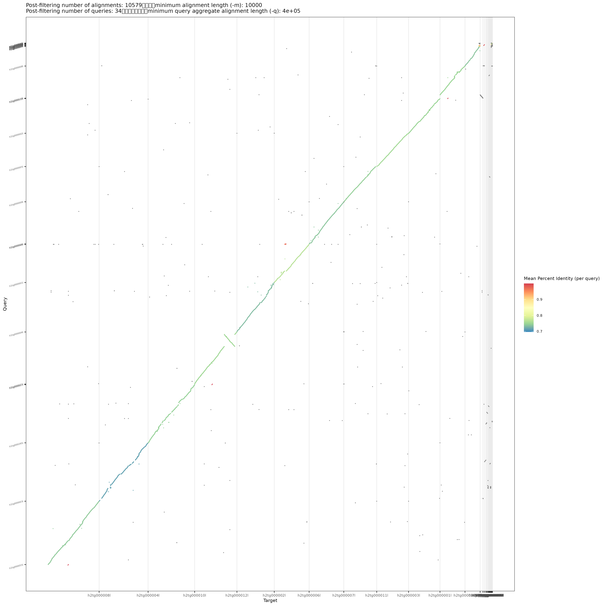 | 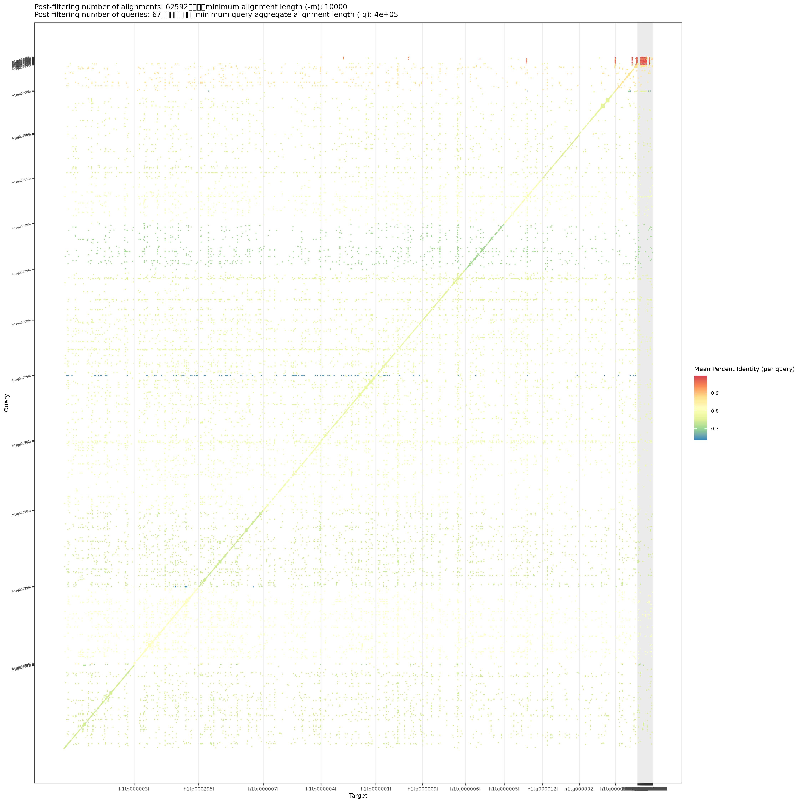  |   |

It seems that there is a number of duplicates at the top-right corner of the H1 vs. H1 and H2 vs. H2 plots. Let's zoom in more...
```
# remove the long, properly-aligned contigs
awk '!($1==$6 && $3==$8 && $4==$9)' 05_nuclear_qc/h1_vs_v2/h1_self.12.paf > 05_nuclear_qc/h1_vs_v2/h1_self.noself.paf
awk '!($1==$6 && $3==$8 && $4==$9)' 05_nuclear_qc/h1_vs_v2/h2_self.12.paf > 05_nuclear_qc/h1_vs_v2/h2_self.noself.paf

# repeat the plotting
Rscript scripts/pafCoordsDotPlotly.R \
    -i 05_nuclear_qc/h1_vs_v2/h1_self.noself.paf \
    -o h1_self_dotplot2_noself -s -m 10000 -q 50000

Rscript scripts/pafCoordsDotPlotly.R \
    -i 05_nuclear_qc/h1_vs_v2/h2_self.noself.paf \
    -o h2_self_dotplot2_noself -s -m 10000 -q 50000
```

|                    Hap 1 vs. Hap 1             |                    Hap 2 vs. Hap 2             |
| :--------------------------------------------: | :--------------------------------------------: |
| 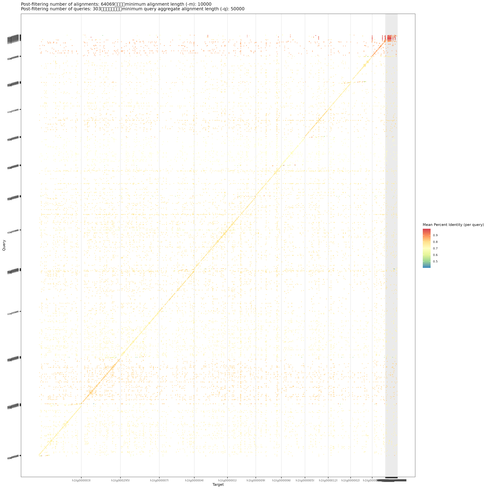  | 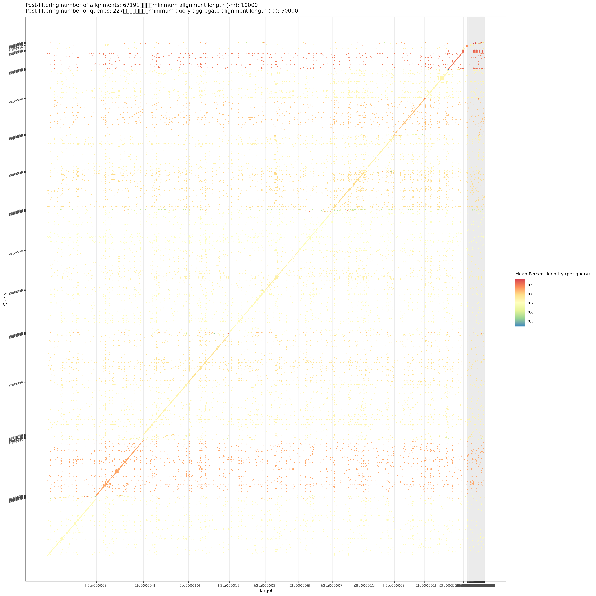  |


### Identity + Mapping Depth

It is still quite tricky to identify those contigs based on the plots. Claude (nicely) generated a Python <a href="./scripts/flag_contained_contigs.py">script</a> to identify putative duplicates based on the following (I will take `hap1` as an example):
- If `hap1` is perfect, then each contig should match 1:1 when mapped against itself. However, from the dotplots, we could see that there are smaller contigs that are better aligned to other longer contigs. The Python script lists every contig with ≥80% of its length lying inside a longer contig, with a minimum of 10kb aligned sites and 90% identity.
- There are four potential reasons how it could happen:
    1. An assembly error, where the same molecule got assembled twice
    2. A phasing error, where both parental alleles were put into hap1
    3. It is a repeat that exists in many copies (e.g., rDNA, a satellite, or organelle DNA)
    4. It is a paralog

    Between these cases, we should remove cases 1-3, but **keep case 4**.
- We can differentiate these four cases by looking at the:
    - Identity
        1. ≥99.9%, because the two assemblies come from the same molecule
        2. ~96.5%, because the median divergence between the two parents are ~3.5%:
            ```
            awk '$11>=100000 {for(i=13;i<=NF;i++) if($i~/^(de|dv):f:/){split($i,a,":"); print 1-a[3]}}' \
                02_assembly/homcov55/hifiasm_s050/compare_h1h2/hap1_vs_hap2.paf | sort -n \
            | awk '{v[NR]=$1} END{printf "n=%d  Q1=%.3f  median=%.3f  Q3=%.3f\n", NR, v[int(NR/4)+1], v[int(NR/2)+1], v[int(NR*3/4)+1]}'
            ```
        3. ≥99.9%, but contained in **several** other contigs
        4. Could be ~96.5% (and thus unidentifiable in regards to case 2)
    - Depth
        1. ~27.5x, because the reads of one locus are shared between two identical copies
        2. ~27.5x, because reads from only one parent would map to the smaller contig
        3. Random
        4. ~55x, because it has its own locus from both parents
- Lastly, instead of setting a fixed cutoff of 27.5x or 55x to keep or remove a contig, we dynamically set a depth threshold for each contig based on it's percentage of contained sites (*f*) with the following formula: `27.5*f* + 55(1 − *f*)`. If the value is lower than the threshold, the contig is more likely to fit either case 1 or 2 and thus should be removed.

```
# identify putative paralogs
python3 scripts/flag_contained_contigs.py 05_nuclear_qc/h1_vs_v2/h1_self.paf > 05_nuclear_qc/h1_vs_v2/h1_dups.tsv
python3 scripts/flag_contained_contigs.py 05_nuclear_qc/h1_vs_v2/h2_self.paf > 05_nuclear_qc/h1_vs_v2/h2_dups.tsv

# calculate each contig's depth
awk -F'\t' 'NR>1{print $1}' 05_nuclear_qc/h1_vs_v2/h1_dups.tsv > 05_nuclear_qc/h1_vs_v2/h1_remove.txt
awk 'NR==FNR{k[$1];next} $1 in k{print $1"\t0\t"$2}' \
    05_nuclear_qc/h1_vs_v2/h1_remove.txt \
    02_assembly/homcov55/hifiasm_s050/E_phylacis_s050.asm.bp.hap1.p_ctg.fa.fai \
    > 05_nuclear_qc/h1_vs_v2/h1_remove.bed
mosdepth -t 16 --by 05_nuclear_qc/h1_vs_v2/h1_remove.bed --no-per-base 05_nuclear_qc/h1_vs_v2/h1_dups 03_qc/hap1.bam
zcat 05_nuclear_qc/h1_vs_v2/h1_dups.regions.bed.gz | awk '{printf "%s\t%.1f\n",$1,$4}' | sort -k2,2n

awk -F'\t' 'NR>1{print $1}' 05_nuclear_qc/h1_vs_v2/h2_dups.tsv > 05_nuclear_qc/h1_vs_v2/h2_remove.txt
awk 'NR==FNR{k[$1];next} $1 in k{print $1"\t0\t"$2}' \
    05_nuclear_qc/h1_vs_v2/h2_remove.txt \
    02_assembly/homcov55/hifiasm_s050/E_phylacis_s050.asm.bp.hap2.p_ctg.fa.fai \
    > 05_nuclear_qc/h1_vs_v2/h2_remove.bed
mosdepth -t 16 --by 05_nuclear_qc/h1_vs_v2/h2_remove.bed --no-per-base 05_nuclear_qc/h1_vs_v2/h2_dups 03_qc/hap2.bam
zcat 05_nuclear_qc/h1_vs_v2/h2_dups.regions.bed.gz | awk '{printf "%s\t%.1f\n",$1,$4}' | sort -k2,2n
```

> [!NOTE]
> - **Remove**: depth ≤ cutoff - potential case 1 or 2
> - **Keep**  : depth > cutoff - potential case 4
> - **Check** : potential case 3

- <b><i>Haplotype 1</b></i> — **62** remove (5.15 Mb), **17** keep (1.37 Mb), **32** check (3.48 Mb)

    | Contig      | Length (bp) | Covered (%) | Max identity (%) | Depth (x) | Cutoff (x) | Contained in                                                    | Verdict |
    | :---------- | ----------: | ----------: | ---------------: | --------: | ---------: | :-------------------------------------------------------------- | :------ |
    | h1tg000348l |      38,223 |        93.4 |            99.98 |       7.1 |          – | h1tg000114l, h1tg000231l, h1tg000016l, h1tg000019l              | Check   |
    | h1tg000160l |      40,059 |       100.0 |            99.99 |      11.4 |       41.2 | h1tg000003l                                                     | Remove  |
    | h1tg000347l |      38,596 |       100.0 |            99.99 |      11.9 |          – | h1tg000101l, h1tg000059l, h1tg000376l, h1tg000121l, h1tg000031l | Check   |
    | h1tg000231l |      57,617 |       100.0 |           100.00 |      12.4 |          – | h1tg000033l, h1tg000016l, h1tg000197l, h1tg000019l, h1tg000268l | Check   |
    | h1tg000284l |      52,359 |       100.0 |            99.99 |      16.1 |          – | h1tg000059l, h1tg000114l, h1tg000019l, h1tg000016l, h1tg000101l | Check   |
    | h1tg000356l |      68,179 |       100.0 |           100.00 |      17.4 |          – | h1tg000059l, h1tg000033l, h1tg000114l, h1tg000019l, h1tg000016l | Check   |
    | h1tg000129l |      43,642 |       100.0 |            99.99 |      20.3 |          – | h1tg000059l, h1tg000114l, h1tg000019l, h1tg000016l, h1tg000031l | Check   |
    | h1tg000029l |      58,330 |        99.9 |           100.00 |      20.5 |          – | h1tg000033l, h1tg000016l, h1tg000019l, h1tg000197l, h1tg000114l | Check   |
    | h1tg000304l |      64,293 |        98.6 |            97.14 |      21.9 |       41.4 | h1tg000005l                                                     | Remove  |
    | h1tg000369l |      50,916 |       100.0 |            95.80 |      22.1 |       41.2 | h1tg000004l                                                     | Remove  |
    | h1tg000114l |     256,182 |       100.0 |           100.00 |      22.6 |          – | h1tg000033l, h1tg000059l, h1tg000019l, h1tg000101l, h1tg000014l | Check   |
    | h1tg000366l |      42,921 |       100.0 |            99.99 |      23.1 |          – | h1tg000033l, h1tg000016l, h1tg000197l, h1tg000019l, h1tg000114l | Check   |
    | h1tg000068l |      77,346 |        88.1 |            96.88 |      23.5 |       42.9 | h1tg000008l                                                     | Remove  |
    | h1tg000357l |      48,044 |       100.0 |            96.49 |      24.5 |       41.2 | h1tg000002l                                                     | Remove  |
    | h1tg000256l |      75,059 |        91.8 |            97.23 |      24.9 |       42.4 | h1tg000002l                                                     | Remove  |
    | h1tg000053l |      68,850 |       100.0 |            99.43 |      25.7 |       41.2 | h1tg000004l, h1tg000102l, h1tg000006l                           | Remove  |
    | h1tg000362l |      56,512 |        84.2 |            95.19 |      26.0 |       43.4 | h1tg000007l                                                     | Remove  |
    | h1tg000159l |      59,911 |        88.0 |            96.30 |      26.2 |       42.9 | h1tg000001l                                                     | Remove  |
    | h1tg000386l |      60,966 |       100.0 |            96.57 |      26.4 |       41.2 | h1tg000004l                                                     | Remove  |
    | h1tg000185l |      61,829 |        90.6 |            96.22 |      26.7 |       42.5 | h1tg000003l                                                     | Remove  |
    | h1tg000198l |      59,360 |        93.8 |            96.61 |      26.8 |       42.1 | h1tg000004l                                                     | Remove  |
    | h1tg000209l |      54,964 |        93.7 |            97.68 |      27.0 |       42.1 | h1tg000003l                                                     | Remove  |
    | h1tg000207l |      62,163 |        98.6 |            96.02 |      27.1 |       41.4 | h1tg000006l                                                     | Remove  |
    | h1tg000392l |      58,378 |        82.8 |            97.10 |      27.2 |       43.6 | h1tg000012l                                                     | Remove  |
    | h1tg000310l |      58,915 |        97.5 |            97.37 |      28.1 |       41.6 | h1tg000005l, h1tg000007l, h1tg000009l, h1tg000071l, h1tg000003l | Remove  |
    | h1tg000010l |      60,816 |       100.0 |           100.00 |      28.3 |          – | h1tg000033l, h1tg000016l, h1tg000197l, h1tg000114l, h1tg000268l | Check   |
    | h1tg000314l |      66,301 |        86.2 |            94.82 |      28.6 |       43.1 | h1tg000004l                                                     | Remove  |
    | h1tg000072l |      74,883 |        80.5 |            97.03 |      29.0 |       43.9 | h1tg000012l                                                     | Remove  |
    | h1tg000137l |      73,968 |        97.9 |            96.80 |      29.7 |       41.5 | h1tg000005l                                                     | Remove  |
    | h1tg000384l |      49,774 |        84.1 |            96.58 |      29.9 |       43.4 | h1tg000004l                                                     | Remove  |
    | h1tg000212l |      77,008 |        88.6 |            96.31 |      30.0 |       42.8 | h1tg000002l                                                     | Remove  |
    | h1tg000171l |      42,060 |       100.0 |            99.99 |      30.3 |          – | h1tg000376l, h1tg000121l, h1tg000101l, h1tg000059l, h1tg000263l | Check   |
    | h1tg000210l |     122,668 |        95.3 |            97.06 |      30.3 |       41.9 | h1tg000012l                                                     | Remove  |
    | h1tg000267l |      59,257 |        95.1 |            94.60 |      30.5 |       41.9 | h1tg000009l                                                     | Remove  |
    | h1tg000105l |      60,672 |        81.4 |            96.21 |      30.6 |       43.8 | h1tg000006l                                                     | Remove  |
    | h1tg000367l |      71,906 |       100.0 |            95.79 |      30.9 |       41.2 | h1tg000008l                                                     | Remove  |
    | h1tg000402l |      32,104 |       100.0 |           100.00 |      30.9 |          – | h1tg000059l, h1tg000376l, h1tg000121l, h1tg000101l, h1tg000031l | Check   |
    | h1tg000234l |      58,540 |        96.8 |            95.50 |      31.1 |       41.7 | h1tg000003l                                                     | Remove  |
    | h1tg000335l |     114,065 |        85.3 |            96.13 |      31.1 |       43.3 | h1tg000003l                                                     | Remove  |
    | h1tg000096l |      61,056 |       100.0 |            95.72 |      31.3 |       41.2 | h1tg000004l                                                     | Remove  |
    | h1tg000239l |      55,435 |        99.4 |            96.96 |      31.4 |       41.3 | h1tg000001l, h1tg000009l                                        | Remove  |
    | h1tg000116l |      56,604 |        95.7 |            95.27 |      31.4 |       41.8 | h1tg000007l                                                     | Remove  |
    | h1tg000099l |      58,344 |        97.1 |            96.48 |      32.1 |       41.6 | h1tg000008l                                                     | Remove  |
    | h1tg000235l |      91,815 |        80.3 |            96.24 |      32.3 |       44.0 | h1tg000005l                                                     | Remove  |
    | h1tg000054l |      46,840 |        84.9 |            95.96 |      32.4 |       43.3 | h1tg000008l                                                     | Remove  |
    | h1tg000385l |      62,848 |        91.9 |            95.49 |      33.1 |       42.4 | h1tg000008l                                                     | Remove  |
    | h1tg000381l |      88,366 |        99.1 |            96.55 |      33.3 |       41.4 | h1tg000012l                                                     | Remove  |
    | h1tg000355l |      61,806 |        96.2 |            95.53 |      33.5 |       41.8 | h1tg000008l                                                     | Remove  |
    | h1tg000278l |      97,489 |        86.3 |            95.99 |      33.6 |       43.1 | h1tg000009l                                                     | Remove  |
    | h1tg000204l |     162,827 |        88.5 |            97.77 |      33.9 |       42.8 | h1tg000295l, h1tg000007l                                        | Remove  |
    | h1tg000102l |     103,537 |       100.0 |            99.60 |      34.0 |       41.2 | h1tg000004l, h1tg000003l, h1tg000009l, h1tg000001l, h1tg000014l | Remove  |
    | h1tg000089l |      99,513 |        87.2 |            96.90 |      34.4 |       43.0 | h1tg000001l                                                     | Remove  |
    | h1tg000138l |     448,249 |        82.6 |            99.38 |      34.5 |       43.6 | h1tg000008l, h1tg000012l, h1tg000295l, h1tg000009l              | Remove  |
    | h1tg000262l |      60,426 |        94.5 |            99.97 |      34.9 |       42.0 | h1tg000004l, h1tg000205l                                        | Remove  |
    | h1tg000157l |      77,595 |        89.1 |            96.85 |      34.9 |       42.7 | h1tg000005l                                                     | Remove  |
    | h1tg000149l |      66,846 |        81.5 |            96.05 |      34.9 |       43.8 | h1tg000003l                                                     | Remove  |
    | h1tg000194l |     101,536 |        89.0 |            95.43 |      35.1 |       42.8 | h1tg000002l                                                     | Remove  |
    | h1tg000192l |      98,955 |        87.5 |            96.01 |      35.2 |       43.0 | h1tg000002l                                                     | Remove  |
    | h1tg000297l |      69,314 |        90.2 |            96.80 |      35.4 |       42.6 | h1tg000295l                                                     | Remove  |
    | h1tg000052l |      57,550 |        98.6 |            95.86 |      35.9 |       41.4 | h1tg000295l                                                     | Remove  |
    | h1tg000020l |      76,640 |        88.7 |            97.35 |      36.4 |       42.8 | h1tg000001l, h1tg000004l, h1tg000295l, h1tg000007l, h1tg000003l | Remove  |
    | h1tg000333l |      66,283 |        87.9 |            96.25 |      36.5 |       42.9 | h1tg000002l                                                     | Remove  |
    | h1tg000383l |      93,603 |        85.7 |            97.46 |      36.5 |       43.2 | h1tg000002l                                                     | Remove  |
    | h1tg000306l |      48,104 |        90.4 |            96.33 |      36.6 |       42.6 | h1tg000008l                                                     | Remove  |
    | h1tg000237l |      69,434 |        93.9 |            96.20 |      36.7 |       42.1 | h1tg000001l, h1tg000005l                                        | Remove  |
    | h1tg000124l |      84,493 |        84.7 |            95.60 |      37.2 |       43.4 | h1tg000009l                                                     | Remove  |
    | h1tg000202l |      54,121 |        86.9 |            95.70 |      37.5 |       43.1 | h1tg000002l                                                     | Remove  |
    | h1tg000019l |     289,545 |       100.0 |           100.00 |      37.8 |          – | h1tg000014l, h1tg000033l, h1tg000059l, h1tg000101l, h1tg000008l | Check   |
    | h1tg000293l |      81,065 |        86.9 |            97.15 |      38.2 |       43.1 | h1tg000002l                                                     | Remove  |
    | h1tg000112l |      60,454 |        84.1 |            97.59 |      38.3 |       43.4 | h1tg000009l                                                     | Remove  |
    | h1tg000324l |      87,889 |        93.1 |            96.69 |      39.7 |       42.2 | h1tg000004l, h1tg000003l, h1tg000005l                           | Remove  |
    | h1tg000073l |      81,226 |       100.0 |            98.50 |      39.9 |       41.2 | h1tg000014l                                                     | Remove  |
    | h1tg000077l |      85,589 |        88.7 |            96.84 |      40.4 |       42.8 | h1tg000008l, h1tg000003l, h1tg000295l                           | Remove  |
    | h1tg000069l |     304,868 |        81.0 |            96.76 |      40.4 |       43.9 | h1tg000009l                                                     | Remove  |
    | h1tg000180l |      55,519 |       100.0 |           100.00 |      41.7 |          – | h1tg000025l, h1tg000373l, h1tg000041l, h1tg000083l, h1tg000005l | Check   |
    | h1tg000352l |      43,085 |       100.0 |           100.00 |      41.7 |          – | h1tg000101l, h1tg000059l, h1tg000121l, h1tg000376l, h1tg000340l | Check   |
    | h1tg000188l |      69,874 |       100.0 |           100.00 |      41.8 |          – | h1tg000033l, h1tg000016l, h1tg000197l, h1tg000019l, h1tg000268l | Check   |
    | h1tg000146l |     142,640 |        89.5 |            98.49 |      41.8 |       42.7 | h1tg000004l, h1tg000005l, h1tg000006l, h1tg000007l, h1tg000071l | Remove  |
    | h1tg000331l |      49,002 |        82.5 |            95.88 |      44.0 |       43.7 | h1tg000008l, h1tg000006l, h1tg000295l, h1tg000005l, h1tg000009l | Keep    |
    | h1tg000043l |      58,740 |        87.1 |            96.78 |      45.2 |       43.0 | h1tg000003l, h1tg000001l                                        | Keep    |
    | h1tg000018l |      87,119 |        88.4 |            98.23 |      45.6 |       42.8 | h1tg000005l, h1tg000009l                                        | Keep    |
    | h1tg000050l |      51,925 |        86.2 |            96.87 |      45.6 |       43.1 | h1tg000009l                                                     | Keep    |
    | h1tg000360l |      65,049 |        81.4 |            96.83 |      46.4 |       43.8 | h1tg000004l, h1tg000071l, h1tg000001l, h1tg000295l, h1tg000006l | Keep    |
    | h1tg000154l |      71,970 |        96.6 |            95.27 |      47.0 |       41.7 | h1tg000012l                                                     | Keep    |
    | h1tg000323l |      67,032 |        85.5 |            98.36 |      47.6 |       43.2 | h1tg000004l, h1tg000007l                                        | Keep    |
    | h1tg000175l |      57,797 |        99.1 |            97.56 |      49.0 |       41.4 | h1tg000295l, h1tg000003l                                        | Keep    |
    | h1tg000325l |      53,329 |        80.6 |            97.73 |      49.5 |       43.9 | h1tg000014l, h1tg000022l, h1tg000001l, h1tg000006l, h1tg000003l | Keep    |
    | h1tg000263l |      56,408 |       100.0 |           100.00 |      52.1 |          – | h1tg000101l, h1tg000059l, h1tg000376l, h1tg000121l, h1tg000031l | Check   |
    | h1tg000299l |      58,740 |        93.4 |            96.90 |      52.5 |       42.2 | h1tg000005l, h1tg000007l                                        | Keep    |
    | h1tg000016l |     201,921 |       100.0 |           100.00 |      53.9 |          – | h1tg000033l, h1tg000114l, h1tg000019l, h1tg000197l, h1tg000059l | Check   |
    | h1tg000047l |     252,734 |        89.8 |            98.49 |      53.9 |       42.7 | h1tg000003l, h1tg000008l                                        | Keep    |
    | h1tg000158l |      56,037 |        88.1 |            95.33 |      57.0 |       42.9 | h1tg000009l                                                     | Keep    |
    | h1tg000197l |     240,577 |       100.0 |           100.00 |      57.7 |          – | h1tg000014l, h1tg000033l, h1tg000019l, h1tg000114l, h1tg000059l | Check   |
    | h1tg000371l |      61,340 |        89.6 |            95.03 |      57.7 |       42.7 | h1tg000008l, h1tg000003l                                        | Keep    |
    | h1tg000195l |      71,957 |       100.0 |           100.00 |      59.2 |          – | h1tg000376l, h1tg000059l, h1tg000121l, h1tg000101l, h1tg000031l | Check   |
    | h1tg000373l |      62,207 |       100.0 |           100.00 |      61.1 |          – | h1tg000025l, h1tg000083l, h1tg000005l                           | Check   |
    | h1tg000031l |     161,493 |       100.0 |           100.00 |      62.8 |          – | h1tg000059l, h1tg000101l, h1tg000121l, h1tg000114l, h1tg000019l | Check   |
    | h1tg000252l |     154,916 |        88.4 |            98.17 |      63.1 |       42.8 | h1tg000001l, h1tg000009l, h1tg000295l, h1tg000002l, h1tg000003l | Keep    |
    | h1tg000121l |     228,093 |       100.0 |           100.00 |      63.3 |          – | h1tg000059l, h1tg000101l, h1tg000114l, h1tg000019l, h1tg000014l | Check   |
    | h1tg000334l |     109,400 |        86.4 |            98.32 |      63.5 |       43.1 | h1tg000005l, h1tg000009l                                        | Keep    |
    | h1tg000211l |      67,208 |       100.0 |           100.00 |      63.7 |          – | h1tg000033l, h1tg000016l, h1tg000019l, h1tg000197l, h1tg000114l | Check   |
    | h1tg000359l |      59,624 |        98.4 |            99.82 |      77.1 |       41.5 | h1tg000002l, h1tg000295l, h1tg000007l, h1tg000009l, h1tg000273l | Keep    |
    | h1tg000309l |      53,645 |       100.0 |           100.00 |      80.0 |          – | h1tg000088l, h1tg000061l, h1tg000141l, h1tg000041l, h1tg000001l | Check   |
    | h1tg000101l |     290,087 |        91.2 |           100.00 |      81.2 |          – | h1tg000059l, h1tg000014l, h1tg000008l, h1tg000033l              | Check   |
    | h1tg000088l |     214,149 |        81.1 |           100.00 |      91.9 |          – | h1tg000041l, h1tg000006l, h1tg000001l, h1tg000007l, h1tg000012l | Check   |
    | h1tg000372l |      57,717 |        84.3 |            97.21 |     104.5 |       43.4 | h1tg000002l                                                     | Keep    |
    | h1tg000376l |     125,158 |       100.0 |           100.00 |     116.9 |          – | h1tg000059l, h1tg000121l, h1tg000101l, h1tg000031l, h1tg000114l | Check   |
    | h1tg000268l |      86,546 |        98.4 |           100.00 |     148.4 |          – | h1tg000033l, h1tg000016l, h1tg000197l, h1tg000019l, h1tg000114l | Check   |
    | h1tg000340l |      89,250 |       100.0 |           100.00 |     149.7 |          – | h1tg000059l, h1tg000376l, h1tg000101l, h1tg000121l, h1tg000031l | Check   |
    | h1tg000141l |      84,386 |       100.0 |           100.00 |     338.6 |          – | h1tg000061l, h1tg000088l, h1tg000041l, h1tg000001l              | Check   |
    | h1tg000061l |     198,533 |        97.5 |           100.00 |     558.2 |          – | h1tg000041l, h1tg000088l, h1tg000001l, h1tg000009l              | Check   |

- <b><i>Haplotype 2</b></i> — **63** remove (5.07 Mb), **18** keep (1.55 Mb), **11** check (2.02 Mb)

    | Contig      | Length (bp) | Covered (%) | Max identity (%) | Depth (x) | Cutoff (x) | Contained in                                                    | Verdict |
    | :---------- | ----------: | ----------: | ---------------: | --------: | ---------: | :-------------------------------------------------------------- | :------ |
    | h2tg000161l |     131,896 |       100.0 |            99.96 |      13.1 |       41.2 | h2tg000001l                                                     | Remove  |
    | h2tg000260l |      60,635 |        94.1 |            96.69 |      23.9 |       42.1 | h2tg000001l                                                     | Remove  |
    | h2tg000033l |      61,285 |       100.0 |            97.56 |      24.4 |       41.2 | h2tg000012l                                                     | Remove  |
    | h2tg000058l |     122,305 |        97.6 |            96.96 |      25.6 |       41.6 | h2tg000009l                                                     | Remove  |
    | h2tg000269l |      57,239 |       100.0 |            97.22 |      25.7 |       41.2 | h2tg000002l                                                     | Remove  |
    | h2tg000298l |      53,830 |        96.2 |            96.45 |      25.8 |       41.8 | h2tg000005l                                                     | Remove  |
    | h2tg000032l |      67,113 |        96.8 |            96.83 |      25.9 |       41.7 | h2tg000001l                                                     | Remove  |
    | h2tg000133l |      61,627 |        99.8 |            96.80 |      26.0 |       41.3 | h2tg000008l                                                     | Remove  |
    | h2tg000130l |      67,099 |        89.4 |            95.49 |      26.1 |       42.7 | h2tg000007l                                                     | Remove  |
    | h2tg000158l |      65,663 |        86.6 |            96.69 |      26.4 |       43.1 | h2tg000008l                                                     | Remove  |
    | h2tg000080l |      55,702 |        93.9 |            96.43 |      26.6 |       42.1 | h2tg000011l                                                     | Remove  |
    | h2tg000067l |      70,936 |        88.2 |            95.61 |      27.4 |       42.9 | h2tg000001l                                                     | Remove  |
    | h2tg000268l |      66,676 |        86.0 |            95.82 |      27.7 |       43.2 | h2tg000007l                                                     | Remove  |
    | h2tg000187l |      84,820 |        82.3 |            96.72 |      28.1 |       43.7 | h2tg000004l                                                     | Remove  |
    | h2tg000040l |      41,228 |        85.1 |            96.37 |      28.4 |       43.3 | h2tg000036l                                                     | Remove  |
    | h2tg000141l |      65,614 |        95.3 |            96.93 |      28.8 |       41.9 | h2tg000036l                                                     | Remove  |
    | h2tg000134l |      61,652 |        93.3 |            97.48 |      29.6 |       42.2 | h2tg000010l                                                     | Remove  |
    | h2tg000290l |      36,811 |       100.0 |            99.99 |      29.7 |          – | h2tg000005l, h2tg000045l, h2tg000068l, h2tg000025l, h2tg000173l | Check   |
    | h2tg000139l |      66,853 |        89.2 |            96.79 |      30.0 |       42.7 | h2tg000008l                                                     | Remove  |
    | h2tg000074l |      75,235 |        83.2 |            96.98 |      30.2 |       43.6 | h2tg000001l                                                     | Remove  |
    | h2tg000205l |      63,721 |        99.5 |            95.17 |      31.4 |       41.3 | h2tg000011l                                                     | Remove  |
    | h2tg000203l |      74,271 |        96.9 |            97.42 |      31.5 |       41.7 | h2tg000011l                                                     | Remove  |
    | h2tg000226l |     125,977 |        87.6 |            98.58 |      31.5 |       43.0 | h2tg000008l                                                     | Remove  |
    | h2tg000132l |      94,325 |        85.4 |            96.88 |      31.7 |       43.3 | h2tg000010l                                                     | Remove  |
    | h2tg000189l |      58,864 |        99.4 |            95.17 |      31.9 |       41.3 | h2tg000011l                                                     | Remove  |
    | h2tg000159l |     102,704 |        99.1 |            96.25 |      31.9 |       41.4 | h2tg000010l, h2tg000007l                                        | Remove  |
    | h2tg000198l |      81,149 |        95.3 |            96.80 |      31.9 |       41.9 | h2tg000002l                                                     | Remove  |
    | h2tg000199l |      53,314 |        99.5 |            96.11 |      32.2 |       41.3 | h2tg000008l                                                     | Remove  |
    | h2tg000276l |      48,196 |        82.5 |            96.72 |      32.6 |       43.7 | h2tg000008l                                                     | Remove  |
    | h2tg000270l |      89,621 |        87.1 |            96.68 |      32.7 |       43.0 | h2tg000003l, h2tg000009l                                        | Remove  |
    | h2tg000123l |      67,248 |        91.0 |            95.96 |      33.0 |       42.5 | h2tg000008l                                                     | Remove  |
    | h2tg000217l |      74,108 |        83.8 |            97.10 |      33.0 |       43.5 | h2tg000002l                                                     | Remove  |
    | h2tg000279l |      61,497 |        96.4 |            95.29 |      33.6 |       41.7 | h2tg000005l                                                     | Remove  |
    | h2tg000207l |      85,960 |        87.0 |            96.39 |      34.5 |       43.0 | h2tg000001l                                                     | Remove  |
    | h2tg000057l |      43,064 |        87.3 |            94.92 |      34.6 |       43.0 | h2tg000010l                                                     | Remove  |
    | h2tg000192l |      81,168 |        86.1 |            96.77 |      34.7 |       43.2 | h2tg000008l                                                     | Remove  |
    | h2tg000230l |      61,325 |        82.8 |            95.98 |      34.7 |       43.6 | h2tg000008l                                                     | Remove  |
    | h2tg000213l |     177,552 |        89.5 |            96.31 |      34.8 |       42.7 | h2tg000012l                                                     | Remove  |
    | h2tg000062l |      75,593 |        84.1 |            96.67 |      34.9 |       43.4 | h2tg000003l, h2tg000010l, h2tg000005l, h2tg000007l, h2tg000008l | Remove  |
    | h2tg000162l |     100,984 |        92.5 |            97.18 |      35.0 |       42.3 | h2tg000007l                                                     | Remove  |
    | h2tg000244l |      56,932 |        95.4 |            97.07 |      35.3 |       41.9 | h2tg000007l                                                     | Remove  |
    | h2tg000249l |      87,280 |        89.8 |            96.50 |      35.5 |       42.7 | h2tg000012l                                                     | Remove  |
    | h2tg000082l |     134,355 |        84.1 |            96.99 |      35.7 |       43.4 | h2tg000008l                                                     | Remove  |
    | h2tg000173l |     174,305 |       100.0 |           100.00 |      36.0 |          – | h2tg000005l, h2tg000045l, h2tg000068l, h2tg000016l, h2tg000090l | Check   |
    | h2tg000115l |      85,713 |        99.7 |            96.78 |      36.3 |       41.3 | h2tg000011l                                                     | Remove  |
    | h2tg000041l |      63,528 |       100.0 |            96.18 |      36.4 |       41.2 | h2tg000008l, h2tg000004l, h2tg000007l, h2tg000005l, h2tg000006l | Remove  |
    | h2tg000046l |      84,672 |        92.3 |            96.79 |      36.7 |       42.3 | h2tg000012l, h2tg000009l, h2tg000011l, h2tg000001l, h2tg000003l | Remove  |
    | h2tg000110l |      74,609 |        86.5 |            96.19 |      36.8 |       43.1 | h2tg000012l, h2tg000185l                                        | Remove  |
    | h2tg000218l |     105,915 |        90.2 |            95.45 |      37.1 |       42.6 | h2tg000001l                                                     | Remove  |
    | h2tg000195l |     123,740 |        81.4 |            99.05 |      37.1 |       43.8 | h2tg000001l, h2tg000010l                                        | Remove  |
    | h2tg000232l |      73,484 |        84.5 |            96.79 |      37.2 |       43.4 | h2tg000001l                                                     | Remove  |
    | h2tg000127l |      93,705 |        94.5 |            95.99 |      37.6 |       42.0 | h2tg000010l                                                     | Remove  |
    | h2tg000101l |      50,093 |        92.5 |            97.96 |      37.9 |       42.3 | h2tg000001l, h2tg000220l                                        | Remove  |
    | h2tg000272l |      58,866 |        95.3 |            97.06 |      38.7 |       41.9 | h2tg000004l                                                     | Remove  |
    | h2tg000056l |     130,833 |        95.9 |            95.13 |      38.8 |       41.8 | h2tg000005l                                                     | Remove  |
    | h2tg000241l |      98,137 |       100.0 |            97.36 |      39.0 |       41.2 | h2tg000004l, h2tg000009l                                        | Remove  |
    | h2tg000238l |      55,369 |        83.1 |            95.04 |      40.0 |       43.6 | h2tg000004l, h2tg000237l                                        | Remove  |
    | h2tg000085l |      60,254 |       100.0 |            96.00 |      40.1 |       41.2 | h2tg000001l                                                     | Remove  |
    | h2tg000081l |      89,468 |        83.7 |            95.28 |      40.1 |       43.5 | h2tg000010l                                                     | Remove  |
    | h2tg000148l |      76,624 |       100.0 |            96.02 |      40.7 |       41.2 | h2tg000004l, h2tg000006l, h2tg000007l                           | Remove  |
    | h2tg000153l |     142,845 |        99.2 |            99.15 |      41.6 |       41.4 | h2tg000011l, h2tg000012l, h2tg000002l, h2tg000010l, h2tg000009l | Keep    |
    | h2tg000191l |     185,841 |        84.7 |            96.21 |      42.0 |       43.4 | h2tg000012l, h2tg000004l, h2tg000010l                           | Remove  |
    | h2tg000119l |      59,694 |        82.4 |            95.81 |      42.0 |       43.7 | h2tg000004l                                                     | Remove  |
    | h2tg000178l |      60,961 |        91.3 |            98.09 |      42.3 |       42.4 | h2tg000002l, h2tg000137l, h2tg000015l                           | Remove  |
    | h2tg000125l |      46,962 |        80.4 |            94.97 |      42.3 |       43.9 | h2tg000001l                                                     | Remove  |
    | h2tg000015l |     151,173 |        80.2 |            98.27 |      42.9 |       44.0 | h2tg000002l                                                     | Remove  |
    | h2tg000055l |      56,644 |       100.0 |            96.07 |      43.0 |       41.2 | h2tg000011l                                                     | Keep    |
    | h2tg000179l |      49,033 |       100.0 |            97.98 |      43.6 |       41.2 | h2tg000003l, h2tg000042l, h2tg000007l, h2tg000005l              | Keep    |
    | h2tg000140l |      53,753 |        86.0 |            96.28 |      44.0 |       43.2 | h2tg000003l                                                     | Keep    |
    | h2tg000124l |      66,744 |        89.5 |            95.38 |      44.6 |       42.7 | h2tg000005l                                                     | Keep    |
    | h2tg000137l |      63,097 |        92.7 |            98.35 |      46.1 |       42.3 | h2tg000002l, h2tg000015l                                        | Keep    |
    | h2tg000181l |      64,728 |        84.7 |            95.83 |      46.8 |       43.4 | h2tg000002l                                                     | Keep    |
    | h2tg000194l |      72,245 |        84.9 |            94.87 |      49.6 |       43.3 | h2tg000012l                                                     | Keep    |
    | h2tg000175l |      72,915 |        93.7 |            97.10 |      51.1 |       42.1 | h2tg000008l                                                     | Keep    |
    | h2tg000121l |     122,198 |       100.0 |            99.98 |      52.0 |          – | h2tg000005l, h2tg000016l, h2tg000090l, h2tg000068l, h2tg000025l | Check   |
    | h2tg000227l |      62,457 |        86.5 |            96.03 |      52.8 |       43.1 | h2tg000002l                                                     | Keep    |
    | h2tg000176l |     132,719 |        82.8 |            97.55 |      53.3 |       43.6 | h2tg000003l, h2tg000011l, h2tg000004l, h2tg000009l, h2tg000012l | Keep    |
    | h2tg000042l |      77,393 |        93.9 |            97.26 |      53.5 |       42.1 | h2tg000003l, h2tg000002l, h2tg000007l, h2tg000005l              | Keep    |
    | h2tg000186l |     186,095 |        80.2 |            97.38 |      54.4 |       44.0 | h2tg000005l, h2tg000009l, h2tg000011l, h2tg000004l, h2tg000008l | Keep    |
    | h2tg000093l |     181,630 |        94.5 |            96.52 |      54.8 |       42.0 | h2tg000012l, h2tg000007l, h2tg000006l, h2tg000004l, h2tg000005l | Keep    |
    | h2tg000073l |      59,854 |        93.4 |            97.28 |      55.4 |       42.2 | h2tg000012l, h2tg000185l                                        | Keep    |
    | h2tg000214l |      61,942 |        80.6 |            97.27 |      59.8 |       43.9 | h2tg000004l, h2tg000011l, h2tg000012l, h2tg000009l, h2tg000008l | Keep    |
    | h2tg000045l |     393,158 |        97.3 |           100.00 |      75.5 |          – | h2tg000005l, h2tg000016l, h2tg000009l                           | Check   |
    | h2tg000233l |      74,029 |        89.9 |            96.64 |      79.5 |       42.6 | h2tg000005l                                                     | Keep    |
    | h2tg000025l |     137,959 |       100.0 |           100.00 |      86.3 |          – | h2tg000005l, h2tg000045l, h2tg000068l, h2tg000016l, h2tg000090l | Check   |
    | h2tg000072l |      45,906 |       100.0 |           100.00 |      86.4 |          – | h2tg000005l, h2tg000016l, h2tg000090l, h2tg000121l, h2tg000273l | Check   |
    | h2tg000016l |     426,642 |        99.4 |           100.00 |      89.5 |          – | h2tg000005l, h2tg000009l                                        | Check   |
    | h2tg000273l |      92,123 |       100.0 |           100.00 |      92.8 |          – | h2tg000005l, h2tg000016l, h2tg000090l, h2tg000045l, h2tg000068l | Check   |
    | h2tg000090l |     292,667 |       100.0 |           100.00 |      93.0 |          – | h2tg000005l, h2tg000016l, h2tg000045l, h2tg000009l              | Check   |
    | h2tg000068l |     252,652 |       100.0 |            99.99 |      97.2 |          – | h2tg000005l, h2tg000045l, h2tg000016l, h2tg000090l, h2tg000009l | Check   |
    | h2tg000240l |      47,255 |        98.8 |           100.00 |     104.0 |          – | h2tg000005l, h2tg000016l, h2tg000090l, h2tg000121l, h2tg000273l | Check   |
    | h2tg000114l |      71,242 |       100.0 |            98.24 |     144.3 |       41.2 | h2tg000002l, h2tg000109l, h2tg000010l, h2tg000004l              | Keep    |

### Organelle Genomes
```
# combine the two organelle genomes
seqkit replace -p '^' -r 'pltd_' 04_organelle/c30k1001/E_phylacis.pltd.ctg.fasta  > 05_nuclear_qc/organelle_and_repeats/organelles.fa
seqkit replace -p '^' -r 'mito_' 04_organelle/c30k1001/E_phylacis.mito.ctg.fasta >> 05_nuclear_qc/organelle_and_repeats/organelles.fa

# wrap the haplotype sequences for barrnap
seqkit seq -w 60 -u 02_assembly/homcov55/hifiasm_s050/E_phylacis_s050.asm.bp.hap1.p_ctg.fa > 02_assembly/homcov55/hifiasm_s050/hap1.wrapped.fa
seqkit seq -w 60 -u 02_assembly/homcov55/hifiasm_s050/E_phylacis_s050.asm.bp.hap2.p_ctg.fa > 02_assembly/homcov55/hifiasm_s050/hap2.wrapped.fa

# map the reads to the organelle genomes
for h in 1 2; do
  minimap2 -cx asm5 -t 128 05_nuclear_qc/organelle_and_repeats/organelles.fa 02_assembly/homcov55/hifiasm_s050/E_phylacis_s050.asm.bp.hap${h}.p_ctg.fa 2>/dev/null \
  | awk '$11>=5000 && $10/$11>=0.98 {print $1"\t"$3"\t"$4"\t"$2"\t"substr($6,1,4)}' \
  | sort -k1,1 -k2,2n | bedtools merge -i - -c 4,5 -o distinct,distinct \
  | awk '{cov[$1]+=$3-$2; len[$1]=$4; org[$1]=$5} END{for(c in cov) printf "%s\t%d\t%.2f\t%s\n", c, len[c], cov[c]/len[c], org[c]}' \
  | sort -k3,3nr > 05_nuclear_qc/organelle_and_repeats/hap${h}_organelle.tsv
done
```

- <b><i>Haplotype 1</b></i>

    | Contig      | Length (bp) | Covered (%) | Organelle     | Flagged | Interpretation                                | Verdict |
    | :---------- | ----------: | ----------: | :------------ | :------ | :-------------------------------------------- | :------ |
    | h1tg000061l |     198,533 |         100 | Plastid       | yes     | organelle contig                              | Remove  |
    | h1tg000309l |      53,645 |         100 | Plastid       | yes     | organelle contig                              | Remove  |
    | h1tg000141l |      84,386 |          97 | Plastid       | yes     | organelle contig                              | Remove  |
    | h1tg000041l |     272,541 |         100 | Mitochondrion | no      | organelle contig                              | Remove  |
    | h1tg000088l |     214,149 |         100 | Mitochondrion | yes     | organelle contig                              | Remove  |
    | h1tg000254l |     140,617 |          97 | Mitochondrion | no      | organelle contig                              | Remove  |
    | h1tg000083l |     136,306 |         100 | Mitochondrion | no      | organelle contig                              | Remove  |
    | h1tg000292l |     118,804 |         100 | Mitochondrion | no      | organelle contig                              | Remove  |
    | h1tg000025l |      64,440 |         100 | Mitochondrion | no      | organelle contig                              | Remove  |
    | h1tg000373l |      62,207 |         100 | Mitochondrion | yes     | organelle contig                              | Remove  |
    | h1tg000180l |      55,519 |         100 | Mitochondrion | yes     | organelle contig                              | Remove  |
    | h1tg000007l |  60,272,560 |           0 | Mitochondrion | no      | chromosome with a small insertion (NUMT/NUPT) | Keep    |
    | h1tg000009l |  43,801,841 |           0 | Plastid       | no      | chromosome with a small insertion (NUMT/NUPT) | Keep    |

- <b><i>Haplotype 2</b></i>

    | Contig      | Length (bp) | Covered (%) | Organelle     | Flagged | Interpretation                                | Verdict |
    | :---------- | ----------: | ----------: | :------------ | :------ | :-------------------------------------------- | :------ |
    | h2tg000113l |      94,627 |          87 | Plastid       | no      | organelle contig                              | Remove  |
    | h2tg000037l |     201,570 |         100 | Mitochondrion | no      | organelle contig                              | Remove  |
    | h2tg000202l |     140,617 |          97 | Mitochondrion | no      | organelle contig                              | Remove  |
    | h2tg000220l |     118,804 |         100 | Mitochondrion | no      | organelle contig                              | Remove  |
    | h2tg000006l |  42,197,018 |           0 | Plastid       | no      | chromosome with a small insertion (NUMT/NUPT) | Keep    |
    | h2tg000011l |  39,826,388 |           0 | Plastid       | no      | chromosome with a small insertion (NUMT/NUPT) | Keep    |

    *Note: h1tg000292l/h2tg000220l and h1tg000254l/h2tg000202l are the same contigs written into both haplotypes*

### rRNA
```
# check for rRNA genes
DB=$(dirname "$(readlink -f "$(which barrnap)")")/../db/euk.hmm
nhmmer --rna --cpu 16 --noali -E 1e-6 --w_length 8000 --tblout 05_nuclear_qc/organelle_and_repeats/hap1_rrna.tbl -o /dev/null "$DB" 02_assembly/homcov55/hifiasm_s050/hap1.wrapped.fa
nhmmer --rna --cpu 16 --noali -E 1e-6 --w_length 8000 --tblout 05_nuclear_qc/organelle_and_repeats/hap2_rrna.tbl -o /dev/null "$DB" 02_assembly/homcov55/hifiasm_s050/hap2.wrapped.fa

# extract contigs with ≥10 hits
for h in 1 2; do
  awk '!/^#/{n[$1 SUBSEP $3]++; c[$1]=1}
       END{split("18S_rRNA 5_8S_rRNA 28S_rRNA 5S_rRNA", g, " ");
           for(k in c){t=0; line=k; for(i=1;i<=4;i++){v=n[k SUBSEP g[i]]+0; t+=v; line=line "\t" v}; print line "\t" t}}' \
      05_nuclear_qc/organelle_and_repeats/hap${h}_rrna.tbl | sort -k6,6nr | awk '$6>=5' > hap${h}_rrna_counts.tsv
done
```

- <b><i>Haplotype 1</b></i>

    | Contig      | 18S | 5.8S | 28S |  5S | Total | Interpretation                    | Flagged | Verdict |
    | :---------- | --: | ---: | --: | --: | ----: | :-------------------------------- | :------ | :------ |
    | h1tg000004l |   9 |    1 |   7 | 984 | 1,001 | 5S rDNA array                     | no      | Keep    |
    | h1tg000014l | 136 |   67 |  80 |   0 |   283 | 45S rDNA array (NOR)              | no      | Keep    |
    | h1tg000059l |  47 |   30 |  31 |   0 |   108 | 45S rDNA fragment                 | no      | Keep    |
    | h1tg000033l |  34 |   29 |  30 |   0 |    93 | 45S rDNA fragment                 | no      | Keep    |
    | h1tg000019l |  32 |   24 |  25 |   0 |    81 | 45S rDNA fragment                 | yes     | Remove  |
    | h1tg000101l |  32 |   24 |  24 |   0 |    80 | 45S rDNA fragment                 | yes     | Remove  |
    | h1tg000197l |  26 |   23 |  24 |   0 |    73 | 45S rDNA fragment                 | yes     | Remove  |
    | h1tg000114l |  29 |   20 |  21 |   0 |    70 | 45S rDNA fragment                 | yes     | Remove  |
    | h1tg000016l |  22 |   18 |  18 |   0 |    58 | 45S rDNA fragment                 | yes     | Remove  |
    | h1tg000121l |  23 |   17 |  18 |   0 |    58 | 45S rDNA fragment                 | yes     | Remove  |
    | h1tg000031l |  21 |   13 |  13 |   0 |    47 | 45S rDNA fragment                 | yes     | Remove  |
    | h1tg000376l |  14 |   12 |  13 |   0 |    39 | 45S rDNA fragment                 | yes     | Remove  |
    | h1tg000268l |   9 |    9 |   9 |   0 |    27 | 45S rDNA fragment                 | yes     | Remove  |
    | h1tg000340l |  10 |    8 |   9 |   0 |    27 | 45S rDNA fragment                 | yes     | Remove  |
    | h1tg000188l |   8 |    6 |   7 |   0 |    21 | 45S rDNA fragment                 | yes     | Remove  |
    | h1tg000211l |   7 |    7 |   7 |   0 |    21 | 45S rDNA fragment                 | yes     | Remove  |
    | h1tg000195l |   8 |    6 |   6 |   0 |    20 | 45S rDNA fragment                 | yes     | Remove  |
    | h1tg000263l |   8 |    6 |   6 |   0 |    20 | 45S rDNA fragment                 | yes     | Remove  |
    | h1tg000010l |   7 |    6 |   6 |   0 |    19 | 45S rDNA fragment                 | yes     | Remove  |
    | h1tg000029l |   7 |    6 |   6 |   0 |    19 | 45S rDNA fragment                 | yes     | Remove  |
    | h1tg000231l |   9 |    5 |   5 |   0 |    19 | 45S rDNA fragment                 | yes     | Remove  |
    | h1tg000001l |   6 |    0 |   8 |   1 |    15 | chromosome; NUPT rRNA (no 5.8S)   | no      | Keep    |
    | h1tg000008l |   7 |    2 |   6 |   0 |    15 | chromosome; a few 45S units       | no      | Keep    |
    | h1tg000352l |   5 |    5 |   5 |   0 |    15 | 45S rDNA fragment                 | yes     | Remove  |
    | h1tg000356l |   7 |    4 |   4 |   0 |    15 | 45S rDNA fragment                 | yes     | Remove  |
    | h1tg000366l |   4 |    4 |   5 |   0 |    13 | 45S rDNA fragment                 | yes     | Remove  |
    | h1tg000061l |   3 |    0 |   9 |   0 |    12 | plastid rRNA (23S/16S homologues) | yes     | Remove  |
    | h1tg000171l |   5 |    3 |   4 |   0 |    12 | 45S rDNA fragment                 | yes     | Remove  |
    | h1tg000284l |   6 |    3 |   3 |   0 |    12 | 45S rDNA fragment                 | yes     | Remove  |
    | h1tg000347l |   4 |    4 |   4 |   0 |    12 | 45S rDNA fragment                 | yes     | Remove  |
    | h1tg000129l |   5 |    3 |   3 |   0 |    11 | 45S rDNA fragment                 | yes     | Remove  |
    | h1tg000402l |   4 |    3 |   3 |   0 |    10 | 45S rDNA fragment                 | yes     | Remove  |

- <b><i>Haplotype 2</b></i>

    | Contig      | 18S | 5.8S | 28S |  5S | Total | Interpretation                     | Flagged | Verdict |
    | :---------- | --: | ---: | --: | --: | ----: | :--------------------------------- | :------ | :------ |
    | h2tg000012l |   9 |    1 |  11 | 851 |   872 | 5S rDNA array                      | no      | Keep    |
    | h2tg000005l | 106 |   72 |  76 |   1 |   255 | 45S rDNA array (NOR)               | no      | Keep    |
    | h2tg000016l |  45 |   34 |  35 |   0 |   114 | 45S rDNA fragment                  | yes     | Remove  |
    | h2tg000045l |  49 |   31 |  32 |   0 |   112 | 45S rDNA fragment                  | yes     | Remove  |
    | h2tg000090l |  31 |   25 |  28 |   0 |    84 | 45S rDNA fragment                  | yes     | Remove  |
    | h2tg000068l |  30 |   21 |  22 |   0 |    73 | 45S rDNA fragment                  | yes     | Remove  |
    | h2tg000173l |  21 |   12 |  12 |   0 |    45 | 45S rDNA fragment                  | yes     | Remove  |
    | h2tg000025l |  17 |   13 |  13 |   0 |    43 | 45S rDNA fragment                  | yes     | Remove  |
    | h2tg000121l |  14 |   12 |  13 |   0 |    39 | 45S rDNA fragment                  | yes     | Remove  |
    | h2tg000273l |  10 |    9 |  10 |   0 |    29 | 45S rDNA fragment                  | yes     | Remove  |
    | h2tg000011l |   3 |    0 |  17 |   0 |    20 | chromosome; NUPT rRNA (no 5.8S)    | no      | Keep    |
    | h2tg000072l |   6 |    5 |   5 |   0 |    16 | 45S rDNA fragment                  | yes     | Remove  |
    | h2tg000240l |   5 |    4 |   5 |   0 |    14 | 45S rDNA fragment                  | yes     | Remove  |
    | h2tg000002l |   7 |    0 |   4 |   0 |    11 | chromosome; rRNA hits without 5.8S | no      | Keep    |
    | h2tg000008l |   1 |    1 |   9 |   0 |    11 | chromosome; scattered 28S hits     | no      | Keep    |
    | h2tg000290l |   4 |    3 |   4 |   0 |    11 | 45S rDNA fragment                  | yes     | Remove  |

### Conclusion

- <b><i>Haplotype 1</b></i> — 53 haplotig (half depth) (4.05 Mb); 2 duplicate (0.10 Mb); 7 repeat (half depth) (1.00 Mb); 26 45S rDNA fragment (2.81 Mb); 3 mitochondrion (0.33 Mb); 3 plastid (0.34 Mb); 17 full depth (1.37 Mb)

    | Contig      | Length (bp) | Covered (%) | Max&nbsp;identity (%) | Depth (x) | Cutoff (x) | Contained in                                                    | Verdict | Reason                |
    | :---------- | ----------: | ----------: | ---------------: | --------: | ---------: | :-------------------------------------------------------------- | :------ | :-------------------- |
    | h1tg000348l |      38,223 |        93.4 |            99.98 |       7.1 |          – | h1tg000114l, h1tg000231l, h1tg000016l, h1tg000019l              | Remove  | 45S rDNA fragment     |
    | h1tg000160l |      40,059 |       100.0 |            99.99 |      11.4 |       41.2 | h1tg000003l                                                     | Remove  | Duplicate             |
    | h1tg000347l |      38,596 |       100.0 |            99.99 |      11.9 |          – | h1tg000101l, h1tg000059l, h1tg000376l, h1tg000121l, h1tg000031l | Remove  | 45S rDNA fragment     |
    | h1tg000231l |      57,617 |       100.0 |           100.00 |      12.4 |          – | h1tg000033l, h1tg000016l, h1tg000197l, h1tg000019l, h1tg000268l | Remove  | 45S rDNA fragment     |
    | h1tg000284l |      52,359 |       100.0 |            99.99 |      16.1 |          – | h1tg000059l, h1tg000114l, h1tg000019l, h1tg000016l, h1tg000101l | Remove  | 45S rDNA fragment     |
    | h1tg000356l |      68,179 |       100.0 |           100.00 |      17.4 |          – | h1tg000059l, h1tg000033l, h1tg000114l, h1tg000019l, h1tg000016l | Remove  | 45S rDNA fragment     |
    | h1tg000129l |      43,642 |       100.0 |            99.99 |      20.3 |          – | h1tg000059l, h1tg000114l, h1tg000019l, h1tg000016l, h1tg000031l | Remove  | 45S rDNA fragment     |
    | h1tg000029l |      58,330 |        99.9 |           100.00 |      20.5 |          – | h1tg000033l, h1tg000016l, h1tg000019l, h1tg000197l, h1tg000114l | Remove  | 45S rDNA fragment     |
    | h1tg000304l |      64,293 |        98.6 |            97.14 |      21.9 |       41.4 | h1tg000005l                                                     | Remove  | Haplotig (half depth) |
    | h1tg000369l |      50,916 |       100.0 |            95.80 |      22.1 |       41.2 | h1tg000004l                                                     | Remove  | Haplotig (half depth) |
    | h1tg000114l |     256,182 |       100.0 |           100.00 |      22.6 |          – | h1tg000033l, h1tg000059l, h1tg000019l, h1tg000101l, h1tg000014l | Remove  | 45S rDNA fragment     |
    | h1tg000366l |      42,921 |       100.0 |            99.99 |      23.1 |          – | h1tg000033l, h1tg000016l, h1tg000197l, h1tg000019l, h1tg000114l | Remove  | 45S rDNA fragment     |
    | h1tg000068l |      77,346 |        88.1 |            96.88 |      23.5 |       42.9 | h1tg000008l                                                     | Remove  | Haplotig (half depth) |
    | h1tg000357l |      48,044 |       100.0 |            96.49 |      24.5 |       41.2 | h1tg000002l                                                     | Remove  | Haplotig (half depth) |
    | h1tg000256l |      75,059 |        91.8 |            97.23 |      24.9 |       42.4 | h1tg000002l                                                     | Remove  | Haplotig (half depth) |
    | h1tg000053l |      68,850 |       100.0 |            99.43 |      25.7 |       41.2 | h1tg000004l, h1tg000102l, h1tg000006l                           | Remove  | Haplotig (half depth) |
    | h1tg000362l |      56,512 |        84.2 |            95.19 |      26.0 |       43.4 | h1tg000007l                                                     | Remove  | Haplotig (half depth) |
    | h1tg000159l |      59,911 |        88.0 |            96.30 |      26.2 |       42.9 | h1tg000001l                                                     | Remove  | Haplotig (half depth) |
    | h1tg000386l |      60,966 |       100.0 |            96.57 |      26.4 |       41.2 | h1tg000004l                                                     | Remove  | Haplotig (half depth) |
    | h1tg000185l |      61,829 |        90.6 |            96.22 |      26.7 |       42.5 | h1tg000003l                                                     | Remove  | Haplotig (half depth) |
    | h1tg000198l |      59,360 |        93.8 |            96.61 |      26.8 |       42.1 | h1tg000004l                                                     | Remove  | Haplotig (half depth) |
    | h1tg000209l |      54,964 |        93.7 |            97.68 |      27.0 |       42.1 | h1tg000003l                                                     | Remove  | Haplotig (half depth) |
    | h1tg000207l |      62,163 |        98.6 |            96.02 |      27.1 |       41.4 | h1tg000006l                                                     | Remove  | Haplotig (half depth) |
    | h1tg000392l |      58,378 |        82.8 |            97.10 |      27.2 |       43.6 | h1tg000012l                                                     | Remove  | Haplotig (half depth) |
    | h1tg000310l |      58,915 |        97.5 |            97.37 |      28.1 |       41.6 | h1tg000005l, h1tg000007l, h1tg000009l, h1tg000071l, h1tg000003l | Remove  | Repeat (half depth)   |
    | h1tg000010l |      60,816 |       100.0 |           100.00 |      28.3 |          – | h1tg000033l, h1tg000016l, h1tg000197l, h1tg000114l, h1tg000268l | Remove  | 45S rDNA fragment     |
    | h1tg000314l |      66,301 |        86.2 |            94.82 |      28.6 |       43.1 | h1tg000004l                                                     | Remove  | Haplotig (half depth) |
    | h1tg000072l |      74,883 |        80.5 |            97.03 |      29.0 |       43.9 | h1tg000012l                                                     | Remove  | Haplotig (half depth) |
    | h1tg000137l |      73,968 |        97.9 |            96.80 |      29.7 |       41.5 | h1tg000005l                                                     | Remove  | Haplotig (half depth) |
    | h1tg000384l |      49,774 |        84.1 |            96.58 |      29.9 |       43.4 | h1tg000004l                                                     | Remove  | Haplotig (half depth) |
    | h1tg000212l |      77,008 |        88.6 |            96.31 |      30.0 |       42.8 | h1tg000002l                                                     | Remove  | Haplotig (half depth) |
    | h1tg000171l |      42,060 |       100.0 |            99.99 |      30.3 |          – | h1tg000376l, h1tg000121l, h1tg000101l, h1tg000059l, h1tg000263l | Remove  | 45S rDNA fragment     |
    | h1tg000210l |     122,668 |        95.3 |            97.06 |      30.3 |       41.9 | h1tg000012l                                                     | Remove  | Haplotig (half depth) |
    | h1tg000267l |      59,257 |        95.1 |            94.60 |      30.5 |       41.9 | h1tg000009l                                                     | Remove  | Haplotig (half depth) |
    | h1tg000105l |      60,672 |        81.4 |            96.21 |      30.6 |       43.8 | h1tg000006l                                                     | Remove  | Haplotig (half depth) |
    | h1tg000367l |      71,906 |       100.0 |            95.79 |      30.9 |       41.2 | h1tg000008l                                                     | Remove  | Haplotig (half depth) |
    | h1tg000402l |      32,104 |       100.0 |           100.00 |      30.9 |          – | h1tg000059l, h1tg000376l, h1tg000121l, h1tg000101l, h1tg000031l | Remove  | 45S rDNA fragment     |
    | h1tg000234l |      58,540 |        96.8 |            95.50 |      31.1 |       41.7 | h1tg000003l                                                     | Remove  | Haplotig (half depth) |
    | h1tg000335l |     114,065 |        85.3 |            96.13 |      31.1 |       43.3 | h1tg000003l                                                     | Remove  | Haplotig (half depth) |
    | h1tg000096l |      61,056 |       100.0 |            95.72 |      31.3 |       41.2 | h1tg000004l                                                     | Remove  | Haplotig (half depth) |
    | h1tg000239l |      55,435 |        99.4 |            96.96 |      31.4 |       41.3 | h1tg000001l, h1tg000009l                                        | Remove  | Haplotig (half depth) |
    | h1tg000116l |      56,604 |        95.7 |            95.27 |      31.4 |       41.8 | h1tg000007l                                                     | Remove  | Haplotig (half depth) |
    | h1tg000099l |      58,344 |        97.1 |            96.48 |      32.1 |       41.6 | h1tg000008l                                                     | Remove  | Haplotig (half depth) |
    | h1tg000235l |      91,815 |        80.3 |            96.24 |      32.3 |       44.0 | h1tg000005l                                                     | Remove  | Haplotig (half depth) |
    | h1tg000054l |      46,840 |        84.9 |            95.96 |      32.4 |       43.3 | h1tg000008l                                                     | Remove  | Haplotig (half depth) |
    | h1tg000385l |      62,848 |        91.9 |            95.49 |      33.1 |       42.4 | h1tg000008l                                                     | Remove  | Haplotig (half depth) |
    | h1tg000381l |      88,366 |        99.1 |            96.55 |      33.3 |       41.4 | h1tg000012l                                                     | Remove  | Haplotig (half depth) |
    | h1tg000355l |      61,806 |        96.2 |            95.53 |      33.5 |       41.8 | h1tg000008l                                                     | Remove  | Haplotig (half depth) |
    | h1tg000278l |      97,489 |        86.3 |            95.99 |      33.6 |       43.1 | h1tg000009l                                                     | Remove  | Haplotig (half depth) |
    | h1tg000204l |     162,827 |        88.5 |            97.77 |      33.9 |       42.8 | h1tg000295l, h1tg000007l                                        | Remove  | Haplotig (half depth) |
    | h1tg000102l |     103,537 |       100.0 |            99.60 |      34.0 |       41.2 | h1tg000004l, h1tg000003l, h1tg000009l, h1tg000001l, h1tg000014l | Remove  | Repeat (half depth)   |
    | h1tg000089l |      99,513 |        87.2 |            96.90 |      34.4 |       43.0 | h1tg000001l                                                     | Remove  | Haplotig (half depth) |
    | h1tg000138l |     448,249 |        82.6 |            99.38 |      34.5 |       43.6 | h1tg000008l, h1tg000012l, h1tg000295l, h1tg000009l              | Remove  | Repeat (half depth)   |
    | h1tg000262l |      60,426 |        94.5 |            99.97 |      34.9 |       42.0 | h1tg000004l, h1tg000205l                                        | Remove  | Duplicate             |
    | h1tg000157l |      77,595 |        89.1 |            96.85 |      34.9 |       42.7 | h1tg000005l                                                     | Remove  | Haplotig (half depth) |
    | h1tg000149l |      66,846 |        81.5 |            96.05 |      34.9 |       43.8 | h1tg000003l                                                     | Remove  | Haplotig (half depth) |
    | h1tg000194l |     101,536 |        89.0 |            95.43 |      35.1 |       42.8 | h1tg000002l                                                     | Remove  | Haplotig (half depth) |
    | h1tg000192l |      98,955 |        87.5 |            96.01 |      35.2 |       43.0 | h1tg000002l                                                     | Remove  | Haplotig (half depth) |
    | h1tg000297l |      69,314 |        90.2 |            96.80 |      35.4 |       42.6 | h1tg000295l                                                     | Remove  | Haplotig (half depth) |
    | h1tg000052l |      57,550 |        98.6 |            95.86 |      35.9 |       41.4 | h1tg000295l                                                     | Remove  | Haplotig (half depth) |
    | h1tg000020l |      76,640 |        88.7 |            97.35 |      36.4 |       42.8 | h1tg000001l, h1tg000004l, h1tg000295l, h1tg000007l, h1tg000003l | Remove  | Repeat (half depth)   |
    | h1tg000333l |      66,283 |        87.9 |            96.25 |      36.5 |       42.9 | h1tg000002l                                                     | Remove  | Haplotig (half depth) |
    | h1tg000383l |      93,603 |        85.7 |            97.46 |      36.5 |       43.2 | h1tg000002l                                                     | Remove  | Haplotig (half depth) |
    | h1tg000306l |      48,104 |        90.4 |            96.33 |      36.6 |       42.6 | h1tg000008l                                                     | Remove  | Haplotig (half depth) |
    | h1tg000237l |      69,434 |        93.9 |            96.20 |      36.7 |       42.1 | h1tg000001l, h1tg000005l                                        | Remove  | Haplotig (half depth) |
    | h1tg000124l |      84,493 |        84.7 |            95.60 |      37.2 |       43.4 | h1tg000009l                                                     | Remove  | Haplotig (half depth) |
    | h1tg000202l |      54,121 |        86.9 |            95.70 |      37.5 |       43.1 | h1tg000002l                                                     | Remove  | Haplotig (half depth) |
    | h1tg000019l |     289,545 |       100.0 |           100.00 |      37.8 |          – | h1tg000014l, h1tg000033l, h1tg000059l, h1tg000101l, h1tg000008l | Remove  | 45S rDNA fragment     |
    | h1tg000293l |      81,065 |        86.9 |            97.15 |      38.2 |       43.1 | h1tg000002l                                                     | Remove  | Haplotig (half depth) |
    | h1tg000112l |      60,454 |        84.1 |            97.59 |      38.3 |       43.4 | h1tg000009l                                                     | Remove  | Haplotig (half depth) |
    | h1tg000324l |      87,889 |        93.1 |            96.69 |      39.7 |       42.2 | h1tg000004l, h1tg000003l, h1tg000005l                           | Remove  | Repeat (half depth)   |
    | h1tg000073l |      81,226 |       100.0 |            98.50 |      39.9 |       41.2 | h1tg000014l                                                     | Remove  | Haplotig (half depth) |
    | h1tg000077l |      85,589 |        88.7 |            96.84 |      40.4 |       42.8 | h1tg000008l, h1tg000003l, h1tg000295l                           | Remove  | Repeat (half depth)   |
    | h1tg000069l |     304,868 |        81.0 |            96.76 |      40.4 |       43.9 | h1tg000009l                                                     | Remove  | Haplotig (half depth) |
    | h1tg000180l |      55,519 |       100.0 |           100.00 |      41.7 |          – | h1tg000025l, h1tg000373l, h1tg000041l, h1tg000083l, h1tg000005l | Remove  | Mitochondrion         |
    | h1tg000352l |      43,085 |       100.0 |           100.00 |      41.7 |          – | h1tg000101l, h1tg000059l, h1tg000121l, h1tg000376l, h1tg000340l | Remove  | 45S rDNA fragment     |
    | h1tg000188l |      69,874 |       100.0 |           100.00 |      41.8 |          – | h1tg000033l, h1tg000016l, h1tg000197l, h1tg000019l, h1tg000268l | Remove  | 45S rDNA fragment     |
    | h1tg000146l |     142,640 |        89.5 |            98.49 |      41.8 |       42.7 | h1tg000004l, h1tg000005l, h1tg000006l, h1tg000007l, h1tg000071l | Remove  | Repeat (half depth)   |
    | h1tg000331l |      49,002 |        82.5 |            95.88 |      44.0 |       43.7 | h1tg000008l, h1tg000006l, h1tg000295l, h1tg000005l, h1tg000009l | Keep    | Full depth            |
    | h1tg000043l |      58,740 |        87.1 |            96.78 |      45.2 |       43.0 | h1tg000003l, h1tg000001l                                        | Keep    | Full depth            |
    | h1tg000018l |      87,119 |        88.4 |            98.23 |      45.6 |       42.8 | h1tg000005l, h1tg000009l                                        | Keep    | Full depth            |
    | h1tg000050l |      51,925 |        86.2 |            96.87 |      45.6 |       43.1 | h1tg000009l                                                     | Keep    | Full depth            |
    | h1tg000360l |      65,049 |        81.4 |            96.83 |      46.4 |       43.8 | h1tg000004l, h1tg000071l, h1tg000001l, h1tg000295l, h1tg000006l | Keep    | Full depth            |
    | h1tg000154l |      71,970 |        96.6 |            95.27 |      47.0 |       41.7 | h1tg000012l                                                     | Keep    | Full depth            |
    | h1tg000323l |      67,032 |        85.5 |            98.36 |      47.6 |       43.2 | h1tg000004l, h1tg000007l                                        | Keep    | Full depth            |
    | h1tg000175l |      57,797 |        99.1 |            97.56 |      49.0 |       41.4 | h1tg000295l, h1tg000003l                                        | Keep    | Full depth            |
    | h1tg000325l |      53,329 |        80.6 |            97.73 |      49.5 |       43.9 | h1tg000014l, h1tg000022l, h1tg000001l, h1tg000006l, h1tg000003l | Keep    | Full depth            |
    | h1tg000263l |      56,408 |       100.0 |           100.00 |      52.1 |          – | h1tg000101l, h1tg000059l, h1tg000376l, h1tg000121l, h1tg000031l | Remove  | 45S rDNA fragment     |
    | h1tg000299l |      58,740 |        93.4 |            96.90 |      52.5 |       42.2 | h1tg000005l, h1tg000007l                                        | Keep    | Full depth            |
    | h1tg000016l |     201,921 |       100.0 |           100.00 |      53.9 |          – | h1tg000033l, h1tg000114l, h1tg000019l, h1tg000197l, h1tg000059l | Remove  | 45S rDNA fragment     |
    | h1tg000047l |     252,734 |        89.8 |            98.49 |      53.9 |       42.7 | h1tg000003l, h1tg000008l                                        | Keep    | Full depth            |
    | h1tg000158l |      56,037 |        88.1 |            95.33 |      57.0 |       42.9 | h1tg000009l                                                     | Keep    | Full depth            |
    | h1tg000197l |     240,577 |       100.0 |           100.00 |      57.7 |          – | h1tg000014l, h1tg000033l, h1tg000019l, h1tg000114l, h1tg000059l | Remove  | 45S rDNA fragment     |
    | h1tg000371l |      61,340 |        89.6 |            95.03 |      57.7 |       42.7 | h1tg000008l, h1tg000003l                                        | Keep    | Full depth            |
    | h1tg000195l |      71,957 |       100.0 |           100.00 |      59.2 |          – | h1tg000376l, h1tg000059l, h1tg000121l, h1tg000101l, h1tg000031l | Remove  | 45S rDNA fragment     |
    | h1tg000373l |      62,207 |       100.0 |           100.00 |      61.1 |          – | h1tg000025l, h1tg000083l, h1tg000005l                           | Remove  | Mitochondrion         |
    | h1tg000031l |     161,493 |       100.0 |           100.00 |      62.8 |          – | h1tg000059l, h1tg000101l, h1tg000121l, h1tg000114l, h1tg000019l | Remove  | 45S rDNA fragment     |
    | h1tg000252l |     154,916 |        88.4 |            98.17 |      63.1 |       42.8 | h1tg000001l, h1tg000009l, h1tg000295l, h1tg000002l, h1tg000003l | Keep    | Full depth            |
    | h1tg000121l |     228,093 |       100.0 |           100.00 |      63.3 |          – | h1tg000059l, h1tg000101l, h1tg000114l, h1tg000019l, h1tg000014l | Remove  | 45S rDNA fragment     |
    | h1tg000334l |     109,400 |        86.4 |            98.32 |      63.5 |       43.1 | h1tg000005l, h1tg000009l                                        | Keep    | Full depth            |
    | h1tg000211l |      67,208 |       100.0 |           100.00 |      63.7 |          – | h1tg000033l, h1tg000016l, h1tg000019l, h1tg000197l, h1tg000114l | Remove  | 45S rDNA fragment     |
    | h1tg000359l |      59,624 |        98.4 |            99.82 |      77.1 |       41.5 | h1tg000002l, h1tg000295l, h1tg000007l, h1tg000009l, h1tg000273l | Keep    | Full depth            |
    | h1tg000309l |      53,645 |       100.0 |           100.00 |      80.0 |          – | h1tg000088l, h1tg000061l, h1tg000141l, h1tg000041l, h1tg000001l | Remove  | Plastid               |
    | h1tg000101l |     290,087 |        91.2 |           100.00 |      81.2 |          – | h1tg000059l, h1tg000014l, h1tg000008l, h1tg000033l              | Remove  | 45S rDNA fragment     |
    | h1tg000088l |     214,149 |        81.1 |           100.00 |      91.9 |          – | h1tg000041l, h1tg000006l, h1tg000001l, h1tg000007l, h1tg000012l | Remove  | Mitochondrion         |
    | h1tg000372l |      57,717 |        84.3 |            97.21 |     104.5 |       43.4 | h1tg000002l                                                     | Keep    | Full depth            |
    | h1tg000376l |     125,158 |       100.0 |           100.00 |     116.9 |          – | h1tg000059l, h1tg000121l, h1tg000101l, h1tg000031l, h1tg000114l | Remove  | 45S rDNA fragment     |
    | h1tg000268l |      86,546 |        98.4 |           100.00 |     148.4 |          – | h1tg000033l, h1tg000016l, h1tg000197l, h1tg000019l, h1tg000114l | Remove  | 45S rDNA fragment     |
    | h1tg000340l |      89,250 |       100.0 |           100.00 |     149.7 |          – | h1tg000059l, h1tg000376l, h1tg000101l, h1tg000121l, h1tg000031l | Remove  | 45S rDNA fragment     |
    | h1tg000141l |      84,386 |       100.0 |           100.00 |     338.6 |          – | h1tg000061l, h1tg000088l, h1tg000041l, h1tg000001l              | Remove  | Plastid               |
    | h1tg000061l |     198,533 |        97.5 |           100.00 |     558.2 |          – | h1tg000041l, h1tg000088l, h1tg000001l, h1tg000009l              | Remove  | Plastid               |

- <b><i>Haplotype 2</b></i> — 57 haplotig (half depth) (4.45 Mb); 1 duplicate (0.13 Mb); 5 repeat (half depth) (0.49 Mb); 11 45S rDNA fragment (2.02 Mb); 18 full depth (1.55 Mb)

    | Contig      | Length (bp) | Covered (%) | Max&nbsp;identity (%) | Depth (x) | Cutoff (x) | Contained in                                                    | Verdict | Reason                |
    | :---------- | ----------: | ----------: | ---------------: | --------: | ---------: | :-------------------------------------------------------------- | :------ | :-------------------- |
    | h2tg000161l |     131,896 |       100.0 |            99.96 |      13.1 |       41.2 | h2tg000001l                                                     | Remove  | Duplicate             |
    | h2tg000260l |      60,635 |        94.1 |            96.69 |      23.9 |       42.1 | h2tg000001l                                                     | Remove  | Haplotig (half&nbsp;depth) |
    | h2tg000033l |      61,285 |       100.0 |            97.56 |      24.4 |       41.2 | h2tg000012l                                                     | Remove  | Haplotig (half depth) |
    | h2tg000058l |     122,305 |        97.6 |            96.96 |      25.6 |       41.6 | h2tg000009l                                                     | Remove  | Haplotig (half depth) |
    | h2tg000269l |      57,239 |       100.0 |            97.22 |      25.7 |       41.2 | h2tg000002l                                                     | Remove  | Haplotig (half depth) |
    | h2tg000298l |      53,830 |        96.2 |            96.45 |      25.8 |       41.8 | h2tg000005l                                                     | Remove  | Haplotig (half depth) |
    | h2tg000032l |      67,113 |        96.8 |            96.83 |      25.9 |       41.7 | h2tg000001l                                                     | Remove  | Haplotig (half depth) |
    | h2tg000133l |      61,627 |        99.8 |            96.80 |      26.0 |       41.3 | h2tg000008l                                                     | Remove  | Haplotig (half depth) |
    | h2tg000130l |      67,099 |        89.4 |            95.49 |      26.1 |       42.7 | h2tg000007l                                                     | Remove  | Haplotig (half depth) |
    | h2tg000158l |      65,663 |        86.6 |            96.69 |      26.4 |       43.1 | h2tg000008l                                                     | Remove  | Haplotig (half depth) |
    | h2tg000080l |      55,702 |        93.9 |            96.43 |      26.6 |       42.1 | h2tg000011l                                                     | Remove  | Haplotig (half depth) |
    | h2tg000067l |      70,936 |        88.2 |            95.61 |      27.4 |       42.9 | h2tg000001l                                                     | Remove  | Haplotig (half depth) |
    | h2tg000268l |      66,676 |        86.0 |            95.82 |      27.7 |       43.2 | h2tg000007l                                                     | Remove  | Haplotig (half depth) |
    | h2tg000187l |      84,820 |        82.3 |            96.72 |      28.1 |       43.7 | h2tg000004l                                                     | Remove  | Haplotig (half depth) |
    | h2tg000040l |      41,228 |        85.1 |            96.37 |      28.4 |       43.3 | h2tg000036l                                                     | Remove  | Haplotig (half depth) |
    | h2tg000141l |      65,614 |        95.3 |            96.93 |      28.8 |       41.9 | h2tg000036l                                                     | Remove  | Haplotig (half depth) |
    | h2tg000134l |      61,652 |        93.3 |            97.48 |      29.6 |       42.2 | h2tg000010l                                                     | Remove  | Haplotig (half depth) |
    | h2tg000290l |      36,811 |       100.0 |            99.99 |      29.7 |          – | h2tg000005l, h2tg000045l, h2tg000068l, h2tg000025l, h2tg000173l | Remove  | 45S rDNA fragment     |
    | h2tg000139l |      66,853 |        89.2 |            96.79 |      30.0 |       42.7 | h2tg000008l                                                     | Remove  | Haplotig (half depth) |
    | h2tg000074l |      75,235 |        83.2 |            96.98 |      30.2 |       43.6 | h2tg000001l                                                     | Remove  | Haplotig (half depth) |
    | h2tg000205l |      63,721 |        99.5 |            95.17 |      31.4 |       41.3 | h2tg000011l                                                     | Remove  | Haplotig (half depth) |
    | h2tg000203l |      74,271 |        96.9 |            97.42 |      31.5 |       41.7 | h2tg000011l                                                     | Remove  | Haplotig (half depth) |
    | h2tg000226l |     125,977 |        87.6 |            98.58 |      31.5 |       43.0 | h2tg000008l                                                     | Remove  | Haplotig (half depth) |
    | h2tg000132l |      94,325 |        85.4 |            96.88 |      31.7 |       43.3 | h2tg000010l                                                     | Remove  | Haplotig (half depth) |
    | h2tg000189l |      58,864 |        99.4 |            95.17 |      31.9 |       41.3 | h2tg000011l                                                     | Remove  | Haplotig (half depth) |
    | h2tg000159l |     102,704 |        99.1 |            96.25 |      31.9 |       41.4 | h2tg000010l, h2tg000007l                                        | Remove  | Haplotig (half depth) |
    | h2tg000198l |      81,149 |        95.3 |            96.80 |      31.9 |       41.9 | h2tg000002l                                                     | Remove  | Haplotig (half depth) |
    | h2tg000199l |      53,314 |        99.5 |            96.11 |      32.2 |       41.3 | h2tg000008l                                                     | Remove  | Haplotig (half depth) |
    | h2tg000276l |      48,196 |        82.5 |            96.72 |      32.6 |       43.7 | h2tg000008l                                                     | Remove  | Haplotig (half depth) |
    | h2tg000270l |      89,621 |        87.1 |            96.68 |      32.7 |       43.0 | h2tg000003l, h2tg000009l                                        | Remove  | Haplotig (half depth) |
    | h2tg000123l |      67,248 |        91.0 |            95.96 |      33.0 |       42.5 | h2tg000008l                                                     | Remove  | Haplotig (half depth) |
    | h2tg000217l |      74,108 |        83.8 |            97.10 |      33.0 |       43.5 | h2tg000002l                                                     | Remove  | Haplotig (half depth) |
    | h2tg000279l |      61,497 |        96.4 |            95.29 |      33.6 |       41.7 | h2tg000005l                                                     | Remove  | Haplotig (half depth) |
    | h2tg000207l |      85,960 |        87.0 |            96.39 |      34.5 |       43.0 | h2tg000001l                                                     | Remove  | Haplotig (half depth) |
    | h2tg000057l |      43,064 |        87.3 |            94.92 |      34.6 |       43.0 | h2tg000010l                                                     | Remove  | Haplotig (half depth) |
    | h2tg000192l |      81,168 |        86.1 |            96.77 |      34.7 |       43.2 | h2tg000008l                                                     | Remove  | Haplotig (half depth) |
    | h2tg000230l |      61,325 |        82.8 |            95.98 |      34.7 |       43.6 | h2tg000008l                                                     | Remove  | Haplotig (half depth) |
    | h2tg000213l |     177,552 |        89.5 |            96.31 |      34.8 |       42.7 | h2tg000012l                                                     | Remove  | Haplotig (half depth) |
    | h2tg000062l |      75,593 |        84.1 |            96.67 |      34.9 |       43.4 | h2tg000003l, h2tg000010l, h2tg000005l, h2tg000007l, h2tg000008l | Remove  | Repeat (half depth)   |
    | h2tg000162l |     100,984 |        92.5 |            97.18 |      35.0 |       42.3 | h2tg000007l                                                     | Remove  | Haplotig (half depth) |
    | h2tg000244l |      56,932 |        95.4 |            97.07 |      35.3 |       41.9 | h2tg000007l                                                     | Remove  | Haplotig (half depth) |
    | h2tg000249l |      87,280 |        89.8 |            96.50 |      35.5 |       42.7 | h2tg000012l                                                     | Remove  | Haplotig (half depth) |
    | h2tg000082l |     134,355 |        84.1 |            96.99 |      35.7 |       43.4 | h2tg000008l                                                     | Remove  | Haplotig (half depth) |
    | h2tg000173l |     174,305 |       100.0 |           100.00 |      36.0 |          – | h2tg000005l, h2tg000045l, h2tg000068l, h2tg000016l, h2tg000090l | Remove  | 45S rDNA fragment     |
    | h2tg000115l |      85,713 |        99.7 |            96.78 |      36.3 |       41.3 | h2tg000011l                                                     | Remove  | Haplotig (half depth) |
    | h2tg000041l |      63,528 |       100.0 |            96.18 |      36.4 |       41.2 | h2tg000008l, h2tg000004l, h2tg000007l, h2tg000005l, h2tg000006l | Remove  | Repeat (half depth)   |
    | h2tg000046l |      84,672 |        92.3 |            96.79 |      36.7 |       42.3 | h2tg000012l, h2tg000009l, h2tg000011l, h2tg000001l, h2tg000003l | Remove  | Repeat (half depth)   |
    | h2tg000110l |      74,609 |        86.5 |            96.19 |      36.8 |       43.1 | h2tg000012l, h2tg000185l                                        | Remove  | Haplotig (half depth) |
    | h2tg000218l |     105,915 |        90.2 |            95.45 |      37.1 |       42.6 | h2tg000001l                                                     | Remove  | Haplotig (half depth) |
    | h2tg000195l |     123,740 |        81.4 |            99.05 |      37.1 |       43.8 | h2tg000001l, h2tg000010l                                        | Remove  | Haplotig (half depth) |
    | h2tg000232l |      73,484 |        84.5 |            96.79 |      37.2 |       43.4 | h2tg000001l                                                     | Remove  | Haplotig (half depth) |
    | h2tg000127l |      93,705 |        94.5 |            95.99 |      37.6 |       42.0 | h2tg000010l                                                     | Remove  | Haplotig (half depth) |
    | h2tg000101l |      50,093 |        92.5 |            97.96 |      37.9 |       42.3 | h2tg000001l, h2tg000220l                                        | Remove  | Haplotig (half depth) |
    | h2tg000272l |      58,866 |        95.3 |            97.06 |      38.7 |       41.9 | h2tg000004l                                                     | Remove  | Haplotig (half depth) |
    | h2tg000056l |     130,833 |        95.9 |            95.13 |      38.8 |       41.8 | h2tg000005l                                                     | Remove  | Haplotig (half depth) |
    | h2tg000241l |      98,137 |       100.0 |            97.36 |      39.0 |       41.2 | h2tg000004l, h2tg000009l                                        | Remove  | Haplotig (half depth) |
    | h2tg000238l |      55,369 |        83.1 |            95.04 |      40.0 |       43.6 | h2tg000004l, h2tg000237l                                        | Remove  | Haplotig (half depth) |
    | h2tg000085l |      60,254 |       100.0 |            96.00 |      40.1 |       41.2 | h2tg000001l                                                     | Remove  | Haplotig (half depth) |
    | h2tg000081l |      89,468 |        83.7 |            95.28 |      40.1 |       43.5 | h2tg000010l                                                     | Remove  | Haplotig (half depth) |
    | h2tg000148l |      76,624 |       100.0 |            96.02 |      40.7 |       41.2 | h2tg000004l, h2tg000006l, h2tg000007l                           | Remove  | Repeat (half depth)   |
    | h2tg000153l |     142,845 |        99.2 |            99.15 |      41.6 |       41.4 | h2tg000011l, h2tg000012l, h2tg000002l, h2tg000010l, h2tg000009l | Keep    | Full depth            |
    | h2tg000191l |     185,841 |        84.7 |            96.21 |      42.0 |       43.4 | h2tg000012l, h2tg000004l, h2tg000010l                           | Remove  | Repeat (half depth)   |
    | h2tg000119l |      59,694 |        82.4 |            95.81 |      42.0 |       43.7 | h2tg000004l                                                     | Remove  | Haplotig (half depth) |
    | h2tg000178l |      60,961 |        91.3 |            98.09 |      42.3 |       42.4 | h2tg000002l, h2tg000137l, h2tg000015l                           | Remove  | Haplotig (half depth) |
    | h2tg000125l |      46,962 |        80.4 |            94.97 |      42.3 |       43.9 | h2tg000001l                                                     | Remove  | Haplotig (half depth) |
    | h2tg000015l |     151,173 |        80.2 |            98.27 |      42.9 |       44.0 | h2tg000002l                                                     | Remove  | Haplotig (half depth) |
    | h2tg000055l |      56,644 |       100.0 |            96.07 |      43.0 |       41.2 | h2tg000011l                                                     | Keep    | Full depth            |
    | h2tg000179l |      49,033 |       100.0 |            97.98 |      43.6 |       41.2 | h2tg000003l, h2tg000042l, h2tg000007l, h2tg000005l              | Keep    | Full depth            |
    | h2tg000140l |      53,753 |        86.0 |            96.28 |      44.0 |       43.2 | h2tg000003l                                                     | Keep    | Full depth            |
    | h2tg000124l |      66,744 |        89.5 |            95.38 |      44.6 |       42.7 | h2tg000005l                                                     | Keep    | Full depth            |
    | h2tg000137l |      63,097 |        92.7 |            98.35 |      46.1 |       42.3 | h2tg000002l, h2tg000015l                                        | Keep    | Full depth            |
    | h2tg000181l |      64,728 |        84.7 |            95.83 |      46.8 |       43.4 | h2tg000002l                                                     | Keep    | Full depth            |
    | h2tg000194l |      72,245 |        84.9 |            94.87 |      49.6 |       43.3 | h2tg000012l                                                     | Keep    | Full depth            |
    | h2tg000175l |      72,915 |        93.7 |            97.10 |      51.1 |       42.1 | h2tg000008l                                                     | Keep    | Full depth            |
    | h2tg000121l |     122,198 |       100.0 |            99.98 |      52.0 |          – | h2tg000005l, h2tg000016l, h2tg000090l, h2tg000068l, h2tg000025l | Remove  | 45S rDNA fragment     |
    | h2tg000227l |      62,457 |        86.5 |            96.03 |      52.8 |       43.1 | h2tg000002l                                                     | Keep    | Full depth            |
    | h2tg000176l |     132,719 |        82.8 |            97.55 |      53.3 |       43.6 | h2tg000003l, h2tg000011l, h2tg000004l, h2tg000009l, h2tg000012l | Keep    | Full depth            |
    | h2tg000042l |      77,393 |        93.9 |            97.26 |      53.5 |       42.1 | h2tg000003l, h2tg000002l, h2tg000007l, h2tg000005l              | Keep    | Full depth            |
    | h2tg000186l |     186,095 |        80.2 |            97.38 |      54.4 |       44.0 | h2tg000005l, h2tg000009l, h2tg000011l, h2tg000004l, h2tg000008l | Keep    | Full depth            |
    | h2tg000093l |     181,630 |        94.5 |            96.52 |      54.8 |       42.0 | h2tg000012l, h2tg000007l, h2tg000006l, h2tg000004l, h2tg000005l | Keep    | Full depth            |
    | h2tg000073l |      59,854 |        93.4 |            97.28 |      55.4 |       42.2 | h2tg000012l, h2tg000185l                                        | Keep    | Full depth            |
    | h2tg000214l |      61,942 |        80.6 |            97.27 |      59.8 |       43.9 | h2tg000004l, h2tg000011l, h2tg000012l, h2tg000009l, h2tg000008l | Keep    | Full depth            |
    | h2tg000045l |     393,158 |        97.3 |           100.00 |      75.5 |          – | h2tg000005l, h2tg000016l, h2tg000009l                           | Remove  | 45S rDNA fragment     |
    | h2tg000233l |      74,029 |        89.9 |            96.64 |      79.5 |       42.6 | h2tg000005l                                                     | Keep    | Full depth            |
    | h2tg000025l |     137,959 |       100.0 |           100.00 |      86.3 |          – | h2tg000005l, h2tg000045l, h2tg000068l, h2tg000016l, h2tg000090l | Remove  | 45S rDNA fragment     |
    | h2tg000072l |      45,906 |       100.0 |           100.00 |      86.4 |          – | h2tg000005l, h2tg000016l, h2tg000090l, h2tg000121l, h2tg000273l | Remove  | 45S rDNA fragment     |
    | h2tg000016l |     426,642 |        99.4 |           100.00 |      89.5 |          – | h2tg000005l, h2tg000009l                                        | Remove  | 45S rDNA fragment     |
    | h2tg000273l |      92,123 |       100.0 |           100.00 |      92.8 |          – | h2tg000005l, h2tg000016l, h2tg000090l, h2tg000045l, h2tg000068l | Remove  | 45S rDNA fragment     |
    | h2tg000090l |     292,667 |       100.0 |           100.00 |      93.0 |          – | h2tg000005l, h2tg000016l, h2tg000045l, h2tg000009l              | Remove  | 45S rDNA fragment     |
    | h2tg000068l |     252,652 |       100.0 |            99.99 |      97.2 |          – | h2tg000005l, h2tg000045l, h2tg000016l, h2tg000090l, h2tg000009l | Remove  | 45S rDNA fragment     |
    | h2tg000240l |      47,255 |        98.8 |           100.00 |     104.0 |          – | h2tg000005l, h2tg000016l, h2tg000090l, h2tg000121l, h2tg000273l | Remove  | 45S rDNA fragment     |
    | h2tg000114l |      71,242 |       100.0 |            98.24 |     144.3 |       41.2 | h2tg000002l, h2tg000109l, h2tg000010l, h2tg000004l              | Keep    | Full depth            |

- <b><i>Other contigs</b></i>

    | Contig      | Length&nbsp;(bp) | Organelle&nbsp;cover&nbsp;(%) | Organelle     | Verdict |
    | :---------- | ----------: | ------------------: | :------------ | :------ |
    | h1tg000025l |      64,440 |                 100 | Mitochondrion | Remove  |
    | h1tg000041l |     272,541 |                 100 | Mitochondrion | Remove  |
    | h1tg000083l |     136,306 |                 100 | Mitochondrion | Remove  |
    | h1tg000292l |     118,804 |                 100 | Mitochondrion | Remove  |
    | h1tg000254l |     140,617 |                  97 | Mitochondrion | Remove  |
    | h2tg000037l |     201,570 |                 100 | Mitochondrion | Remove  |
    | h2tg000220l |     118,804 |                 100 | Mitochondrion | Remove  |
    | h2tg000202l |     140,617 |                  97 | Mitochondrion | Remove  |
    | h2tg000113l |      94,627 |                  87 | Plastid       | Remove  |
    | h1tg000014l |             |                     | 45S rDNA      | Keep    |
    | h1tg000059l |             |                     | 45S rDNA      | Keep    |
    | h1tg000033l |             |                     | 45S rDNA      | Keep    |

---
*Last update: 06 November 2026 by Jeremias Ivan*