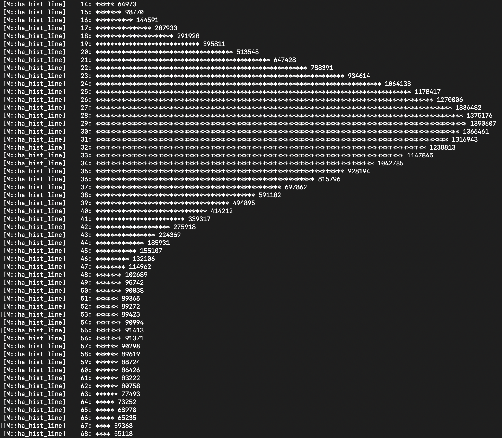
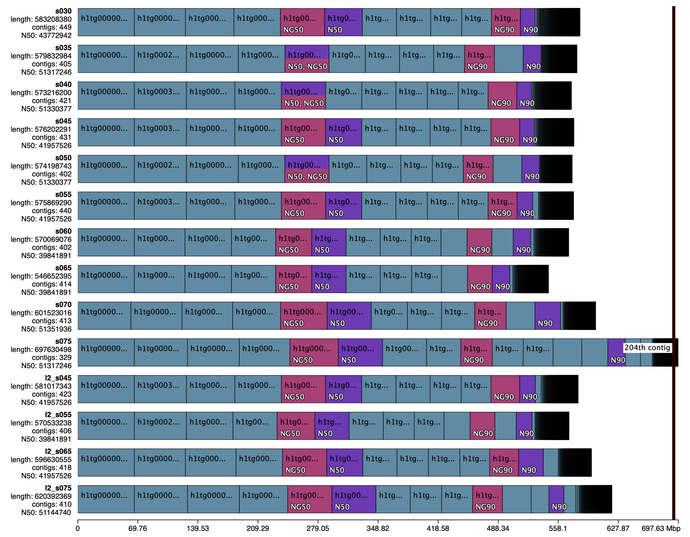
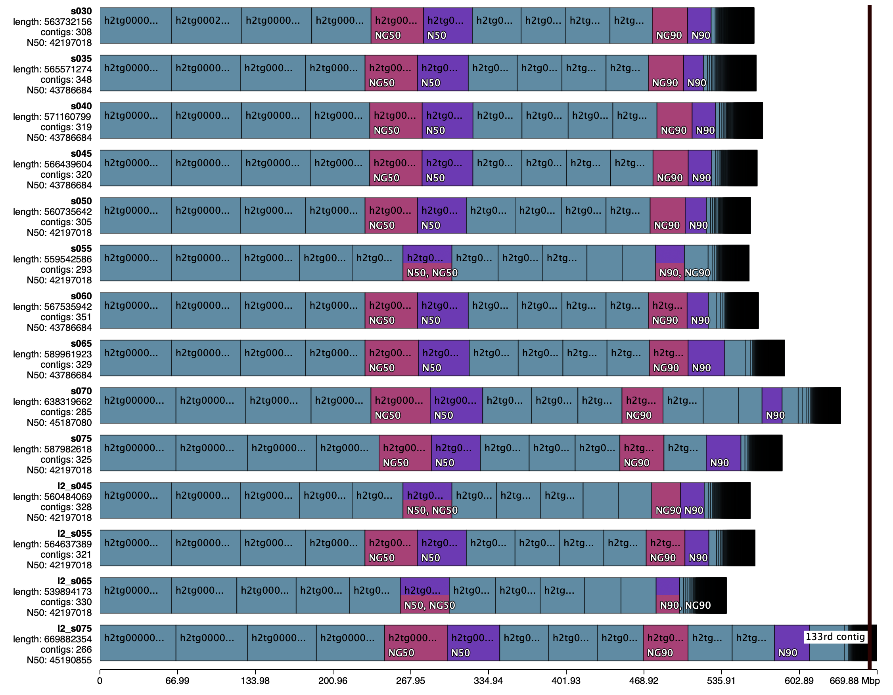

# Assembly

This README is purposed to store additional details required to conduct the `Assembly` step from the main <a href="../../README.md">`README.md`</a>.

## Table of Contents
- <a href="#03a">Using default parameters</a>
- <a href="#03b">Estimating the peak homozygous depth</a>
- <a href="#03c">Rerunning with `--hom-cov 55`</a>
- <a href="#03d">Trying other `-s` values</a>
- <a href="#03e">Conclusion</a>

## <a id="03a">Using default parameters</a>

```
# run Hifiasm with default parameters
hifiasm \
    -o 02_assembly/default/E_phylacis_asm \
    -t 128 \
    --ont \
    -l 3 \
    --telo-m AAACCCT \
    --dual-scaf \
    01_qc/02_chopper/E_phylacis_filtered.fastq.gz \
    2>&1 | tee 02_assembly/default/hifiasm_restart.log
```



After the third correction round, Hifiasm automatically sets the homozygous read depth threshold to be **52**, even though the peak homozygous depth ranges between 54 to 56 based on the histogram.

## <a id="03b">Estimating the peak homozygous depth</a>
To empirically estimate the homozygous peak depth, we can use the median BUSCO depth across the two haplotypes. First, I concatenated the two haplotypes inferred from the <a href="#03a">`default`</a> run and remapped the filtered ONT reads.

```
# change the working directory
cd 02_assembly/default/

# convert GFA to FASTA format
gfatools gfa2fa E_phylacis_asm.bp.hap1.p_ctg.gfa > hap1.fa
gfatools gfa2fa E_phylacis_asm.bp.hap2.p_ctg.gfa > hap2.fa

# concatenate both haplotypes
cat hap1.fa hap2.fa > both_haps.fa

# map the filtered ONT reads to both haplotypes
minimap2 \
    -t 128 \
    -ax lr:hq both_haps.fa \
    ../../01_qc/02_chopper/E_phylacis_filtered.fastq.gz | \
    samtools sort -@16 -o both_haps.bam

# index the BAM file
samtools index both_haps.bam
```

I then ran compleasm on each haplotype, extracted all single-copy BUSCO, and calculated the depth statistics across loci.

```
# download the ODB database
compleasm download eudicotyledons --odb odb12 -L busco_lineages/

# run compleasm on each haplotype
compleasm run -a hap1.fa -o compleasm/compleasm_hap1 -l eudicotyledons --odb odb12 -t 128 -L busco_lineages/
compleasm run -a hap2.fa -o compleasm/compleasm_hap2 -l eudicotyledons --odb odb12 -t 128 -L busco_lineages/

# extract all single-copy BUSCO
for h in hap1 hap2; do
  awk -F'\t' 'NR>1 && $2=="Single"{print $3"\t"$4-1"\t"$5"\t"$1}' compleasm/compleasm_$h/eudicotyledons_odb12/full_table.tsv
done | sort -k1,1 -k2,2n > compleasm/busco_single.bed

# calculate the depth distribution across BUSCO
mosdepth -t 16 --by compleasm/busco_single.bed --no-per-base compleasm/busco both_haps.bam

# extract the Q1, Q2, and Q3 from the depth distribution
zcat compleasm/busco.regions.bed.gz | \
    cut -f5 | sort -n | \
    awk '{a[NR]=$1} END{printf "n=%d  Q1=%.1f  median=%.1f  Q3=%.1f\n", NR, a[int(NR*0.25)], a[int(NR*0.5)], a[int(NR*0.75)]}'

# change the working directory
cd ../..
```

The last command printed the following results:

```
n=5173  Q1=23.6  median=27.9  Q3=32.2
```

The median BUSCO depth (**27.9**) closely matches the heterozygosity peak from Hifiasm and GenomeScope2 (**29**). This means that the homozygosity peak should be approximately double that value. Following the k-mer histogram, we should redo the Hifiasm run with **`--hom-cov 55`**.

## <a id="03c">Rerunning with `--hom-cov 55`</a>

```
hifiasm \
    -o 02_assembly/homcov55/E_phylacis_asm \
    -t 128 \
    --ont \
    -l 3 \
    --telo-m AAACCCT \
    --hom-cov 55 \
    --dual-scaf \
    01_qc/02_chopper/E_phylacis_filtered.fastq.gz \
    2>&1 | tee 02_assembly/homcov55/hifiasm_restart.log
```

The next question is whether we need to adjust the `-l` and `-s` flags, which control the aggressiveness of the haplotig purging. <a href="https://github.com/roblanf/MM_genome/tree/initial_trials">Rob</a> found that `-l 3` generated better results compared to the less aggressive `-l 1` and `-l 2`. However, the effect of different `-s` values has not been tested yet.

`-s` reflects the *"similarity threshold for duplicate haplotigs that should be purged"*. At `-l 3`, the default threshold is 0.55, meaning that a pair of contigs need to have at least 55% cross-parent overlap to be considered as homologous. For an F1 hybrid genome with ~4% heterozygosity, this might be too strict.

## <a id="03d">Trying other `-s` values</a>
Let's try different `-s` values (0.30, 0.35, 0.40, 0.45, 0.50, 0.60, 0.65, 0.70, 0.75) based on the corrected reads from the Hifiasm run. I also tried a stricter `-l 2` with four different `-s` values (0.45, 0.55, 0.65, 0.75). Here's the example code for one Hifiasm run:

```
# change the working directory
cd 02_assembly/homcov55

# set path to the original run
ORIG=../E_phylacis_asm

# set output path
NEW=E_phylacis_s030.asm

# create a new directory and shortcuts to the previous results
mkdir -p hifiasm_s030 && cd hifiasm_s030
for f in ec.bin ovlp.source.bin ovlp.reverse.bin; do
    ln -s ${ORIG}.${f} ${NEW}.${f}
done

# re-run Hifiasm under the new parameter
hifiasm --ont -t 128 -o ${NEW} --hom-cov 55 -l 3 -s 0.30 --dual-scaf --telo-m AAACCCT /dev/null 2> ${NEW}.log

# convert all GFA output files to FASTA format
for g in *.p_ctg.gfa; do
    gfatools gfa2fa "$g" > "${g%.gfa}.fa"
done

# change the working directory
cd ../../..
```

### SeqKit

```
seqkit stats 02_assembly/homcov55/hifiasm_s0*/*.p_ctg.fa > hifiasm_all_seqkit.txt
```

- <b><i>Haplotype 1</b></i>

    | `l`  | `s`  | Contigs | Total length<br>(bp) | Min<br>(bp) | Mean<br>(bp) | Max<br>(bp) |
    | :--: | :--: | ------: | -------------------: | ----------: | -----------: | ----------: |
    |  3   | 0.30 |     449 |       583,208,380 |   30,917 | 1,298,905 | 65,682,487 |
    |  3   | 0.35 |     405 |       579,832,984 |   24,809 | 1,431,686 | 65,682,487 |
    |  3   | 0.40 |     421 |       573,216,200 |   24,809 | 1,361,559 | 65,682,487 |
    |  3   | 0.45 |     431 |       576,202,291 |   24,809 | 1,336,896 | 65,682,487 |
    |  3   | 0.50 |     402 |       574,198,743 |   24,809 | 1,428,355 | 65,682,487 |
    |  3   | 0.55 |     440 |       575,869,290 |   24,809 | 1,308,794 | 65,682,487 |
    |  3   | 0.60 |     402 |       570,069,076 |   24,809 | 1,418,082 | 65,682,487 |
    |  3   | 0.65 |     414 |       546,652,395 |   24,809 | 1,320,416 | 65,682,487 |
    |  3   | 0.70 |     413 |       601,523,016 |   30,917 | 1,456,472 | 61,713,612 |
    |  3   | 0.75 |     329 |       697,630,498 |   30,917 | 2,120,457 | 65,682,489 |
    |  2   | 0.45 |     423 |       581,017,343 |   24,809 | 1,373,564 | 65,682,487 |
    |  2   | 0.55 |     406 |       570,533,238 |   30,917 | 1,405,254 | 65,682,487 |
    |  2   | 0.65 |     418 |       596,630,555 |   30,917 | 1,427,346 | 65,682,487 |
    |  2   | 0.75 |     410 |       620,392,369 |   30,917 | 1,513,152 | 65,682,489 |

- <b><i>Haplotype 2</b></i>

    | `l`  | `s`  | Contigs | Total length<br>(bp) | Min<br>(bp) | Mean<br>(bp) | Max<br>(bp) |
    | :--: | :--: | ------: | -------------------: | ----------: | -----------: | ----------: |
    |  3   | 0.30 |     308 |       563,732,156 |   24,809 | 1,830,299 | 61,702,390 |
    |  3   | 0.35 |     348 |       565,571,274 |   36,811 | 1,625,205 | 61,702,390 |
    |  3   | 0.40 |     319 |       571,160,799 |   36,811 | 1,790,473 | 61,702,390 |
    |  3   | 0.45 |     320 |       566,439,604 |   36,811 | 1,770,124 | 61,702,390 |
    |  3   | 0.50 |     305 |       560,735,642 |   36,811 | 1,838,478 | 61,702,390 |
    |  3   | 0.55 |     293 |       559,542,586 |   36,811 | 1,909,702 | 61,702,390 |
    |  3   | 0.60 |     351 |       567,535,942 |   43,064 | 1,616,912 | 61,702,390 |
    |  3   | 0.65 |     329 |       589,961,923 |   41,601 | 1,793,197 | 61,702,390 |
    |  3   | 0.70 |     285 |       638,319,662 |   24,809 | 2,239,718 | 65,543,494 |
    |  3   | 0.75 |     325 |       587,982,618 |   35,019 | 1,809,177 | 65,543,479 |
    |  2   | 0.45 |     328 |       560,484,069 |   36,811 | 1,708,793 | 61,702,390 |
    |  2   | 0.55 |     321 |       564,637,389 |   42,060 | 1,758,995 | 61,702,390 |
    |  2   | 0.65 |     330 |       539,894,173 |   36,811 | 1,636,043 | 61,702,390 |
    |  2   | 0.75 |     266 |       669,882,354 |   35,019 | 2,518,355 | 65,543,479 |

- <b><i>Primary</b></i>

    | `l`  | `s`  | Contigs | Total length<br>(bp) | Min<br>(bp) | Mean<br>(bp) | Max<br>(bp) |
    | :--: | :--: | ------: | -------------------: | ----------: | -----------: | ----------: |
    |  3   | 0.30 |      55 |       538,510,568 |   30,917 |  9,791,101 | 61,704,473 |
    |  3   | 0.35 |      54 |       538,043,526 |   30,917 |  9,963,769 | 61,704,473 |
    |  3   | 0.40 |      53 |       538,126,685 |   30,917 | 10,153,334 | 61,704,473 |
    |  3   | 0.45 |      52 |       538,070,186 |   30,917 | 10,347,504 | 61,704,473 |
    |  3   | 0.50 |      56 |       538,678,952 |   30,917 |  9,619,267 | 61,704,473 |
    |  3   | 0.55 |      58 |       545,448,847 |   30,917 |  9,404,290 | 61,704,473 |
    |  3   | 0.60 |      57 |       608,733,002 |   30,917 | 10,679,526 | 61,704,473 |
    |  3   | 0.65 |      58 |       633,708,634 |   30,917 | 10,926,011 | 61,704,473 |
    |  3   | 0.70 |      63 |       844,781,570 |   30,917 | 13,409,231 | 61,713,612 |
    |  3   | 0.75 |      64 |       960,983,357 |   30,917 | 15,015,365 | 65,682,489 |
    |  2   | 0.45 |      56 |       544,895,664 |   30,917 |  9,730,280 | 61,704,473 |
    |  2   | 0.55 |      56 |       545,452,896 |   30,917 |  9,740,230 | 61,704,473 |
    |  2   | 0.65 |      58 |       635,269,094 |   30,917 | 10,952,915 | 61,704,473 |
    |  2   | 0.75 |      64 |       961,221,210 |   30,917 | 15,019,081 | 65,682,489 |

### Compleasm + Merqury
To better assess the results from different parameter combinations, we should check the BUSCO completeness and k-mer completeness of individual haplotypes. First, we need to create a k-mer database from the filtered ONT reads, as well as download the BUSCO lineage.

```
# create a k-mer database
meryl count k=21 threads=128 01_qc/02_chopper/E_phylacis_filtered.fastq.gz output 02_assembly/homcov55/merqury/reads.meryl

# download the BUSCO lineage
compleasm download -L 02_assembly/default/busco_lineages/ --odb odb12 eudicotyledons
```

I then ran `compleasm` and `merqury` on each haplotype. Here's the example code for one set of haplotypes:
```
# change the working directory
cd 02_assembly/homcov55/

# run compleasm
compleasm run -a hifiasm_s030/E_phylacis_s030.asm.bp.hap1.p_ctg.fa -o compleasm/s030_hap1  -l eudicotyledons --odb odb12 -t 128 -L ../default/busco_lineages/
compleasm run -a hifiasm_s030/E_phylacis_s030.asm.bp.hap2.p_ctg.fa -o compleasm/s030_hap2  -l eudicotyledons --odb odb12 -t 128 -L ../default/busco_lineages/
compleasm run -a hifiasm_s030/E_phylacis_s030.union.fa             -o compleasm/s030_union -l eudicotyledons --odb odb12 -t 128 -L ../default/busco_lineages/

# run merqury for haplotype 1
mkdir -p merqury/s030_hap1 && cd merqury/s030_hap1
merqury.sh ../reads.meryl ../../hifiasm_s030/E_phylacis_s030.asm.bp.hap1.p_ctg.fa s030_hap1_merq
cd ../..

# run merqury for haplotype 2
mkdir -p merqury/s030_hap2 && cd merqury/s030_hap2
merqury.sh ../reads.meryl ../../hifiasm_s030/E_phylacis_s030.asm.bp.hap2.p_ctg.fa s030_hap2_merq
cd ../..

# run merqury for the combined haplotypes
mkdir -p merqury/s030_union && cd merqury/s030_union
merqury.sh ../reads.meryl ../../hifiasm_s030/E_phylacis_s030.union.fa s030_union_merq
cd ../..

# change the working directory
cd ../..
```

I asked Claude to generate an R <a href="./scripts/summarise_s_runs.R">script</a> to summarise the results across parameter combinations. The following tables show the statistics across **2,805 BUSCOs** (for `compleasm`) and **601,145,508 solid read k-mers** (for `merqury`) per run:

- <b><i>Haplotype 1</b></i>

    | Metric                      |  0.30 |  0.35 |  0.40 |  0.45 |  0.50 |  0.55 |  0.60 |  0.65 |  0.70 |  0.75 | 0.45 (l2) | 0.55 (l2) | 0.65 (l2) | 0.75 (l2) |
    | --------------------------- | ----: | ----: | ----: | ----: | ----: | ----: | ----: | ----: | ----: | ----: | --------: | --------: | --------: | --------: |
    | BUSCO S (%)                 | 92.16 | 93.05 | 92.55 | 92.73 | 93.44 | 92.69 | 93.58 | 91.30 | 63.28 | 48.70 |     92.30 |     93.19 |     85.78 |     50.41 |
    | BUSCO D (%)                 |  7.42 |  6.56 |  7.09 |  6.88 |  6.20 |  6.95 |  5.49 |  5.42 | 22.07 | 37.58 |      7.31 |      5.88 |     10.98 |     31.41 |
    | BUSCO F (%)                 |  0.39 |  0.36 |  0.32 |  0.36 |  0.32 |  0.32 |  0.39 |  0.57 |  1.25 |  0.86 |      0.36 |      0.39 |      0.53 |      1.18 |
    | BUSCO&nbsp;M&nbsp;(%)       |  0.04 |  0.04 |  0.04 |  0.04 |  0.04 |  0.04 |  0.53 |  2.71 | 13.40 | 12.87 |      0.04 |      0.53 |      2.71 |     17.01 |
    | k-mer completeness&nbsp;(%) | 66.68 | 66.29 | 65.96 | 66.13 | 65.94 | 66.13 | 65.55 | 63.06 | 63.65 | 71.98 |     66.46 |     65.46 |     66.57 |     64.97 |
    | Solid k-mers found (M)      | 400.8 | 398.5 | 396.5 | 397.5 | 396.4 | 397.5 | 394.1 | 379.1 | 382.6 | 432.7 |     399.5 |     393.5 |     400.2 |     390.6 |
    | QV                          | 64.32 | 64.56 | 64.25 | 64.44 | 64.43 | 64.41 | 64.55 | 64.47 | 64.35 | 64.93 |     64.60 |     64.58 |     64.40 |     64.62 |
    | Asm-only k-mers             | 4,521 | 4,243 | 4,507 | 4,332 | 4,326 | 4,357 | 4,197 | 4,093 | 4,614 | 4,702 |     4,203 |     4,156 |     4,546 |     4,478 |

- <b><i>Haplotype 2</b></i>

    | Metric                      |  0.30 |  0.35 |  0.40 |  0.45 |  0.50 |  0.55 |  0.60 |  0.65 |  0.70 |  0.75 | 0.45 (l2) | 0.55 (l2) | 0.65 (l2) | 0.75 (l2) |
    | --------------------------- | ----: | ----: | ----: | ----: | ----: | ----: | ----: | ----: | ----: | ----: | --------: | --------: | --------: | --------: |
    | BUSCO S (%)                 | 94.01 | 93.26 | 93.94 | 94.08 | 94.40 | 93.90 | 93.19 | 91.19 | 63.53 | 56.08 |     93.69 |     93.58 |     87.31 |     56.08 |
    | BUSCO D (%)                 |  5.70 |  6.45 |  5.74 |  5.63 |  5.28 |  5.17 |  6.52 |  8.52 | 27.59 | 28.98 |      5.42 |      6.13 |      7.81 |     34.33 |
    | BUSCO F (%)                 |  0.25 |  0.25 |  0.29 |  0.25 |  0.29 |  0.32 |  0.25 |  0.25 |  0.82 |  1.28 |      0.29 |      0.25 |      0.71 |      1.00 |
    | BUSCO&nbsp;M&nbsp;(%)       |  0.04 |  0.04 |  0.04 |  0.04 |  0.04 |  0.61 |  0.04 |  0.04 |  8.06 | 13.65 |      0.61 |      0.04 |      4.17 |      8.59 |
    | k-mer completeness&nbsp;(%) | 65.40 | 65.69 | 65.91 | 65.61 | 65.25 | 64.94 | 65.64 | 67.22 | 67.91 | 63.26 |     65.05 |     65.57 |     62.04 |     70.06 |
    | Solid k-mers found (M)      | 393.1 | 394.9 | 396.2 | 394.4 | 392.3 | 390.4 | 394.6 | 404.1 | 408.3 | 380.3 |     391.0 |     394.2 |     373.0 |     421.2 |
    | QV                          | 65.58 | 65.36 | 65.75 | 65.45 | 65.62 | 65.99 | 65.43 | 65.61 | 65.56 | 65.15 |     65.32 |     65.53 |     65.67 |     65.33 |
    | Asm-only k-mers             | 3,265 | 3,457 | 3,193 | 3,389 | 3,227 | 2,961 | 3,401 | 3,387 | 3,695 | 3,775 |     3,455 |     3,321 |     3,058 |     4,122 |

- <b><i>Union (hap1 + hap2)</b></i>

    | Metric                      |  0.30 |  0.35 |  0.40 |  0.45 |  0.50 |  0.55 |  0.60 |  0.65 |  0.70 |  0.75 | 0.45 (l2) | 0.55 (l2) | 0.65 (l2) | 0.75 (l2) |
    | --------------------------- | ----: | ----: | ----: | ----: | ----: | ----: | ----: | ----: | ----: | ----: | --------: | --------: | --------: | --------: |
    | BUSCO S (%)                 |  2.96 |  2.96 |  2.89 |  2.92 |  2.92 |  2.85 |  2.92 |  2.92 |  2.78 |  2.57 |      2.89 |      2.96 |      2.89 |      2.60 |
    | BUSCO D (%)                 | 96.83 | 96.83 | 96.90 | 96.86 | 96.86 | 96.93 | 96.86 | 96.86 | 97.01 | 97.22 |     96.90 |     96.83 |     96.90 |     97.18 |
    | BUSCO F (%)                 |  0.18 |  0.18 |  0.18 |  0.18 |  0.18 |  0.18 |  0.18 |  0.18 |  0.18 |  0.18 |      0.18 |      0.18 |      0.18 |      0.18 |
    | BUSCO&nbsp;M&nbsp;(%)       |  0.04 |  0.04 |  0.04 |  0.04 |  0.04 |  0.04 |  0.04 |  0.04 |  0.04 |  0.04 |      0.04 |      0.04 |      0.04 |      0.04 |
    | k-mer completeness&nbsp;(%) | 99.31 | 99.31 | 99.31 | 99.31 | 99.31 | 99.31 | 99.31 | 99.31 | 99.31 | 99.31 |     99.31 |     99.31 |     99.31 |     99.31 |
    | Solid k-mers found (M)      | 597.0 | 597.0 | 597.0 | 597.0 | 597.0 | 597.0 | 597.0 | 597.0 | 597.0 | 597.0 |     597.0 |     597.0 |     597.0 |     597.0 |
    | QV                          | 64.90 | 64.94 | 64.93 | 64.91 | 64.98 | 65.12 | 64.96 | 65.02 | 64.93 | 65.03 |     64.94 |     65.02 |     64.95 |     64.98 |
    | Asm-only k-mers             | 7,786 | 7,700 | 7,700 | 7,721 | 7,553 | 7,318 | 7,598 | 7,480 | 8,309 | 8,477 |     7,658 |     7,477 |     7,604 |     8,600 |

The script also calculates the copy number of heterozygous (14–44x depth) and homozygous (44–69x depth) read k-mers in each haplotype based on the `spectra-cn.hist` file outputted by `merqury`.

> [!NOTE]
> - For one haplotype, `het k-mers: 0x` and `het k-mers: 1x` should be ~50% each, while `hom k-mers: 1x` should be ~100%
> - For the union, `het k-mers: 1x` and `hom k-mers: 2x` should be ~100% each
> - In the union, `het k-mers: ≥2x` and `hom k-mers: ≥3x` mark regions where a parental copy was kept more than once across the two haplotypes

- <b><i>Haplotype 1</b></i>

    | Metric               | 0.30 | 0.35 | 0.40 | 0.45 | 0.50 | 0.55 | 0.60 | 0.65 | 0.70 | 0.75 | 0.45 (l2) | 0.55 (l2) | 0.65 (l2) | 0.75 (l2) |
    | -------------------- | ---: | ---: | ---: | ---: | ---: | ---: | ---: | ---: | ---: | ---: | --------: | --------: | --------: | --------: |
    | het k-mers: 0x       | 44.4 | 44.8 | 45.2 | 45.0 | 45.3 | 45.0 | 45.6 | 47.9 | 43.9 | 34.2 |      44.5 |      45.7 |      43.4 |      41.5 |
    | het k-mers: 1x       | 55.2 | 54.7 | 54.4 | 54.6 | 54.3 | 54.6 | 54.0 | 51.8 | 55.1 | 63.9 |      55.0 |      53.9 |      55.9 |      57.0 |
    | het k-mers:&nbsp;≥2x |  0.4 |  0.4 |  0.4 |  0.4 |  0.4 |  0.4 |  0.4 |  0.4 |  1.0 |  1.8 |       0.4 |       0.4 |       0.6 |       1.5 |
    | hom k-mers: 0x       |  8.5 |  8.6 |  8.9 |  8.8 |  8.7 |  8.9 |  9.4 | 12.5 | 21.0 | 15.3 |       8.8 |       9.5 |      11.0 |      22.2 |
    | hom k-mers: 1x       | 77.6 | 78.2 | 77.6 | 77.7 | 78.5 | 77.5 | 78.0 | 75.6 | 50.6 | 43.1 |      77.3 |      78.1 |      70.3 |      42.6 |
    | hom k-mers: 2x       | 13.7 | 13.0 | 13.2 | 13.2 | 12.6 | 13.3 | 12.4 | 11.7 | 27.8 | 40.8 |      13.6 |      12.2 |      18.4 |      34.5 |
    | hom k-mers:&nbsp;≥3x |  0.3 |  0.3 |  0.2 |  0.3 |  0.3 |  0.3 |  0.2 |  0.2 |  0.5 |  0.8 |       0.3 |       0.2 |       0.4 |       0.7 |

- <b><i>Haplotype 2</b></i>

    | Metric               | 0.30 | 0.35 | 0.40 | 0.45 | 0.50 | 0.55 | 0.60 | 0.65 | 0.70 | 0.75 | 0.45 (l2) | 0.55 (l2) | 0.65 (l2) | 0.75 (l2) |
    | -------------------- | ---: | ---: | ---: | ---: | ---: | ---: | ---: | ---: | ---: | ---: | --------: | --------: | --------: | --------: |
    | het k-mers: 0x       | 45.8 | 45.4 | 45.2 | 45.6 | 46.0 | 46.3 | 45.5 | 43.5 | 39.2 | 44.2 |      46.2 |      45.6 |      48.2 |      36.7 |
    | het k-mers: 1x       | 53.8 | 54.2 | 54.4 | 54.0 | 53.7 | 53.3 | 54.1 | 56.0 | 59.4 | 54.6 |      53.5 |      54.0 |      51.3 |      61.8 |
    | het k-mers:&nbsp;≥2x |  0.4 |  0.4 |  0.4 |  0.4 |  0.4 |  0.4 |  0.4 |  0.5 |  1.4 |  1.2 |       0.4 |       0.4 |       0.5 |       1.5 |
    | hom k-mers: 0x       |  9.3 |  9.2 |  8.9 |  9.1 |  9.4 |  9.6 |  9.1 |  8.4 | 16.4 | 21.3 |       9.6 |       9.1 |      15.1 |      15.3 |
    | hom k-mers: 1x       | 78.3 | 77.9 | 78.5 | 78.5 | 78.7 | 78.8 | 78.2 | 76.0 | 50.4 | 49.0 |      78.2 |      78.1 |      71.1 |      47.4 |
    | hom k-mers: 2x       | 12.2 | 12.7 | 12.3 | 12.1 | 11.6 | 11.3 | 12.5 | 15.2 | 32.5 | 29.2 |      11.9 |      12.5 |      13.5 |      36.7 |
    | hom k-mers:&nbsp;≥3x |  0.3 |  0.3 |  0.3 |  0.3 |  0.3 |  0.2 |  0.3 |  0.3 |  0.6 |  0.5 |       0.2 |       0.3 |       0.3 |       0.7 |

- <b><i>Union (hap1 + hap2)</b></i>

    | Metric               | 0.30 | 0.35 | 0.40 | 0.45 | 0.50 | 0.55 | 0.60 | 0.65 | 0.70 | 0.75 | 0.45 (l2) | 0.55 (l2) | 0.65 (l2) | 0.75 (l2) |
    | -------------------- | ---: | ---: | ---: | ---: | ---: | ---: | ---: | ---: | ---: | ---: | --------: | --------: | --------: | --------: |
    | het k-mers: 0x       |  0.6 |  0.6 |  0.6 |  0.6 |  0.6 |  0.6 |  0.6 |  0.6 |  0.6 |  0.6 |       0.6 |       0.6 |       0.6 |       0.6 |
    | het k-mers: 1x       | 88.5 | 88.6 | 88.8 | 88.9 | 89.6 | 89.6 | 89.4 | 89.6 | 80.6 | 75.8 |      89.0 |      89.6 |      89.6 |      75.5 |
    | het k-mers:&nbsp;≥2x | 10.9 | 10.8 | 10.7 | 10.5 |  9.8 |  9.8 | 10.0 |  9.8 | 18.9 | 23.7 |      10.4 |       9.8 |       9.8 |      23.9 |
    | hom k-mers: 0x       |  0.2 |  0.2 |  0.2 |  0.2 |  0.2 |  0.2 |  0.2 |  0.2 |  0.2 |  0.2 |       0.2 |       0.2 |       0.2 |       0.2 |
    | hom k-mers: 1x       |  4.1 |  4.1 |  4.2 |  4.2 |  4.2 |  4.3 |  4.2 |  4.3 |  3.7 |  3.6 |       4.2 |       4.2 |       4.3 |       3.5 |
    | hom k-mers: 2x       | 83.0 | 83.2 | 83.3 | 83.5 | 84.7 | 84.6 | 84.4 | 84.6 | 76.3 | 68.9 |      83.7 |      84.6 |      84.6 |      68.5 |
    | hom k-mers:&nbsp;≥3x | 12.7 | 12.5 | 12.3 | 12.1 | 10.9 | 11.0 | 11.2 | 11.0 | 19.8 | 27.4 |      11.9 |      11.0 |      11.0 |      27.8 |

### Quast

```
# change the working directory
cd 02_assembly/homcov55/

# run Quast
mkdir -p quast
for part in hap1 hap2; do
    files=(); labels=()
    for d in hifiasm_s0*/ hifiasm_l2_s0*/; do
        d=${d%/}; label=${d#hifiasm_}
        files+=("${d}/E_phylacis_${label}.asm.bp.${part}.p_ctg.fa")
        labels+=("$label")
    done
    quast.py --large --est-ref-size 534000000 \
        -o quast/${part} -l "$(IFS=,; echo "${labels[*]}")" "${files[@]}"
done

# change the working directory
cd ../..
```

- <b><i>Haplotype 1</b></i>

    

    | `l`  | `s`  |   N50 (bp) | L50 |  NG50 (bp) |   N90 (bp) | L90 |  NG90 (bp) |   auN (bp) | N's&nbsp;per&nbsp;100&nbsp;kb |
    | :--: | :--: | ---------: | --: | ---------: | ---------: | --: | ---------: | ---------: | ----------------------------: |
    |  3   | 0.30 | 43,772,942 |   6 | 51,317,246 | 17,090,617 |  12 | 33,590,266 | 43,842,519 |                         110.3 |
    |  3   | 0.35 | 51,317,246 |   5 | 51,317,246 | 20,641,050 |  12 | 34,632,737 | 45,079,273 |                         428.9 |
    |  3   | 0.40 | 51,330,377 |   5 | 51,330,377 | 17,090,617 |  12 | 33,387,292 | 44,105,774 |                         429.1 |
    |  3   | 0.45 | 41,957,526 |   6 | 51,317,246 | 17,090,617 |  12 | 33,387,292 | 44,313,252 |                         426.8 |
    |  3   | 0.50 | 51,330,377 |   5 | 51,330,377 | 20,449,059 |  12 | 34,632,737 | 45,320,782 |                         406.7 |
    |  3   | 0.55 | 41,957,526 |   6 | 51,359,987 | 18,186,819 |  12 | 33,662,322 | 44,075,504 |                         567.1 |
    |  3   | 0.60 | 39,841,891 |   6 | 41,957,526 | 20,394,891 |  13 | 28,751,543 | 41,292,460 |                         134.2 |
    |  3   | 0.65 | 39,841,891 |   6 | 41,957,526 | 20,394,891 |  12 | 28,751,543 | 41,997,972 |                         236.6 |
    |  3   | 0.70 | 51,351,936 |   6 | 54,056,018 | 29,899,960 |  12 | 36,525,735 | 45,920,878 |                         471.2 |
    |  3   | 0.75 | 51,317,246 |   6 | 56,292,571 | 20,394,891 |  14 | 36,525,735 | 45,842,407 |                         109.6 |
    |  2   | 0.45 | 41,957,526 |   6 | 51,317,246 | 18,177,790 |  12 | 33,387,292 | 44,085,185 |                         539.0 |
    |  2   | 0.55 | 39,841,891 |   6 | 43,799,538 | 18,352,263 |  13 | 28,751,543 | 41,751,729 |                         528.5 |
    |  2   | 0.65 | 41,957,526 |   6 | 51,359,987 | 28,751,543 |  12 | 33,549,482 | 44,094,347 |                         154.1 |
    |  2   | 0.75 | 51,144,740 |   6 | 51,317,246 | 17,320,306 |  13 | 34,632,737 | 44,526,071 |                         325.9 |

- <b><i>Haplotype 2</b></i>

    

    | `l`  | `s`  |   N50 (bp) | L50 |  NG50 (bp) |   N90 (bp) | L90 |  NG90 (bp) |   auN (bp) | N's&nbsp;per&nbsp;100&nbsp;kb |
    | :--: | :--: | ---------: | --: | ---------: | ---------: | --: | ---------: | ---------: | ----------------------------: |
    |  3   | 0.30 | 42,197,018 |   6 | 45,190,855 | 20,289,095 |  12 | 30,438,125 | 44,221,886 |                         264.7 |
    |  3   | 0.35 | 43,786,684 |   6 | 45,190,855 | 17,142,888 |  12 | 30,327,973 | 43,077,801 |                           0.0 |
    |  3   | 0.40 | 43,786,684 |   6 | 45,187,080 | 20,289,095 |  12 | 30,311,269 | 44,128,093 |                          30.3 |
    |  3   | 0.45 | 43,786,684 |   6 | 45,190,855 | 20,289,095 |  12 | 30,311,269 | 44,029,941 |                          30.6 |
    |  3   | 0.50 | 42,197,018 |   6 | 45,193,510 | 18,310,092 |  12 | 30,255,385 | 43,679,519 |                         117.5 |
    |  3   | 0.55 | 42,197,018 |   6 | 42,197,018 | 24,839,503 |  12 | 24,839,503 | 41,131,917 |                           0.0 |
    |  3   | 0.60 | 43,786,684 |   6 | 45,190,855 | 18,318,392 |  12 | 33,387,292 | 43,416,672 |                         447.7 |
    |  3   | 0.65 | 43,786,684 |   6 | 46,025,662 | 31,562,876 |  12 | 33,387,292 | 43,494,742 |                         525.0 |
    |  3   | 0.70 | 45,187,080 |   6 | 51,144,740 | 17,291,453 |  14 | 35,385,602 | 43,126,439 |                         729.4 |
    |  3   | 0.75 | 42,197,018 |   6 | 45,190,855 | 29,899,960 |  12 | 38,016,435 | 45,700,235 |                          11.1 |
    |  2   | 0.45 | 42,197,018 |   6 | 42,197,018 | 20,442,954 |  13 | 24,839,503 | 40,614,434 |                           0.0 |
    |  2   | 0.55 | 42,197,018 |   6 | 45,190,855 | 20,627,072 |  12 | 33,387,292 | 43,479,232 |                           0.0 |
    |  2   | 0.65 | 42,197,018 |   6 | 42,197,018 | 20,289,095 |  12 | 20,289,095 | 41,264,420 |                         437.7 |
    |  2   | 0.75 | 45,190,855 |   6 | 54,056,018 | 30,311,269 |  13 | 38,519,572 | 46,639,921 |                          40.7 |

## <a id="03e">Conclusion</a>
From all these tests, `-s 0.55` seems to be the higher ceiling, because setting the value higher resulted in longer primary assembly (which means that Hifiasm stops recognising homologous contig pairs) and lower BUSCO completeness. However, using `s 0.55` somehow resulted in a higher percentage of missing BUSCO for hap2. Thus, we should use **`-l 3 -s 0.50`** for our analysis.
