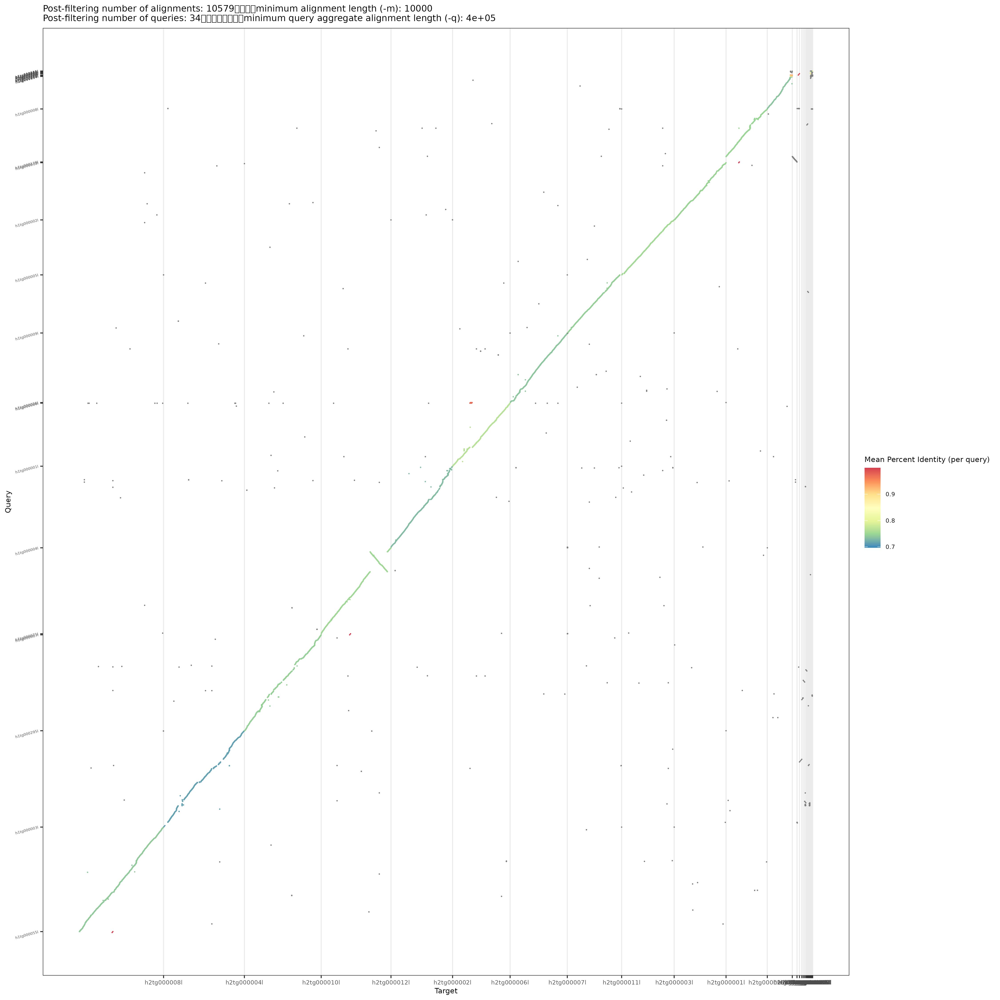
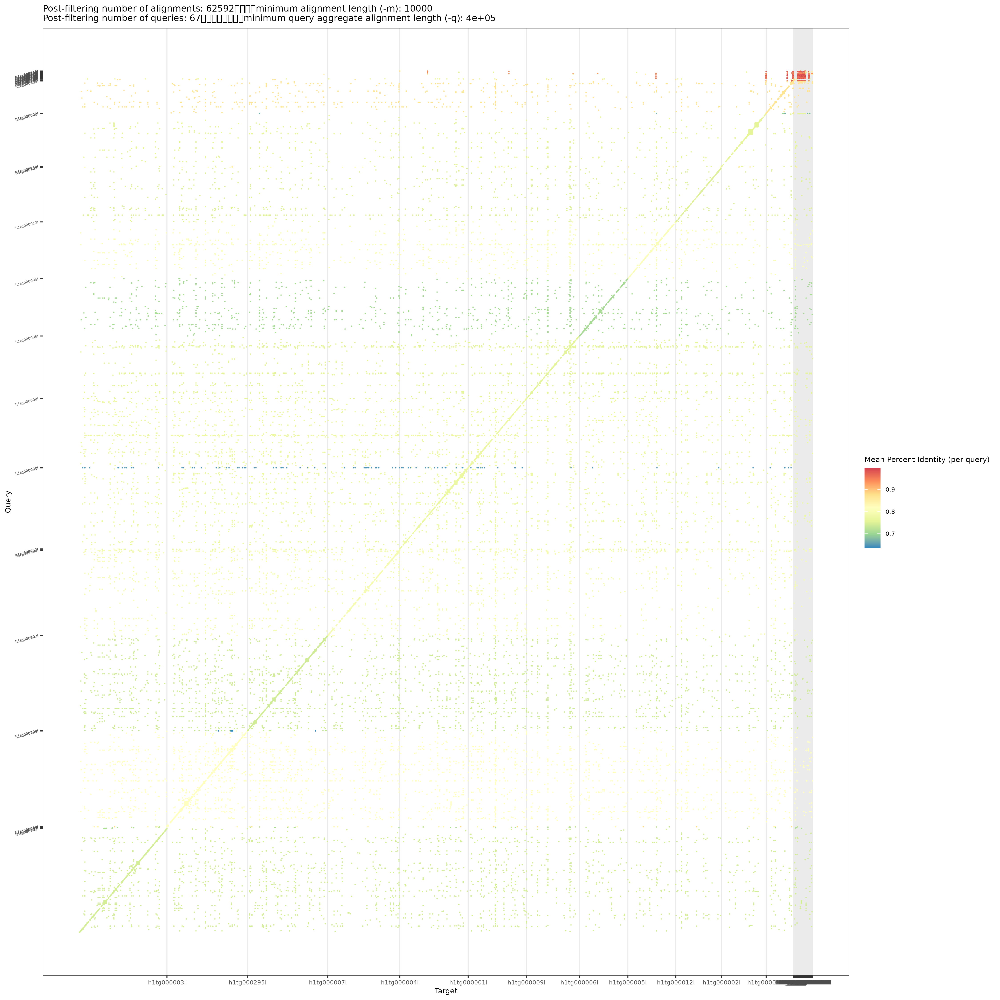
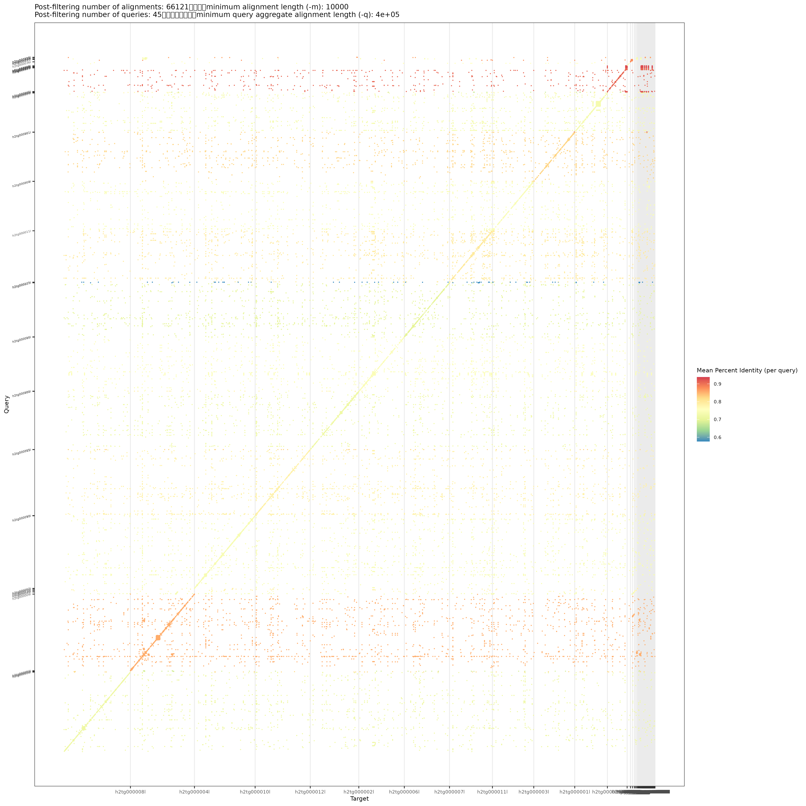
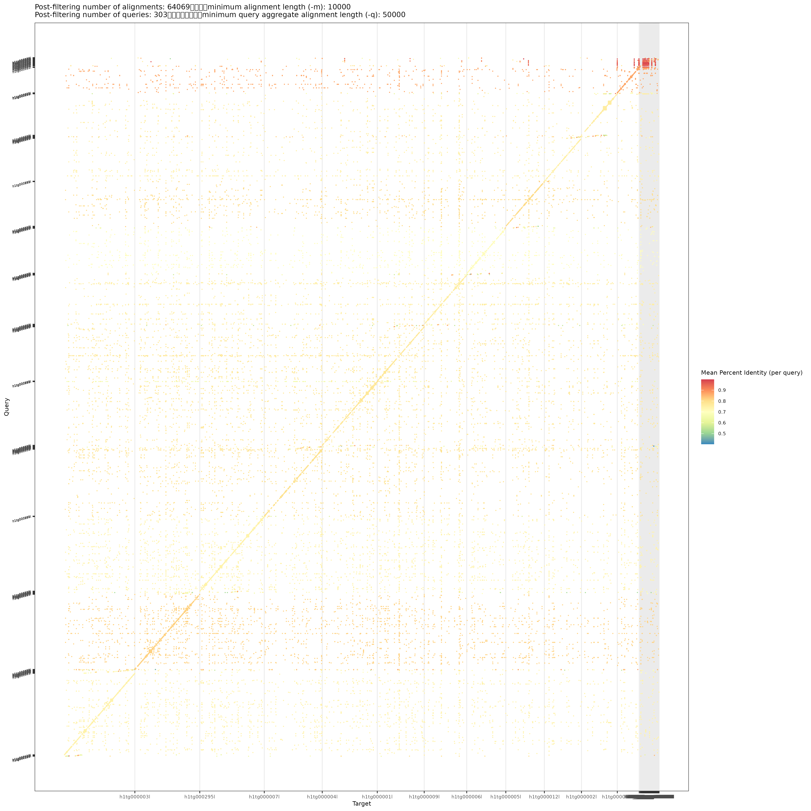
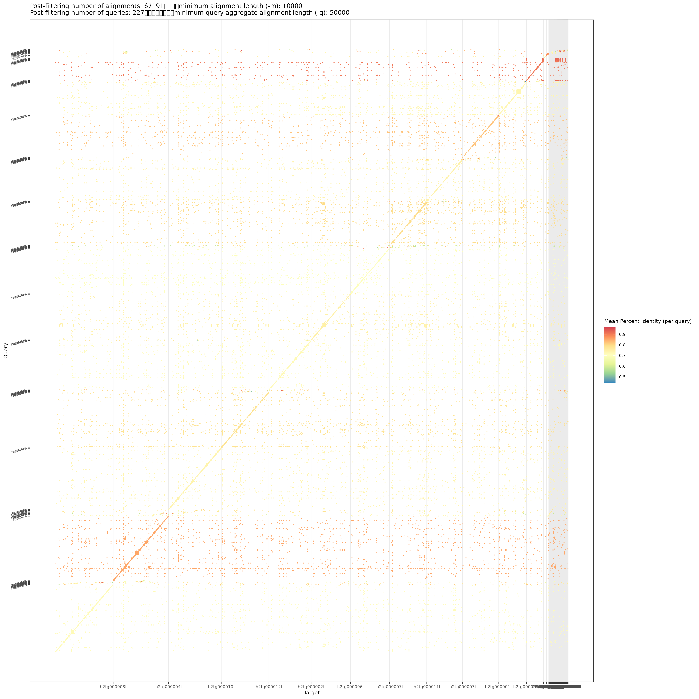
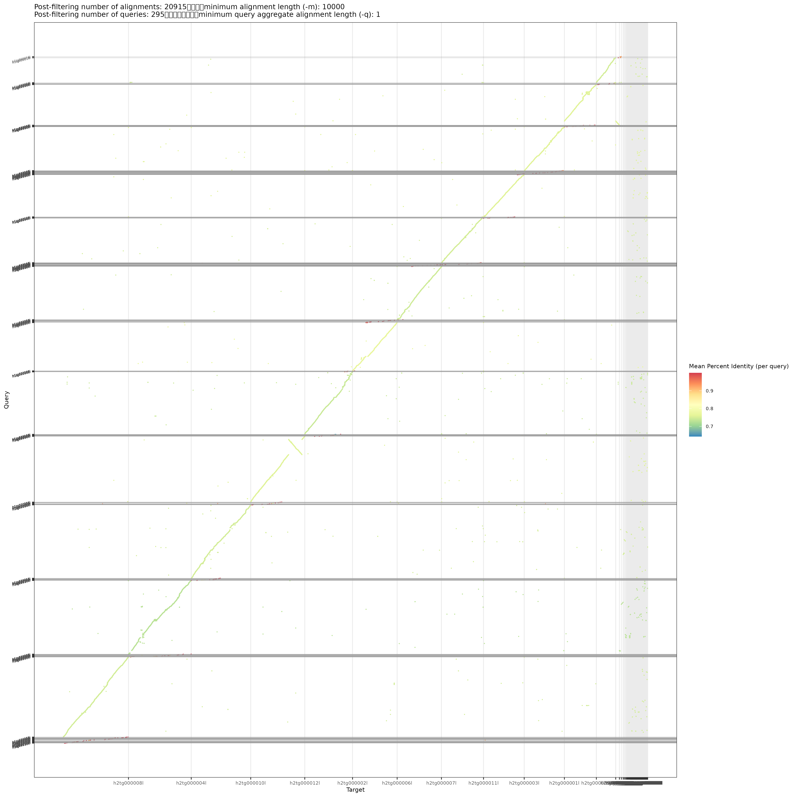

# Nuclear

## Table of Contents
- <a href="#05a">Checking for duplicate contigs</a>
- <a href="#05b">Aligning haplotypes against each other</a>

## <a id="05a">Checking for duplicate contigs</a>
To identify duplicates, I first mapped each haplotype to itself and assessed if there are contigs that were mapped multiple times by different contigs.

```
# map each haplotype against each other and against itself
minimap2 -cx asm20 -t 128 \
    02_assembly/homcov55/hifiasm_s050/E_phylacis_s050.asm.bp.hap2.p_ctg.fa \
    02_assembly/homcov55/hifiasm_s050/E_phylacis_s050.asm.bp.hap1.p_ctg.fa \
    > 05_nuclear_qc/01_h1h2/h1_vs_h2.paf
minimap2 -cx asm20 -DP -m200 -t 128 \
    02_assembly/homcov55/hifiasm_s050/E_phylacis_s050.asm.bp.hap1.p_ctg.fa \
    02_assembly/homcov55/hifiasm_s050/E_phylacis_s050.asm.bp.hap1.p_ctg.fa \
    > 05_nuclear_qc/01_h1h2/h1_self.paf
minimap2 -cx asm20 -DP -m200 -t 128 \
    02_assembly/homcov55/hifiasm_s050/E_phylacis_s050.asm.bp.hap2.p_ctg.fa \
    02_assembly/homcov55/hifiasm_s050/E_phylacis_s050.asm.bp.hap2.p_ctg.fa \
    > 05_nuclear_qc/01_h1h2/h2_self.paf

# extract necessary columns
cut -f1-12 05_nuclear_qc/01_h1h2/h1_self.paf > 05_nuclear_qc/01_h1h2/h1_self.12.paf
cut -f1-12 05_nuclear_qc/01_h1h2/h2_self.paf > 05_nuclear_qc/01_h1h2/h2_self.12.paf

# generate the dotplots
Rscript scripts/pafCoordsDotPlotly.R \
    -i 05_nuclear_qc/01_h1h2/h1_vs_h2.paf \
    -o h1_vs_h2_dotplot2 -s -t

Rscript scripts/pafCoordsDotPlotly.R \
    -i 05_nuclear_qc/01_h1h2/h1_self.12.paf \
    -o h1_self_dotplot2 -s

Rscript scripts/pafCoordsDotPlotly.R \
    -i 05_nuclear_qc/01_h1h2/h2_self.12.paf \
    -o h2_self_dotplot2 -s
```

|                Hap 1 vs Hap 2                 |                    Hap 1 vs. Hap 1             |                    Hap 2 vs. Hap 2             |
| :-------------------------------------------: | :--------------------------------------------: | :--------------------------------------------: |
|  |   |   |

It seems that there is a number of duplicates at the top-right corner of the H1 vs. H1 and H2 vs. H2 plots. Let's zoom in more...

```
# remove the chromosome-scale contigs
awk '!($1==$6 && $3==$8 && $4==$9)' 05_nuclear_qc/01_h1h2/h1_self.12.paf > 05_nuclear_qc/01_h1h2/h1_self.noself.paf
awk '!($1==$6 && $3==$8 && $4==$9)' 05_nuclear_qc/01_h1h2/h2_self.12.paf > 05_nuclear_qc/01_h1h2/h2_self.noself.paf

# repeat the plotting
Rscript scripts/pafCoordsDotPlotly.R \
    -i 05_nuclear_qc/01_h1h2/h1_self.noself.paf \
    -o h1_self_dotplot2_noself -s -m 10000 -q 50000

Rscript scripts/pafCoordsDotPlotly.R \
    -i 05_nuclear_qc/01_h1h2/h2_self.noself.paf \
    -o h2_self_dotplot2_noself -s -m 10000 -q 50000
```

|                    Hap 1 vs. Hap 1             |                    Hap 2 vs. Hap 2             |
| :--------------------------------------------: | :--------------------------------------------: |
|   |   |

It is still quite tricky to identify those contigs based on the plots. Tools such as `purge_dups` removed putative duplicates based on their mapping depths. Here, Claude generated a Python <a href="./scripts/flag_contained_contigs.py">script</a> that works similarly but with several adjustments following our data:
- Use `minimap2 -cx asm20 -DP -m200` to accommodate the ~4% heterozygosity
- Select candidate duplicates as contigs with ≥ 80% of their lengths covered by alignments to a longer contig with ≥ 10 kb length at ≥ 90% identity
- Use a dynamic depth threshold based on the estimated homozygous peak of 55x

Here is the decription of the method:
- If a haplotype is perfect, then each contig should match 1:1 when mapped against itself. However, from the dotplots, we could see that there are smaller contigs that are better aligned to other longer contigs. The Python script lists every contig with ≥ 80% of its length lying inside a longer contig, with a minimum of 10kb aligned sites and 90% identity.
- There are four potential reasons how it could happen:
    1. An assembly error, where the same molecule got assembled twice
    2. A phasing error, where both parental alleles were put into hap1
    3. It is a repeat that exists in many copies (e.g., rDNA or organelle DNA)
    4. It is a paralog

    Among these cases, we should remove cases 1-3, but **keep case 4**.
- We can differentiate these four cases by looking at the:
    - Identity
        1. ≥99.9%, because the two assemblies come from the same molecule
        2. ~96.5%, because the median divergence between the two parents are ~3.5%:
            ```
            awk '$11>=100000 {for(i=13;i<=NF;i++) if($i~/^(de|dv):f:/){split($i,a,":"); print 1-a[3]}}' \
                02_assembly/homcov55/hifiasm_s050/compare_h1h2/hap1_vs_hap2.paf | sort -n \
            | awk '{v[NR]=$1} END{printf "n=%d  Q1=%.3f  median=%.3f  Q3=%.3f\n", NR, v[int(NR/4)+1], v[int(NR/2)+1], v[int(NR*3/4)+1]}'
            ```
        3. ≥99.9%, but contained in **several** other contigs
        4. Could be ~96.5% (and thus unidentifiable in regards to case 2)
    - Depth
        1. ~27.5x, because the reads of one locus are shared between two identical copies
        2. ~27.5x, because reads from only one parent would map to the smaller contig
        3. Random
        4. ~55x, because it has its own locus from both parents
- Lastly, instead of setting a fixed cutoff of 27.5x or 55x to keep or remove a contig, we dynamically set a depth threshold for each contig based on it's percentage of contained sites (*f*) with the following formula: `27.5*f* + 55(1 − *f*)`. If the value is lower than the threshold, the contig is more likely to fit either case 1 or 2 and thus should be removed.

```
# identify putative paralogs
python3 scripts/flag_contained_contigs.py 05_nuclear_qc/01_h1h2/h1_self.paf > 05_nuclear_qc/01_h1h2/h1_dups.tsv
python3 scripts/flag_contained_contigs.py 05_nuclear_qc/01_h1h2/h2_self.paf > 05_nuclear_qc/01_h1h2/h2_dups.tsv

# calculate each contig's depth
awk -F'\t' 'NR>1{print $1}' 05_nuclear_qc/01_h1h2/h1_dups.tsv > 05_nuclear_qc/01_h1h2/h1_remove.txt
awk 'NR==FNR{k[$1];next} $1 in k{print $1"\t0\t"$2}' \
    05_nuclear_qc/01_h1h2/h1_remove.txt \
    02_assembly/homcov55/hifiasm_s050/E_phylacis_s050.asm.bp.hap1.p_ctg.fa.fai \
    > 05_nuclear_qc/01_h1h2/h1_remove.bed
mosdepth -t 16 --by 05_nuclear_qc/01_h1h2/h1_remove.bed --no-per-base 05_nuclear_qc/01_h1h2/h1_dups 03_qc/hap1.bam
zcat 05_nuclear_qc/01_h1h2/h1_dups.regions.bed.gz | awk '{printf "%s\t%.1f\n",$1,$4}' | sort -k2,2n

awk -F'\t' 'NR>1{print $1}' 05_nuclear_qc/01_h1h2/h2_dups.tsv > 05_nuclear_qc/01_h1h2/h2_remove.txt
awk 'NR==FNR{k[$1];next} $1 in k{print $1"\t0\t"$2}' \
    05_nuclear_qc/01_h1h2/h2_remove.txt \
    02_assembly/homcov55/hifiasm_s050/E_phylacis_s050.asm.bp.hap2.p_ctg.fa.fai \
    > 05_nuclear_qc/01_h1h2/h2_remove.bed
mosdepth -t 16 --by 05_nuclear_qc/01_h1h2/h2_remove.bed --no-per-base 05_nuclear_qc/01_h1h2/h2_dups 03_qc/hap2.bam
zcat 05_nuclear_qc/01_h1h2/h2_dups.regions.bed.gz | awk '{printf "%s\t%.1f\n",$1,$4}' | sort -k2,2n
```

> [!NOTE]
> - **Remove**: depth ≤ cutoff - potential case 1 or 2
> - **Keep**  : depth > cutoff - potential case 4
> - **Check** : potential case 3

- <b><i>Haplotype 1</b></i> — **62** remove (5.15 Mb), **17** keep (1.37 Mb), **32** check (3.48 Mb)

    <details>
    <summary><i>Click here to view the full table</i></summary>

    | Contig      | Length (bp) | Covered (%) | Max identity (%) | Depth (x) | Cutoff (x) | Contained in                                                    | Verdict |
    | :---------- | ----------: | ----------: | ---------------: | --------: | ---------: | :-------------------------------------------------------------- | :------ |
    | h1tg000348l |      38,223 |        93.4 |            99.98 |       7.1 |          – | h1tg000114l, h1tg000231l, h1tg000016l, h1tg000019l              | Check   |
    | h1tg000160l |      40,059 |       100.0 |            99.99 |      11.4 |       41.2 | h1tg000003l                                                     | Remove  |
    | h1tg000347l |      38,596 |       100.0 |            99.99 |      11.9 |          – | h1tg000101l, h1tg000059l, h1tg000376l, h1tg000121l, h1tg000031l | Check   |
    | h1tg000231l |      57,617 |       100.0 |           100.00 |      12.4 |          – | h1tg000033l, h1tg000016l, h1tg000197l, h1tg000019l, h1tg000268l | Check   |
    | h1tg000284l |      52,359 |       100.0 |            99.99 |      16.1 |          – | h1tg000059l, h1tg000114l, h1tg000019l, h1tg000016l, h1tg000101l | Check   |
    | h1tg000356l |      68,179 |       100.0 |           100.00 |      17.4 |          – | h1tg000059l, h1tg000033l, h1tg000114l, h1tg000019l, h1tg000016l | Check   |
    | h1tg000129l |      43,642 |       100.0 |            99.99 |      20.3 |          – | h1tg000059l, h1tg000114l, h1tg000019l, h1tg000016l, h1tg000031l | Check   |
    | h1tg000029l |      58,330 |        99.9 |           100.00 |      20.5 |          – | h1tg000033l, h1tg000016l, h1tg000019l, h1tg000197l, h1tg000114l | Check   |
    | h1tg000304l |      64,293 |        98.6 |            97.14 |      21.9 |       41.4 | h1tg000005l                                                     | Remove  |
    | h1tg000369l |      50,916 |       100.0 |            95.80 |      22.1 |       41.2 | h1tg000004l                                                     | Remove  |
    | h1tg000114l |     256,182 |       100.0 |           100.00 |      22.6 |          – | h1tg000033l, h1tg000059l, h1tg000019l, h1tg000101l, h1tg000014l | Check   |
    | h1tg000366l |      42,921 |       100.0 |            99.99 |      23.1 |          – | h1tg000033l, h1tg000016l, h1tg000197l, h1tg000019l, h1tg000114l | Check   |
    | h1tg000068l |      77,346 |        88.1 |            96.88 |      23.5 |       42.9 | h1tg000008l                                                     | Remove  |
    | h1tg000357l |      48,044 |       100.0 |            96.49 |      24.5 |       41.2 | h1tg000002l                                                     | Remove  |
    | h1tg000256l |      75,059 |        91.8 |            97.23 |      24.9 |       42.4 | h1tg000002l                                                     | Remove  |
    | h1tg000053l |      68,850 |       100.0 |            99.43 |      25.7 |       41.2 | h1tg000004l, h1tg000102l, h1tg000006l                           | Remove  |
    | h1tg000362l |      56,512 |        84.2 |            95.19 |      26.0 |       43.4 | h1tg000007l                                                     | Remove  |
    | h1tg000159l |      59,911 |        88.0 |            96.30 |      26.2 |       42.9 | h1tg000001l                                                     | Remove  |
    | h1tg000386l |      60,966 |       100.0 |            96.57 |      26.4 |       41.2 | h1tg000004l                                                     | Remove  |
    | h1tg000185l |      61,829 |        90.6 |            96.22 |      26.7 |       42.5 | h1tg000003l                                                     | Remove  |
    | h1tg000198l |      59,360 |        93.8 |            96.61 |      26.8 |       42.1 | h1tg000004l                                                     | Remove  |
    | h1tg000209l |      54,964 |        93.7 |            97.68 |      27.0 |       42.1 | h1tg000003l                                                     | Remove  |
    | h1tg000207l |      62,163 |        98.6 |            96.02 |      27.1 |       41.4 | h1tg000006l                                                     | Remove  |
    | h1tg000392l |      58,378 |        82.8 |            97.10 |      27.2 |       43.6 | h1tg000012l                                                     | Remove  |
    | h1tg000310l |      58,915 |        97.5 |            97.37 |      28.1 |       41.6 | h1tg000005l, h1tg000007l, h1tg000009l, h1tg000071l, h1tg000003l | Remove  |
    | h1tg000010l |      60,816 |       100.0 |           100.00 |      28.3 |          – | h1tg000033l, h1tg000016l, h1tg000197l, h1tg000114l, h1tg000268l | Check   |
    | h1tg000314l |      66,301 |        86.2 |            94.82 |      28.6 |       43.1 | h1tg000004l                                                     | Remove  |
    | h1tg000072l |      74,883 |        80.5 |            97.03 |      29.0 |       43.9 | h1tg000012l                                                     | Remove  |
    | h1tg000137l |      73,968 |        97.9 |            96.80 |      29.7 |       41.5 | h1tg000005l                                                     | Remove  |
    | h1tg000384l |      49,774 |        84.1 |            96.58 |      29.9 |       43.4 | h1tg000004l                                                     | Remove  |
    | h1tg000212l |      77,008 |        88.6 |            96.31 |      30.0 |       42.8 | h1tg000002l                                                     | Remove  |
    | h1tg000171l |      42,060 |       100.0 |            99.99 |      30.3 |          – | h1tg000376l, h1tg000121l, h1tg000101l, h1tg000059l, h1tg000263l | Check   |
    | h1tg000210l |     122,668 |        95.3 |            97.06 |      30.3 |       41.9 | h1tg000012l                                                     | Remove  |
    | h1tg000267l |      59,257 |        95.1 |            94.60 |      30.5 |       41.9 | h1tg000009l                                                     | Remove  |
    | h1tg000105l |      60,672 |        81.4 |            96.21 |      30.6 |       43.8 | h1tg000006l                                                     | Remove  |
    | h1tg000367l |      71,906 |       100.0 |            95.79 |      30.9 |       41.2 | h1tg000008l                                                     | Remove  |
    | h1tg000402l |      32,104 |       100.0 |           100.00 |      30.9 |          – | h1tg000059l, h1tg000376l, h1tg000121l, h1tg000101l, h1tg000031l | Check   |
    | h1tg000234l |      58,540 |        96.8 |            95.50 |      31.1 |       41.7 | h1tg000003l                                                     | Remove  |
    | h1tg000335l |     114,065 |        85.3 |            96.13 |      31.1 |       43.3 | h1tg000003l                                                     | Remove  |
    | h1tg000096l |      61,056 |       100.0 |            95.72 |      31.3 |       41.2 | h1tg000004l                                                     | Remove  |
    | h1tg000239l |      55,435 |        99.4 |            96.96 |      31.4 |       41.3 | h1tg000001l, h1tg000009l                                        | Remove  |
    | h1tg000116l |      56,604 |        95.7 |            95.27 |      31.4 |       41.8 | h1tg000007l                                                     | Remove  |
    | h1tg000099l |      58,344 |        97.1 |            96.48 |      32.1 |       41.6 | h1tg000008l                                                     | Remove  |
    | h1tg000235l |      91,815 |        80.3 |            96.24 |      32.3 |       44.0 | h1tg000005l                                                     | Remove  |
    | h1tg000054l |      46,840 |        84.9 |            95.96 |      32.4 |       43.3 | h1tg000008l                                                     | Remove  |
    | h1tg000385l |      62,848 |        91.9 |            95.49 |      33.1 |       42.4 | h1tg000008l                                                     | Remove  |
    | h1tg000381l |      88,366 |        99.1 |            96.55 |      33.3 |       41.4 | h1tg000012l                                                     | Remove  |
    | h1tg000355l |      61,806 |        96.2 |            95.53 |      33.5 |       41.8 | h1tg000008l                                                     | Remove  |
    | h1tg000278l |      97,489 |        86.3 |            95.99 |      33.6 |       43.1 | h1tg000009l                                                     | Remove  |
    | h1tg000204l |     162,827 |        88.5 |            97.77 |      33.9 |       42.8 | h1tg000295l, h1tg000007l                                        | Remove  |
    | h1tg000102l |     103,537 |       100.0 |            99.60 |      34.0 |       41.2 | h1tg000004l, h1tg000003l, h1tg000009l, h1tg000001l, h1tg000014l | Remove  |
    | h1tg000089l |      99,513 |        87.2 |            96.90 |      34.4 |       43.0 | h1tg000001l                                                     | Remove  |
    | h1tg000138l |     448,249 |        82.6 |            99.38 |      34.5 |       43.6 | h1tg000008l, h1tg000012l, h1tg000295l, h1tg000009l              | Remove  |
    | h1tg000262l |      60,426 |        94.5 |            99.97 |      34.9 |       42.0 | h1tg000004l, h1tg000205l                                        | Remove  |
    | h1tg000157l |      77,595 |        89.1 |            96.85 |      34.9 |       42.7 | h1tg000005l                                                     | Remove  |
    | h1tg000149l |      66,846 |        81.5 |            96.05 |      34.9 |       43.8 | h1tg000003l                                                     | Remove  |
    | h1tg000194l |     101,536 |        89.0 |            95.43 |      35.1 |       42.8 | h1tg000002l                                                     | Remove  |
    | h1tg000192l |      98,955 |        87.5 |            96.01 |      35.2 |       43.0 | h1tg000002l                                                     | Remove  |
    | h1tg000297l |      69,314 |        90.2 |            96.80 |      35.4 |       42.6 | h1tg000295l                                                     | Remove  |
    | h1tg000052l |      57,550 |        98.6 |            95.86 |      35.9 |       41.4 | h1tg000295l                                                     | Remove  |
    | h1tg000020l |      76,640 |        88.7 |            97.35 |      36.4 |       42.8 | h1tg000001l, h1tg000004l, h1tg000295l, h1tg000007l, h1tg000003l | Remove  |
    | h1tg000333l |      66,283 |        87.9 |            96.25 |      36.5 |       42.9 | h1tg000002l                                                     | Remove  |
    | h1tg000383l |      93,603 |        85.7 |            97.46 |      36.5 |       43.2 | h1tg000002l                                                     | Remove  |
    | h1tg000306l |      48,104 |        90.4 |            96.33 |      36.6 |       42.6 | h1tg000008l                                                     | Remove  |
    | h1tg000237l |      69,434 |        93.9 |            96.20 |      36.7 |       42.1 | h1tg000001l, h1tg000005l                                        | Remove  |
    | h1tg000124l |      84,493 |        84.7 |            95.60 |      37.2 |       43.4 | h1tg000009l                                                     | Remove  |
    | h1tg000202l |      54,121 |        86.9 |            95.70 |      37.5 |       43.1 | h1tg000002l                                                     | Remove  |
    | h1tg000019l |     289,545 |       100.0 |           100.00 |      37.8 |          – | h1tg000014l, h1tg000033l, h1tg000059l, h1tg000101l, h1tg000008l | Check   |
    | h1tg000293l |      81,065 |        86.9 |            97.15 |      38.2 |       43.1 | h1tg000002l                                                     | Remove  |
    | h1tg000112l |      60,454 |        84.1 |            97.59 |      38.3 |       43.4 | h1tg000009l                                                     | Remove  |
    | h1tg000324l |      87,889 |        93.1 |            96.69 |      39.7 |       42.2 | h1tg000004l, h1tg000003l, h1tg000005l                           | Remove  |
    | h1tg000073l |      81,226 |       100.0 |            98.50 |      39.9 |       41.2 | h1tg000014l                                                     | Remove  |
    | h1tg000077l |      85,589 |        88.7 |            96.84 |      40.4 |       42.8 | h1tg000008l, h1tg000003l, h1tg000295l                           | Remove  |
    | h1tg000069l |     304,868 |        81.0 |            96.76 |      40.4 |       43.9 | h1tg000009l                                                     | Remove  |
    | h1tg000180l |      55,519 |       100.0 |           100.00 |      41.7 |          – | h1tg000025l, h1tg000373l, h1tg000041l, h1tg000083l, h1tg000005l | Check   |
    | h1tg000352l |      43,085 |       100.0 |           100.00 |      41.7 |          – | h1tg000101l, h1tg000059l, h1tg000121l, h1tg000376l, h1tg000340l | Check   |
    | h1tg000188l |      69,874 |       100.0 |           100.00 |      41.8 |          – | h1tg000033l, h1tg000016l, h1tg000197l, h1tg000019l, h1tg000268l | Check   |
    | h1tg000146l |     142,640 |        89.5 |            98.49 |      41.8 |       42.7 | h1tg000004l, h1tg000005l, h1tg000006l, h1tg000007l, h1tg000071l | Remove  |
    | h1tg000331l |      49,002 |        82.5 |            95.88 |      44.0 |       43.7 | h1tg000008l, h1tg000006l, h1tg000295l, h1tg000005l, h1tg000009l | Keep    |
    | h1tg000043l |      58,740 |        87.1 |            96.78 |      45.2 |       43.0 | h1tg000003l, h1tg000001l                                        | Keep    |
    | h1tg000018l |      87,119 |        88.4 |            98.23 |      45.6 |       42.8 | h1tg000005l, h1tg000009l                                        | Keep    |
    | h1tg000050l |      51,925 |        86.2 |            96.87 |      45.6 |       43.1 | h1tg000009l                                                     | Keep    |
    | h1tg000360l |      65,049 |        81.4 |            96.83 |      46.4 |       43.8 | h1tg000004l, h1tg000071l, h1tg000001l, h1tg000295l, h1tg000006l | Keep    |
    | h1tg000154l |      71,970 |        96.6 |            95.27 |      47.0 |       41.7 | h1tg000012l                                                     | Keep    |
    | h1tg000323l |      67,032 |        85.5 |            98.36 |      47.6 |       43.2 | h1tg000004l, h1tg000007l                                        | Keep    |
    | h1tg000175l |      57,797 |        99.1 |            97.56 |      49.0 |       41.4 | h1tg000295l, h1tg000003l                                        | Keep    |
    | h1tg000325l |      53,329 |        80.6 |            97.73 |      49.5 |       43.9 | h1tg000014l, h1tg000022l, h1tg000001l, h1tg000006l, h1tg000003l | Keep    |
    | h1tg000263l |      56,408 |       100.0 |           100.00 |      52.1 |          – | h1tg000101l, h1tg000059l, h1tg000376l, h1tg000121l, h1tg000031l | Check   |
    | h1tg000299l |      58,740 |        93.4 |            96.90 |      52.5 |       42.2 | h1tg000005l, h1tg000007l                                        | Keep    |
    | h1tg000016l |     201,921 |       100.0 |           100.00 |      53.9 |          – | h1tg000033l, h1tg000114l, h1tg000019l, h1tg000197l, h1tg000059l | Check   |
    | h1tg000047l |     252,734 |        89.8 |            98.49 |      53.9 |       42.7 | h1tg000003l, h1tg000008l                                        | Keep    |
    | h1tg000158l |      56,037 |        88.1 |            95.33 |      57.0 |       42.9 | h1tg000009l                                                     | Keep    |
    | h1tg000197l |     240,577 |       100.0 |           100.00 |      57.7 |          – | h1tg000014l, h1tg000033l, h1tg000019l, h1tg000114l, h1tg000059l | Check   |
    | h1tg000371l |      61,340 |        89.6 |            95.03 |      57.7 |       42.7 | h1tg000008l, h1tg000003l                                        | Keep    |
    | h1tg000195l |      71,957 |       100.0 |           100.00 |      59.2 |          – | h1tg000376l, h1tg000059l, h1tg000121l, h1tg000101l, h1tg000031l | Check   |
    | h1tg000373l |      62,207 |       100.0 |           100.00 |      61.1 |          – | h1tg000025l, h1tg000083l, h1tg000005l                           | Check   |
    | h1tg000031l |     161,493 |       100.0 |           100.00 |      62.8 |          – | h1tg000059l, h1tg000101l, h1tg000121l, h1tg000114l, h1tg000019l | Check   |
    | h1tg000252l |     154,916 |        88.4 |            98.17 |      63.1 |       42.8 | h1tg000001l, h1tg000009l, h1tg000295l, h1tg000002l, h1tg000003l | Keep    |
    | h1tg000121l |     228,093 |       100.0 |           100.00 |      63.3 |          – | h1tg000059l, h1tg000101l, h1tg000114l, h1tg000019l, h1tg000014l | Check   |
    | h1tg000334l |     109,400 |        86.4 |            98.32 |      63.5 |       43.1 | h1tg000005l, h1tg000009l                                        | Keep    |
    | h1tg000211l |      67,208 |       100.0 |           100.00 |      63.7 |          – | h1tg000033l, h1tg000016l, h1tg000019l, h1tg000197l, h1tg000114l | Check   |
    | h1tg000359l |      59,624 |        98.4 |            99.82 |      77.1 |       41.5 | h1tg000002l, h1tg000295l, h1tg000007l, h1tg000009l, h1tg000273l | Keep    |
    | h1tg000309l |      53,645 |       100.0 |           100.00 |      80.0 |          – | h1tg000088l, h1tg000061l, h1tg000141l, h1tg000041l, h1tg000001l | Check   |
    | h1tg000101l |     290,087 |        91.2 |           100.00 |      81.2 |          – | h1tg000059l, h1tg000014l, h1tg000008l, h1tg000033l              | Check   |
    | h1tg000088l |     214,149 |        81.1 |           100.00 |      91.9 |          – | h1tg000041l, h1tg000006l, h1tg000001l, h1tg000007l, h1tg000012l | Check   |
    | h1tg000372l |      57,717 |        84.3 |            97.21 |     104.5 |       43.4 | h1tg000002l                                                     | Keep    |
    | h1tg000376l |     125,158 |       100.0 |           100.00 |     116.9 |          – | h1tg000059l, h1tg000121l, h1tg000101l, h1tg000031l, h1tg000114l | Check   |
    | h1tg000268l |      86,546 |        98.4 |           100.00 |     148.4 |          – | h1tg000033l, h1tg000016l, h1tg000197l, h1tg000019l, h1tg000114l | Check   |
    | h1tg000340l |      89,250 |       100.0 |           100.00 |     149.7 |          – | h1tg000059l, h1tg000376l, h1tg000101l, h1tg000121l, h1tg000031l | Check   |
    | h1tg000141l |      84,386 |       100.0 |           100.00 |     338.6 |          – | h1tg000061l, h1tg000088l, h1tg000041l, h1tg000001l              | Check   |
    | h1tg000061l |     198,533 |        97.5 |           100.00 |     558.2 |          – | h1tg000041l, h1tg000088l, h1tg000001l, h1tg000009l              | Check   |

    </details>

- <b><i>Haplotype 2</b></i> — **63** remove (5.07 Mb), **18** keep (1.55 Mb), **11** check (2.02 Mb)

    <details>
    <summary><i>Click here to view the full table</i></summary>

    | Contig      | Length (bp) | Covered (%) | Max identity (%) | Depth (x) | Cutoff (x) | Contained in                                                    | Verdict |
    | :---------- | ----------: | ----------: | ---------------: | --------: | ---------: | :-------------------------------------------------------------- | :------ |
    | h2tg000161l |     131,896 |       100.0 |            99.96 |      13.1 |       41.2 | h2tg000001l                                                     | Remove  |
    | h2tg000260l |      60,635 |        94.1 |            96.69 |      23.9 |       42.1 | h2tg000001l                                                     | Remove  |
    | h2tg000033l |      61,285 |       100.0 |            97.56 |      24.4 |       41.2 | h2tg000012l                                                     | Remove  |
    | h2tg000058l |     122,305 |        97.6 |            96.96 |      25.6 |       41.6 | h2tg000009l                                                     | Remove  |
    | h2tg000269l |      57,239 |       100.0 |            97.22 |      25.7 |       41.2 | h2tg000002l                                                     | Remove  |
    | h2tg000298l |      53,830 |        96.2 |            96.45 |      25.8 |       41.8 | h2tg000005l                                                     | Remove  |
    | h2tg000032l |      67,113 |        96.8 |            96.83 |      25.9 |       41.7 | h2tg000001l                                                     | Remove  |
    | h2tg000133l |      61,627 |        99.8 |            96.80 |      26.0 |       41.3 | h2tg000008l                                                     | Remove  |
    | h2tg000130l |      67,099 |        89.4 |            95.49 |      26.1 |       42.7 | h2tg000007l                                                     | Remove  |
    | h2tg000158l |      65,663 |        86.6 |            96.69 |      26.4 |       43.1 | h2tg000008l                                                     | Remove  |
    | h2tg000080l |      55,702 |        93.9 |            96.43 |      26.6 |       42.1 | h2tg000011l                                                     | Remove  |
    | h2tg000067l |      70,936 |        88.2 |            95.61 |      27.4 |       42.9 | h2tg000001l                                                     | Remove  |
    | h2tg000268l |      66,676 |        86.0 |            95.82 |      27.7 |       43.2 | h2tg000007l                                                     | Remove  |
    | h2tg000187l |      84,820 |        82.3 |            96.72 |      28.1 |       43.7 | h2tg000004l                                                     | Remove  |
    | h2tg000040l |      41,228 |        85.1 |            96.37 |      28.4 |       43.3 | h2tg000036l                                                     | Remove  |
    | h2tg000141l |      65,614 |        95.3 |            96.93 |      28.8 |       41.9 | h2tg000036l                                                     | Remove  |
    | h2tg000134l |      61,652 |        93.3 |            97.48 |      29.6 |       42.2 | h2tg000010l                                                     | Remove  |
    | h2tg000290l |      36,811 |       100.0 |            99.99 |      29.7 |          – | h2tg000005l, h2tg000045l, h2tg000068l, h2tg000025l, h2tg000173l | Check   |
    | h2tg000139l |      66,853 |        89.2 |            96.79 |      30.0 |       42.7 | h2tg000008l                                                     | Remove  |
    | h2tg000074l |      75,235 |        83.2 |            96.98 |      30.2 |       43.6 | h2tg000001l                                                     | Remove  |
    | h2tg000205l |      63,721 |        99.5 |            95.17 |      31.4 |       41.3 | h2tg000011l                                                     | Remove  |
    | h2tg000203l |      74,271 |        96.9 |            97.42 |      31.5 |       41.7 | h2tg000011l                                                     | Remove  |
    | h2tg000226l |     125,977 |        87.6 |            98.58 |      31.5 |       43.0 | h2tg000008l                                                     | Remove  |
    | h2tg000132l |      94,325 |        85.4 |            96.88 |      31.7 |       43.3 | h2tg000010l                                                     | Remove  |
    | h2tg000189l |      58,864 |        99.4 |            95.17 |      31.9 |       41.3 | h2tg000011l                                                     | Remove  |
    | h2tg000159l |     102,704 |        99.1 |            96.25 |      31.9 |       41.4 | h2tg000010l, h2tg000007l                                        | Remove  |
    | h2tg000198l |      81,149 |        95.3 |            96.80 |      31.9 |       41.9 | h2tg000002l                                                     | Remove  |
    | h2tg000199l |      53,314 |        99.5 |            96.11 |      32.2 |       41.3 | h2tg000008l                                                     | Remove  |
    | h2tg000276l |      48,196 |        82.5 |            96.72 |      32.6 |       43.7 | h2tg000008l                                                     | Remove  |
    | h2tg000270l |      89,621 |        87.1 |            96.68 |      32.7 |       43.0 | h2tg000003l, h2tg000009l                                        | Remove  |
    | h2tg000123l |      67,248 |        91.0 |            95.96 |      33.0 |       42.5 | h2tg000008l                                                     | Remove  |
    | h2tg000217l |      74,108 |        83.8 |            97.10 |      33.0 |       43.5 | h2tg000002l                                                     | Remove  |
    | h2tg000279l |      61,497 |        96.4 |            95.29 |      33.6 |       41.7 | h2tg000005l                                                     | Remove  |
    | h2tg000207l |      85,960 |        87.0 |            96.39 |      34.5 |       43.0 | h2tg000001l                                                     | Remove  |
    | h2tg000057l |      43,064 |        87.3 |            94.92 |      34.6 |       43.0 | h2tg000010l                                                     | Remove  |
    | h2tg000192l |      81,168 |        86.1 |            96.77 |      34.7 |       43.2 | h2tg000008l                                                     | Remove  |
    | h2tg000230l |      61,325 |        82.8 |            95.98 |      34.7 |       43.6 | h2tg000008l                                                     | Remove  |
    | h2tg000213l |     177,552 |        89.5 |            96.31 |      34.8 |       42.7 | h2tg000012l                                                     | Remove  |
    | h2tg000062l |      75,593 |        84.1 |            96.67 |      34.9 |       43.4 | h2tg000003l, h2tg000010l, h2tg000005l, h2tg000007l, h2tg000008l | Remove  |
    | h2tg000162l |     100,984 |        92.5 |            97.18 |      35.0 |       42.3 | h2tg000007l                                                     | Remove  |
    | h2tg000244l |      56,932 |        95.4 |            97.07 |      35.3 |       41.9 | h2tg000007l                                                     | Remove  |
    | h2tg000249l |      87,280 |        89.8 |            96.50 |      35.5 |       42.7 | h2tg000012l                                                     | Remove  |
    | h2tg000082l |     134,355 |        84.1 |            96.99 |      35.7 |       43.4 | h2tg000008l                                                     | Remove  |
    | h2tg000173l |     174,305 |       100.0 |           100.00 |      36.0 |          – | h2tg000005l, h2tg000045l, h2tg000068l, h2tg000016l, h2tg000090l | Check   |
    | h2tg000115l |      85,713 |        99.7 |            96.78 |      36.3 |       41.3 | h2tg000011l                                                     | Remove  |
    | h2tg000041l |      63,528 |       100.0 |            96.18 |      36.4 |       41.2 | h2tg000008l, h2tg000004l, h2tg000007l, h2tg000005l, h2tg000006l | Remove  |
    | h2tg000046l |      84,672 |        92.3 |            96.79 |      36.7 |       42.3 | h2tg000012l, h2tg000009l, h2tg000011l, h2tg000001l, h2tg000003l | Remove  |
    | h2tg000110l |      74,609 |        86.5 |            96.19 |      36.8 |       43.1 | h2tg000012l, h2tg000185l                                        | Remove  |
    | h2tg000218l |     105,915 |        90.2 |            95.45 |      37.1 |       42.6 | h2tg000001l                                                     | Remove  |
    | h2tg000195l |     123,740 |        81.4 |            99.05 |      37.1 |       43.8 | h2tg000001l, h2tg000010l                                        | Remove  |
    | h2tg000232l |      73,484 |        84.5 |            96.79 |      37.2 |       43.4 | h2tg000001l                                                     | Remove  |
    | h2tg000127l |      93,705 |        94.5 |            95.99 |      37.6 |       42.0 | h2tg000010l                                                     | Remove  |
    | h2tg000101l |      50,093 |        92.5 |            97.96 |      37.9 |       42.3 | h2tg000001l, h2tg000220l                                        | Remove  |
    | h2tg000272l |      58,866 |        95.3 |            97.06 |      38.7 |       41.9 | h2tg000004l                                                     | Remove  |
    | h2tg000056l |     130,833 |        95.9 |            95.13 |      38.8 |       41.8 | h2tg000005l                                                     | Remove  |
    | h2tg000241l |      98,137 |       100.0 |            97.36 |      39.0 |       41.2 | h2tg000004l, h2tg000009l                                        | Remove  |
    | h2tg000238l |      55,369 |        83.1 |            95.04 |      40.0 |       43.6 | h2tg000004l, h2tg000237l                                        | Remove  |
    | h2tg000085l |      60,254 |       100.0 |            96.00 |      40.1 |       41.2 | h2tg000001l                                                     | Remove  |
    | h2tg000081l |      89,468 |        83.7 |            95.28 |      40.1 |       43.5 | h2tg000010l                                                     | Remove  |
    | h2tg000148l |      76,624 |       100.0 |            96.02 |      40.7 |       41.2 | h2tg000004l, h2tg000006l, h2tg000007l                           | Remove  |
    | h2tg000153l |     142,845 |        99.2 |            99.15 |      41.6 |       41.4 | h2tg000011l, h2tg000012l, h2tg000002l, h2tg000010l, h2tg000009l | Keep    |
    | h2tg000191l |     185,841 |        84.7 |            96.21 |      42.0 |       43.4 | h2tg000012l, h2tg000004l, h2tg000010l                           | Remove  |
    | h2tg000119l |      59,694 |        82.4 |            95.81 |      42.0 |       43.7 | h2tg000004l                                                     | Remove  |
    | h2tg000178l |      60,961 |        91.3 |            98.09 |      42.3 |       42.4 | h2tg000002l, h2tg000137l, h2tg000015l                           | Remove  |
    | h2tg000125l |      46,962 |        80.4 |            94.97 |      42.3 |       43.9 | h2tg000001l                                                     | Remove  |
    | h2tg000015l |     151,173 |        80.2 |            98.27 |      42.9 |       44.0 | h2tg000002l                                                     | Remove  |
    | h2tg000055l |      56,644 |       100.0 |            96.07 |      43.0 |       41.2 | h2tg000011l                                                     | Keep    |
    | h2tg000179l |      49,033 |       100.0 |            97.98 |      43.6 |       41.2 | h2tg000003l, h2tg000042l, h2tg000007l, h2tg000005l              | Keep    |
    | h2tg000140l |      53,753 |        86.0 |            96.28 |      44.0 |       43.2 | h2tg000003l                                                     | Keep    |
    | h2tg000124l |      66,744 |        89.5 |            95.38 |      44.6 |       42.7 | h2tg000005l                                                     | Keep    |
    | h2tg000137l |      63,097 |        92.7 |            98.35 |      46.1 |       42.3 | h2tg000002l, h2tg000015l                                        | Keep    |
    | h2tg000181l |      64,728 |        84.7 |            95.83 |      46.8 |       43.4 | h2tg000002l                                                     | Keep    |
    | h2tg000194l |      72,245 |        84.9 |            94.87 |      49.6 |       43.3 | h2tg000012l                                                     | Keep    |
    | h2tg000175l |      72,915 |        93.7 |            97.10 |      51.1 |       42.1 | h2tg000008l                                                     | Keep    |
    | h2tg000121l |     122,198 |       100.0 |            99.98 |      52.0 |          – | h2tg000005l, h2tg000016l, h2tg000090l, h2tg000068l, h2tg000025l | Check   |
    | h2tg000227l |      62,457 |        86.5 |            96.03 |      52.8 |       43.1 | h2tg000002l                                                     | Keep    |
    | h2tg000176l |     132,719 |        82.8 |            97.55 |      53.3 |       43.6 | h2tg000003l, h2tg000011l, h2tg000004l, h2tg000009l, h2tg000012l | Keep    |
    | h2tg000042l |      77,393 |        93.9 |            97.26 |      53.5 |       42.1 | h2tg000003l, h2tg000002l, h2tg000007l, h2tg000005l              | Keep    |
    | h2tg000186l |     186,095 |        80.2 |            97.38 |      54.4 |       44.0 | h2tg000005l, h2tg000009l, h2tg000011l, h2tg000004l, h2tg000008l | Keep    |
    | h2tg000093l |     181,630 |        94.5 |            96.52 |      54.8 |       42.0 | h2tg000012l, h2tg000007l, h2tg000006l, h2tg000004l, h2tg000005l | Keep    |
    | h2tg000073l |      59,854 |        93.4 |            97.28 |      55.4 |       42.2 | h2tg000012l, h2tg000185l                                        | Keep    |
    | h2tg000214l |      61,942 |        80.6 |            97.27 |      59.8 |       43.9 | h2tg000004l, h2tg000011l, h2tg000012l, h2tg000009l, h2tg000008l | Keep    |
    | h2tg000045l |     393,158 |        97.3 |           100.00 |      75.5 |          – | h2tg000005l, h2tg000016l, h2tg000009l                           | Check   |
    | h2tg000233l |      74,029 |        89.9 |            96.64 |      79.5 |       42.6 | h2tg000005l                                                     | Keep    |
    | h2tg000025l |     137,959 |       100.0 |           100.00 |      86.3 |          – | h2tg000005l, h2tg000045l, h2tg000068l, h2tg000016l, h2tg000090l | Check   |
    | h2tg000072l |      45,906 |       100.0 |           100.00 |      86.4 |          – | h2tg000005l, h2tg000016l, h2tg000090l, h2tg000121l, h2tg000273l | Check   |
    | h2tg000016l |     426,642 |        99.4 |           100.00 |      89.5 |          – | h2tg000005l, h2tg000009l                                        | Check   |
    | h2tg000273l |      92,123 |       100.0 |           100.00 |      92.8 |          – | h2tg000005l, h2tg000016l, h2tg000090l, h2tg000045l, h2tg000068l | Check   |
    | h2tg000090l |     292,667 |       100.0 |           100.00 |      93.0 |          – | h2tg000005l, h2tg000016l, h2tg000045l, h2tg000009l              | Check   |
    | h2tg000068l |     252,652 |       100.0 |            99.99 |      97.2 |          – | h2tg000005l, h2tg000045l, h2tg000016l, h2tg000090l, h2tg000009l | Check   |
    | h2tg000240l |      47,255 |        98.8 |           100.00 |     104.0 |          – | h2tg000005l, h2tg000016l, h2tg000090l, h2tg000121l, h2tg000273l | Check   |
    | h2tg000114l |      71,242 |       100.0 |            98.24 |     144.3 |       41.2 | h2tg000002l, h2tg000109l, h2tg000010l, h2tg000004l              | Keep    |

    </details>

### Organelle Genomes
```
# combine the two organelle genomes
seqkit replace -p '^' -r 'pltd_' 04_organelle/c30k1001/E_phylacis.pltd.ctg.fasta  > 05_nuclear_qc/02_non_nuclear/organelles.fa
seqkit replace -p '^' -r 'mito_' 04_organelle/c30k1001/E_phylacis.mito.ctg.fasta >> 05_nuclear_qc/02_non_nuclear/organelles.fa

# wrap the haplotype sequences for barrnap
seqkit seq -w 60 -u 02_assembly/homcov55/hifiasm_s050/E_phylacis_s050.asm.bp.hap1.p_ctg.fa > 02_assembly/homcov55/hifiasm_s050/hap1.wrapped.fa
seqkit seq -w 60 -u 02_assembly/homcov55/hifiasm_s050/E_phylacis_s050.asm.bp.hap2.p_ctg.fa > 02_assembly/homcov55/hifiasm_s050/hap2.wrapped.fa

# map the reads to the organelle genomes
for h in 1 2; do
  minimap2 -cx asm5 -t 128 05_nuclear_qc/02_non_nuclear/organelles.fa 02_assembly/homcov55/hifiasm_s050/E_phylacis_s050.asm.bp.hap${h}.p_ctg.fa 2>/dev/null \
  | awk '$11>=5000 && $10/$11>=0.98 {print $1"\t"$3"\t"$4"\t"$2"\t"substr($6,1,4)}' \
  | sort -k1,1 -k2,2n | bedtools merge -i - -c 4,5 -o distinct,distinct \
  | awk '{cov[$1]+=$3-$2; len[$1]=$4; org[$1]=$5} END{for(c in cov) printf "%s\t%d\t%.2f\t%s\n", c, len[c], cov[c]/len[c], org[c]}' \
  | sort -k3,3nr > 05_nuclear_qc/02_non_nuclear/hap${h}_organelle.tsv
done
```

- <b><i>Haplotype 1</b></i>

    | Contig      | Length (bp) | Covered (%) | Organelle     | Flagged | Interpretation                                | Verdict |
    | :---------- | ----------: | ----------: | :------------ | :------ | :-------------------------------------------- | :------ |
    | h1tg000061l |     198,533 |         100 | Plastid       | yes     | organelle contig                              | Remove  |
    | h1tg000309l |      53,645 |         100 | Plastid       | yes     | organelle contig                              | Remove  |
    | h1tg000141l |      84,386 |          97 | Plastid       | yes     | organelle contig                              | Remove  |
    | h1tg000041l |     272,541 |         100 | Mitochondrion | no      | organelle contig                              | Remove  |
    | h1tg000088l |     214,149 |         100 | Mitochondrion | yes     | organelle contig                              | Remove  |
    | h1tg000254l |     140,617 |          97 | Mitochondrion | no      | organelle contig                              | Remove  |
    | h1tg000083l |     136,306 |         100 | Mitochondrion | no      | organelle contig                              | Remove  |
    | h1tg000292l |     118,804 |         100 | Mitochondrion | no      | organelle contig                              | Remove  |
    | h1tg000025l |      64,440 |         100 | Mitochondrion | no      | organelle contig                              | Remove  |
    | h1tg000373l |      62,207 |         100 | Mitochondrion | yes     | organelle contig                              | Remove  |
    | h1tg000180l |      55,519 |         100 | Mitochondrion | yes     | organelle contig                              | Remove  |
    | h1tg000007l |  60,272,560 |           0 | Mitochondrion | no      | chromosome with a small insertion (NUMT/NUPT) | Keep    |
    | h1tg000009l |  43,801,841 |           0 | Plastid       | no      | chromosome with a small insertion (NUMT/NUPT) | Keep    |

- <b><i>Haplotype 2</b></i>

    | Contig      | Length (bp) | Covered (%) | Organelle     | Flagged | Interpretation                                | Verdict |
    | :---------- | ----------: | ----------: | :------------ | :------ | :-------------------------------------------- | :------ |
    | h2tg000113l |      94,627 |          87 | Plastid       | no      | organelle contig                              | Remove  |
    | h2tg000037l |     201,570 |         100 | Mitochondrion | no      | organelle contig                              | Remove  |
    | h2tg000202l |     140,617 |          97 | Mitochondrion | no      | organelle contig                              | Remove  |
    | h2tg000220l |     118,804 |         100 | Mitochondrion | no      | organelle contig                              | Remove  |
    | h2tg000006l |  42,197,018 |           0 | Plastid       | no      | chromosome with a small insertion (NUMT/NUPT) | Keep    |
    | h2tg000011l |  39,826,388 |           0 | Plastid       | no      | chromosome with a small insertion (NUMT/NUPT) | Keep    |

    *Note: h1tg000292l/h2tg000220l and h1tg000254l/h2tg000202l are the same contigs written into both haplotypes*

### rRNA
```
# check for rRNA genes
DB=$(dirname "$(readlink -f "$(which barrnap)")")/../db/euk.hmm
nhmmer --rna --cpu 16 --noali -E 1e-6 --w_length 8000 --tblout 05_nuclear_qc/02_non_nuclear/hap1_rrna.tbl -o /dev/null "$DB" 02_assembly/homcov55/hifiasm_s050/hap1.wrapped.fa
nhmmer --rna --cpu 16 --noali -E 1e-6 --w_length 8000 --tblout 05_nuclear_qc/02_non_nuclear/hap2_rrna.tbl -o /dev/null "$DB" 02_assembly/homcov55/hifiasm_s050/hap2.wrapped.fa

# extract contigs with ≥10 hits
for h in 1 2; do
  awk '!/^#/{n[$1 SUBSEP $3]++; c[$1]=1}
       END{split("18S_rRNA 5_8S_rRNA 28S_rRNA 5S_rRNA", g, " ");
           for(k in c){t=0; line=k; for(i=1;i<=4;i++){v=n[k SUBSEP g[i]]+0; t+=v; line=line "\t" v}; print line "\t" t}}' \
      05_nuclear_qc/02_non_nuclear/hap${h}_rrna.tbl | sort -k6,6nr | awk '$6>=5' > hap${h}_rrna_counts.tsv
done
```

- <b><i>Haplotype 1</b></i>

    | Contig      | 18S | 5.8S | 28S |  5S | Total | Interpretation                    | Flagged | Verdict |
    | :---------- | --: | ---: | --: | --: | ----: | :-------------------------------- | :------ | :------ |
    | h1tg000004l |   9 |    1 |   7 | 984 | 1,001 | 5S rDNA array                     | no      | Keep    |
    | h1tg000014l | 136 |   67 |  80 |   0 |   283 | 45S rDNA array                    | no      | Keep    |
    | h1tg000059l |  47 |   30 |  31 |   0 |   108 | 45S rDNA fragment                 | no      | Keep    |
    | h1tg000033l |  34 |   29 |  30 |   0 |    93 | 45S rDNA fragment                 | no      | Keep    |
    | h1tg000019l |  32 |   24 |  25 |   0 |    81 | 45S rDNA fragment                 | yes     | Remove  |
    | h1tg000101l |  32 |   24 |  24 |   0 |    80 | 45S rDNA fragment                 | yes     | Remove  |
    | h1tg000197l |  26 |   23 |  24 |   0 |    73 | 45S rDNA fragment                 | yes     | Remove  |
    | h1tg000114l |  29 |   20 |  21 |   0 |    70 | 45S rDNA fragment                 | yes     | Remove  |
    | h1tg000016l |  22 |   18 |  18 |   0 |    58 | 45S rDNA fragment                 | yes     | Remove  |
    | h1tg000121l |  23 |   17 |  18 |   0 |    58 | 45S rDNA fragment                 | yes     | Remove  |
    | h1tg000031l |  21 |   13 |  13 |   0 |    47 | 45S rDNA fragment                 | yes     | Remove  |
    | h1tg000376l |  14 |   12 |  13 |   0 |    39 | 45S rDNA fragment                 | yes     | Remove  |
    | h1tg000268l |   9 |    9 |   9 |   0 |    27 | 45S rDNA fragment                 | yes     | Remove  |
    | h1tg000340l |  10 |    8 |   9 |   0 |    27 | 45S rDNA fragment                 | yes     | Remove  |
    | h1tg000188l |   8 |    6 |   7 |   0 |    21 | 45S rDNA fragment                 | yes     | Remove  |
    | h1tg000211l |   7 |    7 |   7 |   0 |    21 | 45S rDNA fragment                 | yes     | Remove  |
    | h1tg000195l |   8 |    6 |   6 |   0 |    20 | 45S rDNA fragment                 | yes     | Remove  |
    | h1tg000263l |   8 |    6 |   6 |   0 |    20 | 45S rDNA fragment                 | yes     | Remove  |
    | h1tg000010l |   7 |    6 |   6 |   0 |    19 | 45S rDNA fragment                 | yes     | Remove  |
    | h1tg000029l |   7 |    6 |   6 |   0 |    19 | 45S rDNA fragment                 | yes     | Remove  |
    | h1tg000231l |   9 |    5 |   5 |   0 |    19 | 45S rDNA fragment                 | yes     | Remove  |
    | h1tg000001l |   6 |    0 |   8 |   1 |    15 | chromosome                        | no      | Keep    |
    | h1tg000008l |   7 |    2 |   6 |   0 |    15 | chromosome                        | no      | Keep    |
    | h1tg000352l |   5 |    5 |   5 |   0 |    15 | 45S rDNA fragment                 | yes     | Remove  |
    | h1tg000356l |   7 |    4 |   4 |   0 |    15 | 45S rDNA fragment                 | yes     | Remove  |
    | h1tg000366l |   4 |    4 |   5 |   0 |    13 | 45S rDNA fragment                 | yes     | Remove  |
    | h1tg000061l |   3 |    0 |   9 |   0 |    12 | plastid rRNA (23S/16S homologues) | yes     | Remove  |
    | h1tg000171l |   5 |    3 |   4 |   0 |    12 | 45S rDNA fragment                 | yes     | Remove  |
    | h1tg000284l |   6 |    3 |   3 |   0 |    12 | 45S rDNA fragment                 | yes     | Remove  |
    | h1tg000347l |   4 |    4 |   4 |   0 |    12 | 45S rDNA fragment                 | yes     | Remove  |
    | h1tg000129l |   5 |    3 |   3 |   0 |    11 | 45S rDNA fragment                 | yes     | Remove  |
    | h1tg000402l |   4 |    3 |   3 |   0 |    10 | 45S rDNA fragment                 | yes     | Remove  |

- <b><i>Haplotype 2</b></i>

    | Contig      | 18S | 5.8S | 28S |  5S | Total | Interpretation                     | Flagged | Verdict |
    | :---------- | --: | ---: | --: | --: | ----: | :--------------------------------- | :------ | :------ |
    | h2tg000012l |   9 |    1 |  11 | 851 |   872 | 5S rDNA array                      | no      | Keep    |
    | h2tg000005l | 106 |   72 |  76 |   1 |   255 | 45S rDNA array                     | no      | Keep    |
    | h2tg000016l |  45 |   34 |  35 |   0 |   114 | 45S rDNA fragment                  | yes     | Remove  |
    | h2tg000045l |  49 |   31 |  32 |   0 |   112 | 45S rDNA fragment                  | yes     | Remove  |
    | h2tg000090l |  31 |   25 |  28 |   0 |    84 | 45S rDNA fragment                  | yes     | Remove  |
    | h2tg000068l |  30 |   21 |  22 |   0 |    73 | 45S rDNA fragment                  | yes     | Remove  |
    | h2tg000173l |  21 |   12 |  12 |   0 |    45 | 45S rDNA fragment                  | yes     | Remove  |
    | h2tg000025l |  17 |   13 |  13 |   0 |    43 | 45S rDNA fragment                  | yes     | Remove  |
    | h2tg000121l |  14 |   12 |  13 |   0 |    39 | 45S rDNA fragment                  | yes     | Remove  |
    | h2tg000273l |  10 |    9 |  10 |   0 |    29 | 45S rDNA fragment                  | yes     | Remove  |
    | h2tg000011l |   3 |    0 |  17 |   0 |    20 | chromosome                         | no      | Keep    |
    | h2tg000072l |   6 |    5 |   5 |   0 |    16 | 45S rDNA fragment                  | yes     | Remove  |
    | h2tg000240l |   5 |    4 |   5 |   0 |    14 | 45S rDNA fragment                  | yes     | Remove  |
    | h2tg000002l |   7 |    0 |   4 |   0 |    11 | chromosome                         | no      | Keep    |
    | h2tg000008l |   1 |    1 |   9 |   0 |    11 | chromosome                         | no      | Keep    |
    | h2tg000290l |   4 |    3 |   4 |   0 |    11 | 45S rDNA fragment                  | yes     | Remove  |

### Conclusion

- <b><i>Haplotype 1</b></i> — 53 haplotig (half depth) (4.05 Mb); 2 duplicate (0.10 Mb); 7 repeat (half depth) (1.00 Mb); 26 45S rDNA fragment (2.81 Mb); 3 mitochondrion (0.33 Mb); 3 plastid (0.34 Mb); 17 full depth (1.37 Mb)

    <details>
    <summary><i>Click here to view the full table</i></summary>

    | Contig      | Length (bp) | Covered (%) | Max&nbsp;identity (%) | Depth (x) | Cutoff (x) | Contained in                                                    | Verdict | Reason                |
    | :---------- | ----------: | ----------: | --------------------: | --------: | ---------: | :-------------------------------------------------------------- | :------ | :-------------------- |
    | h1tg000348l |      38,223 |        93.4 |            99.98 |       7.1 |          – | h1tg000114l, h1tg000231l, h1tg000016l, h1tg000019l              | Remove  | 45S rDNA fragment     |
    | h1tg000160l |      40,059 |       100.0 |            99.99 |      11.4 |       41.2 | h1tg000003l                                                     | Remove  | Duplicate             |
    | h1tg000347l |      38,596 |       100.0 |            99.99 |      11.9 |          – | h1tg000101l, h1tg000059l, h1tg000376l, h1tg000121l, h1tg000031l | Remove  | 45S rDNA fragment     |
    | h1tg000231l |      57,617 |       100.0 |           100.00 |      12.4 |          – | h1tg000033l, h1tg000016l, h1tg000197l, h1tg000019l, h1tg000268l | Remove  | 45S rDNA fragment     |
    | h1tg000284l |      52,359 |       100.0 |            99.99 |      16.1 |          – | h1tg000059l, h1tg000114l, h1tg000019l, h1tg000016l, h1tg000101l | Remove  | 45S rDNA fragment     |
    | h1tg000356l |      68,179 |       100.0 |           100.00 |      17.4 |          – | h1tg000059l, h1tg000033l, h1tg000114l, h1tg000019l, h1tg000016l | Remove  | 45S rDNA fragment     |
    | h1tg000129l |      43,642 |       100.0 |            99.99 |      20.3 |          – | h1tg000059l, h1tg000114l, h1tg000019l, h1tg000016l, h1tg000031l | Remove  | 45S rDNA fragment     |
    | h1tg000029l |      58,330 |        99.9 |           100.00 |      20.5 |          – | h1tg000033l, h1tg000016l, h1tg000019l, h1tg000197l, h1tg000114l | Remove  | 45S rDNA fragment     |
    | h1tg000304l |      64,293 |        98.6 |            97.14 |      21.9 |       41.4 | h1tg000005l                                                     | Remove  | Haplotig (half depth) |
    | h1tg000369l |      50,916 |       100.0 |            95.80 |      22.1 |       41.2 | h1tg000004l                                                     | Remove  | Haplotig (half depth) |
    | h1tg000114l |     256,182 |       100.0 |           100.00 |      22.6 |          – | h1tg000033l, h1tg000059l, h1tg000019l, h1tg000101l, h1tg000014l | Remove  | 45S rDNA fragment     |
    | h1tg000366l |      42,921 |       100.0 |            99.99 |      23.1 |          – | h1tg000033l, h1tg000016l, h1tg000197l, h1tg000019l, h1tg000114l | Remove  | 45S rDNA fragment     |
    | h1tg000068l |      77,346 |        88.1 |            96.88 |      23.5 |       42.9 | h1tg000008l                                                     | Remove  | Haplotig (half depth) |
    | h1tg000357l |      48,044 |       100.0 |            96.49 |      24.5 |       41.2 | h1tg000002l                                                     | Remove  | Haplotig (half depth) |
    | h1tg000256l |      75,059 |        91.8 |            97.23 |      24.9 |       42.4 | h1tg000002l                                                     | Remove  | Haplotig (half depth) |
    | h1tg000053l |      68,850 |       100.0 |            99.43 |      25.7 |       41.2 | h1tg000004l, h1tg000102l, h1tg000006l                           | Remove  | Haplotig (half depth) |
    | h1tg000362l |      56,512 |        84.2 |            95.19 |      26.0 |       43.4 | h1tg000007l                                                     | Remove  | Haplotig (half depth) |
    | h1tg000159l |      59,911 |        88.0 |            96.30 |      26.2 |       42.9 | h1tg000001l                                                     | Remove  | Haplotig (half depth) |
    | h1tg000386l |      60,966 |       100.0 |            96.57 |      26.4 |       41.2 | h1tg000004l                                                     | Remove  | Haplotig (half depth) |
    | h1tg000185l |      61,829 |        90.6 |            96.22 |      26.7 |       42.5 | h1tg000003l                                                     | Remove  | Haplotig (half depth) |
    | h1tg000198l |      59,360 |        93.8 |            96.61 |      26.8 |       42.1 | h1tg000004l                                                     | Remove  | Haplotig (half depth) |
    | h1tg000209l |      54,964 |        93.7 |            97.68 |      27.0 |       42.1 | h1tg000003l                                                     | Remove  | Haplotig (half depth) |
    | h1tg000207l |      62,163 |        98.6 |            96.02 |      27.1 |       41.4 | h1tg000006l                                                     | Remove  | Haplotig (half depth) |
    | h1tg000392l |      58,378 |        82.8 |            97.10 |      27.2 |       43.6 | h1tg000012l                                                     | Remove  | Haplotig (half depth) |
    | h1tg000310l |      58,915 |        97.5 |            97.37 |      28.1 |       41.6 | h1tg000005l, h1tg000007l, h1tg000009l, h1tg000071l, h1tg000003l | Remove  | Repeat (half depth)   |
    | h1tg000010l |      60,816 |       100.0 |           100.00 |      28.3 |          – | h1tg000033l, h1tg000016l, h1tg000197l, h1tg000114l, h1tg000268l | Remove  | 45S rDNA fragment     |
    | h1tg000314l |      66,301 |        86.2 |            94.82 |      28.6 |       43.1 | h1tg000004l                                                     | Remove  | Haplotig (half depth) |
    | h1tg000072l |      74,883 |        80.5 |            97.03 |      29.0 |       43.9 | h1tg000012l                                                     | Remove  | Haplotig (half depth) |
    | h1tg000137l |      73,968 |        97.9 |            96.80 |      29.7 |       41.5 | h1tg000005l                                                     | Remove  | Haplotig (half depth) |
    | h1tg000384l |      49,774 |        84.1 |            96.58 |      29.9 |       43.4 | h1tg000004l                                                     | Remove  | Haplotig (half depth) |
    | h1tg000212l |      77,008 |        88.6 |            96.31 |      30.0 |       42.8 | h1tg000002l                                                     | Remove  | Haplotig (half depth) |
    | h1tg000171l |      42,060 |       100.0 |            99.99 |      30.3 |          – | h1tg000376l, h1tg000121l, h1tg000101l, h1tg000059l, h1tg000263l | Remove  | 45S rDNA fragment     |
    | h1tg000210l |     122,668 |        95.3 |            97.06 |      30.3 |       41.9 | h1tg000012l                                                     | Remove  | Haplotig (half depth) |
    | h1tg000267l |      59,257 |        95.1 |            94.60 |      30.5 |       41.9 | h1tg000009l                                                     | Remove  | Haplotig (half depth) |
    | h1tg000105l |      60,672 |        81.4 |            96.21 |      30.6 |       43.8 | h1tg000006l                                                     | Remove  | Haplotig (half depth) |
    | h1tg000367l |      71,906 |       100.0 |            95.79 |      30.9 |       41.2 | h1tg000008l                                                     | Remove  | Haplotig (half depth) |
    | h1tg000402l |      32,104 |       100.0 |           100.00 |      30.9 |          – | h1tg000059l, h1tg000376l, h1tg000121l, h1tg000101l, h1tg000031l | Remove  | 45S rDNA fragment     |
    | h1tg000234l |      58,540 |        96.8 |            95.50 |      31.1 |       41.7 | h1tg000003l                                                     | Remove  | Haplotig (half depth) |
    | h1tg000335l |     114,065 |        85.3 |            96.13 |      31.1 |       43.3 | h1tg000003l                                                     | Remove  | Haplotig (half depth) |
    | h1tg000096l |      61,056 |       100.0 |            95.72 |      31.3 |       41.2 | h1tg000004l                                                     | Remove  | Haplotig (half depth) |
    | h1tg000239l |      55,435 |        99.4 |            96.96 |      31.4 |       41.3 | h1tg000001l, h1tg000009l                                        | Remove  | Haplotig (half depth) |
    | h1tg000116l |      56,604 |        95.7 |            95.27 |      31.4 |       41.8 | h1tg000007l                                                     | Remove  | Haplotig (half depth) |
    | h1tg000099l |      58,344 |        97.1 |            96.48 |      32.1 |       41.6 | h1tg000008l                                                     | Remove  | Haplotig (half depth) |
    | h1tg000235l |      91,815 |        80.3 |            96.24 |      32.3 |       44.0 | h1tg000005l                                                     | Remove  | Haplotig (half depth) |
    | h1tg000054l |      46,840 |        84.9 |            95.96 |      32.4 |       43.3 | h1tg000008l                                                     | Remove  | Haplotig (half depth) |
    | h1tg000385l |      62,848 |        91.9 |            95.49 |      33.1 |       42.4 | h1tg000008l                                                     | Remove  | Haplotig (half depth) |
    | h1tg000381l |      88,366 |        99.1 |            96.55 |      33.3 |       41.4 | h1tg000012l                                                     | Remove  | Haplotig (half depth) |
    | h1tg000355l |      61,806 |        96.2 |            95.53 |      33.5 |       41.8 | h1tg000008l                                                     | Remove  | Haplotig (half depth) |
    | h1tg000278l |      97,489 |        86.3 |            95.99 |      33.6 |       43.1 | h1tg000009l                                                     | Remove  | Haplotig (half depth) |
    | h1tg000204l |     162,827 |        88.5 |            97.77 |      33.9 |       42.8 | h1tg000295l, h1tg000007l                                        | Remove  | Haplotig (half depth) |
    | h1tg000102l |     103,537 |       100.0 |            99.60 |      34.0 |       41.2 | h1tg000004l, h1tg000003l, h1tg000009l, h1tg000001l, h1tg000014l | Remove  | Repeat (half depth)   |
    | h1tg000089l |      99,513 |        87.2 |            96.90 |      34.4 |       43.0 | h1tg000001l                                                     | Remove  | Haplotig (half depth) |
    | h1tg000138l |     448,249 |        82.6 |            99.38 |      34.5 |       43.6 | h1tg000008l, h1tg000012l, h1tg000295l, h1tg000009l              | Remove  | Repeat (half depth)   |
    | h1tg000262l |      60,426 |        94.5 |            99.97 |      34.9 |       42.0 | h1tg000004l, h1tg000205l                                        | Remove  | Duplicate             |
    | h1tg000157l |      77,595 |        89.1 |            96.85 |      34.9 |       42.7 | h1tg000005l                                                     | Remove  | Haplotig (half depth) |
    | h1tg000149l |      66,846 |        81.5 |            96.05 |      34.9 |       43.8 | h1tg000003l                                                     | Remove  | Haplotig (half depth) |
    | h1tg000194l |     101,536 |        89.0 |            95.43 |      35.1 |       42.8 | h1tg000002l                                                     | Remove  | Haplotig (half depth) |
    | h1tg000192l |      98,955 |        87.5 |            96.01 |      35.2 |       43.0 | h1tg000002l                                                     | Remove  | Haplotig (half depth) |
    | h1tg000297l |      69,314 |        90.2 |            96.80 |      35.4 |       42.6 | h1tg000295l                                                     | Remove  | Haplotig (half depth) |
    | h1tg000052l |      57,550 |        98.6 |            95.86 |      35.9 |       41.4 | h1tg000295l                                                     | Remove  | Haplotig (half depth) |
    | h1tg000020l |      76,640 |        88.7 |            97.35 |      36.4 |       42.8 | h1tg000001l, h1tg000004l, h1tg000295l, h1tg000007l, h1tg000003l | Remove  | Repeat (half depth)   |
    | h1tg000333l |      66,283 |        87.9 |            96.25 |      36.5 |       42.9 | h1tg000002l                                                     | Remove  | Haplotig (half depth) |
    | h1tg000383l |      93,603 |        85.7 |            97.46 |      36.5 |       43.2 | h1tg000002l                                                     | Remove  | Haplotig (half depth) |
    | h1tg000306l |      48,104 |        90.4 |            96.33 |      36.6 |       42.6 | h1tg000008l                                                     | Remove  | Haplotig (half depth) |
    | h1tg000237l |      69,434 |        93.9 |            96.20 |      36.7 |       42.1 | h1tg000001l, h1tg000005l                                        | Remove  | Haplotig (half depth) |
    | h1tg000124l |      84,493 |        84.7 |            95.60 |      37.2 |       43.4 | h1tg000009l                                                     | Remove  | Haplotig (half depth) |
    | h1tg000202l |      54,121 |        86.9 |            95.70 |      37.5 |       43.1 | h1tg000002l                                                     | Remove  | Haplotig (half depth) |
    | h1tg000019l |     289,545 |       100.0 |           100.00 |      37.8 |          – | h1tg000014l, h1tg000033l, h1tg000059l, h1tg000101l, h1tg000008l | Remove  | 45S rDNA fragment     |
    | h1tg000293l |      81,065 |        86.9 |            97.15 |      38.2 |       43.1 | h1tg000002l                                                     | Remove  | Haplotig (half depth) |
    | h1tg000112l |      60,454 |        84.1 |            97.59 |      38.3 |       43.4 | h1tg000009l                                                     | Remove  | Haplotig (half depth) |
    | h1tg000324l |      87,889 |        93.1 |            96.69 |      39.7 |       42.2 | h1tg000004l, h1tg000003l, h1tg000005l                           | Remove  | Repeat (half depth)   |
    | h1tg000073l |      81,226 |       100.0 |            98.50 |      39.9 |       41.2 | h1tg000014l                                                     | Remove  | Haplotig (half depth) |
    | h1tg000077l |      85,589 |        88.7 |            96.84 |      40.4 |       42.8 | h1tg000008l, h1tg000003l, h1tg000295l                           | Remove  | Repeat (half depth)   |
    | h1tg000069l |     304,868 |        81.0 |            96.76 |      40.4 |       43.9 | h1tg000009l                                                     | Remove  | Haplotig (half depth) |
    | h1tg000180l |      55,519 |       100.0 |           100.00 |      41.7 |          – | h1tg000025l, h1tg000373l, h1tg000041l, h1tg000083l, h1tg000005l | Remove  | Mitochondrion         |
    | h1tg000352l |      43,085 |       100.0 |           100.00 |      41.7 |          – | h1tg000101l, h1tg000059l, h1tg000121l, h1tg000376l, h1tg000340l | Remove  | 45S rDNA fragment     |
    | h1tg000188l |      69,874 |       100.0 |           100.00 |      41.8 |          – | h1tg000033l, h1tg000016l, h1tg000197l, h1tg000019l, h1tg000268l | Remove  | 45S rDNA fragment     |
    | h1tg000146l |     142,640 |        89.5 |            98.49 |      41.8 |       42.7 | h1tg000004l, h1tg000005l, h1tg000006l, h1tg000007l, h1tg000071l | Remove  | Repeat (half depth)   |
    | h1tg000331l |      49,002 |        82.5 |            95.88 |      44.0 |       43.7 | h1tg000008l, h1tg000006l, h1tg000295l, h1tg000005l, h1tg000009l | Keep    | Full depth            |
    | h1tg000043l |      58,740 |        87.1 |            96.78 |      45.2 |       43.0 | h1tg000003l, h1tg000001l                                        | Keep    | Full depth            |
    | h1tg000018l |      87,119 |        88.4 |            98.23 |      45.6 |       42.8 | h1tg000005l, h1tg000009l                                        | Keep    | Full depth            |
    | h1tg000050l |      51,925 |        86.2 |            96.87 |      45.6 |       43.1 | h1tg000009l                                                     | Keep    | Full depth            |
    | h1tg000360l |      65,049 |        81.4 |            96.83 |      46.4 |       43.8 | h1tg000004l, h1tg000071l, h1tg000001l, h1tg000295l, h1tg000006l | Keep    | Full depth            |
    | h1tg000154l |      71,970 |        96.6 |            95.27 |      47.0 |       41.7 | h1tg000012l                                                     | Keep    | Full depth            |
    | h1tg000323l |      67,032 |        85.5 |            98.36 |      47.6 |       43.2 | h1tg000004l, h1tg000007l                                        | Keep    | Full depth            |
    | h1tg000175l |      57,797 |        99.1 |            97.56 |      49.0 |       41.4 | h1tg000295l, h1tg000003l                                        | Keep    | Full depth            |
    | h1tg000325l |      53,329 |        80.6 |            97.73 |      49.5 |       43.9 | h1tg000014l, h1tg000022l, h1tg000001l, h1tg000006l, h1tg000003l | Keep    | Full depth            |
    | h1tg000263l |      56,408 |       100.0 |           100.00 |      52.1 |          – | h1tg000101l, h1tg000059l, h1tg000376l, h1tg000121l, h1tg000031l | Remove  | 45S rDNA fragment     |
    | h1tg000299l |      58,740 |        93.4 |            96.90 |      52.5 |       42.2 | h1tg000005l, h1tg000007l                                        | Keep    | Full depth            |
    | h1tg000016l |     201,921 |       100.0 |           100.00 |      53.9 |          – | h1tg000033l, h1tg000114l, h1tg000019l, h1tg000197l, h1tg000059l | Remove  | 45S rDNA fragment     |
    | h1tg000047l |     252,734 |        89.8 |            98.49 |      53.9 |       42.7 | h1tg000003l, h1tg000008l                                        | Keep    | Full depth            |
    | h1tg000158l |      56,037 |        88.1 |            95.33 |      57.0 |       42.9 | h1tg000009l                                                     | Keep    | Full depth            |
    | h1tg000197l |     240,577 |       100.0 |           100.00 |      57.7 |          – | h1tg000014l, h1tg000033l, h1tg000019l, h1tg000114l, h1tg000059l | Remove  | 45S rDNA fragment     |
    | h1tg000371l |      61,340 |        89.6 |            95.03 |      57.7 |       42.7 | h1tg000008l, h1tg000003l                                        | Keep    | Full depth            |
    | h1tg000195l |      71,957 |       100.0 |           100.00 |      59.2 |          – | h1tg000376l, h1tg000059l, h1tg000121l, h1tg000101l, h1tg000031l | Remove  | 45S rDNA fragment     |
    | h1tg000373l |      62,207 |       100.0 |           100.00 |      61.1 |          – | h1tg000025l, h1tg000083l, h1tg000005l                           | Remove  | Mitochondrion         |
    | h1tg000031l |     161,493 |       100.0 |           100.00 |      62.8 |          – | h1tg000059l, h1tg000101l, h1tg000121l, h1tg000114l, h1tg000019l | Remove  | 45S rDNA fragment     |
    | h1tg000252l |     154,916 |        88.4 |            98.17 |      63.1 |       42.8 | h1tg000001l, h1tg000009l, h1tg000295l, h1tg000002l, h1tg000003l | Keep    | Full depth            |
    | h1tg000121l |     228,093 |       100.0 |           100.00 |      63.3 |          – | h1tg000059l, h1tg000101l, h1tg000114l, h1tg000019l, h1tg000014l | Remove  | 45S rDNA fragment     |
    | h1tg000334l |     109,400 |        86.4 |            98.32 |      63.5 |       43.1 | h1tg000005l, h1tg000009l                                        | Keep    | Full depth            |
    | h1tg000211l |      67,208 |       100.0 |           100.00 |      63.7 |          – | h1tg000033l, h1tg000016l, h1tg000019l, h1tg000197l, h1tg000114l | Remove  | 45S rDNA fragment     |
    | h1tg000359l |      59,624 |        98.4 |            99.82 |      77.1 |       41.5 | h1tg000002l, h1tg000295l, h1tg000007l, h1tg000009l, h1tg000273l | Keep    | Full depth            |
    | h1tg000309l |      53,645 |       100.0 |           100.00 |      80.0 |          – | h1tg000088l, h1tg000061l, h1tg000141l, h1tg000041l, h1tg000001l | Remove  | Plastid               |
    | h1tg000101l |     290,087 |        91.2 |           100.00 |      81.2 |          – | h1tg000059l, h1tg000014l, h1tg000008l, h1tg000033l              | Remove  | 45S rDNA fragment     |
    | h1tg000088l |     214,149 |        81.1 |           100.00 |      91.9 |          – | h1tg000041l, h1tg000006l, h1tg000001l, h1tg000007l, h1tg000012l | Remove  | Mitochondrion         |
    | h1tg000372l |      57,717 |        84.3 |            97.21 |     104.5 |       43.4 | h1tg000002l                                                     | Keep    | Full depth            |
    | h1tg000376l |     125,158 |       100.0 |           100.00 |     116.9 |          – | h1tg000059l, h1tg000121l, h1tg000101l, h1tg000031l, h1tg000114l | Remove  | 45S rDNA fragment     |
    | h1tg000268l |      86,546 |        98.4 |           100.00 |     148.4 |          – | h1tg000033l, h1tg000016l, h1tg000197l, h1tg000019l, h1tg000114l | Remove  | 45S rDNA fragment     |
    | h1tg000340l |      89,250 |       100.0 |           100.00 |     149.7 |          – | h1tg000059l, h1tg000376l, h1tg000101l, h1tg000121l, h1tg000031l | Remove  | 45S rDNA fragment     |
    | h1tg000141l |      84,386 |       100.0 |           100.00 |     338.6 |          – | h1tg000061l, h1tg000088l, h1tg000041l, h1tg000001l              | Remove  | Plastid               |
    | h1tg000061l |     198,533 |        97.5 |           100.00 |     558.2 |          – | h1tg000041l, h1tg000088l, h1tg000001l, h1tg000009l              | Remove  | Plastid               |

    </details>

- <b><i>Haplotype 2</b></i> — 57 haplotig (half depth) (4.45 Mb); 1 duplicate (0.13 Mb); 5 repeat (half depth) (0.49 Mb); 11 45S rDNA fragment (2.02 Mb); 18 full depth (1.55 Mb)

    <details>
    <summary><i>Click here to view the full table</i></summary>

    | Contig      | Length (bp) | Covered (%) | Max&nbsp;identity (%) | Depth (x) | Cutoff (x) | Contained in                                                    | Verdict | Reason                |
    | :---------- | ----------: | ----------: | --------------------: | --------: | ---------: | :-------------------------------------------------------------- | :------ | :-------------------- |
    | h2tg000161l |     131,896 |       100.0 |            99.96 |      13.1 |       41.2 | h2tg000001l                                                     | Remove  | Duplicate             |
    | h2tg000260l |      60,635 |        94.1 |            96.69 |      23.9 |       42.1 | h2tg000001l                                                     | Remove  | Haplotig (half&nbsp;depth) |
    | h2tg000033l |      61,285 |       100.0 |            97.56 |      24.4 |       41.2 | h2tg000012l                                                     | Remove  | Haplotig (half depth) |
    | h2tg000058l |     122,305 |        97.6 |            96.96 |      25.6 |       41.6 | h2tg000009l                                                     | Remove  | Haplotig (half depth) |
    | h2tg000269l |      57,239 |       100.0 |            97.22 |      25.7 |       41.2 | h2tg000002l                                                     | Remove  | Haplotig (half depth) |
    | h2tg000298l |      53,830 |        96.2 |            96.45 |      25.8 |       41.8 | h2tg000005l                                                     | Remove  | Haplotig (half depth) |
    | h2tg000032l |      67,113 |        96.8 |            96.83 |      25.9 |       41.7 | h2tg000001l                                                     | Remove  | Haplotig (half depth) |
    | h2tg000133l |      61,627 |        99.8 |            96.80 |      26.0 |       41.3 | h2tg000008l                                                     | Remove  | Haplotig (half depth) |
    | h2tg000130l |      67,099 |        89.4 |            95.49 |      26.1 |       42.7 | h2tg000007l                                                     | Remove  | Haplotig (half depth) |
    | h2tg000158l |      65,663 |        86.6 |            96.69 |      26.4 |       43.1 | h2tg000008l                                                     | Remove  | Haplotig (half depth) |
    | h2tg000080l |      55,702 |        93.9 |            96.43 |      26.6 |       42.1 | h2tg000011l                                                     | Remove  | Haplotig (half depth) |
    | h2tg000067l |      70,936 |        88.2 |            95.61 |      27.4 |       42.9 | h2tg000001l                                                     | Remove  | Haplotig (half depth) |
    | h2tg000268l |      66,676 |        86.0 |            95.82 |      27.7 |       43.2 | h2tg000007l                                                     | Remove  | Haplotig (half depth) |
    | h2tg000187l |      84,820 |        82.3 |            96.72 |      28.1 |       43.7 | h2tg000004l                                                     | Remove  | Haplotig (half depth) |
    | h2tg000040l |      41,228 |        85.1 |            96.37 |      28.4 |       43.3 | h2tg000036l                                                     | Remove  | Haplotig (half depth) |
    | h2tg000141l |      65,614 |        95.3 |            96.93 |      28.8 |       41.9 | h2tg000036l                                                     | Remove  | Haplotig (half depth) |
    | h2tg000134l |      61,652 |        93.3 |            97.48 |      29.6 |       42.2 | h2tg000010l                                                     | Remove  | Haplotig (half depth) |
    | h2tg000290l |      36,811 |       100.0 |            99.99 |      29.7 |          – | h2tg000005l, h2tg000045l, h2tg000068l, h2tg000025l, h2tg000173l | Remove  | 45S rDNA fragment     |
    | h2tg000139l |      66,853 |        89.2 |            96.79 |      30.0 |       42.7 | h2tg000008l                                                     | Remove  | Haplotig (half depth) |
    | h2tg000074l |      75,235 |        83.2 |            96.98 |      30.2 |       43.6 | h2tg000001l                                                     | Remove  | Haplotig (half depth) |
    | h2tg000205l |      63,721 |        99.5 |            95.17 |      31.4 |       41.3 | h2tg000011l                                                     | Remove  | Haplotig (half depth) |
    | h2tg000203l |      74,271 |        96.9 |            97.42 |      31.5 |       41.7 | h2tg000011l                                                     | Remove  | Haplotig (half depth) |
    | h2tg000226l |     125,977 |        87.6 |            98.58 |      31.5 |       43.0 | h2tg000008l                                                     | Remove  | Haplotig (half depth) |
    | h2tg000132l |      94,325 |        85.4 |            96.88 |      31.7 |       43.3 | h2tg000010l                                                     | Remove  | Haplotig (half depth) |
    | h2tg000189l |      58,864 |        99.4 |            95.17 |      31.9 |       41.3 | h2tg000011l                                                     | Remove  | Haplotig (half depth) |
    | h2tg000159l |     102,704 |        99.1 |            96.25 |      31.9 |       41.4 | h2tg000010l, h2tg000007l                                        | Remove  | Haplotig (half depth) |
    | h2tg000198l |      81,149 |        95.3 |            96.80 |      31.9 |       41.9 | h2tg000002l                                                     | Remove  | Haplotig (half depth) |
    | h2tg000199l |      53,314 |        99.5 |            96.11 |      32.2 |       41.3 | h2tg000008l                                                     | Remove  | Haplotig (half depth) |
    | h2tg000276l |      48,196 |        82.5 |            96.72 |      32.6 |       43.7 | h2tg000008l                                                     | Remove  | Haplotig (half depth) |
    | h2tg000270l |      89,621 |        87.1 |            96.68 |      32.7 |       43.0 | h2tg000003l, h2tg000009l                                        | Remove  | Haplotig (half depth) |
    | h2tg000123l |      67,248 |        91.0 |            95.96 |      33.0 |       42.5 | h2tg000008l                                                     | Remove  | Haplotig (half depth) |
    | h2tg000217l |      74,108 |        83.8 |            97.10 |      33.0 |       43.5 | h2tg000002l                                                     | Remove  | Haplotig (half depth) |
    | h2tg000279l |      61,497 |        96.4 |            95.29 |      33.6 |       41.7 | h2tg000005l                                                     | Remove  | Haplotig (half depth) |
    | h2tg000207l |      85,960 |        87.0 |            96.39 |      34.5 |       43.0 | h2tg000001l                                                     | Remove  | Haplotig (half depth) |
    | h2tg000057l |      43,064 |        87.3 |            94.92 |      34.6 |       43.0 | h2tg000010l                                                     | Remove  | Haplotig (half depth) |
    | h2tg000192l |      81,168 |        86.1 |            96.77 |      34.7 |       43.2 | h2tg000008l                                                     | Remove  | Haplotig (half depth) |
    | h2tg000230l |      61,325 |        82.8 |            95.98 |      34.7 |       43.6 | h2tg000008l                                                     | Remove  | Haplotig (half depth) |
    | h2tg000213l |     177,552 |        89.5 |            96.31 |      34.8 |       42.7 | h2tg000012l                                                     | Remove  | Haplotig (half depth) |
    | h2tg000062l |      75,593 |        84.1 |            96.67 |      34.9 |       43.4 | h2tg000003l, h2tg000010l, h2tg000005l, h2tg000007l, h2tg000008l | Remove  | Repeat (half depth)   |
    | h2tg000162l |     100,984 |        92.5 |            97.18 |      35.0 |       42.3 | h2tg000007l                                                     | Remove  | Haplotig (half depth) |
    | h2tg000244l |      56,932 |        95.4 |            97.07 |      35.3 |       41.9 | h2tg000007l                                                     | Remove  | Haplotig (half depth) |
    | h2tg000249l |      87,280 |        89.8 |            96.50 |      35.5 |       42.7 | h2tg000012l                                                     | Remove  | Haplotig (half depth) |
    | h2tg000082l |     134,355 |        84.1 |            96.99 |      35.7 |       43.4 | h2tg000008l                                                     | Remove  | Haplotig (half depth) |
    | h2tg000173l |     174,305 |       100.0 |           100.00 |      36.0 |          – | h2tg000005l, h2tg000045l, h2tg000068l, h2tg000016l, h2tg000090l | Remove  | 45S rDNA fragment     |
    | h2tg000115l |      85,713 |        99.7 |            96.78 |      36.3 |       41.3 | h2tg000011l                                                     | Remove  | Haplotig (half depth) |
    | h2tg000041l |      63,528 |       100.0 |            96.18 |      36.4 |       41.2 | h2tg000008l, h2tg000004l, h2tg000007l, h2tg000005l, h2tg000006l | Remove  | Repeat (half depth)   |
    | h2tg000046l |      84,672 |        92.3 |            96.79 |      36.7 |       42.3 | h2tg000012l, h2tg000009l, h2tg000011l, h2tg000001l, h2tg000003l | Remove  | Repeat (half depth)   |
    | h2tg000110l |      74,609 |        86.5 |            96.19 |      36.8 |       43.1 | h2tg000012l, h2tg000185l                                        | Remove  | Haplotig (half depth) |
    | h2tg000218l |     105,915 |        90.2 |            95.45 |      37.1 |       42.6 | h2tg000001l                                                     | Remove  | Haplotig (half depth) |
    | h2tg000195l |     123,740 |        81.4 |            99.05 |      37.1 |       43.8 | h2tg000001l, h2tg000010l                                        | Remove  | Haplotig (half depth) |
    | h2tg000232l |      73,484 |        84.5 |            96.79 |      37.2 |       43.4 | h2tg000001l                                                     | Remove  | Haplotig (half depth) |
    | h2tg000127l |      93,705 |        94.5 |            95.99 |      37.6 |       42.0 | h2tg000010l                                                     | Remove  | Haplotig (half depth) |
    | h2tg000101l |      50,093 |        92.5 |            97.96 |      37.9 |       42.3 | h2tg000001l, h2tg000220l                                        | Remove  | Haplotig (half depth) |
    | h2tg000272l |      58,866 |        95.3 |            97.06 |      38.7 |       41.9 | h2tg000004l                                                     | Remove  | Haplotig (half depth) |
    | h2tg000056l |     130,833 |        95.9 |            95.13 |      38.8 |       41.8 | h2tg000005l                                                     | Remove  | Haplotig (half depth) |
    | h2tg000241l |      98,137 |       100.0 |            97.36 |      39.0 |       41.2 | h2tg000004l, h2tg000009l                                        | Remove  | Haplotig (half depth) |
    | h2tg000238l |      55,369 |        83.1 |            95.04 |      40.0 |       43.6 | h2tg000004l, h2tg000237l                                        | Remove  | Haplotig (half depth) |
    | h2tg000085l |      60,254 |       100.0 |            96.00 |      40.1 |       41.2 | h2tg000001l                                                     | Remove  | Haplotig (half depth) |
    | h2tg000081l |      89,468 |        83.7 |            95.28 |      40.1 |       43.5 | h2tg000010l                                                     | Remove  | Haplotig (half depth) |
    | h2tg000148l |      76,624 |       100.0 |            96.02 |      40.7 |       41.2 | h2tg000004l, h2tg000006l, h2tg000007l                           | Remove  | Repeat (half depth)   |
    | h2tg000153l |     142,845 |        99.2 |            99.15 |      41.6 |       41.4 | h2tg000011l, h2tg000012l, h2tg000002l, h2tg000010l, h2tg000009l | Keep    | Full depth            |
    | h2tg000191l |     185,841 |        84.7 |            96.21 |      42.0 |       43.4 | h2tg000012l, h2tg000004l, h2tg000010l                           | Remove  | Repeat (half depth)   |
    | h2tg000119l |      59,694 |        82.4 |            95.81 |      42.0 |       43.7 | h2tg000004l                                                     | Remove  | Haplotig (half depth) |
    | h2tg000178l |      60,961 |        91.3 |            98.09 |      42.3 |       42.4 | h2tg000002l, h2tg000137l, h2tg000015l                           | Remove  | Haplotig (half depth) |
    | h2tg000125l |      46,962 |        80.4 |            94.97 |      42.3 |       43.9 | h2tg000001l                                                     | Remove  | Haplotig (half depth) |
    | h2tg000015l |     151,173 |        80.2 |            98.27 |      42.9 |       44.0 | h2tg000002l                                                     | Remove  | Haplotig (half depth) |
    | h2tg000055l |      56,644 |       100.0 |            96.07 |      43.0 |       41.2 | h2tg000011l                                                     | Keep    | Full depth            |
    | h2tg000179l |      49,033 |       100.0 |            97.98 |      43.6 |       41.2 | h2tg000003l, h2tg000042l, h2tg000007l, h2tg000005l              | Keep    | Full depth            |
    | h2tg000140l |      53,753 |        86.0 |            96.28 |      44.0 |       43.2 | h2tg000003l                                                     | Keep    | Full depth            |
    | h2tg000124l |      66,744 |        89.5 |            95.38 |      44.6 |       42.7 | h2tg000005l                                                     | Keep    | Full depth            |
    | h2tg000137l |      63,097 |        92.7 |            98.35 |      46.1 |       42.3 | h2tg000002l, h2tg000015l                                        | Keep    | Full depth            |
    | h2tg000181l |      64,728 |        84.7 |            95.83 |      46.8 |       43.4 | h2tg000002l                                                     | Keep    | Full depth            |
    | h2tg000194l |      72,245 |        84.9 |            94.87 |      49.6 |       43.3 | h2tg000012l                                                     | Keep    | Full depth            |
    | h2tg000175l |      72,915 |        93.7 |            97.10 |      51.1 |       42.1 | h2tg000008l                                                     | Keep    | Full depth            |
    | h2tg000121l |     122,198 |       100.0 |            99.98 |      52.0 |          – | h2tg000005l, h2tg000016l, h2tg000090l, h2tg000068l, h2tg000025l | Remove  | 45S rDNA fragment     |
    | h2tg000227l |      62,457 |        86.5 |            96.03 |      52.8 |       43.1 | h2tg000002l                                                     | Keep    | Full depth            |
    | h2tg000176l |     132,719 |        82.8 |            97.55 |      53.3 |       43.6 | h2tg000003l, h2tg000011l, h2tg000004l, h2tg000009l, h2tg000012l | Keep    | Full depth            |
    | h2tg000042l |      77,393 |        93.9 |            97.26 |      53.5 |       42.1 | h2tg000003l, h2tg000002l, h2tg000007l, h2tg000005l              | Keep    | Full depth            |
    | h2tg000186l |     186,095 |        80.2 |            97.38 |      54.4 |       44.0 | h2tg000005l, h2tg000009l, h2tg000011l, h2tg000004l, h2tg000008l | Keep    | Full depth            |
    | h2tg000093l |     181,630 |        94.5 |            96.52 |      54.8 |       42.0 | h2tg000012l, h2tg000007l, h2tg000006l, h2tg000004l, h2tg000005l | Keep    | Full depth            |
    | h2tg000073l |      59,854 |        93.4 |            97.28 |      55.4 |       42.2 | h2tg000012l, h2tg000185l                                        | Keep    | Full depth            |
    | h2tg000214l |      61,942 |        80.6 |            97.27 |      59.8 |       43.9 | h2tg000004l, h2tg000011l, h2tg000012l, h2tg000009l, h2tg000008l | Keep    | Full depth            |
    | h2tg000045l |     393,158 |        97.3 |           100.00 |      75.5 |          – | h2tg000005l, h2tg000016l, h2tg000009l                           | Remove  | 45S rDNA fragment     |
    | h2tg000233l |      74,029 |        89.9 |            96.64 |      79.5 |       42.6 | h2tg000005l                                                     | Keep    | Full depth            |
    | h2tg000025l |     137,959 |       100.0 |           100.00 |      86.3 |          – | h2tg000005l, h2tg000045l, h2tg000068l, h2tg000016l, h2tg000090l | Remove  | 45S rDNA fragment     |
    | h2tg000072l |      45,906 |       100.0 |           100.00 |      86.4 |          – | h2tg000005l, h2tg000016l, h2tg000090l, h2tg000121l, h2tg000273l | Remove  | 45S rDNA fragment     |
    | h2tg000016l |     426,642 |        99.4 |           100.00 |      89.5 |          – | h2tg000005l, h2tg000009l                                        | Remove  | 45S rDNA fragment     |
    | h2tg000273l |      92,123 |       100.0 |           100.00 |      92.8 |          – | h2tg000005l, h2tg000016l, h2tg000090l, h2tg000045l, h2tg000068l | Remove  | 45S rDNA fragment     |
    | h2tg000090l |     292,667 |       100.0 |           100.00 |      93.0 |          – | h2tg000005l, h2tg000016l, h2tg000045l, h2tg000009l              | Remove  | 45S rDNA fragment     |
    | h2tg000068l |     252,652 |       100.0 |            99.99 |      97.2 |          – | h2tg000005l, h2tg000045l, h2tg000016l, h2tg000090l, h2tg000009l | Remove  | 45S rDNA fragment     |
    | h2tg000240l |      47,255 |        98.8 |           100.00 |     104.0 |          – | h2tg000005l, h2tg000016l, h2tg000090l, h2tg000121l, h2tg000273l | Remove  | 45S rDNA fragment     |
    | h2tg000114l |      71,242 |       100.0 |            98.24 |     144.3 |       41.2 | h2tg000002l, h2tg000109l, h2tg000010l, h2tg000004l              | Keep    | Full depth            |

    </details>

- <b><i>Other contigs</b></i>

    <details>
    <summary><i>Click here to view the full table</i></summary>

    | Contig      | Organelle     | Verdict |
    | :---------- | :------------ | :------ |
    | h1tg000025l | Mitochondrion | Remove  |
    | h1tg000041l | Mitochondrion | Remove  |
    | h1tg000083l | Mitochondrion | Remove  |
    | h1tg000292l | Mitochondrion | Remove  |
    | h1tg000254l | Mitochondrion | Remove  |
    | h2tg000037l | Mitochondrion | Remove  |
    | h2tg000220l | Mitochondrion | Remove  |
    | h2tg000202l | Mitochondrion | Remove  |
    | h2tg000113l | Plastid       | Remove  |
    | h1tg000014l | 45S rDNA      | Keep    |
    | h1tg000059l | 45S rDNA      | Keep    |
    | h1tg000033l | 45S rDNA      | Keep    |

    </details>

## <a id="05b">Aligning haplotypes against each other</a>
```
# align hap1 to hap2
minimap2 -cx asm20 --secondary=no -t 128 \
    05_nuclear_qc/03_filtered/hap2.purged.fa \
    05_nuclear_qc/03_filtered/hap1.purged.fa \
    > 05_nuclear_qc/04_alignment/h1_vs_h2.paf

# align hap2 to hap1
minimap2 -cx asm20 --secondary=no -t 128 \
    05_nuclear_qc/03_filtered/hap1.purged.fa \
    05_nuclear_qc/03_filtered/hap2.purged.fa \
    > 05_nuclear_qc/04_alignment/h2_vs_h1.paf

# combine both pairwise comparisons
awk 'BEGIN{OFS="\t"} {t=$1;$1=$6;$6=t; t=$2;$2=$7;$7=t; t=$3;$3=$8;$8=t; t=$4;$4=$9;$9=t; print}' \
    05_nuclear_qc/04_alignment/h2_vs_h1.paf | cat 05_nuclear_qc/04_alignment/h1_vs_h2.paf - > 05_nuclear_qc/04_alignment/both.paf

# generate dotplot
cut -f1-12 05_nuclear_qc/04_alignment/both.paf > 05_nuclear_qc/04_alignment/both.12.paf
Rscript scripts/pafCoordsDotPlotly.R \
    -i 05_nuclear_qc/04_alignment/both.12.paf \
    -o both_dotplot -s -l -m 10000 -q 1

# generate pairwise coverage table
python3 scripts/pair_coverage.py 05_nuclear_qc/04_alignment/both.paf \
    --prefix 05_nuclear_qc/04_alignment/both
```



- <b><i>Chromosome-scale homologous pairs</b></i>

    | hap1 contig | Length (bp) | hap2 contig | Length (bp) | Identity (%) | hap1&nbsp;cov (%) | hap2&nbsp;cov (%) | Note          |
    | :---------- | ----------: | :---------- | ----------: | -----------: | ----------------: | ----------------: | :------------ |
    | h1tg000003l |  65,682,487 | h2tg000008l |  61,702,390 |        95.77 |                55 |                58 |               |
    | h1tg000295l |  60,519,633 | h2tg000004l |  59,378,024 |        95.55 |                48 |                49 |               |
    | h1tg000007l |  60,272,560 | h2tg000010l |  56,292,565 |        95.74 |                55 |                57 |               |
    | h1tg000004l |  54,056,000 | h2tg000012l |  51,144,738 |        95.94 |                71 |                72 | 5S&nbsp;rDNA  |
    | h1tg000001l |  51,330,377 | h2tg000002l |  45,193,510 |        95.78 |                51 |                55 |               |
    | h1tg000009l |  43,801,841 | h2tg000007l |  41,957,526 |        95.73 |                59 |                60 |               |
    | h1tg000006l |  39,646,165 | h2tg000006l |  42,197,018 |        96.04 |                71 |                67 |               |
    | h1tg000005l |  36,525,735 | h2tg000011l |  39,826,388 |        95.95 |                70 |                66 |               |
    | h1tg000012l |  35,966,191 | h2tg000001l |  38,016,435 |        95.82 |                58 |                57 |               |
    | h1tg000002l |  34,632,737 | h2tg000003l |  38,512,742 |        96.01 |                66 |                62 |               |
    | h1tg000008l |  33,387,292 | h2tg000009l |  30,255,385 |        95.66 |                54 |                60 |               |
    | h1tg000014l |  20,449,059 | h2tg000005l |  18,310,092 |        95.70 |                51 |                53 | 45S&nbsp;rDNA |

- <b><i>Placement of the small contigs (< 10 Mb)</b></i>

    | Haplotype | Small contigs |    ≥80% covered by a chromosome&nbsp;contig    | Covered&nbsp;by&nbsp;a small&nbsp;contig |     50–80% covered    | No partner |
    | :-------- | ------------: | :--------------------------------------------- | ---------------------------------------: | --------------------: | ---------: |
    | hap1      |           291 | 279 (26.89 Mb)<br>- ≥99: 265<br>- 94-99%: 14 |                              2 (0.95 Mb) | 2&nbsp;(0.19&nbsp;Mb) |          8 |
    | hap2      |           215 | 214 (28.46 Mb)<br>- ≥99: 204<br>- 94-99%: 10 |                                        0 | 1&nbsp;(1.85&nbsp;Mb) |          0 |
