# Scaffolding

This README is purposed to store additional details required to conduct the `Scaffolding` step from the main <a href="../../README.md">`README.md`</a>.

## Table of Contents
- <a href="#06a">Scaffolding against *E. virginea* and *E. decipiens* reference genomes</a>
- <a href="#06b">Checking telomere motif</a>
- <a href="#06c">Scaffolding against *E. melliodora* reference genome</a>
- <a href="#06d">Trying different RagTag parameters</a>
    - <a href="#06d1">`-a`</a>
    - <a href="#06d2">`-f`</a>
- <a href="#06e">Binning and removing contigs beyond telomeres</a>
- <a href="#06f">Gap closing</a>
- <a href="#06g">Visualisation using SyRi</a>

## <a id="06a">Scaffolding against *E. virginea* and *E. decipiens* reference genomes</a>

```
# change working directory
cd 07_scaffold/

# virginea-like to virginea
ragtag.py scaffold -t 128 --mm2-params "-x asm20" -f 10000 -u -a 0.1 \
    -o virginea_like ../06_parental_assign/parents/roadies/Eucalyptus_virginea_GCA_014182375.1.fna \
    ../06_parental_assign/final/E_phylacis_virginea_like.dedup.fa

# decipiens-like to decipiens
ragtag.py scaffold -t 128 --mm2-params "-x asm20" -f 10000 -u -a 0.1 \
    -o decipiens_like ../06_parental_assign/parents/roadies/Eucalyptus_decipiens_GCA_014182575.1.fna \
    ../06_parental_assign/final/E_phylacis_decipiens_like.dedup.fa

# change working directory
cd ..
```

| Metric               | decipiens-like | virginea-like | 
| :------------------- | -------------: | ------------: |
| Chromosome scaffolds |             11 |            11 |
| Contigs placed       |            106 |           112 |
| Placed (bp)          |    557,947,248 |   523,001,838 |
| Placed (%)           |           98.9 |          98.7 |
| Contigs unplaced     |             42 |            45 |
| Unplaced (bp)        |      6,400,947 |     7,006,748 |
| Gaps (100 N)         |             94 |           101 |

## <a id="06b">Checking telomere motif</a>

```
# extract the 11 chromosomes
seqkit grep -r -p '^CM0245' 07_scaffold/virginea_like/ragtag.scaffold.fasta  > 07_scaffold/virginea_like/vir_chromosomes.fa
seqkit grep -r -p '^CM0246' 07_scaffold/decipiens_like/ragtag.scaffold.fasta > 07_scaffold/decipiens_like/dec_chromosomes.fa

# extract telomeres
tidk search -s AAACCCT -o vir_tidk -d 07_scaffold/ 07_scaffold/virginea_like/vir_chromosomes.fa
tidk plot   -t 07_scaffold/vir_tidk_telomeric_repeat_windows.tsv -o 07_scaffold/vir_telomeres
tidk search -s AAACCCT -o dec_tidk -d 07_scaffold/ 07_scaffold/decipiens_like/dec_chromosomes.fa
tidk plot   -t 07_scaffold/dec_tidk_telomeric_repeat_windows.tsv -o 07_scaffold/dec_telomeres
```

|                    decipiens-like                    |                   virginea-like                     |
| :--------------------------------------------------: | :-------------------------------------------------: |
|  |  |

It seems like scaffolding works pretty well. Two chromosomes of the `decipiens-like` haplotype have missing telomeres. Moreover, chromosome 4 on `virginea-like` haplotype (`CM024517.1`) has two telomeres at the start. Let's extract the corresponding contig and map all contigs to it.

```
# extract the contig
grep "CM024517.1" 07_scaffold/virginea_like/ragtag.scaffold.agp | tail -1       # --> h1tg000012l

# extract the contig sequence
seqkit grep -p h1tg000012l 05_nuclear_qc/03_filtered/union.purged.fa > 05_nuclear_qc/03_filtered/h1tg000281l.fa

# map all contigs to the contig
minimap2 -cx asm20 05_nuclear_qc/03_filtered/union.purged.fa 05_nuclear_qc/03_filtered/h1tg000281l.fa \
    | awk '$11>=10000 {printf "%s\t%d-%d\tid=%.4f\tlen=%d\n", $6, $8, $9, $10/$11, $11}' | sort -t$'\t' -k4,4nr | head
```

This generated the following table, showing that there is a region on `h1tg000012l` that belongs to the `decipiens-like` haplotype, which is likely due to `hifiasm` wrongly stitched the two contigs together. Thus, we should remove the corresponding region (`35919968:35956317`), but retain the rest.
```
h1tg000012l	13475-35379892	    id=1.0000	len=35366417
h1tg000012l	35385041-35398699	id=1.0000	len=13658
h1tg000012l	35515957-35705868	id=1.0000	len=189911
h1tg000012l	35919968-35956317	id=1.0000	len=36349
h2tg000001l	37974011-38010248	id=0.9977	len=36305
```

Upon further inspection, we know that the `35398700:35515957` region consists of Ns. So, let's divide the contig into two to exclude the Ns.

```
# extract regions of interest
seqkit subseq --chr h1tg000012l -r 1:35398699        06_parental_assign/final/E_phylacis_virginea_like.dedup.fa | seqkit replace -p '.*' -r 'h1tg000012l'       > 06_parental_assign/final/h1tg000012l_main.fa
seqkit subseq --chr h1tg000012l -r 35515958:35705868 06_parental_assign/final/E_phylacis_virginea_like.dedup.fa | seqkit replace -p '.*' -r 'h1tg000012l_head'  > 06_parental_assign/final/h1tg000012l_head.fa

# update the haplotypes (remove `h1tg000012l`, add `h1tg000012l_main` and `h1tg000012l_head`)
seqkit grep -v -p h1tg000012l 06_parental_assign/final/E_phylacis_virginea_like.dedup.fa | \
    cat - 06_parental_assign/final/h1tg000012l_main.fa 06_parental_assign/final/h1tg000012l_head.fa \
    > 06_parental_assign/final/E_phylacis_virginea_like.dedup.split.fa
```

Now, let's redo the scaffolding for the `virginea-like` haplotype.

```
# change working directory
cd 07_scaffold/

# virginea-like to virginea
ragtag.py scaffold -t 128 --mm2-params "-x asm20" -f 10000 -u -a 0.1 \
    -o virginea_like_split ../06_parental_assign/parents/roadies/Eucalyptus_virginea_GCA_014182375.1.fna \
    ../06_parental_assign/final/E_phylacis_virginea_like.dedup.split.fa

# extract the 11 chromosomes
seqkit grep -r -p '^CM0245' virginea_like_split/ragtag.scaffold.fasta > virginea_like_split/vir_chromosomes.fa

# extract telomeres
tidk search -s AAACCCT -o vir_tidk_split -d ./ virginea_like_split/vir_chromosomes.fa
tidk plot   -t vir_tidk_split_telomeric_repeat_windows.tsv -o vir_telomeres_split

# change working directory
cd ..
```

|                virginea-like (before)                |                virginea-like (after)                |
| :--------------------------------------------------: | :-------------------------------------------------: |
|   |  |

## <a id="06c">Scaffolding against *E. melliodora* reference genome</a>
I tried to scaffold the two haplotypes against a higher-quality *E. melliodora* reference genome. There might be a trade-off between the quality of the reference genome, as well as the genetic distance between the two species being compared.

```
# change working directory
cd 07_scaffold/

# virginea-like to melliodora
ragtag.py scaffold -t 64 --mm2-params "-x asm20" -f 10000 -u -a 0.1 \
    -o virginea_like_mel ../06_parental_assign/parents/roadies/Eucalyptus_melliodora_GCA_004368105.4.fna \
    ../06_parental_assign/final/E_phylacis_virginea_like.dedup.split.fa

# decipiens-like to melliodora
ragtag.py scaffold -t 64 --mm2-params "-x asm20" -f 10000 -u -a 0.1 \
    -o decipiens_like_mel ../06_parental_assign/parents/roadies/Eucalyptus_melliodora_GCA_004368105.4.fna \
    ../06_parental_assign/final/E_phylacis_decipiens_like.dedup.fa

# extract the 11 chromosomes
seqkit grep -r -p '^CM0234' virginea_like_mel/ragtag.scaffold.fasta  > virginea_like_mel/vir_chromosomes.fa
seqkit grep -r -p '^CM0234' decipiens_like_mel/ragtag.scaffold.fasta > decipiens_like_mel/dec_chromosomes.fa

# extract telomeres
tidk search -s AAACCCT -o vir_tidk_mel -d ./ virginea_like_mel/vir_chromosomes.fa
tidk plot   -t vir_tidk_mel_telomeric_repeat_windows.tsv -o vir_telomeres_mel
tidk search -s AAACCCT -o dec_tidk_mel -d ./ decipiens_like_mel/dec_chromosomes.fa
tidk plot   -t dec_tidk_mel_telomeric_repeat_windows.tsv -o dec_telomeres_mel

# change working directory
cd ..
```

| Metric               | decipiens-like | virginea-like | 
| :------------------- | -------------: | ------------: |
| Contigs placed       |             94 |           102 |
| Placed (bp)          |    553,425,857 |   522,408,916 |
| Contigs unplaced     |             54 |            56 |
| Unplaced (bp)        |     10,922,338 |     7,222,089 |
| Gaps (100 N)         |             82 |            91 |

|                    decipiens-like                    |                   virginea-like                     |
| :--------------------------------------------------: | :-------------------------------------------------: |
| 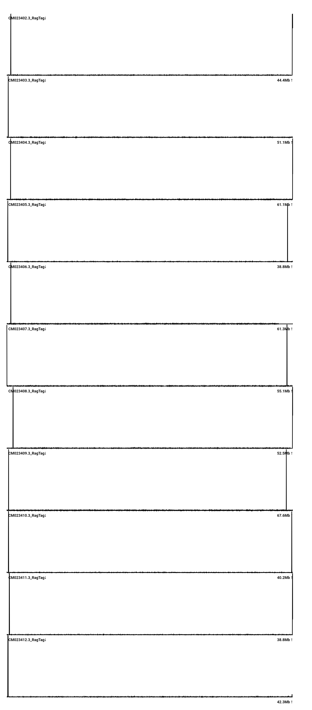 |  |

It seems that the results are comparable with no clear winner. Let's try another approach by first mapping *all* contigs to *E. melliodora* reference genome, and then use the collapsed haplotype as the reference for each haplotype.

```
# change working directory
cd 07_scaffold/

# combine the two contigs
cat ../06_parental_assign/final/E_phylacis_virginea_like.dedup.split.fa \
    ../06_parental_assign/final/E_phylacis_decipiens_like.dedup.fa \
    > ../06_parental_assign/final/E_phylacis_union.dedup.split.fa

# union to melliodora
ragtag.py scaffold -t 64 --mm2-params "-x asm20" -f 10000 -u -a 0.1 \
    -o union_mel ../06_parental_assign/parents/roadies/Eucalyptus_melliodora_GCA_004368105.4.fna \
    ../06_parental_assign/final/E_phylacis_union.dedup.split.fa

# extract the 11 chromosomes
seqkit grep -r -p '^CM0234' union_mel/ragtag.scaffold.fasta  > union_mel/union_chromosomes.fa

# virginea-like to union
ragtag.py scaffold -t 64 --mm2-params "-x asm20" -f 10000 -u -a 0.1 \
    -o virginea_like_union union_mel/union_chromosomes.fa \
    ../06_parental_assign/final/E_phylacis_virginea_like.dedup.split.fa

# decipiens-like to union
ragtag.py scaffold -t 64 --mm2-params "-x asm20" -f 10000 -u -a 0.1 \
    -o decipiens_like_union union_mel/union_chromosomes.fa \
    ../06_parental_assign/final/E_phylacis_decipiens_like.dedup.fa

# extract the 11 chromosomes
seqkit grep -r -p '^CM0234' virginea_like_union/ragtag.scaffold.fasta  > virginea_like_union/vir_chromosomes.fa
seqkit grep -r -p '^CM0234' decipiens_like_union/ragtag.scaffold.fasta > decipiens_like_union/dec_chromosomes.fa

# extract telomeres
tidk search -s AAACCCT -o vir_tidk_union -d ./ virginea_like_union/vir_chromosomes.fa
tidk plot   -t vir_tidk_union_telomeric_repeat_windows.tsv -o vir_telomeres_union
tidk search -s AAACCCT -o dec_tidk_union -d ./ decipiens_like_union/dec_chromosomes.fa
tidk plot   -t dec_tidk_union_telomeric_repeat_windows.tsv -o dec_telomeres_union

# change working directory
cd ..
```

| Metric               | decipiens-like | virginea-like | 
| :------------------- | -------------: | ------------: |
| Contigs placed       |             71 |            84 |
| Placed (bp)          |    554,327,408 |   521,762,818 |
| Contigs unplaced     |             77 |            74 |
| Unplaced (bp)        |     10,020,787 |     7,868,187 |
| Gaps (100 N)         |             60 |            73 |

|                    decipiens-like                    |                   virginea-like                     |
| :--------------------------------------------------: | :-------------------------------------------------: |
| 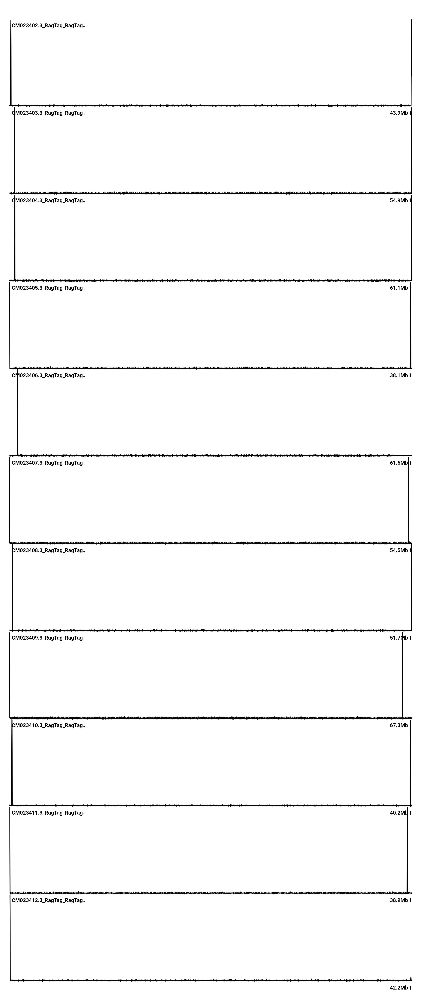 | 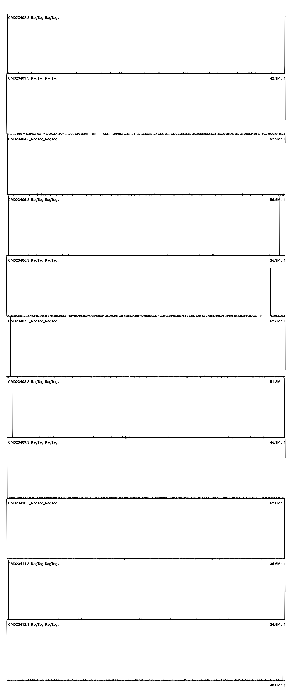 |

I think it looks much cleaner for most chromosomes, with telomere motifs found at both ends of the chromosome! Let's see if we can improve this further by changing the scaffolding parameters.

## <a id="06d">Trying different RagTag parameters</a>
As *E. melliodora* is not a direct close relative to sect. *Bisectae*, we need to be more careful on the initial scaffolding.

### <a id="06d1">`-a`</a>

```
# change working directory
cd 07_scaffold_a/

# iterate over different values of -a
for a in 0.0 0.1 0.2 0.3 0.4 0.5; do

    # union to melliodora
    ragtag.py scaffold -t 64 --mm2-params "-x asm20" -f 10000 -u -a ${a} \
        -o union_mel_a${a} ../06_parental_assign/parents/roadies/Eucalyptus_melliodora_GCA_004368105.4.fna \
        ../06_parental_assign/final/E_phylacis_union.dedup.split.fa

    # extract the 11 chromosomes
    seqkit grep -r -p '^CM0234' union_mel_a${a}/ragtag.scaffold.fasta \
        > union_mel_a${a}/union_chromosomes.fa

    # virginea-like to union
    ragtag.py scaffold -t 64 --mm2-params "-x asm20" -f 10000 -u -a ${a} \
        -o virginea_like_union_a${a} union_mel_a${a}/union_chromosomes.fa \
        ../06_parental_assign/final/E_phylacis_virginea_like.dedup.split.fa

    # decipiens-like to union
    ragtag.py scaffold -t 64 --mm2-params "-x asm20" -f 10000 -u -a ${a} \
        -o decipiens_like_union_a${a} union_mel_a${a}/union_chromosomes.fa \
        ../06_parental_assign/final/E_phylacis_decipiens_like.dedup.fa

    # extract the 11 chromosomes
    seqkit grep -r -p '^CM0234' virginea_like_union_a${a}/ragtag.scaffold.fasta \
        > virginea_like_union_a${a}/vir_chromosomes.fa
    seqkit grep -r -p '^CM0234' decipiens_like_union_a${a}/ragtag.scaffold.fasta \
        > decipiens_like_union_a${a}/dec_chromosomes.fa

    # extract telomeres
    tidk search -s AAACCCT -o vir_tidk_union_a${a} -d ./ virginea_like_union_a${a}/vir_chromosomes.fa
    tidk plot   -t vir_tidk_union_a${a}_telomeric_repeat_windows.tsv -o vir_telomeres_union_a${a}
    tidk search -s AAACCCT -o dec_tidk_union_a${a} -d ./ decipiens_like_union_a${a}/dec_chromosomes.fa
    tidk plot   -t dec_tidk_union_a${a}_telomeric_repeat_windows.tsv -o dec_telomeres_union_a${a}

done

# change working directory
cd ..
```

### Union

| Metric             | 0.0        | 0.1        | 0.2        | 0.3        | 0.4        | 0.5        |
| :----------------- | ---------: | ---------: | ---------: | ---------: | ---------: | ---------: |
| Contigs placed     | 201        | 174        | 165        | 161        | 159        | 157        |
| Placed (bp)        | 853369829  | 847845139  | 847077575  | 846003747  | 845696338  | 845490834  |
| Contigs unplaced   | 105        | 132        | 141        | 145        | 147        | 149        |
| Unplaced (bp)      | 240609371  | 246134061  | 246901625  | 247975453  | 248282862  | 248488366  |
| Gaps (100 N)       | 189        | 162        | 153        | 149        | 147        | 145        |

### Decipiens-like

| Metric             | 0.0        | 0.1        | 0.2        | 0.3        | 0.4        | 0.5        |
| :----------------- | ---------: | ---------: | ---------: | ---------: | ---------: | ---------: |
| Contigs placed     | 63         | 71         | 75         | 76         | 75         | 77         |
| Placed (bp)        | 555160364  | 554327408  | 554735695  | 554790709  | 554552711  | 554758215  |
| Contigs unplaced   | 85         | 77         | 73         | 72         | 73         | 71         |
| Unplaced (bp)      | 9187831    | 10020787   | 9612500    | 9557486    | 9795484    | 9589980    |
| Gaps (100 N)       | 52         | 60         | 64         | 65         | 64         | 66         |

| 0.0        | 0.1        | 0.2        | 0.3        | 0.4        | 0.5        |
| ---------: | ---------: | ---------: | ---------: | ---------: | ---------: |
| 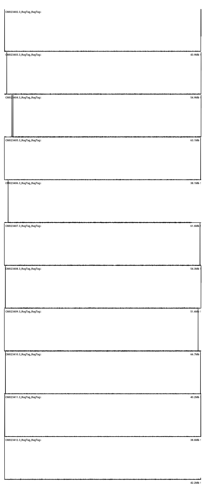 | 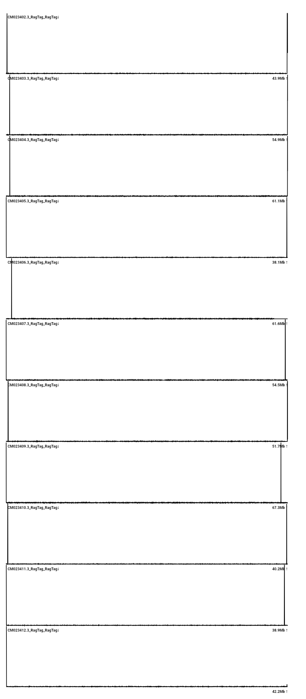 |  | 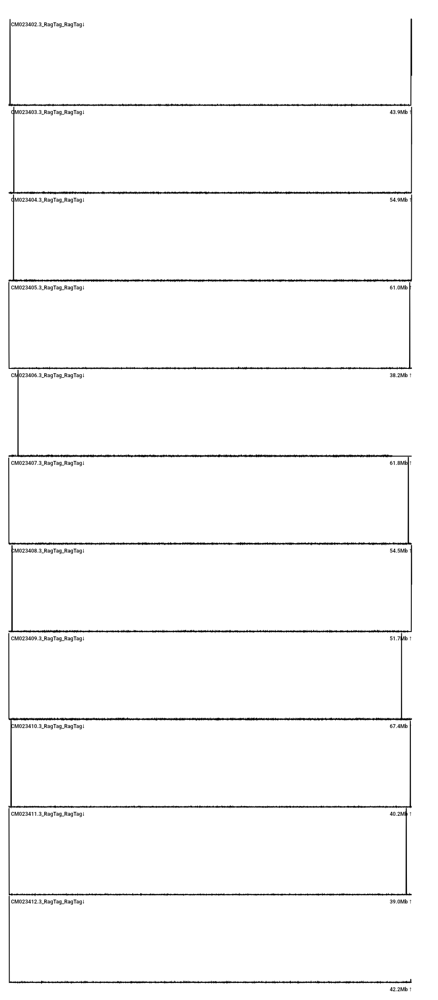 | 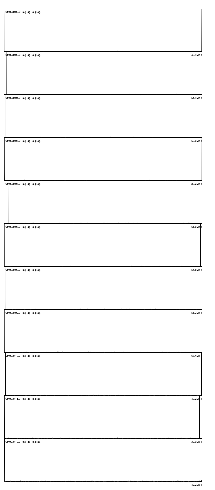 |  |

### Virginea-like

| Metric             | 0.0        | 0.1        | 0.2        | 0.3        | 0.4        | 0.5        |
| :----------------- | ---------: | ---------: | ---------: | ---------: | ---------: | ---------: |
| Contigs placed     | 86         | 84         | 85         | 86         | 86         | 86         |
| Placed (bp)        | 521223776  | 521762818  | 521823859  | 522714367  | 522714367  | 522714367  |
| Contigs unplaced   | 72         | 74         | 73         | 72         | 72         | 72         |
| Unplaced (bp)      | 8407229    | 7868187    | 7807146    | 6916638    | 6916638    | 6916638    |
| Gaps (100 N)       | 75         | 73         | 74         | 75         | 75         | 75         |

| 0.0        | 0.1        | 0.2        | 0.3        | 0.4        | 0.5        |
| ---------: | ---------: | ---------: | ---------: | ---------: | ---------: |
| 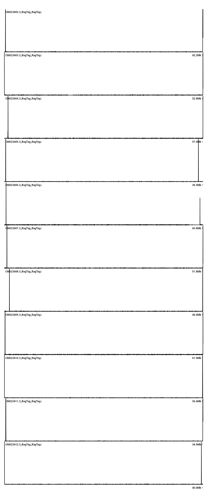 | 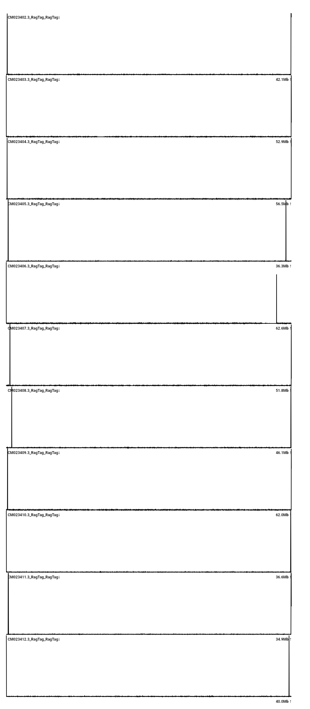 |  | 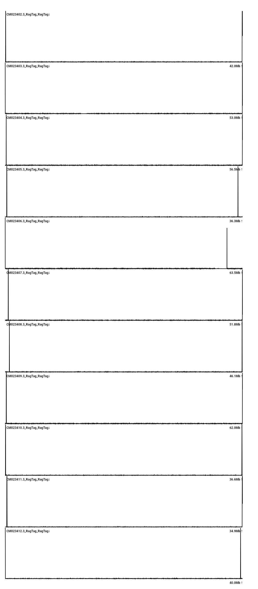 |  |  |

It seems that the results are comparable when `-a` > 0.0. However, using `-a` ≥ 0.3 seems to move the telomere of `CM023406.3` closer to the middle. Let's use `-a 0.2` then!

### <a id="06d2">`-f`</a>

```
# change working directory
cd 07_scaffold_a02_f/

# iterate over -f values
for f_label in 5k 10k 25k 50k 75k 100k 250k 500k; do

    # convert f_label to bp
    f=$(( ${f_label%k} * 1000 ))

    # union to melliodora
    ragtag.py scaffold -t 64 --mm2-params "-x asm20" -f ${f} -u -a 0.2 \
        -o union_mel_f${f_label} ../06_parental_assign/parents/roadies/Eucalyptus_melliodora_GCA_004368105.4.fna \
        ../06_parental_assign/final/E_phylacis_union.dedup.split.fa

    # extract the 11 chromosomes
    seqkit grep -r -p '^CM0234' union_mel_f${f_label}/ragtag.scaffold.fasta \
        > union_mel_f${f_label}/union_chromosomes.fa

    # virginea-like to union
    ragtag.py scaffold -t 64 --mm2-params "-x asm20" -f ${f} -u -a 0.1 \
        -o virginea_like_union_f${f_label} union_mel_f${f_label}/union_chromosomes.fa \
        ../06_parental_assign/final/E_phylacis_virginea_like.dedup.split.fa

    # decipiens-like to union
    ragtag.py scaffold -t 64 --mm2-params "-x asm20" -f ${f} -u -a 0.1 \
        -o decipiens_like_union_f${f_label} union_mel_f${f_label}/union_chromosomes.fa \
        ../06_parental_assign/final/E_phylacis_decipiens_like.dedup.fa

    # extract the 11 chromosomes
    seqkit grep -r -p '^CM0234' virginea_like_union_f${f_label}/ragtag.scaffold.fasta \
        > virginea_like_union_f${f_label}/vir_chromosomes.fa
    seqkit grep -r -p '^CM0234' decipiens_like_union_f${f_label}/ragtag.scaffold.fasta \
        > decipiens_like_union_f${f_label}/dec_chromosomes.fa

    # extract telomeres
    tidk search -s AAACCCT -o vir_tidk_union_f${f_label} -d ./ virginea_like_union_f${f_label}/vir_chromosomes.fa
    tidk plot   -t vir_tidk_union_f${f_label}_telomeric_repeat_windows.tsv -o vir_telomeres_union_f${f_label}
    tidk search -s AAACCCT -o dec_tidk_union_f${f_label} -d ./ decipiens_like_union_f${f_label}/dec_chromosomes.fa
    tidk plot   -t dec_tidk_union_f${f_label}_telomeric_repeat_windows.tsv -o dec_telomeres_union_f${f_label}

done

# change working directory
cd ..
```

### Union

| Metric             | 5k         | 10k        | 25k        | 50k        | 75k        | 100k       |
| :----------------- | ---------: | ---------: | ---------: | ---------: | ---------: | ---------: |
| Contigs placed     | 170        | 165        | 157        | 147        | 143        | 142        |
| Placed (bp)        | 847748482  | 847077575  | 846561745  | 846726970  | 846184561  | 846092539  |
| Contigs unplaced   | 136        | 141        | 149        | 159        | 163        | 164        |
| Unplaced (bp)      | 246230718  | 246901625  | 247417455  | 247252230  | 247794639  | 247886661  |
| Gaps (100 N)       | 157        | 153        | 145        | 136        | 132        | 131        |

### Decipiens-like

| Metric             | 5k         | 10k        | 25k        | 50k        | 75k        | 100k       |
| :----------------- | ---------: | ---------: | ---------: | ---------: | ---------: | ---------: |
| Contigs placed     | 76         | 75         | 77         | 83         | 83         | 82         |
| Placed (bp)        | 554737707  | 554735695  | 554759526  | 557068269  | 557063298  | 556971276  |
| Contigs unplaced   | 72         | 73         | 71         | 65         | 65         | 66         |
| Unplaced (bp)      | 9610488    | 9612500    | 9588669    | 7279926    | 7284897    | 7376919    |
| Gaps (100 N)       | 65         | 64         | 66         | 72         | 72         | 71         |

| 5k         | 10k        | 25k        | 50k        | 75k        | 100k       |
| ---------: | ---------: | ---------: | ---------: | ---------: | ---------: |
| 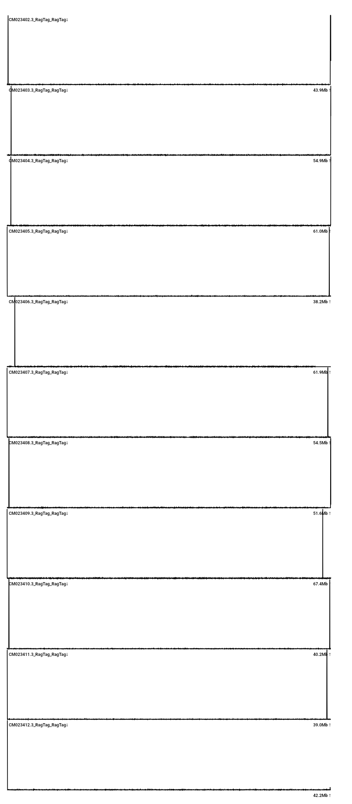 | 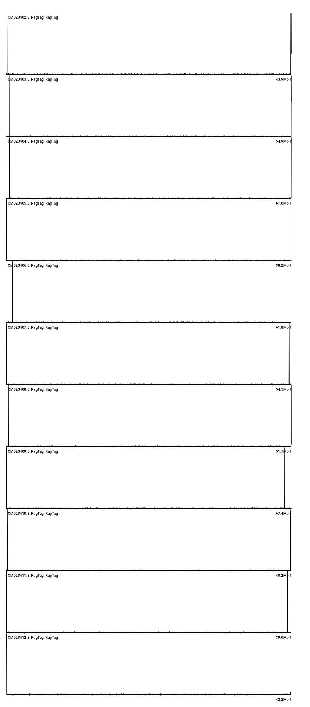 | 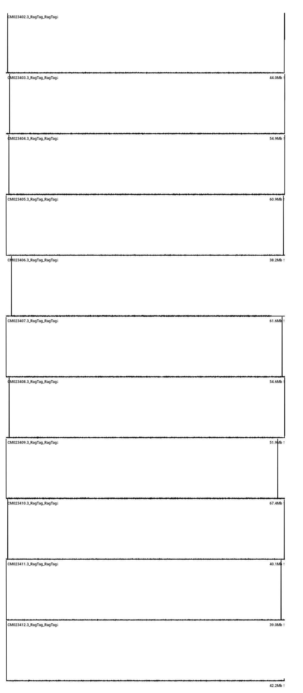 | 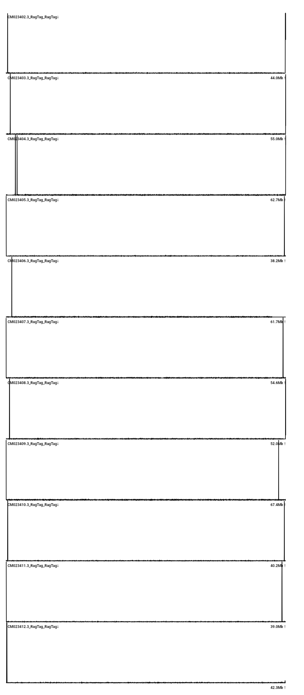 | 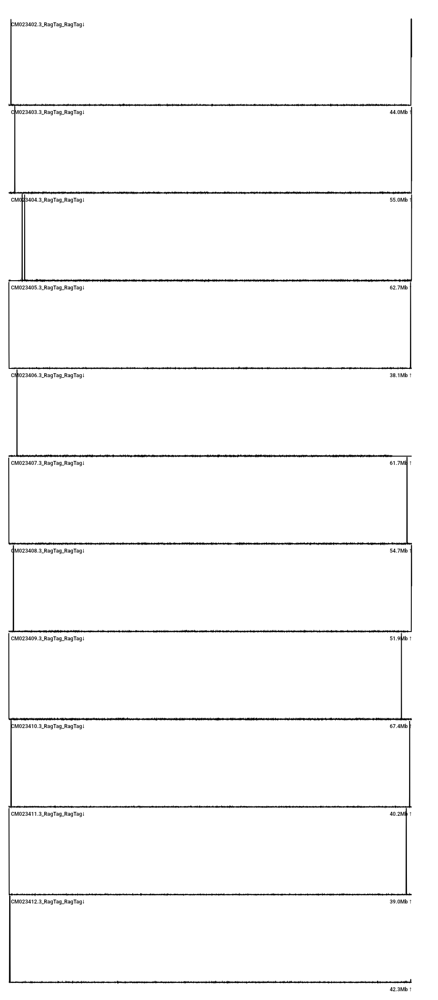 | 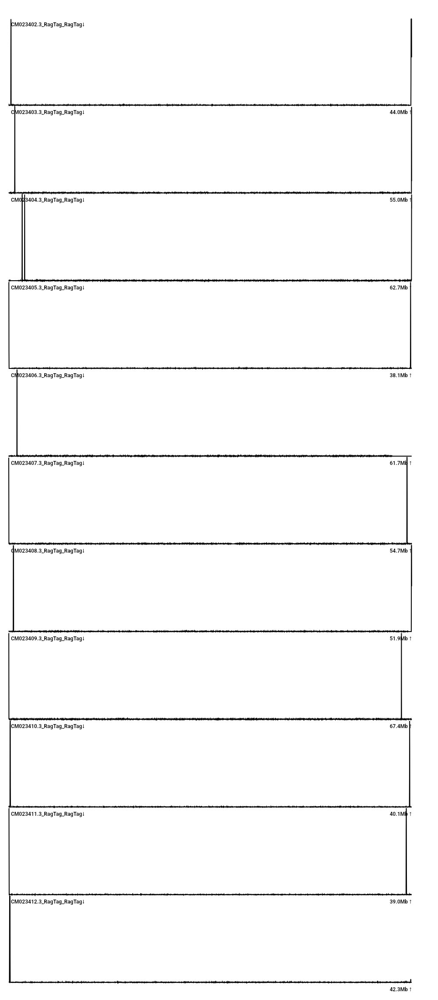 |

### Virginea-like

| Metric             | 5k         | 10k        | 25k        | 50k        | 75k        | 100k       |
| :----------------- | ---------: | ---------: | ---------: | ---------: | ---------: | ---------: |
| Contigs placed     | 82         | 85         | 86         | 90         | 93         | 92         |
| Placed (bp)        | 521653739  | 521823859  | 521933233  | 522859729  | 523313177  | 523222714  |
| Contigs unplaced   | 76         | 73         | 72         | 68         | 65         | 66         |
| Unplaced (bp)      | 7977266    | 7807146    | 7697772    | 6771276    | 6317828    | 6408291    |
| Gaps (100 N)       | 71         | 74         | 75         | 79         | 82         | 81         |

| 5k         | 10k        | 25k        | 50k        | 75k        | 100k       |
| ---------: | ---------: | ---------: | ---------: | ---------: | ---------: |
| 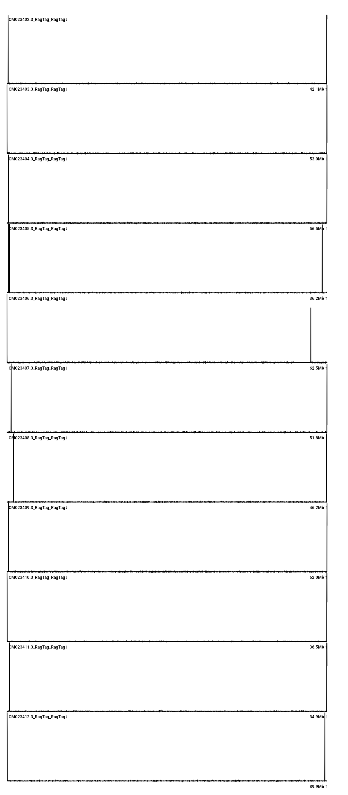 | 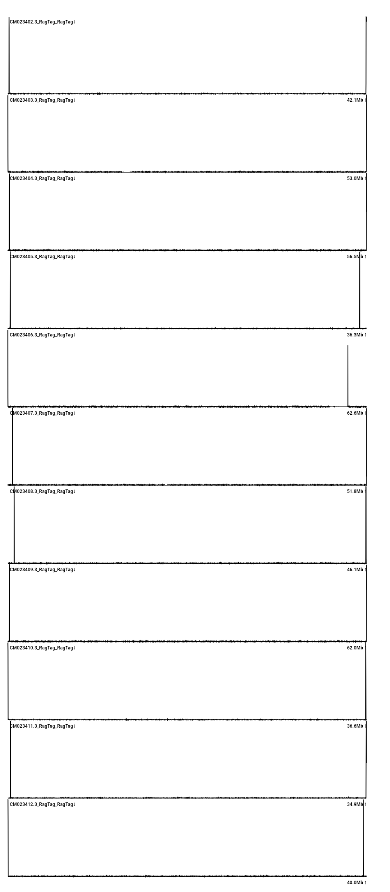 | 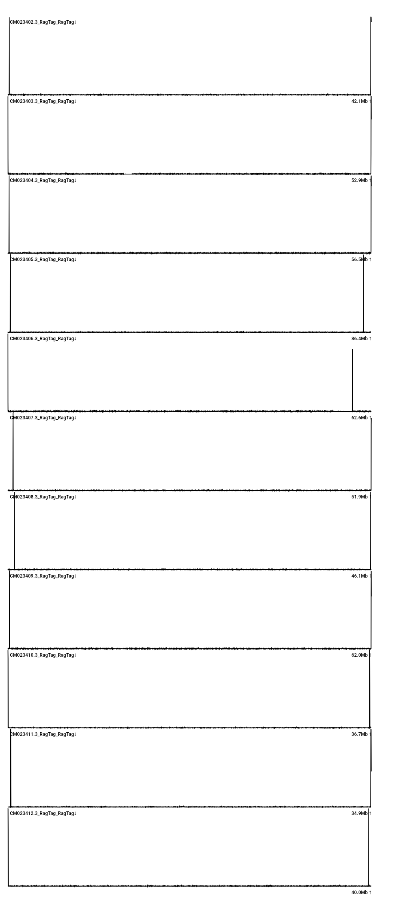 |  |  | 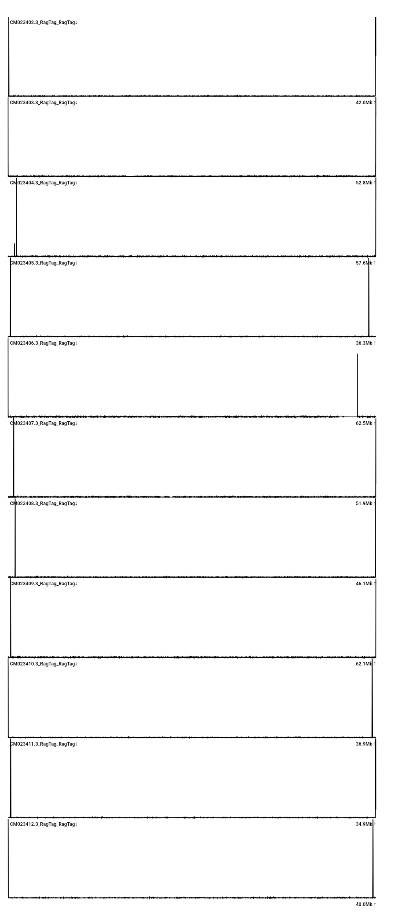 |

Similarly, it seems that increasing the value of `-f` does not have a big impact, except on one chromosome on the `decipiens-like` haplotype. Let's stick with `-f 25000`.

## <a id="06e">Binning and removing contigs beyond telomeres</a>
Claude generated a <a href="./scripts/scaffold_per_chromosome.sh">script</a> to bin contigs based on the previous RagTag run, and exclude contigs that are placed beyond telomeres.

```
# create new folders
mkdir -p 07_scaffold_correct_bin/refs/
mkdir -p 07_scaffold_correct_bin/init/

# copy the reference to a new folder
cp 07_scaffold_a02_f/union_mel_f25k/union_chromosomes.fa 07_scaffold_correct_bin/refs/

# remove the _RagTag suffix
seqkit replace -p '_RagTag' -r '' 07_scaffold_correct_bin/refs/union_chromosomes.fa > 07_scaffold_correct_bin/refs/union_chromosomes_clean.fa

# rerun RagTag with -a 0.2 -f 25000
cd 07_scaffold_correct_bin/init/

ragtag.py scaffold -t 64 --mm2-params "-x asm20" -f 25000 -u -a 0.2 \
        -o virginea_like ../refs/union_chromosomes_clean.fa \
        ../../06_parental_assign/final/E_phylacis_virginea_like.dedup.split.fa

ragtag.py scaffold -t 64 --mm2-params "-x asm20" -f 25000 -u -a 0.2 \
        -o decipiens_like ../refs/union_chromosomes_clean.fa \
        ../../06_parental_assign/final/E_phylacis_decipiens_like.dedup.fa

cd ../..

# run binning (iteration 1)
bash scripts/scaffold_per_chromosome.sh vir
bash scripts/scaffold_per_chromosome.sh dec

# run iterative binning (iteration 2, etc.) - virginea-like
P=vir; W=07_scaffold_correct_bin/$P
cp $W/beyond_telomere.txt $W/exclude_all.txt

for i in 1 2 3 4 5; do
    EXCLUDE=$PWD/$W/exclude_all.txt bash scripts/scaffold_per_chromosome.sh $P
    n=$(wc -l < $W/beyond_telomere.txt)
    echo "round $i: $n fragments still beyond a telomere"
    [ "$n" -eq 0 ] && { echo "converged"; break; }
    cat $W/beyond_telomere.txt >> $W/exclude_all.txt
    sort -u -o $W/exclude_all.txt $W/exclude_all.txt
done

# run iterative binning (iteration 2, etc.) - decipiens-like
P=dec; W=07_scaffold_correct_bin/$P
cp $W/beyond_telomere.txt $W/exclude_all.txt

for i in 1 2 3 4 5; do
    EXCLUDE=$PWD/$W/exclude_all.txt bash scripts/scaffold_per_chromosome.sh $P
    n=$(wc -l < $W/beyond_telomere.txt)
    echo "round $i: $n fragments still beyond a telomere"
    [ "$n" -eq 0 ] && { echo "converged"; break; }
    cat $W/beyond_telomere.txt >> $W/exclude_all.txt
    sort -u -o $W/exclude_all.txt $W/exclude_all.txt
done
```

### Virginea-like

- <b><i>Iteration 1</i></b>

    ```
    scaffold               anchor        left end                                       right end                                       internal-in-anchor
    CM023406.3_RagTag      h2tg000004l   telomere 3019 copies                           telomere 1146 copies; 16 comp. beyond (3.30 Mb) -
    CM023409.3_RagTag      h2tg000008l   telomere 6775 copies; 4 comp. beyond (0.27 Mb) telomere 3379 copies                            -
    CM023404.3_RagTag      h2tg000010l   telomere 2634 copies; 2 comp. beyond (0.11 Mb) telomere 4079 copies                            -
    CM023403.3_RagTag      h2tg000005l   telomere 3134 copies                           telomere 4226 copies                            -
    CM023407.3_RagTag      h2tg000012l   telomere 4501 copies; 8 comp. beyond (0.79 Mb) telomere 2536 copies                            -
    CM023408.3_RagTag      h2tg000002l   telomere 2831 copies; 7 comp. beyond (0.61 Mb) telomere 4531 copies; 1 comp. beyond (0.05 Mb)  -
    CM023402.3_RagTag      h2tg000007l   telomere 3815 copies; 2 comp. beyond (0.14 Mb) telomere 8668 copies                            -
    CM023412.3_RagTag      h1tg000006l   telomere 5317 copies                           telomere 2771 copies; 3 comp. beyond (0.31 Mb)  -
    CM023410.3_RagTag      h1tg000005l   telomere 4126 copies                           telomere 4361 copies; 5 comp. beyond (0.33 Mb)  -
    CM023405.3_RagTag      h1tg000012l   telomere 4100 copies; 1 comp. beyond (0.05 Mb) telomere 2603 copies; 8 comp. beyond (0.68 Mb)  -
    CM023411.3_RagTag      h1tg000002l   telomere 5850 copies; 4 comp. beyond (0.24 Mb) telomere 5678 copies                            -

    chromosome ends with a telomere: 22/22; components placed beyond a telomere: 61
    ```

- <b><i>Iteration 2</i></b>

    ```
    scaffold               anchor        left end                                       right end               internal-in-anchor
    CM023409.3_RagTag      h2tg000008l   telomere 6776 copies                           telomere 3380 copies    -
    CM023406.3_RagTag      h2tg000004l   telomere 3019 copies                           telomere 1145 copies    -
    CM023404.3_RagTag      h2tg000010l   telomere 2634 copies                           telomere 4079 copies    -
    CM023403.3_RagTag      h2tg000005l   telomere 3134 copies                           telomere 4226 copies    -
    CM023407.3_RagTag      h2tg000012l   telomere 4593 copies                           telomere 2537 copies    -
    CM023408.3_RagTag      h2tg000002l   telomere 2837 copies; 1 comp. beyond (0.07 Mb) telomere 4529 copies    -
    CM023402.3_RagTag      h2tg000007l   telomere 3814 copies                           telomere 8667 copies    -
    CM023412.3_RagTag      h1tg000006l   telomere 5317 copies                           telomere 2770 copies    -
    CM023410.3_RagTag      h1tg000005l   telomere 4126 copies                           telomere 4359 copies    -
    CM023405.3_RagTag      h1tg000012l   telomere 4160 copies                           telomere 2663 copies    -
    CM023411.3_RagTag      h1tg000002l   telomere 5851 copies                           telomere 5678 copies    -

    chromosome ends with a telomere: 22/22; components placed beyond a telomere: 1
    ```

- <b><i>Iteration 3</i></b>

    ```
    scaffold               anchor        left end                           right end                          internal-in-anchor
    CM023409.3_RagTag      h2tg000008l   telomere 6776 copies               telomere 3380 copies               -
    CM023406.3_RagTag      h2tg000004l   telomere 3019 copies               telomere 1145 copies               -
    CM023404.3_RagTag      h2tg000010l   telomere 2634 copies               telomere 4079 copies               -
    CM023403.3_RagTag      h2tg000005l   telomere 3134 copies               telomere 4226 copies               -
    CM023407.3_RagTag      h2tg000012l   telomere 4593 copies               telomere 2537 copies               -
    CM023408.3_RagTag      h2tg000002l   telomere 2825 copies               telomere 4529 copies               -
    CM023402.3_RagTag      h2tg000007l   telomere 3814 copies               telomere 8667 copies               -
    CM023412.3_RagTag      h1tg000006l   telomere 5317 copies               telomere 2770 copies               -
    CM023410.3_RagTag      h1tg000005l   telomere 4126 copies               telomere 4359 copies               -
    CM023405.3_RagTag      h1tg000012l   telomere 4160 copies               telomere 2663 copies               -
    CM023411.3_RagTag      h1tg000002l   telomere 5851 copies               telomere 5678 copies               -

    chromosome ends with a telomere: 22/22; components placed beyond a telomere: 0
    ```

    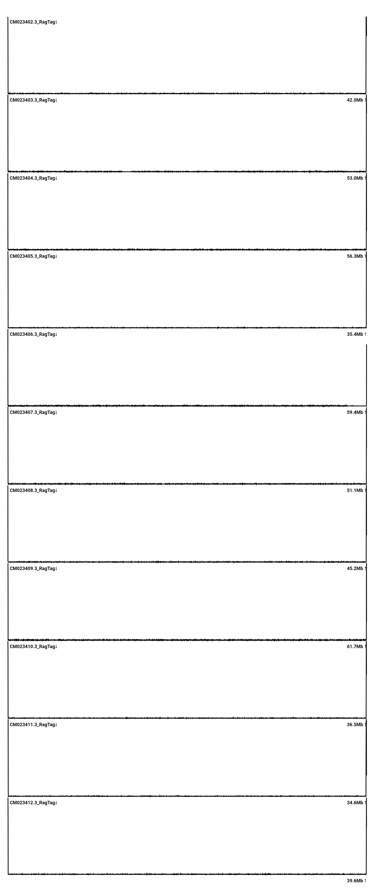

### Decipiens-like

- <b><i>Iteration 1</i></b>

    ```
    scaffold               anchor        left end                                        right end                                       internal-in-anchor
    CM023409.3_RagTag      h1tg000003l   telomere 3415 copies                            telomere 2705 copies; 18 comp. beyond (1.91 Mb) -
    CM023406.3_RagTag      h1tg000295l   telomere 4091 copies; 12 comp. beyond (1.31 Mb) no telomere                                     -
    CM023404.3_RagTag      h1tg000007l   telomere 2987 copies; 5 comp. beyond (0.62 Mb)  telomere 3489 copies                            -
    CM023403.3_RagTag      h1tg000014l   telomere 3357 copies; 6 comp. beyond (0.68 Mb)  telomere 3056 copies                            -
    CM023407.3_RagTag      h1tg000004l   telomere 2241 copies                            telomere 5589 copies; 7 comp. beyond (0.49 Mb)  -
    CM023408.3_RagTag      h1tg000001l   telomere 6214 copies; 6 comp. beyond (0.56 Mb)  telomere 5487 copies                            -
    CM023402.3_RagTag      h1tg000009l   telomere 3625 copies; 2 comp. beyond (0.13 Mb)  telomere 9776 copies                            -
    CM023412.3_RagTag      h2tg000006l   telomere 8149 copies                            no telomere                                     -
    CM023410.3_RagTag      h2tg000011l   telomere 4533 copies; 3 comp. beyond (0.22 Mb)  telomere 2904 copies                            -
    CM023411.3_RagTag      h2tg000003l   telomere 5003 copies                            telomere 4286 copies; 6 comp. beyond (0.58 Mb)  -
    CM023405.3_RagTag      h2tg000001l   telomere 3134 copies                            telomere 2520 copies; 2 comp. beyond (0.17 Mb)  -

    chromosome ends with a telomere: 20/22; components placed beyond a telomere: 67
    ```

- <b><i>Iteration 2</i></b>

    ```
    scaffold               anchor        left end                           right end                          internal-in-anchor
    CM023409.3_RagTag      h1tg000003l   telomere 3415 copies               telomere 2704 copies               -
    CM023406.3_RagTag      h1tg000295l   telomere 4093 copies               no telomere                        -
    CM023404.3_RagTag      h1tg000007l   telomere 2989 copies               telomere 3489 copies               -
    CM023403.3_RagTag      h1tg000014l   telomere 3357 copies               telomere 3055 copies               -
    CM023407.3_RagTag      h1tg000004l   telomere 2241 copies               telomere 5589 copies               -
    CM023408.3_RagTag      h1tg000001l   telomere 6223 copies               telomere 5479 copies               -
    CM023402.3_RagTag      h1tg000009l   telomere 3624 copies               telomere 9777 copies               -
    CM023412.3_RagTag      h2tg000006l   telomere 8149 copies               no telomere                        -
    CM023410.3_RagTag      h2tg000011l   telomere 4534 copies               telomere 2902 copies               -
    CM023411.3_RagTag      h2tg000003l   telomere 5003 copies               telomere 4286 copies               -
    CM023405.3_RagTag      h2tg000001l   telomere 3134 copies               telomere 2520 copies               -

    chromosome ends with a telomere: 20/22; components placed beyond a telomere: 0
    ```

    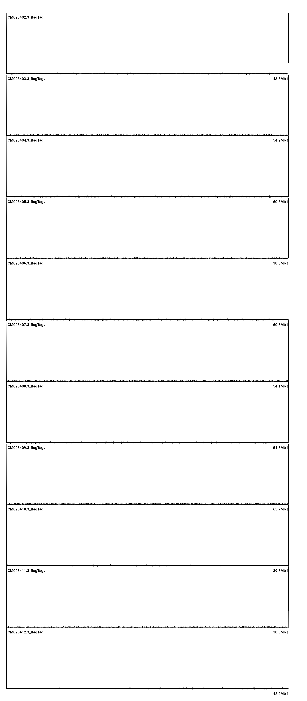

### SeqKit

| Metric                       | virginea-like | decipiens-like |
| :--------------------------- | ------------: | -------------: |
| Chromosome scaffolds         |            11 |             11 |
| Chromosome total (bp)        |   514,919,711 |    548,419,156 |
| Chromosome min (bp)          |    34,632,737 |     38,016,435 |
| Chromosome mean (bp)         |    46,810,883 |     49,856,287 |
| Chromosome max (bp)          |    61,702,390 |     65,682,487 |
| Unplaced sequences           |           130 |            135 |
| Unplaced total (bp)          |    14,712,994 |     15,929,239 |
| Unplaced max (bp)            |     1,702,289 |      1,848,943 |
| Total sequences              |           141 |            146 |
| Total length (bp)            |   529,632,705 |    564,348,395 |

## <a id="06f">Gap closing</a>

```
# create another set of longer reads but with slightly lower quality
pigz -dc -p 16 00_raw_data/*.fastq.gz | \
chopper -q 7 -l 50000 | \
bgzip -@ 128 > 01_qc/02_chopper/E_phylacis_filtered_Q750k.fastq.gz

# rename individual chromosomes
seqkit replace -p '^' -r 'vir_' 07_scaffold_correct_bin/vir/E_phylacis_virginea_like.scaffolds.fa  > 08_gapclosing/vir.fa
seqkit replace -p '^' -r 'dec_' 07_scaffold_correct_bin/dec/E_phylacis_decipiens_like.scaffolds.fa > 08_gapclosing/dec.fa
cat 08_gapclosing/vir.fa 08_gapclosing/dec.fa > 08_gapclosing/both_parents.fa

# map filtered reads to both parents
minimap2 -x map-ont -t 128 --secondary=no 08_gapclosing/both_parents.fa \
    01_qc/02_chopper/E_phylacis_filtered.fastq.gz > 08_gapclosing/reads_vs_parents_Q1015k.paf

minimap2 -x map-ont -t 128 --secondary=no 08_gapclosing/both_parents.fa \
    01_qc/02_chopper/E_phylacis_filtered_Q750k.fastq.gz > 08_gapclosing/reads_vs_parents_Q750k.paf

# create new directories
mkdir -p 08_gapclosing/decipiens/
mkdir -p 08_gapclosing/virginea/

# change working directory
cd 08_gapclosing/decipiens/

# extract gap windows (±100 kb) on the decipiens scaffolds, named as in both_parents.fa
awk -F'\t' '$5=="U" {s=$2-100000; if (s<1) s=1; print "dec_"$1"\t"s"\t"$3+100000}' \
    ../../07_scaffold_correct_bin/dec/combined.agp > dec_gaps.bed

# extract all reads that overlap a gap window
awk '$6 ~ /^dec_/ {print $6"\t"$8"\t"$9"\t"$1}' ../reads_vs_parents_Q1015k.paf \
    | bedtools intersect -u -a - -b dec_gaps.bed | cut -f4 | sort -u > dec_gap_reads.txt
seqkit grep -f dec_gap_reads.txt ../../01_qc/02_chopper/E_phylacis_filtered.fastq.gz | seqkit fq2fa > dec_gap_reads.fa

awk '$6 ~ /^dec_/ {print $6"\t"$8"\t"$9"\t"$1}' ../reads_vs_parents_Q750k.paf \
    | bedtools intersect -u -a - -b dec_gaps.bed | cut -f4 | sort -u > dec_extra_gap_reads.txt
seqkit grep -f dec_extra_gap_reads.txt ../../01_qc/02_chopper/E_phylacis_filtered_Q750k.fastq.gz | seqkit fq2fa > dec_extra_gap_reads.fa

# combine two sets of reads
cat dec_gap_reads.fa dec_extra_gap_reads.fa | seqkit rmdup -n > dec_gap_reads_all.fa

# gap closing
tgsgapcloser --scaff ../dec.fa --reads dec_gap_reads_all.fa --output dec_closed --tgstype ont \
    --racon /home/jeremias/anaconda3/envs/btk/bin/racon --thread 64 > dec_closed.log 2>&1

# change working directory
cd ../virginea/

# do the same with virginea
awk -F'\t' '$5=="U" {s=$2-100000; if (s<1) s=1; print "vir_"$1"\t"s"\t"$3+100000}' \
    ../../07_scaffold_correct_bin/vir/combined.agp > vir_gaps.bed

awk '$6 ~ /^vir_/ {print $6"\t"$8"\t"$9"\t"$1}' ../reads_vs_parents_Q1015k.paf \
    | bedtools intersect -u -a - -b vir_gaps.bed | cut -f4 | sort -u > vir_gap_reads.txt
seqkit grep -f vir_gap_reads.txt ../../01_qc/02_chopper/E_phylacis_filtered.fastq.gz | seqkit fq2fa > vir_gap_reads.fa

awk '$6 ~ /^vir_/ {print $6"\t"$8"\t"$9"\t"$1}' ../reads_vs_parents_Q750k.paf \
    | bedtools intersect -u -a - -b vir_gaps.bed | cut -f4 | sort -u > vir_extra_gap_reads.txt
seqkit grep -f vir_extra_gap_reads.txt ../../01_qc/02_chopper/E_phylacis_filtered_Q750k.fastq.gz | seqkit fq2fa > vir_extra_gap_reads.fa

cat vir_gap_reads.fa vir_extra_gap_reads.fa | seqkit rmdup -n > vir_gap_reads_all.fa

# gap closing
tgsgapcloser --scaff ../vir.fa --reads vir_gap_reads_all.fa --output vir_closed --tgstype ont \
    --racon /home/jeremias/anaconda3/envs/btk/bin/racon --thread 64 > vir_closed.log 2>&1

# change working directory
cd ../..

# visualisation
python3 scripts/plot_scaffolds.py \
    --agp 07_scaffold_correct_bin/dec/combined.agp \
    --detail 08_gapclosing/decipiens/dec_closed.gap_fill_detail \
    --prefix dec_ \
    --title "E. phylacis, decipiens-like genome" \
    --out 08_gapclosing/decipiens/dec_scaffolds.png \
    --fasta 07_scaffold_correct_bin/dec/E_phylacis_decipiens_like.scaffolds.fa

python3 scripts/plot_scaffolds.py \
    --agp 07_scaffold_correct_bin/vir/combined.agp \
    --detail 08_gapclosing/virginea/vir_closed.gap_fill_detail \
    --prefix vir_ \
    --title "E. phylacis, virginea-like genome" \
    --out 08_gapclosing/virginea/vir_scaffolds.png \
    --fasta 07_scaffold_correct_bin/vir/E_phylacis_virginea_like.scaffolds.fa
```

|                    decipiens-like                    |                   virginea-like                     |
| :--------------------------------------------------: | :-------------------------------------------------: |
| 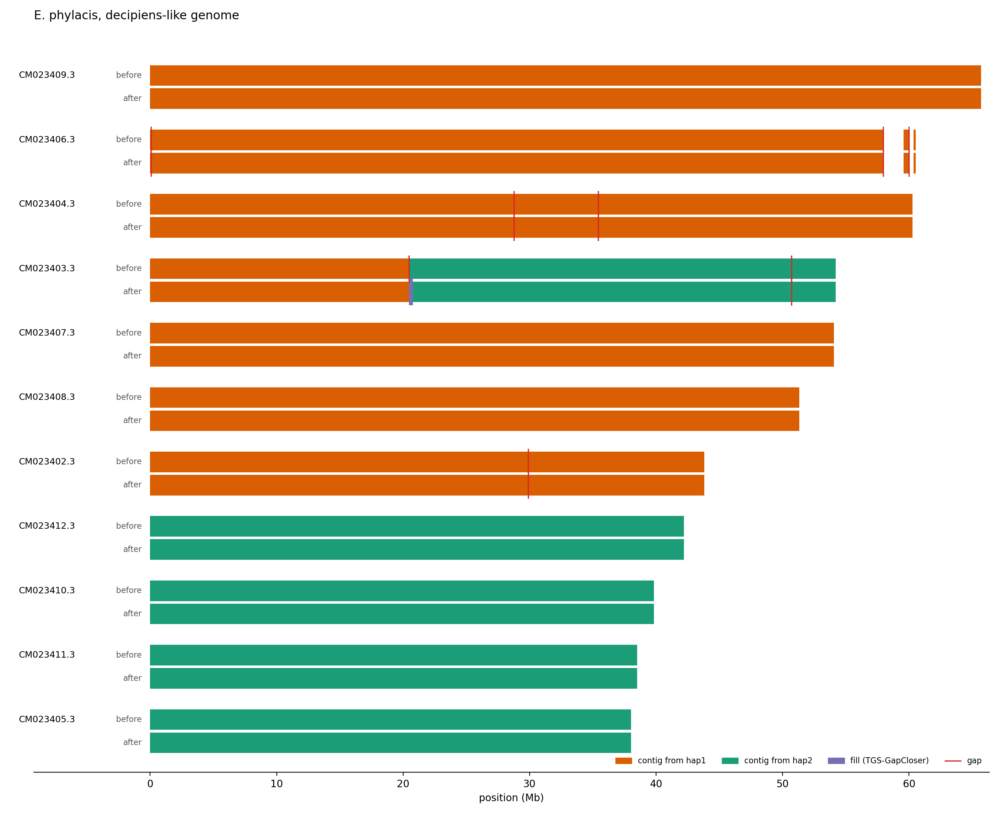 | 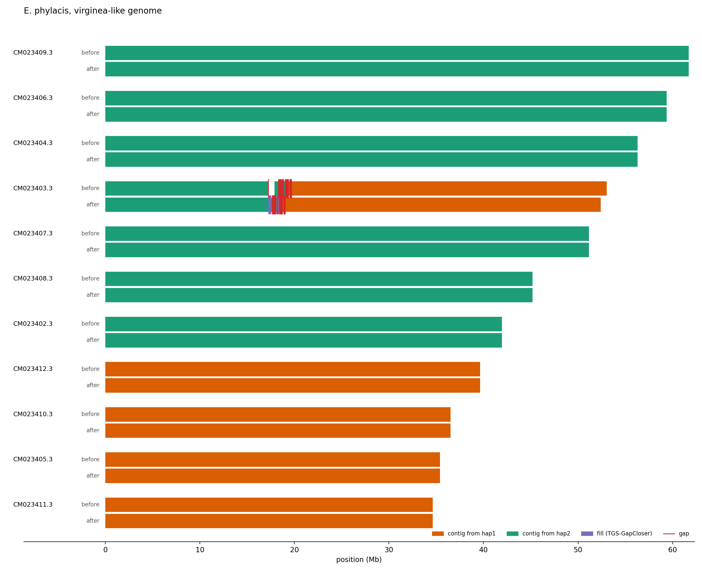 |

It seems like TGS-GapCloser filled the long, repetitive regions on chromosome 2 of both haplotype (`CM023403.3`). Unfortunately, we do not have any contig long enough to cover the whole region without gaps. As we cannot really estimate the length of the repetitive regions, we would skip the gap closing step.

## <a id="06g">Visualisation using SyRi</a>
Let's check the synteny between these haplotypes to their putative parents.

```
# update the chromosome names (decipiens-like)
awk '
BEGIN {
    map["CM023402.3_RagTag"] = "Chr1";
    map["CM023403.3_RagTag"] = "Chr2";
    map["CM023404.3_RagTag"] = "Chr3";
    map["CM023405.3_RagTag"] = "Chr4";
    map["CM023406.3_RagTag"] = "Chr5";
    map["CM023407.3_RagTag"] = "Chr6";
    map["CM023408.3_RagTag"] = "Chr7";
    map["CM023409.3_RagTag"] = "Chr8";
    map["CM023410.3_RagTag"] = "Chr9";
    map["CM023411.3_RagTag"] = "Chr10";
    map["CM023412.3_RagTag"] = "Chr11";
}
/^>/ {
    header = $1;
    sub(/^>/, "", header);
    if (header in map) {
        print ">" map[header];
    } else {
        print $0;
    }
    next;
}
{ print }
' 07_scaffold_correct_bin/dec/chromosomes.fa > 07_scaffold_correct_bin/syri/dec_chromosomes.fa

# update the chromosome names (virginea-like)
awk '
BEGIN {
    map["CM023402.3_RagTag"] = "Chr1";
    map["CM023403.3_RagTag"] = "Chr2";
    map["CM023404.3_RagTag"] = "Chr3";
    map["CM023405.3_RagTag"] = "Chr4";
    map["CM023406.3_RagTag"] = "Chr5";
    map["CM023407.3_RagTag"] = "Chr6";
    map["CM023408.3_RagTag"] = "Chr7";
    map["CM023409.3_RagTag"] = "Chr8";
    map["CM023410.3_RagTag"] = "Chr9";
    map["CM023411.3_RagTag"] = "Chr10";
    map["CM023412.3_RagTag"] = "Chr11";
}
/^>/ {
    header = $1;
    sub(/^>/, "", header);
    if (header in map) {
        print ">" map[header];
    } else {
        print $0;
    }
    next;
}
{ print }
' 07_scaffold_correct_bin/vir/chromosomes.fa > 07_scaffold_correct_bin/syri/vir_chromosomes.fa

# extract chromosomes 1 to 11
samtools faidx 06_parental_assign/parents/E_virginea.fa 1 2 3 4 5 6 7 8 9 10 11  > 07_scaffold_correct_bin/syri/ref_virginea.fa
samtools faidx 06_parental_assign/parents/E_decipiens.fa 1 2 3 4 5 6 7 8 9 10 11 > 07_scaffold_correct_bin/syri/ref_decipiens.fa
sed -i 's/^>/>Chr/' 07_scaffold_correct_bin/syri/ref_virginea.fa 
sed -i 's/^>/>Chr/' 07_scaffold_correct_bin/syri/ref_decipiens.fa

# change working directory
cd 07_scaffold_correct_bin/syri/

# reverse-complement chromosomes (based on previous runs): dec_chromosomes.fa
samtools faidx dec_chromosomes.fa Chr1 Chr2 Chr3 Chr5 Chr6 Chr7 Chr8 Chr10 Chr11 > dec_tmp.fa
samtools faidx dec_chromosomes.fa Chr4 -i > dec_chr4_rc.fa
samtools faidx dec_chromosomes.fa Chr9 -i > dec_chr9_rc.fa
cat dec_tmp.fa dec_chr4_rc.fa dec_chr9_rc.fa > dec_chromosomes_fixed.fa
rm  dec_tmp.fa dec_chr4_rc.fa dec_chr9_rc.fa
sed -i 's/\/rc//' dec_chromosomes_fixed.fa

# reverse-complement chromosomes: vir_chromosomes.fa
samtools faidx vir_chromosomes.fa Chr1 Chr2 Chr3 Chr5 Chr7 Chr8 Chr10 Chr11 > vir_tmp.fa
samtools faidx vir_chromosomes.fa Chr4 -i > vir_chr4_rc.fa
samtools faidx vir_chromosomes.fa Chr9 -i > vir_chr9_rc.fa
samtools faidx vir_chromosomes.fa Chr6 -i > vir_chr6_rc.fa
cat vir_tmp.fa vir_chr4_rc.fa vir_chr9_rc.fa vir_chr6_rc.fa > vir_chromosomes_fixed.fa
rm  vir_tmp.fa vir_chr4_rc.fa vir_chr9_rc.fa vir_chr6_rc.fa 
sed -i 's/\/rc//' vir_chromosomes_fixed.fa

# reverse-complement chromosomes: ref_virginea.fa
samtools faidx ref_virginea.fa Chr1 Chr2 Chr3 Chr4 Chr5 Chr7 Chr8 Chr10 Chr11 > vir_tmp.fa
samtools faidx ref_virginea.fa Chr9 -i > vir_chr9_rc.fa
samtools faidx ref_virginea.fa Chr6 -i > vir_chr6_rc.fa
cat vir_tmp.fa vir_chr9_rc.fa vir_chr6_rc.fa > ref_virginea_fixed.fa
rm  vir_tmp.fa vir_chr9_rc.fa vir_chr6_rc.fa 
sed -i 's/\/rc//' ref_virginea_fixed.fa

# decipiens vs decipiens-like
minimap2 -ax asm5 -t 64 --secondary=no --eqx \
    ref_decipiens.fa \
    dec_chromosomes_fixed.fa \
    > dec_vs_declike.sam

# decipiens-like vs virginea-like
minimap2 -ax asm20 -t 64 --secondary=no --eqx \
    dec_chromosomes_fixed.fa \
    vir_chromosomes_fixed.fa \
    > declike_vs_virlike.sam

# virginea-like vs virginea
minimap2 -ax asm5 -t 64 --secondary=no --eqx \
    vir_chromosomes_fixed.fa \
    ref_virginea_fixed.fa \
    > virlike_vs_vir.sam

# run Syri
syri -c dec_vs_declike.sam \
    -r ref_decipiens.fa \
    -q dec_chromosomes_fixed.fa \
    --prefix dec_vs_declike \
    -F S --cigar

syri -c declike_vs_virlike.sam \
    -r dec_chromosomes_fixed.fa \
    -q vir_chromosomes_fixed.fa \
    --prefix declike_vs_virlike \
    -F S --cigar

syri -c virlike_vs_vir.sam \
    -r vir_chromosomes_fixed.fa \
    -q ref_virginea_fixed.fa \
    --prefix virlike_vs_vir \
    -F S --cigar

# create genomes.txt
cat > genomes.txt << 'EOF'
#file	name	tags
ref_decipiens.fa	E. decipiens	lw:1.5
dec_chromosomes_fixed.fa	decipiens-like	lw:1.5
vir_chromosomes_fixed.fa	virginea-like	lw:1.5
ref_virginea_fixed.fa	E. virginea	lw:1.5
EOF

# plot
plotsr \
  --sr dec_vs_declikesyri.out \
  --sr declike_vs_virlikesyri.out \
  --sr virlike_vs_virsyri.out \
  --genomes genomes.txt \
  -o four_way_synteny.pdf
```

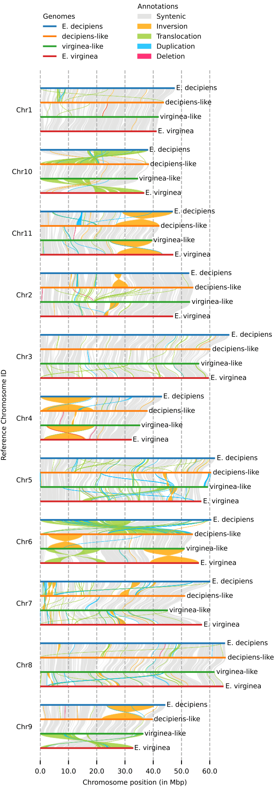

There seems to be a lot of chromosomal arrangements... Let's see if this is caused by using *E. melliodora* as the reference.

```
# update the chromosome names (E. melliodora)
awk '
BEGIN {
    map["CM023402.3"] = "Chr1";
    map["CM023403.3"] = "Chr2";
    map["CM023404.3"] = "Chr3";
    map["CM023405.3"] = "Chr4";
    map["CM023406.3"] = "Chr5";
    map["CM023407.3"] = "Chr6";
    map["CM023408.3"] = "Chr7";
    map["CM023409.3"] = "Chr8";
    map["CM023410.3"] = "Chr9";
    map["CM023411.3"] = "Chr10";
    map["CM023412.3"] = "Chr11";
}
/^>/ {
    header = $1;
    sub(/^>/, "", header);
    if (header in map) {
        print ">" map[header];
    } else {
        print $0;
    }
    next;
}
{ print }
' 06_parental_assign/parents/roadies/Eucalyptus_melliodora_GCA_004368105.4.fna > 07_scaffold_correct_bin/syri_mel/ref_melliodora_raw.fa

# extract chromosomes 1-11
samtools faidx 07_scaffold_correct_bin/syri_mel/ref_melliodora_raw.fa Chr1 Chr2 Chr3 Chr4 Chr5 Chr6 Chr7 Chr8 Chr9 Chr10 Chr11 \
    > 07_scaffold_correct_bin/syri_mel/ref_melliodora.fa
rm 07_scaffold_correct_bin/syri_mel/ref_melliodora_raw.fa

# change working directory
cd 07_scaffold_correct_bin/syri_mel/

# reverse-complement chromosomes: ref_melliodora.fa
samtools faidx ref_melliodora.fa Chr1 Chr2 Chr3 Chr4 Chr5 Chr7 Chr8 Chr9 Chr10 Chr11 > mel_tmp.fa
samtools faidx ref_melliodora.fa Chr6 -i > mel_chr6_rc.fa
cat mel_tmp.fa mel_chr6_rc.fa > ref_melliodora_fixed.fa
rm  mel_tmp.fa mel_chr6_rc.fa 
sed -i 's/\/rc//' ref_melliodora_fixed.fa

# reverse-complement chromosomes: vir_chromosomes.fa
samtools faidx ../syri/vir_chromosomes.fa Chr1 Chr2 Chr3 Chr4 Chr5 Chr7 Chr8 Chr9 Chr10 Chr11 > vir_tmp.fa
samtools faidx ../syri/vir_chromosomes.fa Chr6 -i > vir_chr6_rc.fa
cat vir_tmp.fa vir_chr6_rc.fa > vir_chromosomes_fixed.fa
rm  vir_tmp.fa vir_chr6_rc.fa 
sed -i 's/\/rc//' vir_chromosomes_fixed.fa

# decipiens-like vs melliodora
minimap2 -ax asm20 -t 64 --secondary=no --eqx \
    ../syri/dec_chromosomes.fa \
    ref_melliodora_fixed.fa \
    > declike_vs_mel.sam

# melliodora vs virginea-like
minimap2 -ax asm20 -t 64 --secondary=no --eqx \
    ref_melliodora_fixed.fa \
    vir_chromosomes_fixed.fa \
    > mel_vs_virlike.sam

# run Syri
syri -c declike_vs_mel.sam \
    -r ../syri/dec_chromosomes.fa \
    -q ref_melliodora_fixed.fa \
    --prefix declike_vs_mel \
    -F S --cigar

syri -c mel_vs_virlike.sam \
    -r ref_melliodora_fixed.fa \
    -q vir_chromosomes_fixed.fa \
    --prefix mel_vs_virlike \
    -F S --cigar

# create genomes.txt
cat > genomes.txt << 'EOF'
#file	name	tags
../syri/dec_chromosomes.fa	decipiens-like	lw:1.5
ref_melliodora_fixed.fa	E. melliodora	lw:1.5
vir_chromosomes_fixed.fa	virginea-like	lw:1.5
EOF

# plot
plotsr \
  --sr declike_vs_melsyri.out \
  --sr mel_vs_virlikesyri.out \
  --genomes genomes.txt \
  -o three_way_synteny.pdf
```

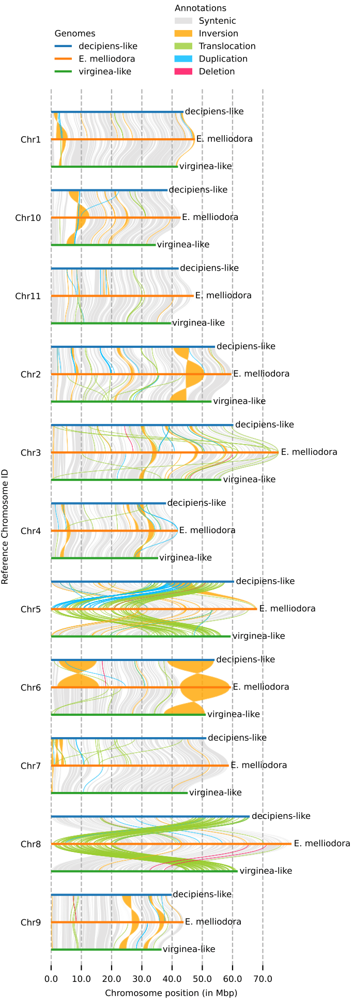

It seems that our scaffolding was largely affected by the chromosomal architecture of *E. melliodora*. We might need to redo using *E. decipiens* and *E. virginea* as references...