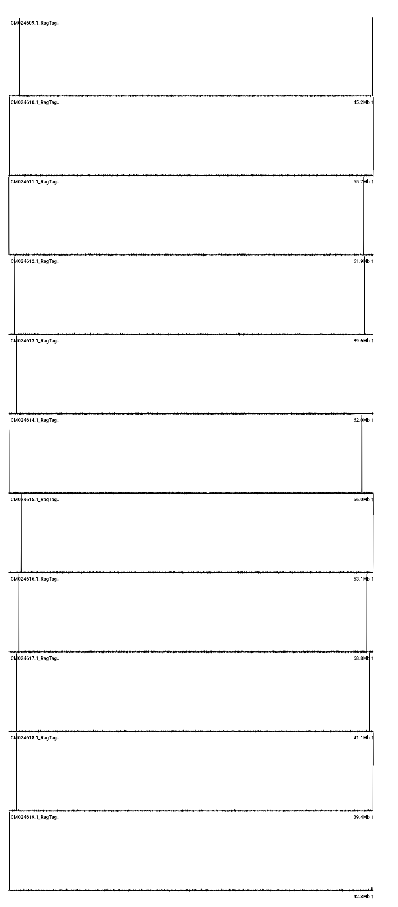
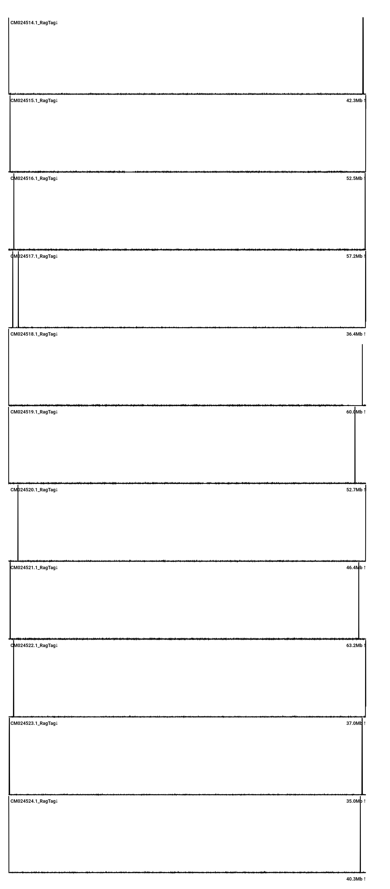
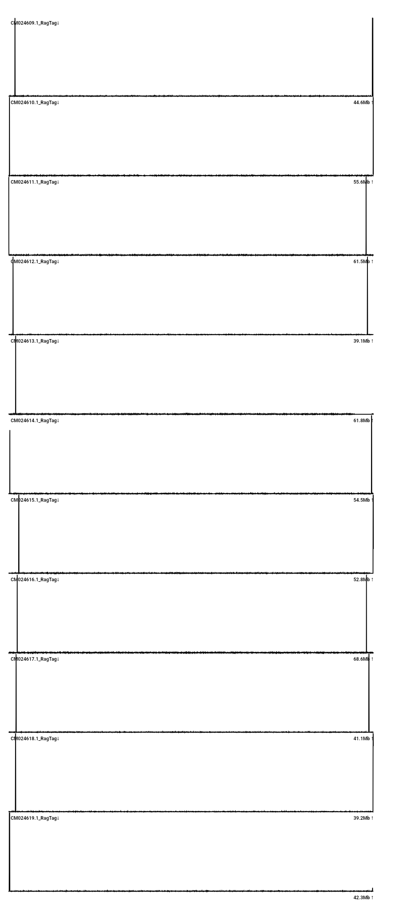
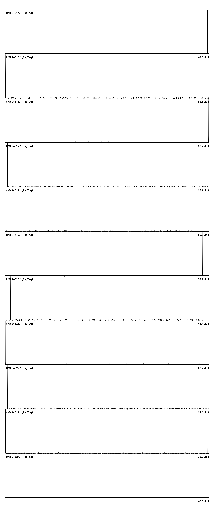
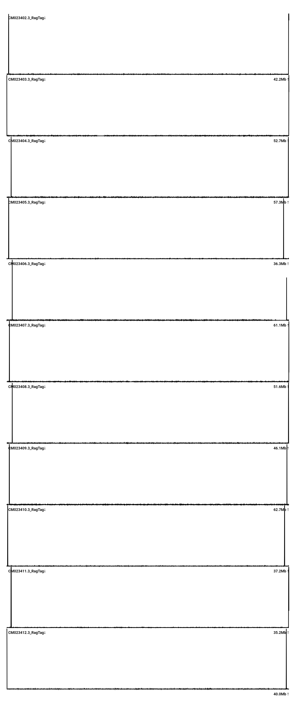

# Scaffolding

This README is purposed to store additional details required to conduct the `Scaffolding` step from the main <a href="../../README.md">`README.md`</a>.

## Table of Contents
- <a href="#06a">Scaffolding against eucalypt reference genomes</a>
- <a href="#06b">Checking telomere motif</a>
- <a href="#06c">Excluding contigs beyond telomeres</a>

## <a id="06a">Scaffolding against eucalypt reference genomes</a>

```
# change working directory
cd 07_scaffold/

# virginea-like to virginea
ragtag.py scaffold -t 128 --mm2-params "-x asm20" -f 10000 -u -a 0.1 \
    -o virginea_like ../06_parental_assign/parents/roadies/Eucalyptus_virginea_GCA_014182375.1.fna \
    ../06_parental_assign/final/E_phylacis_virginea_like.fa

# decipiens-like to decipiens
ragtag.py scaffold -t 128 --mm2-params "-x asm20" -f 10000 -u -a 0.1 \
    -o decipiens_like ../06_parental_assign/parents/roadies/Eucalyptus_decipiens_GCA_014182575.1.fna \
    ../06_parental_assign/final/E_phylacis_decipiens_like.fa

# virginea-like to regnans
ragtag.py scaffold -t 128 --mm2-params "-x asm20" -f 10000 -u -a 0.1 \
    -o virginea_like_regnans ../06_parental_assign/parents/roadies/Eucalyptus_regnans_GCA_037349125.1.fna \
    ../06_parental_assign/final/E_phylacis_virginea_like.fa

# decipiens-like to regnans
ragtag.py scaffold -t 128 --mm2-params "-x asm20" -f 10000 -u -a 0.1 \
    -o decipiens_like_regnans ../06_parental_assign/parents/roadies/Eucalyptus_regnans_GCA_037349125.1.fna \
    ../06_parental_assign/final/E_phylacis_decipiens_like.fa

# change working directory
cd ..
```

| Metric               | virginea-like,<br>ref. *E. virginea* | virginea-like,<br>ref. *E. regnans* | decipiens-like,<br>ref. *E. decipiens* | decipiens-like,<br>ref. *E. regnans* |
| :------------------- | -----------------------------------: | ----------------------------------: | -------------------------------------: | -----------------------------------: |
| Input contigs        |                             277 |                            277 |                               245 |                             245 |
| Chromosome scaffolds |                              11 |                             11 |                                11 |                              11 |
| Contigs placed       |                             193 |                            159 |                               181 |                             153 |
| Placed (bp)          |                     534,221,985 |                    530,423,308 |                       565,214,048 |                     561,954,513 |
| Placed (%)           |                            98.2 |                           97.5 |                              98.6 |                            98.0 |
| Contigs unplaced     |                              84 |                            118 |                                64 |                              92 |
| `-a` < 0.1 (Mb)      |                       20 (5.19) |                      32 (5.96) |                         21 (2.43) |                       32 (5.99) |
| Unplaced (bp)        |                       9,686,931 |                     13,485,608 |                         8,269,866 |                      11,529,401 |
| Gaps (100 N)         |                             182 |                            147 |                               169 |                             142 |

## <a id="06b">Checking telomere motif</a>

```
# extract the 11 chromosomes
seqkit grep -r -p '^CM0245' 07_scaffold/virginea_like_a01/ragtag.scaffold.fasta  > 07_scaffold/virginea_like_a01/vir_chromosomes.fa
seqkit grep -r -p '^CM0246' 07_scaffold/decipiens_like_a01/ragtag.scaffold.fasta > 07_scaffold/decipiens_like_a01/dec_chromosomes.fa

# extract telomeres
tidk search -s AAACCCT -o vir_tidk -d 07_scaffold/ 07_scaffold/virginea_like_a01/vir_chromosomes.fa
tidk plot   -t 07_scaffold/vir_tidk_telomeric_repeat_windows.tsv -o 07_scaffold/vir_telomeres
tidk search -s AAACCCT -o dec_tidk -d 07_scaffold/ 07_scaffold/decipiens_like_a01/dec_chromosomes.fa
tidk plot   -t 07_scaffold/dec_tidk_telomeric_repeat_windows.tsv -o 07_scaffold/dec_telomeres
```

|                    decipiens-like                    |                   virginea-like                     |
| :--------------------------------------------------: | :-------------------------------------------------: |
|  |  |

It seems like scaffolding does not really work that well, especially for the repetitive motifs on the virginea-like haplotype. I tried to do `ragtag.py correct` prior to scaffolding, but it made the scaffolds worse. Let's try another approach...

## <a id="06c">Binning contigs to each chromosome</a>
Let's try to bin the contigs prior to scaffolding, so every contig is placed on the right chromosome. Claude generated a <a href="./scripts/scaffold_per_chromosome.sh">script</a> to do this based on the `parent_of_contig.tsv` file from the `Assigning individual contigs to each putative parent` step (see the main <a href="../../README.md">`README.md`</a> file). We also need a file that stores the putative parent of each chromosome-scale contigs, which can be generated from `dv_scoring.tsv` file.

```
awk -F'\t' 'NR>1 {len=$3; gsub(",","",len)}
            NR>1 && (len+0 >= 10000000 || $1=="h2tg000036l") && ($15=="decipiens" || $15=="virginea") {print $1"\t"$15}' \
    06_parental_assign/alignment/dv_scoring.tsv > 06_parental_assign/alignment/parent_of_chromosome.tsv
```

### tidk

|                    decipiens-like                    |                   virginea-like                     |
| :--------------------------------------------------: | :-------------------------------------------------: |
|  |  |

### decipiens-like
```
scaffold               anchor        left end                                          right end                                        internal-in-anchor
CM024616.1_RagTag      h1tg000003l   telomere 3416 copies; 16 comp. beyond (1.59 Mb)   telomere 2704 copies; 8 comp. beyond (1.29 Mb)   -
CM024613.1_RagTag      h1tg000295l   telomere 4092 copies; 10 comp. beyond (1.07 Mb)   no telomere                                      -
CM024611.1_RagTag      h1tg000007l   telomere 2989 copies                              telomere 3490 copies; 10 comp. beyond (1.21 Mb)  -
CM024610.1_RagTag      h1tg000014l   telomere 3261 copies; 1 comp. beyond (0.11 Mb)    telomere 3031 copies                             -
CM024614.1_RagTag      h1tg000004l   telomere 2241 copies; 2 comp. beyond (0.16 Mb)    telomere 5491 copies; 4 comp. beyond (0.25 Mb)   -
CM024615.1_RagTag      h1tg000001l   telomere 6223 copies; 17 comp. beyond (1.44 Mb)   telomere 5531 copies                             -
CM024609.1_RagTag      h1tg000009l   telomere 3625 copies; 11 comp. beyond (0.76 Mb)   telomere 9685 copies; 1 comp. beyond (0.06 Mb)   -
CM024619.1_RagTag      h2tg000006l   telomere 8149 copies; 1 comp. beyond (0.07 Mb)    no telomere                                      -
CM024617.1_RagTag      h2tg000011l   telomere 2900 copies; 4 comp. beyond (0.83 Mb)    telomere 4534 copies; 6 comp. beyond (0.48 Mb)   -
CM024618.1_RagTag      h2tg000003l   telomere 4288 copies; 9 comp. beyond (0.72 Mb)    telomere 5002 copies                             -
CM024612.1_RagTag      h2tg000001l   telomere 2522 copies; 6 comp. beyond (0.46 Mb)    telomere 3084 copies; 8 comp. beyond (0.62 Mb)   -

chromosome ends with a telomere: 20/22; components placed beyond a telomere: 114
```

### virginea-like
```
scaffold               anchor        left end                                          right end                                        internal-in-anchor
CM024521.1_RagTag      h2tg000008l   telomere 6775 copies; 1 comp. beyond (0.07 Mb)    telomere 3381 copies; 17 comp. beyond (1.52 Mb)  -
CM024518.1_RagTag      h2tg000004l   telomere 3019 copies                              telomere 1145 copies; 6 comp. beyond (0.69 Mb)   -
CM024516.1_RagTag      h2tg000010l   telomere 2636 copies; 7 comp. beyond (3.05 Mb)    telomere 4080 copies; 1 comp. beyond (0.09 Mb)   -
CM024515.1_RagTag      h2tg000005l   telomere 3133 copies; 2 comp. beyond (0.14 Mb)    telomere 4226 copies                             -
CM024519.1_RagTag      h2tg000012l   telomere 2537 copies                              telomere 4591 copies; 10 comp. beyond (1.01 Mb)  -
CM024520.1_RagTag      h2tg000002l   telomere 2831 copies; 11 comp. beyond (0.91 Mb)   telomere 4529 copies; 1 comp. beyond (0.09 Mb)   -
CM024514.1_RagTag      h2tg000007l   telomere 3814 copies                              telomere 8667 copies; 4 comp. beyond (0.30 Mb)   -
CM024524.1_RagTag      h1tg000006l   telomere 5317 copies                              telomere 2770 copies; 10 comp. beyond (1.24 Mb)  -
CM024522.1_RagTag      h1tg000005l   telomere 4125 copies; 7 comp. beyond (0.53 Mb)    telomere 4361 copies; 2 comp. beyond (0.30 Mb)   -
CM024517.1_RagTag      h1tg000012l   telomere 3057 copies; 14 comp. beyond (1.25 Mb)   telomere 4161 copies                             2701 copies at 1.82 Mb
CM024523.1_RagTag      h1tg000002l   telomere 5851 copies                              telomere 5680 copies; 10 comp. beyond (0.90 Mb)  -

chromosome ends with a telomere: 22/22; components placed beyond a telomere: 103
```

It seems like binning does help! Two chromosomes on the `decipiens-like` haplotype have missing telomeres, while all `virginea-like` chromosomes have both telomeres However, we still have two telomere peaks at the end of chromosomes 4 (`CM024517.1`) and 10 (`CM024523.1`) on the `virginea-like` haplotype.

- <b><i>Chromosome 10</b></i>

    If we extract the last contig of the corresponding chromosome with  `grep "CM024523.1_RagTag" 07_scaffold/virginea_like_a01/ragtag.scaffold.agp | tail -1`, we would get the following:

    ```
    CM024523.1_RagTag	35744117	35852586	31	W	h1tg000281l	1	108470	+
    ```

    `h1tg000281l` covers the second telomere motif peak, and this might be caused by several things, such as duplication (i.e., `hifiasm` assembled the end of the chromosome twice) or misphasing (i.e., it is actually a missing telomere from one of the `decipiens-like` chromosomes). To assess these possibilities, I first mapped all contigs to `h1tg000281l` and extracted those that are well-aligned to it. If there is no duplicate, it should only return the `h1tg000281l` itself.

    ```
    # extract the contig sequence
    seqkit grep -p h1tg000281l 05_nuclear_qc/03_filtered/union.purged.fa > h1tg000281l.fa

    # map all contigs to the contig
    minimap2 -cx asm20 05_nuclear_qc/03_filtered/union.purged.fa h1tg000281l.fa \
    | awk '$11>=10000 {printf "%s\t%d-%d\tid=%.4f\tlen=%d\n", $6, $8, $9, $10/$11, $11}' | sort -t$'\t' -k4,4nr | head
    ```

    This generated the following table, showing two hits on the contig with 100% identity. The other contig, `h2tg000003l`, came from haplotype 2, which means that this is likely to be a misphasing problem.

    ```
    h1tg000281l	          0-83797	id=1.0000	len=83797
    h2tg000003l	38404103-38487902	id=1.0000	len=83799
    ```

    Now, the question is whether the `decipiens-like` haplotype needs this contig. To do this, we should check the position of `h2tg000003l` on the `decipiens-like` haplotype. A quick `grep` showed that it is located at the end of chromosome 10 (`CM024618.1`), which already has a telomere, and so we can safely remove `h1tg000281l` from the `virginea-like` haplotype.

- <b><i>Chromosome 4</b></i>

    According to the table above, `CM024517.1` has an internal-in-anchor, meaning that an array of telomere motif is found *within* a contig. Repeating what we did on chromosome 10, we got the following:

    ```
    h1tg000012l	   13475-35379892	id=1.0000	len=35366417
    h1tg000012l	35385041-35398699	id=1.0000	len=13658
    h1tg000012l	35515957-35705868	id=1.0000	len=189911
    h1tg000012l	35919968-35956317	id=1.0000	len=36349
    h2tg000001l	37974011-38010248	id=0.9977	len=36305
    ```

    Similar to chromosome 10, there is a region on `h1tg000012l` that belongs to the `decipiens-like` haplotype, which is likely due to `hifiasm` wrongly stitched the two contigs together. Thus, we should remove the corresponding region (`35919968:35956317`), but retain the rest. Because we know that the contig consists of Ns, we should first identify their coordinates.

    ```
    seqkit locate -r -i -G -p 'NNNNNNNNNN+' 06_parental_assign/final/E_phylacis_virginea_like.fa | awk '$1=="h1tg000012l" {print $5, $6, $6-$5+1}'
    ```

    This shows that the Ns are located at: `35398700:35515957` and `35705869:35919968`. Let's divide the contig into two to exclude the Ns.

    ```
    # extract regions of interest
    seqkit subseq --chr h1tg000012l -r 1:35398699        06_parental_assign/final/E_phylacis_virginea_like.fa | seqkit replace -p '.*' -r 'h1tg000012l_main'  > 07d_scaffold_check_chr/h1tg000012l_main.fa
    seqkit subseq --chr h1tg000012l -r 35515958:35705868 06_parental_assign/final/E_phylacis_virginea_like.fa | seqkit replace -p '.*' -r 'h1tg000012l_head'  > 07d_scaffold_check_chr/h1tg000012l_head.fa

    # update the haplotypes (remove `h1tg000012l` and `h1tg000281l`, add `h1tg000012l_main` and `h1tg000012l_head`)
    seqkit grep -v -p h1tg000012l -p h1tg000281l 06_parental_assign/final/E_phylacis_virginea_like.fa | \
        cat - 07d_scaffold_check_chr/h1tg000012l_main.fa 07d_scaffold_check_chr/h1tg000012l_head.fa \
        > 06_parental_assign/final/E_phylacis_virginea_like.split.fa
    ```

    Now, let's redo the scaffolding for the `virginea-like` haplotype.

    ```
    scaffold               anchor           left end                                        right end                                        internal-in-anchor
    CM024521.1_RagTag      h2tg000008l      telomere 6775 copies; 1 comp. beyond (0.07 Mb)  telomere 3381 copies; 17 comp. beyond (1.52 Mb)  -
    CM024518.1_RagTag      h2tg000004l      telomere 3019 copies                            telomere 1145 copies; 6 comp. beyond (0.69 Mb)   -
    CM024516.1_RagTag      h2tg000010l      telomere 2636 copies; 7 comp. beyond (3.05 Mb)  telomere 4080 copies; 1 comp. beyond (0.09 Mb)   -
    CM024515.1_RagTag      h2tg000005l      telomere 3133 copies; 2 comp. beyond (0.14 Mb)  telomere 4226 copies                             -
    CM024519.1_RagTag      h2tg000012l      telomere 2537 copies                            telomere 4591 copies; 10 comp. beyond (1.01 Mb)  -
    CM024520.1_RagTag      h2tg000002l      telomere 2831 copies; 11 comp. beyond (0.91 Mb) telomere 4529 copies; 1 comp. beyond (0.09 Mb)   -
    CM024514.1_RagTag      h2tg000007l      telomere 3814 copies                            telomere 8667 copies; 4 comp. beyond (0.30 Mb)   -
    CM024524.1_RagTag      h1tg000006l      telomere 5317 copies                            telomere 2770 copies; 10 comp. beyond (1.24 Mb)  -
    CM024522.1_RagTag      h1tg000005l      telomere 4125 copies; 7 comp. beyond (0.53 Mb)  telomere 4361 copies; 2 comp. beyond (0.30 Mb)   -
    CM024523.1_RagTag      h1tg000002l      telomere 5851 copies                            telomere 5680 copies; 9 comp. beyond (0.79 Mb)   -
    CM024517.1_RagTag      h1tg000012l_main telomere 2701 copies                            telomere 4092 copies                             -

    chromosome ends with a telomere: 22/22; components placed beyond a telomere: 88
    ```

    

    Looks **much** better!
    
## <a id="06c">Excluding contigs beyond telomeres</a>
Based on these observation, it seems that we need to: (i) remove contigs that are a single-haplotype copy but mistakenly put in the other haplotype, and (ii) exclude contigs that are placed beyond the telomeres. To do the latter, Claude generated a <a href="./scripts/fragment_audit.py">script</a>. To do the former, we can check the depth of the contigs and remove those with <41.3x depth (similar to the previous criteria).

```
# change working directory
cd 07d_scaffold_check_chr/

# compare vir-hap1 to hap1.bam, and dec-hap2 to hap2.bam
for p in vir dec; do
    bam=$([ $p = vir ] && echo ../03_qc/hap1.bam || echo ../03_qc/hap2.bam)      # reads mapped to one haplotype alone
    awk -v h=$([ $p = vir ] && echo h1 || echo h2) 'NR==FNR {L[$1]=$2; next} ($1 in L) && $1 ~ "^"h {print $1"\t0\t"L[$1]}' \
        ../06_parental_assign/final/union.current.fa.fai ../07c_scaffold_correct_bin/$p/audit/drop_duplicates.txt > ${p}_dups.bed
    mosdepth -t 16 --by ${p}_dups.bed --no-per-base ${p}_dups $bam
done

# compare vir-hap2 to hap2.bam, and dec-hap1 to hap1.bam
awk 'NR==FNR {L[$1]=$2; next} ($1 in L) && $1 ~ /^h2/ {print $1"\t0\t"L[$1]}' ../06_parental_assign/final/union.current.fa.fai ../07c_scaffold_correct_bin/vir/audit/drop_duplicates.txt > vir_dups_h2.bed
awk 'NR==FNR {L[$1]=$2; next} ($1 in L) && $1 ~ /^h1/ {print $1"\t0\t"L[$1]}' ../06_parental_assign/final/union.current.fa.fai ../07c_scaffold_correct_bin/dec/audit/drop_duplicates.txt > dec_dups_h1.bed
mosdepth -t 16 --by vir_dups_h2.bed --no-per-base vir_dups_h2 ../03_qc/hap2.bam
mosdepth -t 16 --by dec_dups_h1.bed --no-per-base dec_dups_h1 ../03_qc/hap1.bam

# final drop / keep lists per parent, by the purge cutoff
for p in vir dec; do
    zcat ${p}_dups.regions.bed.gz ${p}_dups_h[12].regions.bed.gz | awk -v p=$p '$4 <= 41.3 {print $1 > p"_drop_final.txt"} $4 > 41.3 {print $1 > p"_keep_unplaced.txt"}'
    echo "$p: drop $(wc -l < ${p}_drop_final.txt), keep $(wc -l < ${p}_keep_unplaced.txt)"
done

# change working directory
cd ../07_scaffold/both_a01_v2/

# remove contigs from the purged sequences
seqkit grep -v -f ../../07d_scaffold_check_chr/vir_drop_final.txt ../../06_parental_assign/final/E_phylacis_virginea_like.split.fa -o E_phylacis_virginea_like.final.fa
seqkit grep -v -f ../../07d_scaffold_check_chr/dec_drop_final.txt ../../06_parental_assign/final/E_phylacis_decipiens_like.fa      -o E_phylacis_decipiens_like.final.fa

# exclude contigs from scaffolding
ragtag.py scaffold -t 32 --mm2-params "-x asm20" -f 10000 -u -a 0.1 \
    -e ../../07c_scaffold_correct_bin/vir/audit/exclude_beyond_telomere.txt \
    -o virginea_like \
    ../../06_parental_assign/parents/roadies/Eucalyptus_virginea_GCA_014182375.1.fna \
    E_phylacis_virginea_like.final.fa

ragtag.py scaffold -t 32 --mm2-params "-x asm20" -f 10000 -u -a 0.1 \
    -e ../../07c_scaffold_correct_bin/dec/audit/exclude_beyond_telomere.txt \
    -o decipiens_like \
    ../../06_parental_assign/parents/roadies/Eucalyptus_decipiens_GCA_014182575.1.fna \
    E_phylacis_decipiens_like.final.fa
```
