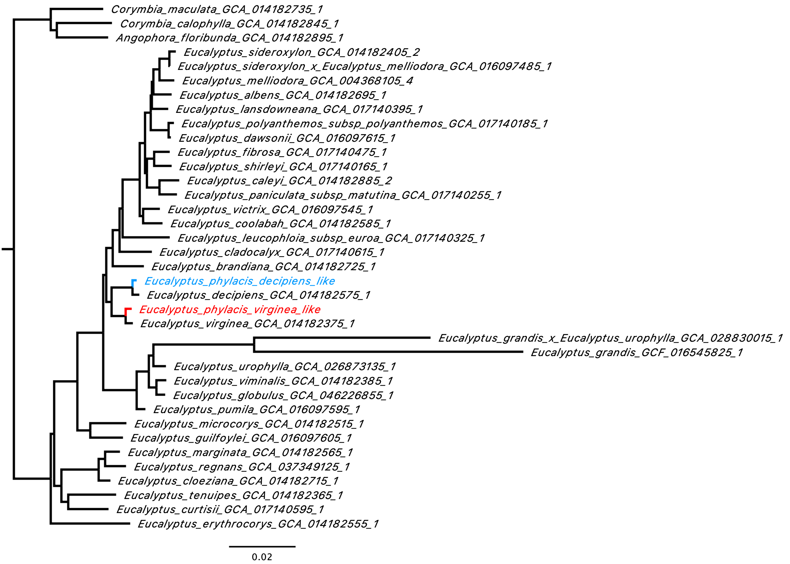

# Tree Inference

This README is purposed to store additional details required to conduct the `Tree Inference` step from the main <a href="../../README.md">`README.md`</a>.

## Gene tree inference
I ran `compleasm` on each of the reference genome on `06_parental_assign/parents/roadies/`, including the two haplotypes from *E. x phylacis* stored at `07_scaffold_correct_bin/`. I stored everything in `09_compleasm/output/`.

Here's the **R code** to infer individual gene trees.

```
# change working directory
setwd 09_compleasm/

# libraries
library(doSNOW)
library(dplyr)

# functions
f_mafft <- function(fn_input, fn_output, params_mafft, exe_mafft) {
    cmd_mafft <- paste(exe_mafft, params_mafft,
                       fn_input, ">", fn_output)
    system(cmd_mafft)
}

f_iqtree2 <- function(fn_input, exe_iqtree2) {
    cmd_iqtree2 <- paste(exe_iqtree2,
                         "-s", fn_input,
                         "-T 1 --quiet -redo")
    system(cmd_iqtree2)
}

# extract all samples
ls_sample <- list.dirs("./output/", recursive=F, full.names=F)

# iterate over sample
for (sample in ls_sample) {
    # open the compleasm output table
    df <- data.table::fread(file.path("output", sample, "eudicotyledons_odb12", "full_table.tsv"), fill=T)

    # extract all single-copy BUSCO
    ls_busco <- df %>% filter(Status=="Single") %>% pull(Gene) %>% unique()

    # open the FASTA sequences
    seq <- Biostrings::readBStringSet(file.path("output", sample, "eudicotyledons_odb12", "gene_marker.fasta"))

    # iterate over BUSCO
    for (busco in ls_busco) {
        outdir <- file.path("alignment", busco)
        if (!dir.exists(outdir)) {
            dir.create(outdir, recursive=T)
        }

        # extract the best gene for the respective BUSCO
        bestgene <- df$"Best gene"[df$Gene==busco]
        if (length(bestgene) != 1) {
            print(paste("Multiple best hits of", busco, "for", sample))
            next
        }

        # extract the BUSCO sequence
        subseq <- seq[names(seq)==bestgene]
        if (length(subseq) != 1) {
            print(paste("Multiple sequences for", busco, "for", sample))
            next
        }

        # rename the sequence following the sample
        names(subseq)[1] <- gsub("\\.", "_", gsub("_compleasm","",sample))

        # save the BUSCO sequence
        Biostrings::writeXStringSet(subseq, filepath=file.path(outdir, paste0(busco, ".fna")), append=T)
    }
}

# extract the updated list of BUSCO
ls_busco <- list.dirs("./alignment/", recursive=F, full.names=F)

# create a doSNOW cluster
nwcl <- makeCluster(100)
registerDoSNOW(nwcl)

# infer individual alignments and trees
foreach (busco = ls_busco) %dopar% {
    fn_input  <- file.path("alignment", busco, paste0(busco, ".fna"))
    fn_output <- file.path("alignment", busco, paste0(busco, "_aligned.fna"))
    f_mafft(fn_input, fn_output, "--auto", "mafft")
    f_iqtree2(fn_output, "iqtree2")
}

stopCluster(nwcl)
```

## Species tree inference and calculation of concordance factors
I inferred the species tree using `ASTRAL-IV` and calculated the concordance factors using `IQ-TREE2`.

```
# change working directory
cd 09_compleasm/tree/

# infer ASTRAL tree
cat ../alignment/*/*.treefile > alltrees.treefile
astral4 -u 2 -i alltrees.treefile -o astral.tre -t 100 2> astral.log

# concatenate BUSCO alignments
AMAS.py concat -f fasta -d dna -i ../alignment/*/*_aligned.fna --part-format nexus -t concatenated.out -p partitions.nex

# calculate concordance factors
iqtree2 -t astral.tre --gcf alltrees.treefile -s concatenated.out --scf 100 -T 100 --prefix iqtree2_cf
```


**Note that `GCA_028830015_1` only has 39 single-copy BUSCO, resulting in a very long branch length on the ASTRAL tree*

| Haplotypes     | gCF (gN)     | sCF (sN)        | qCF (qN)     |
| :------------- | -----------: | --------------: | -----------: |
| decipiens-like | 62.91 (2583) | 85.62 (7531.32) | 75.82 (2583) |
| virginea-like  | 55.94 (2610) | 80.24 (6543.75) | 70.73 (2610) |